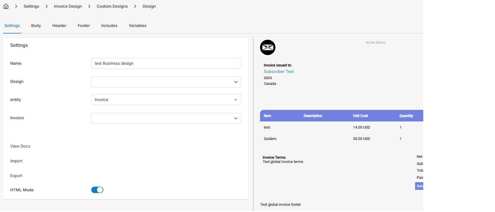
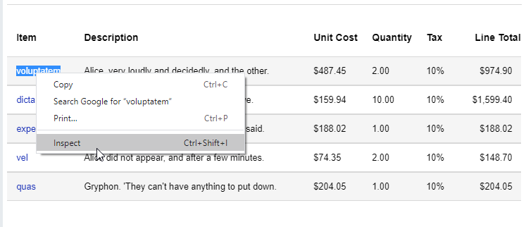
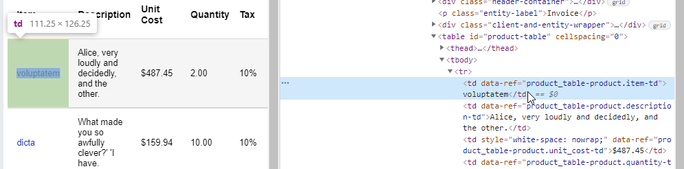
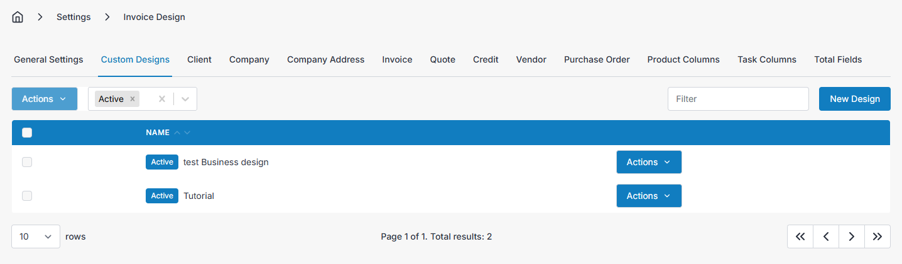
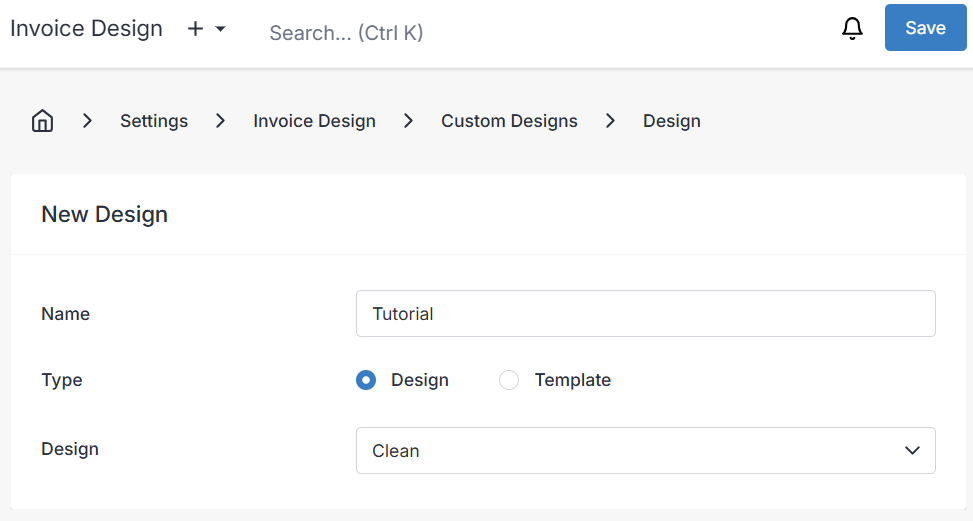
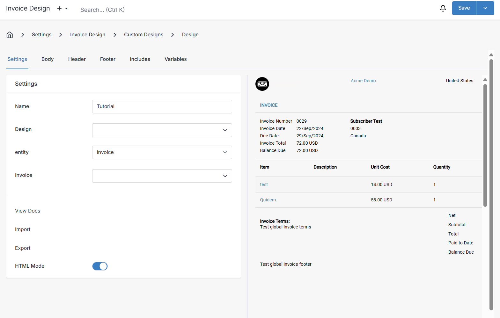
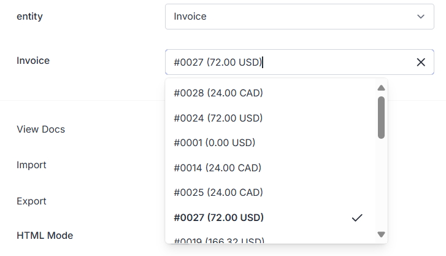
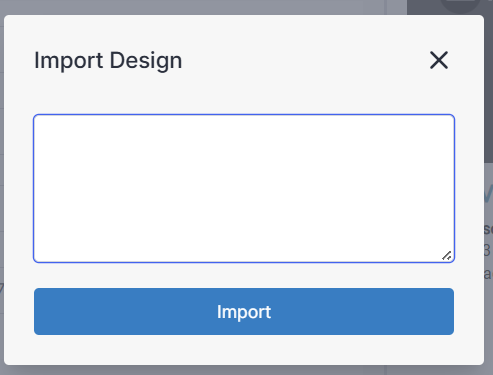

# PDF templates and custom field placeholders: customize how documents look

You can change how invoices, quotes and other documents look by editing their HTML and CSS, and by inserting placeholders for standard fields and your own custom fields.

## What is PDF customization? {#pdf-customizations}

This page is about HTML and CSS invoice designs, and about using field placeholders in PDFs. To create or name extra invoice, client or product fields, start with [Custom Fields in Advanced Settings](/docs/user-guide/advanced-settings#custom_fields).

Invoice Ninja builds PDFs from HTML templates. You can pick one of the built-in designs, or create your own with HTML and CSS.

## What CSS snippets can I use? {#snippets}

These snippets are starting points you can paste into a custom design. They are most useful when you are targeting a specific field in the generated HTML.

### How do I find a selector on a design? {#getting-all-available-selectors-on-the-design}

1. Go to **Settings > Invoice Design**.
2. Open the **Custom Designs** tab and edit a design.
3. Use the **Body**, **Header** and **Footer** tabs to read the HTML source. On the **Settings** tab, **HTML Mode** is a toggle at the bottom of the page.







Many mapped fields get a `data-ref` attribute when the PDF is generated. You can target those with CSS. They may not all appear in the template source, because some are added at render time.

### How do I show a table column on one design and hide it on others? {#showing-table-column-on-one-design-hiding-on-others}

This example hides a custom product column, including its heading and cells, on the design where you add the CSS. To hide the column on some designs and leave it visible on others, add this only to the designs that should hide it.

```css
/** CSS (includes) **/

[data-ref="product_table-product.product1-th"],
[data-ref="product_table-product.product1-td"] {
  display: none;
}
```

### How do I overwrite a hidden property on an element? {#overwriting-the-hidden-property-on-element}

Some elements have a `hidden` property. You can overwrite that with CSS. This example targets the subtotal label in the totals table:

```css
[data-ref="totals_table-subtotal-label"] {
  display: inline; /* or block */
}
```

## How do I create a custom design? {#creating-a-custom-design}

Use this when you want a new design from scratch, or when you want to see how the templates are put together.

:::info
Creating or heavily editing a design needs some knowledge of HTML and CSS.
:::

### How do I add a design entry? {#creating-a-design-entry}

1. Go to **Settings > Invoice Design**.
2. Open the **Custom Designs** tab (`#/settings/invoice_design/custom_designs`).
3. Click **New Design**.

The list has a **Filter** box, a **Lifecycle** filter (for example **Active**), and a **Name** column. An **Active** badge appears next to the name of an active design. Each row's **Actions** menu has **Edit**, **Clone**, **Export**, **Archive** and **Delete**.



**New Design** opens an unsaved form (`#/settings/invoice_design/custom_designs/create`). It is not stored until you click **Save**.



4. Enter a **Name**.
5. Set **Type** to **Design** or **Template**. **Design** is the default.
6. Optionally pick a **Design** to use as the starting point. Built-in options include **Bold**, **Business**, **Calm**, **Clean**, **Creative**, **Elegant**, **Hipster**, **Modern**, **Plain**, **Playful** and **Tech**. The base design is less important if you already have a complete layout in mind.
7. Click **Save**.

### How is a design structured? {#design-structure}

The design editor is split into tabs: **Settings**, **Body**, **Header**, **Footer**, **Includes** and **Variables**. Most day-to-day editing happens in **Includes** and **Body**.

#### What is on the Settings tab? {#settings}



On the Settings tab you control how the design behaves while you edit it:

- **Name**: the name of your design.
- **Design**: a dropdown of existing designs. Selecting one replaces the current design with the selected design.
- **Type**: the kind of document the preview is for: Invoice, Quote, Credit or Purchase Order.
- A fourth dropdown, labeled with the type you picked (for example **Invoice**). It lists recent records of that type, so the live preview on the right can show real data. Changing the design or the preview record does not change the record itself.
- **API Docs**: a documentation link.
- **Import**: opens the **Import Design** dialog, with a textarea and an **Import** button. Paste code you copied with **Export** from another design. If you do not want to import, close the dialog with the **X** (there is no Cancel button).
- **Export**: copies the design code to your clipboard, so you can import it into another design.
- **HTML Mode**: a toggle at the bottom of the Settings tab.

The editor header has **Save**. A live PDF preview appears on the right.





#### What is on the Body tab? {#body}

The **Body** tab is the main content of the PDF. This is where you organize the layout. The HTML for the body is all here.

#### What is on the Header tab? {#header}

The **Header** tab is the usual place for content that belongs at the top of the page.

#### What is on the Footer tab? {#footer}

The **Footer** tab is the usual place for content that belongs at the bottom of the page.

#### What is on the Includes tab? {#includes}

The **Includes** tab is where your styles go. This is the usual place for the CSS snippets above.

#### What is on the Variables tab? {#variables}

The **Variables** tab lists common placeholders, grouped as **Invoice**, **Client**, **Contact** and **Company**. Clicking a variable copies it to the clipboard (the app confirms with a "Copied ... to the clipboard" message), so you can paste it into the design.

This is a shorter list than the [full placeholder reference](#custom-fields) later on this page. Custom field placeholders such as `$client.custom1` may not appear in these groups.

### What else is on Invoice Design? {#other-tabs}

Invoice Design has several other tabs besides **Custom Designs**.

- **General Settings**: choose the design for invoices, quotes, credits, purchase orders, statements, delivery notes, payment receipts and payment refunds. You can also set **Page Layout**, **Page Size**, **Font Size**, **Logo Size**, **Primary Font**, **Primary Color**, **Secondary Font**, **Secondary Color**, **Show Paid Stamp**, **Show Shipping Address**, **Embed Images/Documents** (help text: "Include attached images/pdfs in the invoice."), **Empty Columns** (Hide or Show) and **Page Numbering**. Click **Save** to store these options.
- **Custom Designs**: create and edit custom designs, as described above.

The remaining tabs control which fields and columns appear on every design that includes that data. For example, to show the client's VAT number, add that field on the **Client** tab and it appears on invoices that include the client block.

- **Client**
- **Company**
- **Company Address**
- **Invoice**
- **Quote**
- **Credit**
- **Vendor**
- **Purchase Order**
- **Invoice Product Columns**
- **Quote Product Columns**
- **Task Columns**
- **Total Fields**

## What does a design need in order to work? {#requirements}

Invoice Ninja expects certain element IDs to be present in the design. The app uses them when it maps your field and column choices onto the PDF.

### Which element IDs are required? {#target-elements}

- `#company-details`
- `#company-address`
- `#client-details`
- `#entity-details`
- `#delivery-note-table`
- `#product-table`
- `#task-table`
- `#table-totals`
- `#footer`

For more specific selectors, use [How do I find a selector on a design?](#getting-all-available-selectors-on-the-design).

If you prefer to develop a static template first, you can export the design from the Settings tab, work on it locally, then import the changes when you are happy with them.

## What selectors can I use? {#selectors}

:::info
The selectors below are marked with a `data-ref` attribute.
:::

To target `client_details-client.name`, for example, use CSS like this:

```css
[data-ref="client_details-client.name"] {
  background-color: red;
}
```

Some older notes use `entity_details-quote.*` under credit details. Check the generated HTML for the `data-ref` values your design actually emits before you rely on a selector.

### Client details {#client-details}

- client_details-client.name
- client_details-client.number
- client_details-client.vat_number
- client_details-client.address1
- client_details-client.address2
- client_details-client.city_state_postal
- client_details-client.country
- client_details-client.phone
- client_details-client.email

### Company details {#company-details}

- company_details-company.name
- company_details-company.id_number
- company_details-company.vat_number
- company_details-company.website
- company_details-company.email
- company_details-company.phone

### Company address {#company-address}

- company_address-company.address1
- company_address-company.address2
- company_address-company.city_state_postal
- company_address-company.country

### Invoice details {#invoice-details}

- entity_details-invoice.number_label
- entity_details-invoice.number
- entity_details-invoice.po_number_label
- entity_details-invoice.po_number
- entity_details-invoice.date_label
- entity_details-invoice.date
- entity_details-invoice.due_date_label
- entity_details-invoice.due_date
- entity_details-invoice.total_label
- entity_details-invoice.total
- entity_details-invoice.balance_due_label
- entity_details-invoice.balance_due

### Quote details {#quote-details}

- entity_details-quote.number_label
- entity_details-quote.number
- entity_details-quote.po_number_label
- entity_details-quote.po_number
- entity_details-quote.date_label
- entity_details-quote.date
- entity_details-quote.valid_until_label
- entity_details-quote.valid_until
- entity_details-quote.total_label
- entity_details-quote.total

### Credit details {#credit-details}

- entity_details-quote.number_label
- entity_details-quote.number
- entity_details-quote.po_number_label
- entity_details-quote.po_number
- entity_details-quote.date_label
- entity_details-quote.date
- entity_details-quote.balance_label
- entity_details-quote.balance
- entity_details-quote.total_label
- entity_details-quote.total

### Product table {#product-table}

- product_table-product.item-th
- product_table-product.description-th
- product_table-product.unit_cost-th
- product_table-product.quantity-th
- product_table-product.discount-th
- product_table-product.tax-th
- product_table-product.line_total-th

### Task table {#task-table}

- task_table-task.service-th
- task_table-task.description-th
- task_table-task.rate-th
- task_table-task.hours-th
- task_table-task.discount-th
- task_table-task.tax-th
- task_table-task.line_total-th

### Total columns {#total-columns}

- totals_table-net_subtotal-label
- totals_table-net_subtotal
- totals_table-subtotal-label
- totals_table-subtotal
- totals_table-discount-label
- totals_table-discount
- totals_table-custom_surcharge1-label
- totals_table-custom_surcharge1
- totals_table-custom_surcharge2-label
- totals_table-custom_surcharge2
- totals_table-custom_surcharge3-label
- totals_table-custom_surcharge3
- totals_table-custom_surcharge4-label
- totals_table-custom_surcharge4
- totals_table-paid_to_date-label
- totals_table-paid_to_date
- totals_table-outstanding-label
- totals_table-outstanding

## Which placeholders can I use in a design? {#custom-fields}

Placeholders use a `$` prefix, for example `$client.name` or `$invoice.number`. Custom fields you created under **Settings > Custom Fields** appear as `$client.custom1`, `$invoice.custom2`, and similar names. Those custom field names may not appear in the design editor's **Variables** tab; you can still type them into the design.

You can use these placeholders in a custom design, and many of them also work in [email templates](/docs/advanced-topics/email-customization). The list below is the usual set. If a placeholder is blank in a PDF, the field may be empty on that record, or it may not apply to that document type.

```bash
$tax - Tax Label
$app_url - The full URL to the application
$from - From label
$to - To label
$total_tax_labels - Map of tax labels
$total_tax_values - Map of tax values
$line_tax_labels - Map of line tax labels
$line_tax_values - Map of line tax values
$date - Entity date label/value
$invoice.date - Alias of the $date label
$due_date - Entity due date label/value (or partial payment due date if set on invoice or quote)
$invoice.due_date - Alias of due date
$payment_due - Payment due label/value
$invoice.number - Invoice number label/value
$invoice.po_number - Invoice po_number label/value
$entity.datetime - Entity datetime label/value
$invoice.datetime - Alias of $entity.datetime
$quote.datetime - Alias of $entity.datetime
$credit.datetime - Alias of $entity.datetime

$entity - The entity Label ie. Invoice / Credit / Quote
$number - The number label ie. Invoice Number
$entity.terms - The entity terms label/value ie. Invoice Terms:
$terms - Alias of $entity.terms
$view_link - Entity view link ie. <a href="/link/to/entity">View Invoice</a>
$view_url - Entity view url ie. https://link.to.resource

$project.name - Project name label/value
$project.number - Project number /value

$entity_number - Alias of $number
$invoice.discount - Invoice discount label/value
$discount - Alias of $invoice.discount
$subtotal - Subtotal label/value
$invoice.subtotal - Alias of $subtotal

$balance_due - Currency formatted balance due label/value
$balance_due_raw - Unformatted balance due label/value
$quote.balance_due - Alias of $balance_due
$invoice.balance_due - Alias of $balance_due
$outstanding - Alias of $balance_due

$partial_due - Partial due label/value
$total - Total label/value
$amount - Alias of $total
$amount_raw - Unformatted alias of $total
$amount_due - Alias of $total
$quote.total - Alias of $total

$invoice.total - Alias of $total
$invoice_total_raw - Unformatted alias of $total
$invoice.amount - Alias of $total
$quote.amount - Alias of $total
$credit.total - Alias of $total
$credit.number - Alias of $number
$credit.total - Alias of $total
$credit.po_number - Alias of $invoice.po_number
$credit.date - Credit date label/value
$balance - Alias of $balance
$credit.balance - Alias of $balance
$invoice.balance - Alias of $balance
$taxes - Total taxes label/value
$invoice.taxes - Alias of $taxes

$invoice.custom1 - Invoice custom value 1 label/value
$invoice.custom2 - Invoice custom value 2 label/value
$invoice.custom3 - Invoice custom value 3 label/value
$invoice.custom4 - Invoice custom value 4 label/value

$invoice.public_notes - Invoice public notes label/value
$entity.public_notes - Alias of $invoice.public_notes
$public_notes - Alias of $invoice.public_notes

$entity_issued_to - Issued to label
$your_entity - Your `entity` label

$quote.date - Alias of $date
$quote.number - Alias of $number
$quote.po_number - Alias of $invoice.po_number
$quote.quote_number - Alias of $quote.number
$quote_no - Alias of $quote.number
$quote.quote_no - Alias of $quote.number
$quote.valid_until - Valid until label/value
$credit_amount - Alias of $amount
$credit_balance - Alias of $balance

$credit_number - Alias of $number
$credit_no - Alias of $number
$credit.credit_no - Alias of $number

$invoice_no - Alias of $number
$invoice.invoice_no - Alias of $number

$client1 - Client custom value 1 label/value
$client2 - Client custom value 2 label/value
$client3 - Client custom value 3 label/value
$client4 - Client custom value 4 label/value

$address1 - Address line one label/value
$address2 - Address line two label/value
$id_number - Client id number label/value
$client.number - Client number label/value
$vat_number - Client VAT number label/value
$website - Client website label/value
$phone - Client phone label/value
$country - Client country label/value
$email - Contact email label/value
$client_name - Client name label/value
$client.name - Alias of $client_name
$client.address1 - Alias of $address1
$client.address2 - Alias of $address2
$client_address - Full client address label/value
$client.address - Alias of $client_address
$client.id_number - Alias of $id_number
$client.vat_number - Alias of $vat_number
$client.website - Alias of $website
$client.phone - Alias of $phone
$city_state_postal - Client city_state_postal code combination label/value
$client.city_state_postal - Alias of $city_state_postal
$postal_city_state - Client city_state combination label/value
$client.postal_city_state - Alias of $postal_city_state
$client.country - Alias of $country
$client.email - Alias of $email

$client.shipping_address - Full client shipping address block
$client.shipping_address1 - Shipping address line one label/value
$client.shipping_address2 - Shipping address line two label/value
$client.shipping_city - Shipping address city
$client.shipping_state - Shipping address state
$client.shipping_postal_code - Shipping address postal code
$client.shipping_country - Shipping address country

$client.currency - Client currency code ie. AUD, USD

$client.lang_2 - Locale of client language, ie. 'en'

$client.balance - Client balance label/value
$outstanding - Alias of $client.balance
$client_balance - Alias of $client.balance
$paid_to_date - Client paid to date label/value

$contact.full_name - Contact full name label/value
$contact.email - Contact email label/value
$contact.phone - Contact phone label/value

$contact.name - Contact name label/value
$contact.first_name - Contact first name label/value
$contact.last_name - Contact last name label/value


$contact.custom1 - Contact custom value 1 label/value
$contact.custom2 - Contact custom value 2 label/value
$contact.custom3 - Contact custom value 3 label/value
$contact.custom4 - Contact custom value 4 label/value

$company.city_state_postal - Company city_state_postal combination label/value
$company.postal_city_state - Company city_state combination label/value
$company.name - Company name label/value
$company.address1 - Company address line one label/value
$company.address2 - Company address line two label/value
$company.city - Company city label/value
$company.state - Company state label/value
$company.postal_code - Company postal code label/value
$company.country - Company country label/value
$company.phone - Company phone label/value
$company.email - Company email label/value
$company.vat_number - Company vat number label/value
$company.id_number - Company id number label/value
$company.website - Company website label/value
$company.address - Company full address label/value

$spc_qr_code - SPC formatted QR code

$logo - Full URL to company logo
$company.logo - Alias of $logo
$company_logo - Alias of $logo
$company1 - Company custom value 1 label/value
$company2 - Company custom value 2 label/value
$company3 - Company custom value 3 label/value
$company4 - Company custom value 4 label/value

$custom_surcharge1 - Custom surcharge 1 label/value
$custom_surcharge2 - Custom surcharge 2 label/value
$custom_surcharge3 - Custom surcharge 3 label/value
$custom_surcharge4 - Custom surcharge 4 label/value

$product.item - Product item label
$product.date - Product date label
$product.discount - Product discount label
$product.product_key - Product key label
$product.description - Product description label
$product.unit_cost - Product unit cost label
$product.quantity - Product quantity label
$product.tax - Tax label
$product.tax_name1 - Product tax name 1 label
$product.tax_name2 - Product tax name 2 label
$product.tax_name3 - Product tax name 3 label
$product.line_total - Product line total label
$product.product1 - Product custom 1 label
$product.product2 - Product custom 2 label
$product.product3 - Product custom 3 label
$product.product4 - Product custom 4 label

$task.date - Task date label
$task.discount - Task discount label
$task.service - Task service label
$task.description - Task description label
$task.rate - Task rate label
$task.hours - Task hours label
$task.tax - Tax label
$task.tax_name1 - Task tax name 1 label
$task.tax_name2 - Task tax name 2 label
$task.tax_name3 - Task tax name 3 label
$task.line_total - Task line total label

$contact.signature - The contact signature image.

$thanks - Thanks label
$from - From label
$to - To label
$details - Details label
$item - Item label
$description - Description label
$entity_footer - Entity footer label/value

$secondary_font_url - The URL to the font resource
$secondary_font_name - The name of the secondary font

$font_size - The size of the font selected in the settings
$font_name - The name of the primary font
$font_url - The URL to the primary font resource
```

## Related

- [Advanced Settings](/docs/user-guide/advanced-settings)
- [Custom fields in Advanced Settings](/docs/user-guide/advanced-settings#custom_fields)
- [Email customization](/docs/advanced-topics/email-customization)
- [QR codes](/docs/advanced-topics/qr-codes)
- [Templates](/docs/advanced-topics/templates)
