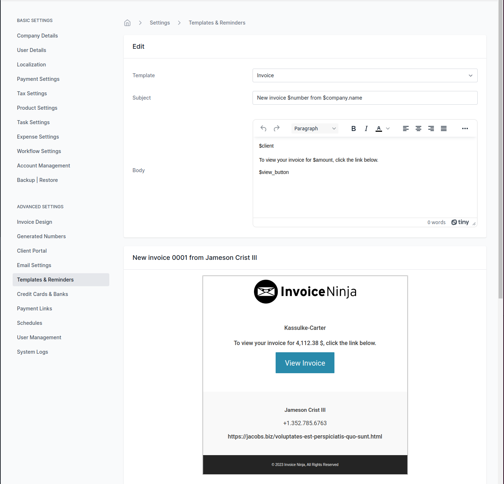

# Customize your email templates

Change the wording of the emails Invoice Ninja sends to your clients, and use placeholders to fill in invoice and payment details automatically.

## What can I customize? {#custom-content}

Invoice Ninja includes translated default email templates that suit most businesses. If you want your own wording, you can edit the subject and body of each template.

## How do I edit an email template? {#wysiwyg-editor}

The template editor is WYSIWYG (what you see is what you get), so you can format text without writing HTML. Each template has a **Subject** field and a **Body** editor. There are no CC, BCC or attach-PDF fields, and there is no send-test button. A preview card under the editor shows how the email will look.



1. Go to **Settings > Templates & Reminders** (`#/settings/templates_and_reminders`).
2. Pick the template tab you want: **Invoice**, **Quote**, **Credit**, **Purchase Order**, **Payment**, **Statement**, **Reminders** or **Custom**.
3. If the tab has sub-choices, pick the email you want:
   - **Payment**: **Payment**, **Partial Payment** or **Payment Failed**.
   - **Reminders**: **First Reminder**, **Second Reminder**, **Third Reminder**, **Endless Reminder** or **First Quote Reminder**. Reminder templates also have **Days**, **Schedule** (for example **After the due date**), **Send Email**, **Late Fee Amount** and **Late Fee Percent**.
   - **Custom**: three fixed slots, **First Custom**, **Second Custom** and **Third Custom**. There is no Add button. To create a custom template, fill in a slot and click **Save**.
   - **Statement** has a single template, with no sub-choices.
4. Edit the **Subject** and **Body**.
5. Click **Save**. Use **Cancel** if you want to leave without saving.

A **Variables** panel under the editor lists placeholders you can insert, grouped as **Invoice**, **Client**, **Contact** and **Company**. Invoice, quote and credit templates share the same groups.

## Which placeholders work in invoice, quote and credit emails? {#invoice-email-customization}

Invoice, quote and credit emails use the same placeholders as PDF designs. See the [full placeholder list](/docs/advanced-topics/custom-fields#custom-fields). The Variables panel on these tabs shows a shorter list of common names. Custom field placeholders may not appear in that panel; you can still type them if you use them in a design.

## Which placeholders work in payment emails? {#payment-email-customization}

These `$variables` work in a payment email. The Payment template's Variables panel includes `$view_button`, `$view_url`, `$payment_url`, `$payment_button`, `$payment.status`, `$invoice`, `$invoices`, `$invoice_references`, `$invoices.amount`, `$invoices.balance`, `$invoices.due_date` and `$invoices.po_number`, plus the shared Client, Contact and Company names. The default payment email uses `$amount`, `$view_button` and `$contact.first_name`.

Other names in the list below are also documented and may still work even if they are not shown in the panel.

```bash
$view_button - A styled HTML button with a link to view the payment
$view_url - The payment link as text
$payment_url - The payment URL
$payment_button - A payment button
$payment.status - The payment status
$amount - The payment amount
$payment.amount - Alias of $amount

$view_link - A plain HTML link to view the payment
$viewLink - Alias of $view_link
$paymentLink - Alias of $view_link
$portalButton - A plain HTML link to the client portal login page
$portal_url - The text string of the client portal login page

$signature - The company email signature
$emailSignature - Alias of $signature

$poNumber - The purchase order number for the invoice (if set)
$client.balance - The outstanding client balance
$outstanding - Alias of $client.balance
$client_balance - Alias of $client.balance
$paid_to_date - Total paid to date for the client

$from - Label for the translated word "From"
$to - Label for the translated word "To"

$number - The payment number
$payment.number - Alias of $number
$entity - Label for the term "Payment"
$payment.refunded - The total refunded for the payment
$payment.date - The date of the payment
$transaction_reference - The payment transaction reference
$public_notes - The public notes of the Payment record
$payment1 - Custom value 1 for payments
$payment2 - Custom value 2 for payments
$payment3 - Custom value 3 for payments
$payment4 - Custom value 4 for payments

$address1 - Address line 1 of the client
$client.address1 - Alias of $address1
$address2 - Address line 2 of the client
$client.address2 - Alias of $address2
$client_address - Full client address
$id_number - ID Number of the client
$client.id_number - Alias of $id_number
$client.number - Number of the client
$vat_number - VAT/TAX number of the client
$client.vat_number - Alias of $vat_number
$website - Web URL of the client
$client.website - Alias of $website
$phone - Client phone
$client.phone - Alias of $phone
$country - Client country name
$client.country - Alias of $country
$email - Primary contact email address
$client.email - Alias of $email
$client_name - The client name
$client.name - Alias of $client_name
$client - Alias of $client_name
$city_state_postal - City / State / Postal code of the client
$client.city_state_postal - Alias of $city_state_postal
$postal_city_state - Postal code / City / State of the client
$client.postal_city_state - Alias of $postal_city_state
$postal_city - Postal Code / City of the client
$client.postal_city - Alias of $postal_city
```

### How do I list every invoice a payment covers? {#invoice-helpers}

One payment can cover several invoices. These helper variables output all the invoice references. The example under each one shows the kind of text it produces. `$invoices`, `$invoice`, `$invoice_references`, `$invoices.amount`, `$invoices.balance`, `$invoices.due_date` and `$invoices.po_number` appear in the Payment Variables panel.

```bash
$invoices - A comma-separated string of invoices and the payment amount received, for example:
```

:::info
Invoice #123 $5000.00, Invoice #124 $1000.00
:::

```bash
$invoice_references_subject - A custom subject line which includes all of the invoices and their amounts, for example:
```

:::info
Invoice #123 $5000.00, Invoice #124 $1000.00
:::

```bash
$invoice_references - A custom body of text including detailed information of the invoices
```

:::info
Invoice #123
Amount $5000.00
Balance $0

Invoice #124
Amount $1000.00
Balance $500.00
:::

```bash
$invoice - A comma-separated list of invoice numbers
```

:::info
Invoice #123,124,125
:::

```bash
$invoices.amount - A formatted string of invoice amounts
```

:::info
Invoice #123 $1000 Invoice #124 $2000.00
:::

```bash
$invoices.balance - A formatted string of invoice balances
```

:::info
Invoice #123 $1000 Invoice #124 $2000.00
:::

```bash
$invoices.due_date - A formatted string of invoice due dates
```

:::info
Invoice #123 2023/01/01 Invoice #124 2023/01/02
:::

```bash
$invoices.po_number - Purchase order numbers for the invoices in the payment
```

```bash
$invoice_numbers - Comma-separated raw string of invoice numbers
```

:::info
123,124,125
:::

```bash
$status_logo - Shows a paid stamp on the email if the payment status is completed
```

## Related

- [PDF templates and custom field placeholders](/docs/advanced-topics/custom-fields)
- [Advanced Settings](/docs/user-guide/advanced-settings)
- [Templates](/docs/advanced-topics/templates)
