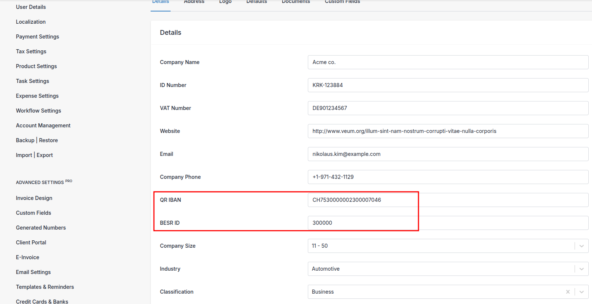
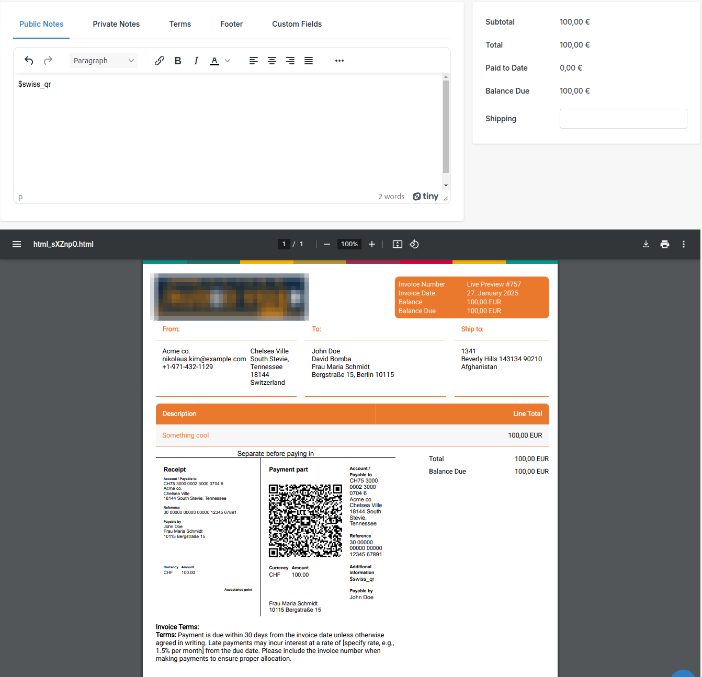
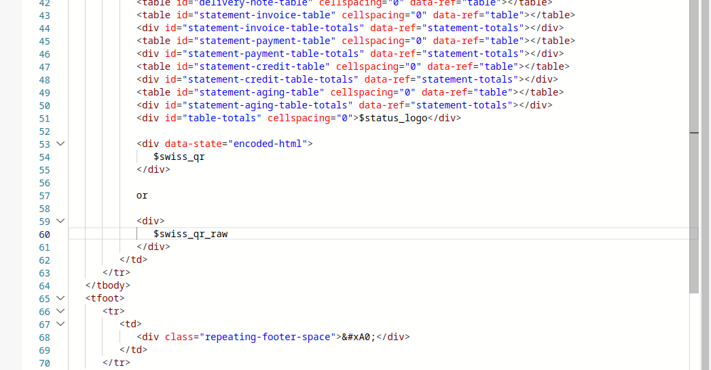
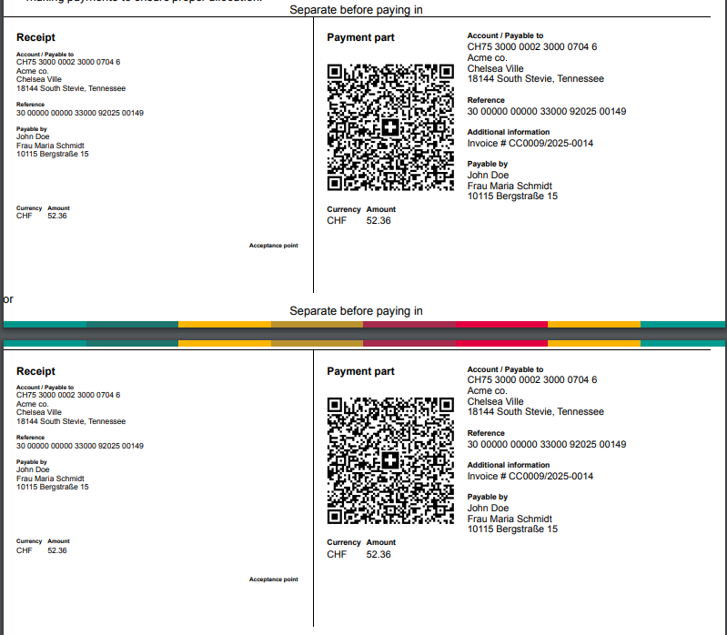
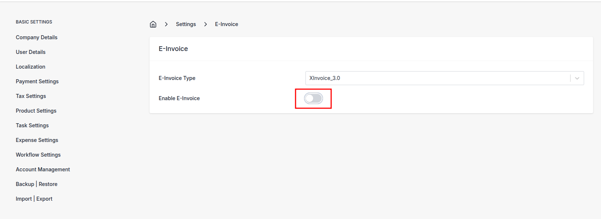
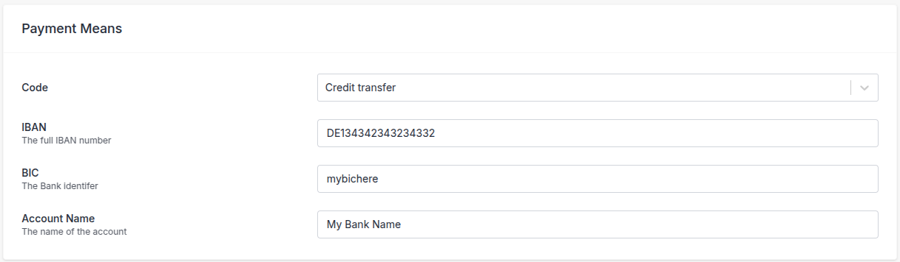
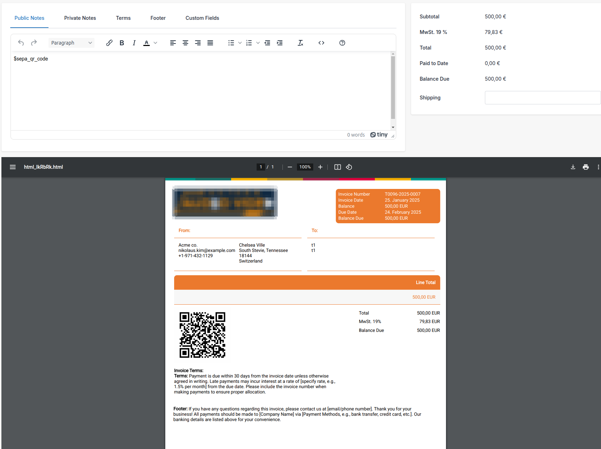
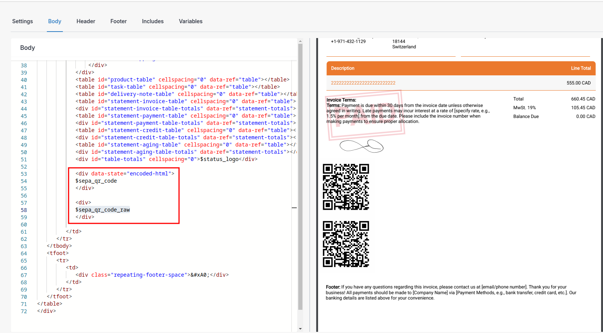

# Add QR codes to your invoices

Put a scannable payment QR code on your invoice PDFs, so clients can pay from their banking app or open the client portal.

Invoice Ninja supports three kinds of QR code. Type the placeholder into an invoice's **Public Notes** or **Terms**, or into a custom design. These placeholders are not listed in the design editor's **Variables** tab.

| QR code | Best for | Placeholder |
|---|---|---|
| Swiss QR | Swiss businesses (QR-Rechnung) | `$swiss_qr`, `$swiss_qr_raw` |
| SEPA QR | Bank transfers in the SEPA area | `$sepa_qr_code`, `$sepa_qr_code_raw` |
| Payment link | Paying online in the client portal | `$payment_qrcode` |

## How do I add Swiss QR codes? {#swiss-qr-codes}

If your business is in Switzerland, Invoice Ninja can add Swiss payment QR codes (QR-Rechnungen) directly to your invoice design. There are three types:

1. **QR-IBAN with QR-Reference.** A QR-IBAN is a special IBAN, different from your normal IBAN. The easiest way to get one is to ask your bank, but you can also calculate it yourself (see below). The QR-Reference is a 26 digit number followed by one check digit, calculated with recursive modulo 10. You can also add up to 140 characters of text.
2. **IBAN without a reference.** This uses your normal IBAN. You can't use a reference, only up to 140 characters of text.
3. **IBAN with a Creditor Reference.** This follows the ISO 11649 standard. It works like a QR-Reference, but it can be used internationally, including outside Switzerland. Use your normal IBAN, not the QR-IBAN.

### How do I calculate my QR-IBAN automatically? {#how-to-calculate-automatically-your-qr-iban}

1. Go to the [SIX Group IID inquiry page](https://www.six-group.com/en/products-services/banking-services/interbank-clearing/online-services/inquiry-iid.html).
2. Enter your bank name in the **Bank/Institution** field and click **Search**.
3. Find the **QR-IID** in the results. It is a number between 30000 and 31999.
4. Paste the QR-IID and your IBAN into the [Swiss IBAN to QR-IBAN Converter](https://alexin-tech.github.io/Swiss-IBAN-to-QR-IBAN-Converter/).

### How do I calculate my QR-IBAN by hand? {#how-to-calculate-manually-your-qr-iban}

This worked example uses a sample IBAN, not a real account.

1. Find your bank's normal IID. For example, Raiffeisen's IID is 80808, so a Raiffeisen IBAN could look like CH21 **8080 8**001 2345 6789 0.
2. Replace the IID with your bank's QR-IID. Raiffeisen's QR-IID is 30808, which gives CH21 **3080 8**001 2345 6789 0. The check digits (21) are now wrong, so you need to recalculate them.
3. Move the first four characters to the end, and replace the check digits with XX: 3080 8001 2345 6789 0 CHXX.
4. Replace the letters with numbers (A=10, B=11, C=12 and so on, so C=12 and H=17). CH becomes 1217: 3080 8001 2345 6789 0 1217XX.
5. Put 00 in place of XX and calculate modulo 97. 3080 8001 2345 6789 0 121700 modulo 97 = 32.
6. Work out the check digits: 98 minus 32 = 66. Check it: 3080 8001 2345 6789 0 121766 modulo 97 = 1.
7. Move the digits back to the front and put the country code back: **CH66 3080 8001 2345 6789 0**. This is your QR-IBAN.

### How do I put the Swiss QR code on my invoice? {#inserting-the-qr-code-into-your-invoice}

:::info
Your company country must be set to Switzerland before the **QR IBAN** and **BESR Number** fields appear on the **Company Details** page.
:::



The quickest option is to type `$swiss_qr` into the **Public Notes** or **Terms** of an invoice, using the editor. The invoice editor does not show a hint for this placeholder; type it yourself.



:::warning
Those sections are narrow, so the QR code will look squashed. To make it span the full width of the PDF, add it to a custom design instead.
:::

To add it to a [custom design](/docs/advanced-topics/custom-fields#creating-a-custom-design), add this at the bottom of the **Body** tab:

```html
<div style="page-break-inside: avoid;" data-state="encoded-html">
$swiss_qr
```

There is also a decoded version:

```bash
$swiss_qr_raw
```



The QR code then spans the width of the PDF:



After you save the design, set it as your default invoice design under **Settings > Invoice Design > General Settings**.

**QR code not showing?** This is usually missing details. Your company needs a full address, and so does the client.

## How do I add SEPA QR codes? {#sepa-erc-qr-codes}

SEPA QR codes need at least an IBAN. For payments from outside the EEA you also need a BIC.

1. Go to **Settings > E-Invoicing** (`#/settings/e_invoice`).
2. Under **Payment Means**, set **Code** to **Credit transfer** or **SEPA credit transfer**. The dropdown lists names only; it does not show numeric codes. Payment Means is on this page even if **Enable E-Invoice** is off.
3. Fill in the account fields that appear, then click **Save**.





Then type `$sepa_qr_code` into an invoice's **Public Notes** or **Terms**, and the QR code is generated automatically:

```bash
$sepa_qr_code
```



To control where the code appears, add it to a custom design instead:

```html
<div data-state="encoded-html">
$sepa_qr_code
```

or use the decoded version:

```bash
$sepa_qr_code_raw
```



These placeholders are not listed in the design editor's **Variables** tab.

For more on payment means, see [E-Invoicing](/docs/user-guide/einvoicing).

## How do I add a payment link QR code? {#generic-payment-link-qr-codes}

A payment link QR code takes your client to the client portal to pay. Add this block to your custom design. `$payment_qrcode` is not listed in the design editor's **Variables** tab.

```html
<div>
$payment_qrcode
```

## Related

- [PDF templates and custom field placeholders](/docs/advanced-topics/custom-fields)
- [E-Invoicing](/docs/user-guide/einvoicing)
- [Advanced Settings](/docs/user-guide/advanced-settings)
