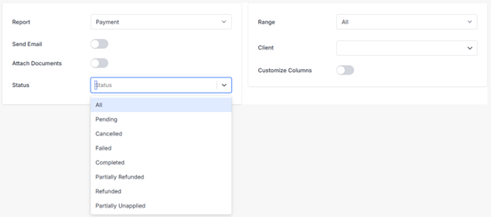
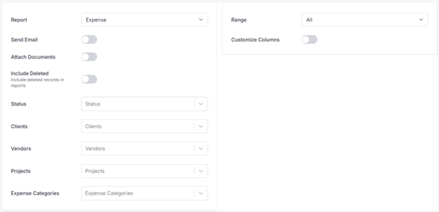
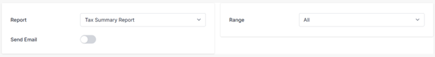
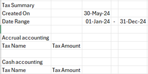
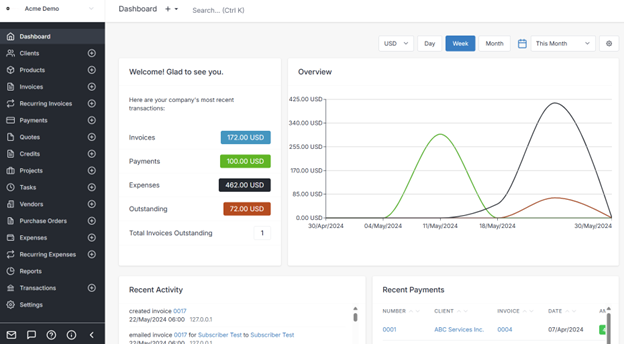
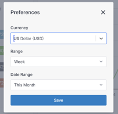
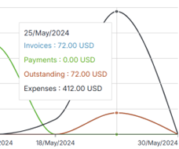

# Tax accounting tips: keep records ready for year end

If you already bill clients in Invoice Ninja, you can also use it to record expenses, payments and tax, then run reports at year end. This page describes what the app can do. It is not tax advice. For advice, talk to a tax professional.

Features that help with bookkeeping include:

- **[Expenses](/docs/user-guide/expenses)**: record what you spend, including tax paid, currency, vendor, client and category.
- **[Recurring Expenses](/docs/user-guide/recurring-expenses)**: repeat an expense on a schedule, for example a monthly subscription.
- **[Transactions](/docs/user-guide/transactions)**: bring in bank lines, then turn withdrawals into expenses or create invoices from deposits. To connect a bank or import a CSV, see [Banking](/docs/user-guide/banking).
- **[Payments](/docs/user-guide/payments)**: record money you receive, by client and invoice, including reference numbers and payment methods.
- **[Reports](/docs/user-guide/reports)**: build and export reports for sales, expenses, tax and profit, including Profit and Loss, Tax Summary Report and Tax Period Report.

## What is cash basis accounting? {#what-is-cash-basis-accounting}

Cash basis accounting recognizes revenue and expenses **at the time** the money is received or paid out.

For example, if you invoiced a client in November 2023 and your tax year is the calendar year ending December 31, 2023, but the client paid in February 2024, that revenue belongs to the 2024 tax year. Most small businesses use cash basis accounting.

## How do I track my expenses? {#track-all-of-your-expenses}

As a small business, it is much easier to log a business expense when it happens than to reconstruct it at the end of the tax year. Enter each one under [Expenses](/docs/user-guide/expenses).

### How do I enter a new expense? {#enter-a-new-expense}

- To track who you paid, attach a vendor.
- If the expense relates to a client or project, attach those too.
- Categorize the expense by selecting or creating a category.
- **Mark Paid** records that the expense has been paid (the help text is "Track the expense has been paid"). This means you paid the vendor, not that a client paid you.
- If you need to record tax you paid, so you can claim input tax credits, first set **Expense Tax Rates** under **Settings > Tax Settings** (`#/settings/tax_settings`) to One Tax Rate, Two Tax Rates or Three Tax Rates. Until that is enabled, the expense form shows "Item tax rates are disabled" with a link to Settings, and the tax rate fields are hidden. You can also use **Inclusive Taxes** on Tax Settings when the amount you enter already includes tax. See [Taxes](/docs/user-guide/taxes) for the full tax setup.

### What are some example use cases? {#example-use-cases}

- A business pays $100 plus 13% sales tax, so the card is charged $113. After Expense Tax Rates is enabled, it creates an expense for $113, selects the 13% tax rate, and uses **Inclusive Taxes**. Reports then show the net amount and the tax paid correctly.
- A business uses a recurring expense for a $123 monthly internet bill that already includes 13% sales tax. Because the provider charges the company card automatically, **Mark Paid** is turned on so each occurrence is recorded as paid.
- A utilities bill is entered with a vendor and a category (for example water). Later, expenses can be filtered by that vendor or category, and the year-end Profit and Loss report reflects the categories you used.

## How do I collect sales tax? {#sales-tax-collection}

If you collect sales tax, set up your rates under **Settings > Tax Settings**, including **Invoice Tax Rates** and **Line Item Tax Rates**. See [Taxes](/docs/user-guide/taxes).

On a product, choose a **Tax Category**. Line-item tax rate fields appear on the product when **Line Item Tax Rates** is enabled in Tax Settings. For a tax-exempt product, set it on the product itself, using its **Tax Category** and tax fields, or handle it under **Settings > Tax Settings**. For client-level exemptions and the rest of the tax setup, see [Taxes](/docs/user-guide/taxes) and [Products](/docs/user-guide/products).

## How do bank transactions help with bookkeeping? {#transactions}

You can connect a bank account under **Settings > Credit Cards & Banks**, import a bank CSV, or enter a transaction by hand. See [Banking](/docs/user-guide/banking) and [Transactions](/docs/user-guide/transactions).

The Transactions list has separate **Deposit** and **Withdrawal** columns, plus Date, Description, Invoices and Expense. Each line is a deposit or a withdrawal, with a currency, bank account and description. Withdrawals can be turned into expenses. Deposits can be used to create an invoice. Matching rules can do some of this automatically.

## How do payments fit into the tax year? {#payments}

Payments are records of money your business receives against invoices. When a client pays online through Invoice Ninja, a payment is created and linked automatically. You can also click **Enter Payment** to record a payment by hand, for example if the client paid by check.

A payment form includes the client, amount, invoice, payment date, payment type and transaction reference, and can show applied, refunded and unapplied amounts. There is no tax field on the payment. For year-end reporting, treat tax as coming from the related invoice, not from the payment record.

You can run the Payment report and filter by date, client, invoice or amount.

## Which reports help at year end? {#financial-reports}

If you have entered expenses and payments through the year, you can use built-in reports to total revenue, tax collected, expenses and profit for your tax agency. On **Reports**, choose the report type and a date **Range**, then use **Export**. The list includes **Payment**, **Expense**, **Profit and Loss**, **Tax Summary Report** and **Tax Period Report**, among others.

### How do I use the Profit and Loss report? {#profit-and-loss-report}

See [Reports: Profit and Loss Report](/docs/user-guide/reports#profit_and_loss_report). That report can convert amounts into your company's default currency when you have more than one currency.

### How do I add the figures up myself? {#manual-calculations}

If you prefer not to use the Profit and Loss report, you can run a combination of reports and add the figures yourself.

#### How do I total payments? {#payment}

- The Payment report totals payments received in the date range you choose.
- After you export a CSV, you can open it in a spreadsheet, select the payment amount column, and read the sum (many spreadsheets show it in the status bar).
- That sum is not enough if you received payments in more than one currency. The Profit and Loss report converts payments to your company's default currency automatically.

#### How do I total expenses? {#expense}

The Expense report totals expenditures in the date range you choose. You can also filter by expense type and other options.

#### How do I total tax collected? {#tax-summary-report}

The Tax Summary Report totals tax in the date range, broken down by each tax rate's name and rate. This is useful if you collect more than one rate and need to work out input tax credits. **Tax Period Report** is also in the Reports list if you need totals by tax period.

#### What other reports can I use? {#other-reports}

There are also reports for product sales, invoices by client, credits, quotes, purchase orders and more. See [Reports](/docs/user-guide/reports).

### How do the year-end figures come together? {#calculations}

If you have logged expenses, payments and tax in Invoice Ninja, you can produce the year-end totals at any time with the reports above.

## How does the dashboard help? {#dashboard}

At the top right of the dashboard you can set the currency, the period (**Day**, **Week** or **Month**) and the date range (for example Last 7 Days). There is also a sliders icon and a gear icon.

The **Overview** chart can show invoices, payments, outstanding amounts and expenses. Hover over a point to see the figures for that date. A **Recent Transactions** card also lists Invoices, Payments, Expenses, Outstanding and Total Invoices Outstanding. Other cards include Recent Activity, Recent Payments, Upcoming Invoices and Past Due Invoices.

The amounts shown on the dashboard include sales tax collected.

## Is this tax advice? {#disclaimer}

This article is not any form of tax advice. It only describes Invoice Ninja's capabilities and configuration. For tax advice, consult a tax professional.

## Related

- [Taxes](/docs/user-guide/taxes)
- [Tax Settings](/docs/user-guide/basic-settings#tax_settings)
- [Expenses](/docs/user-guide/expenses)
- [Recurring Expenses](/docs/user-guide/recurring-expenses)
- [Transactions](/docs/user-guide/transactions)
- [Banking](/docs/user-guide/banking)
- [Payments](/docs/user-guide/payments)
- [Reports](/docs/user-guide/reports)
- [Products](/docs/user-guide/products)
