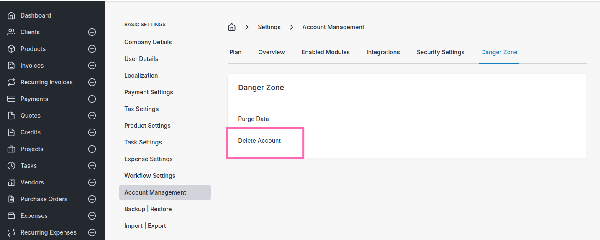
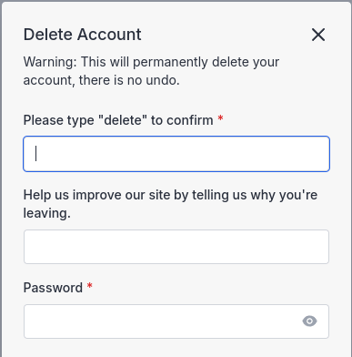

# Delete your hosted Invoice Ninja account

Use the Danger Zone only when you want to permanently remove a company or wipe the data on a hosted account. These actions cannot be undone.

## How do I delete a company or purge my account data? {#delete-your-hosted-account}

1. Go to **Settings > Account Management** (route `#/settings/account_management`). The tabs are **Plan**, **Overview**, **Enabled Modules**, **Integrations**, **Security Settings**, **Referral Program**, **Users**, **Billing History** and **Danger Zone**.
2. Open the **Danger Zone** tab (route `#/settings/account_management/danger_zone`).

The **Danger Zone** tab has two buttons: **Purge Data** and **Delete Company**. There is no **Delete Account** button.

- **Delete Company** permanently deletes the company you currently have selected.
- **Purge Data** permanently wipes the companies and records on the account.

:::warning
Once you confirm, the action cannot be undone. Data removed this way cannot be restored.
:::

3. Click the button for the action you intend. A confirmation dialog appears. Read it carefully, then confirm only if you are sure.

If you have more than one company, delete each company you no longer need, then use **Purge Data** if you want the remaining account data removed. The published privacy documentation states that after **Purge Data**, the account login can remain active.

Do not click **Purge Data** or **Delete Company** unless you intend to destroy that data. Changing a plan is not the same as deleting data. The **Plan** tab has **Upgrade**, **Downgrade** (labeled **Downgrade to Free Plan**) and **Add Payment Method**. There is no Cancel Plan button.

For the rest of Account Management, see [How do I manage my account, modules and security?](/docs/user-guide/basic-settings#account_management).

## Related

- [How do I manage my account, modules and security?](/docs/user-guide/basic-settings#account_management)
- [How do I back up or restore a company?](/docs/user-guide/basic-settings#backup_restore)
