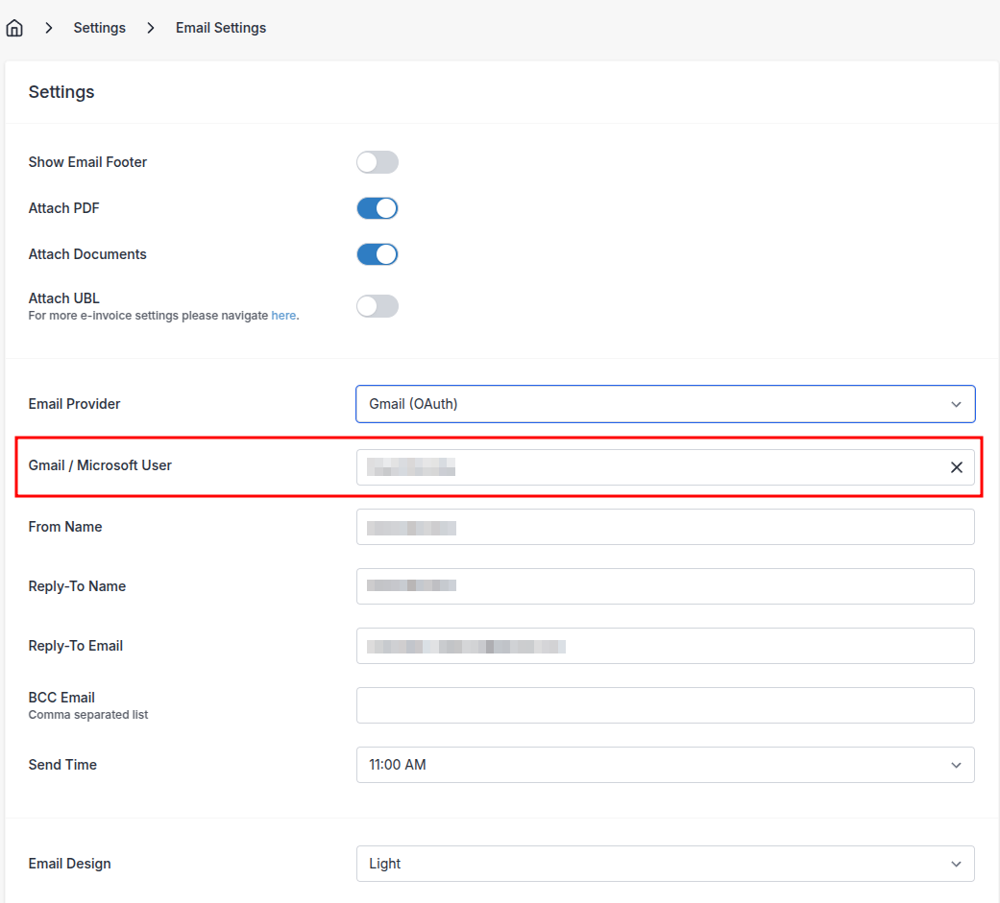
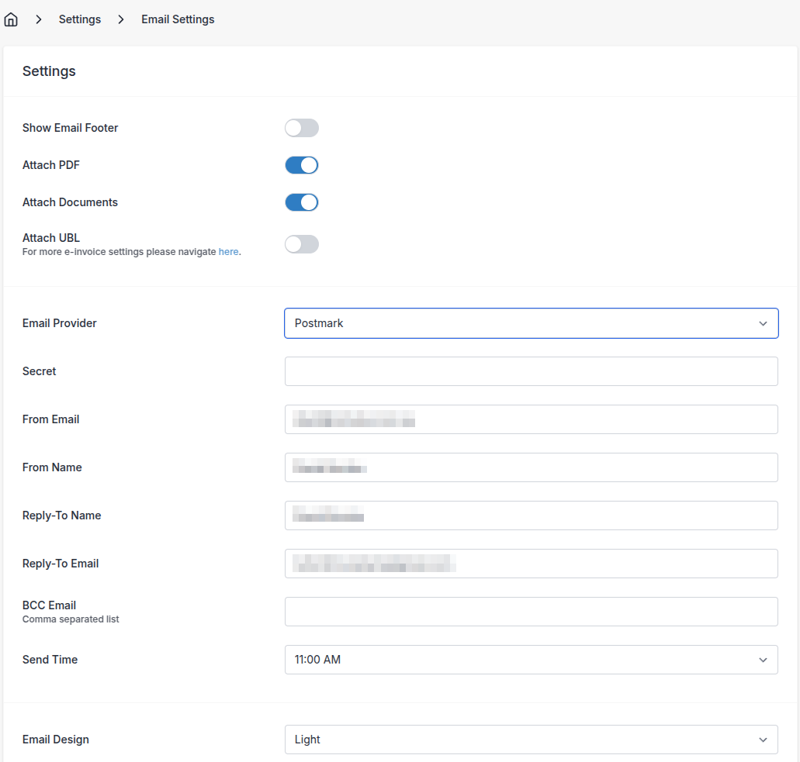
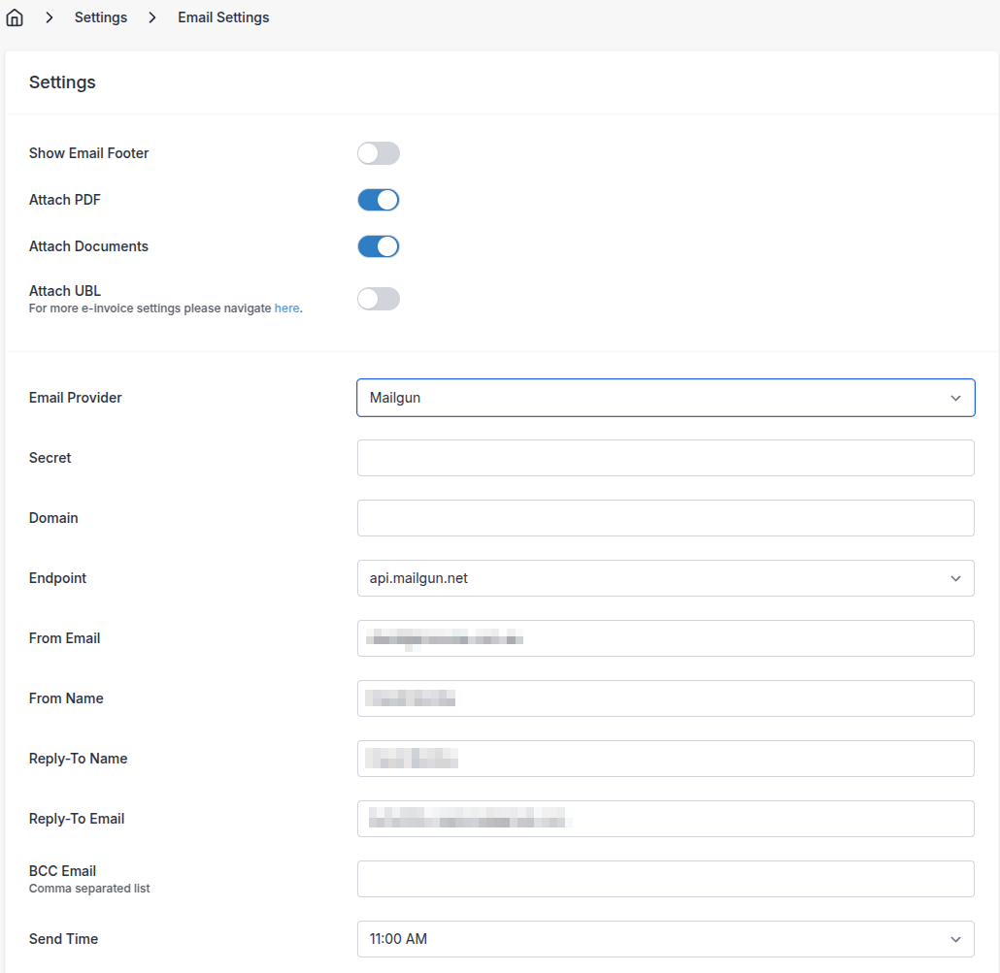
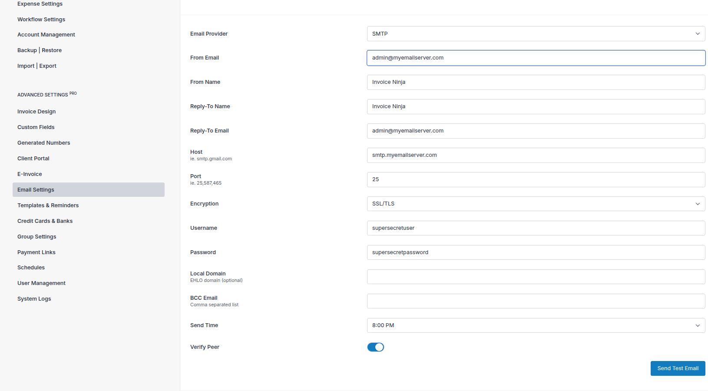
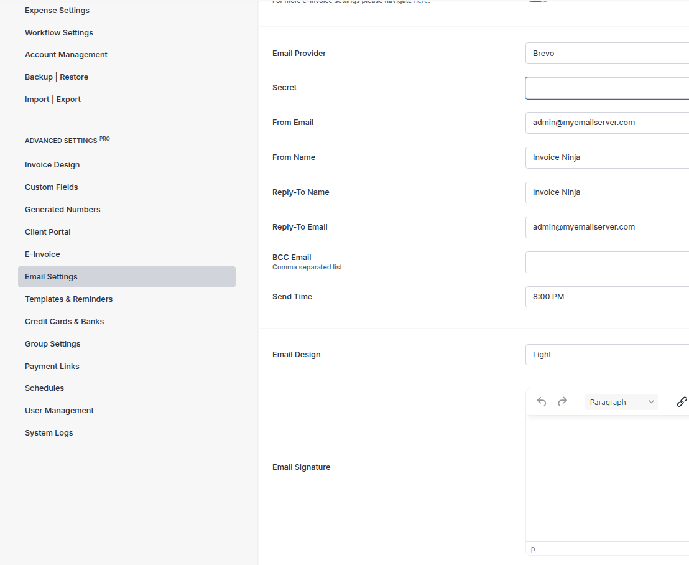

import VideoPlayer from "@site/src/components/VideoPlayer";

# Send invoice emails from your own mailbox

You can send Invoice Ninja emails from your own mailbox or from a bulk provider, as well as through the default hosted mail service. This is documented as a Pro or Enterprise plan option.

Go to **Settings > Email Settings** (route `#/settings/email_settings`) to choose the **Email Provider**. On the hosted app, the options are **Default (Postmark)**, **Mailgun (Hosted)**, **Amazon SES (Hosted)**, **Gmail (OAuth)**, **Microsoft (OAuth)**, **Postmark**, **Mailgun**, **Brevo** and **SMTP**.

For reply-to, signatures, PDF attachments and send time, see [How do I set up outgoing email?](/docs/user-guide/advanced-settings#email_settings).

## How do I send with Gmail or Microsoft? {#send-with-gmail--microsoft}

Sending with Gmail or Microsoft uses the same steps. This short video shows the flow:

<VideoPlayer src="/assets/videos/hosted_mail/hosted_mail.mpd" isDash={true} id="hosted_mail-video" />

:::info
The Google or Microsoft account you sign in with must be the same address you want to send from. Sign in with that address, then grant permission for that same address to send email. You cannot use one account to authenticate and a different address to send.
:::

1. Go to **Settings > User Details** (route `#/settings/user_details`) and open the **OAuth / Mail** tab (route `#/settings/user_details/connect`).
2. Use the Google sign-in button, or click **Log in with Microsoft**, and sign in with the account you want to send from. Use that same address when you authenticate and when you grant sending permission.
3. Go to **Settings > Email Settings**.
4. Set **Email Provider** to **Gmail (OAuth)** or **Microsoft (OAuth)**.
5. If the page then shows a user or account selector for that provider, choose the user you signed in with.



## How do I send with Postmark? {#send-with-postmark}

If you prefer to send bulk email through your own Postmark account, choose **Postmark**. Invoice Ninja does not throttle outbound mail when you use Postmark, so this suits high-volume sending.



1. Go to **Settings > Email Settings**.
2. Set **Email Provider** to **Postmark**.
3. Enter the Postmark credentials the form shows, such as your API or server token.

:::warning
You must configure a sender signature in Postmark, or Postmark will reject the messages. The email address of your primary Invoice Ninja user must match the sender signature you set in Postmark.
:::

To receive delivery and bounce events back in Invoice Ninja, see [Webhook configuration](#webhook-configuration-delivery--bounce-tracking).

## How do I send with Mailgun? {#send-with-mailgun}

Your own Mailgun account is also supported, and outbound mail is not throttled, so this also suits high-volume sending.



1. Go to **Settings > Email Settings**.
2. Set **Email Provider** to **Mailgun**.
3. Enter the Mailgun details the form shows, such as your secret and domain.

**Mailgun (Hosted)** is a separate option. That one uses Invoice Ninja's hosted Mailgun service, not your own Mailgun account.

## What happens if a contact unsubscribes or marks mail as spam? {#handling-spam--contacts-unsubscribing-from-your-emails}

Email delivery is hard. Large providers such as Gmail, Yahoo and Microsoft keep tightening the rules against unsolicited mail. Since 2024 they have added more checks so that only high-quality mail reaches the inbox. In particular, they expect a working unsubscribe link in emails.

:::warning
All outbound emails sent from the Invoice Ninja hosted mail service (`maildelivery@mail.invoicing.co` and `maildelivery@invoicing.co`) include a working unsubscribe link. If you send through your own provider (Postmark, Mailgun, Gmail or Microsoft), Invoice Ninja does not insert these unsubscribe links into your emails.
:::

If a client clicks an unsubscribe link, they are taken to a page where they can opt out of emails from you. This marks their client record as **DO NOT SEND**, and you receive a follow-up email about that action.

For more on the 2024 Gmail and Yahoo requirements, see [this Postmark article](https://postmarkapp.com/blog/2024-gmail-yahoo-email-requirements).

## How do I send with SMTP? {#send-with-smtp}

You can also send through your own SMTP server.



1. Go to **Settings > Email Settings**.
2. Set **Email Provider** to **SMTP**.
3. Fill in the SMTP details the form shows, such as host, port, encryption, username, password and any option to verify the server certificate. Examples of host and port values include `smtp.gmail.com` and `587`, `25` or `465`. Encryption may be listed as tls, ssl or starttls.
4. If the form includes a test-email action, use it only when you intend to send a test message and confirm the server works.

## How do I send with Brevo? {#send-with-brevo}



Your own Brevo account is also supported, and outbound mail is not throttled, so this suits high-volume sending.

1. Go to **Settings > Email Settings**.
2. Set **Email Provider** to **Brevo**.
3. Enter the Brevo credentials the form shows, such as your API key.

## How do I track delivery, bounces and complaints? {#webhook-configuration-delivery--bounce-tracking}

When an email provider reports that a message was delivered, bounced or marked as spam, Invoice Ninja uses those events to update the email status in the app and to flag problem recipients so you stop emailing dead or hostile addresses.

:::info
If you send through the **default** hosted mail service, this is fully automatic. Delivery, bounce, complaint and unsubscribe handling is built in and needs no setup from you.
:::

If you send through **your own** provider account (the Postmark, Mailgun or Amazon SES options above), you can optionally enable webhooks so this tracking still works. The credentials you enter under **Settings > Email Settings** are the ones the webhook is validated against. You do not need server access.

### Postmark {#postmark}

In your own Postmark server, add a webhook pointing at:

```
https://invoicing.co/api/v1/postmark_webhook
```

Add a custom HTTP header so the request authenticates, using the same Postmark server token you entered in **Settings > Email Settings**:

```
X-API-SECURITY: your_postmark_server_token
```

Then enable the **Delivery**, **Bounce**, **Spam Complaint** and (optionally) **Open** events.

### Mailgun and Amazon SES {#mailgun--amazon-ses}

Delivery webhooks for Mailgun and Amazon SES rely on a signing key (Mailgun) or an SNS topic (SES) that is managed at the platform level. If you need bounce and delivery tracking wired up for your own Mailgun or SES account on the hosted platform, contact support so it can be enabled. If you self-host, see the [Mail Webhooks](/docs/self-host/self-host-installation#mail-webhooks-delivery-bounce--complaint-tracking) guide for the full configuration.

## Related

- [How do I set up outgoing email?](/docs/user-guide/advanced-settings#email_settings)
- [How do I send email from my Gmail account?](/docs/hosted/hosted-quickstart#send-emails-from-your-own-gmail-account)
- [Mail Webhooks (self-host)](/docs/self-host/self-host-installation#mail-webhooks-delivery-bounce--complaint-tracking)
