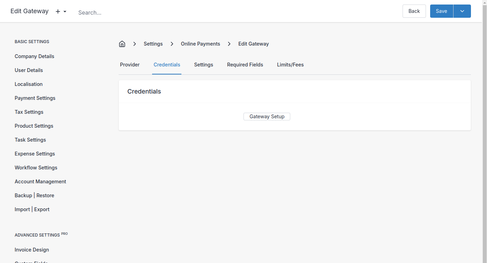
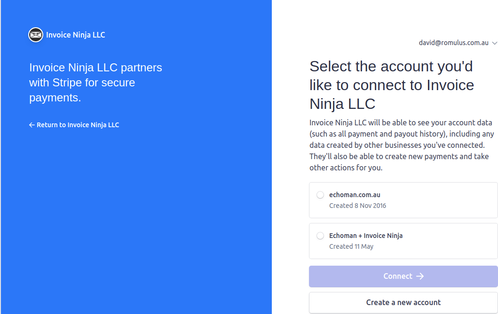
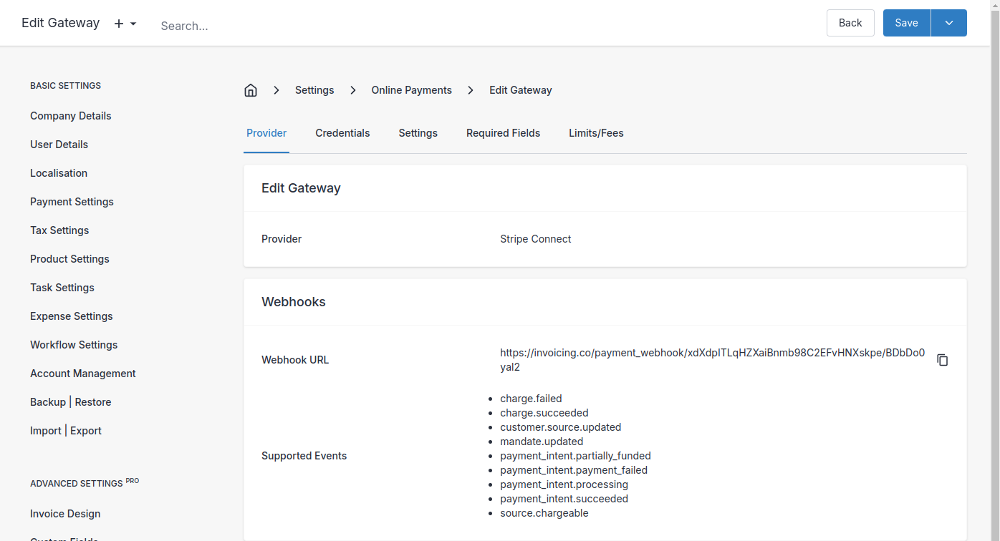
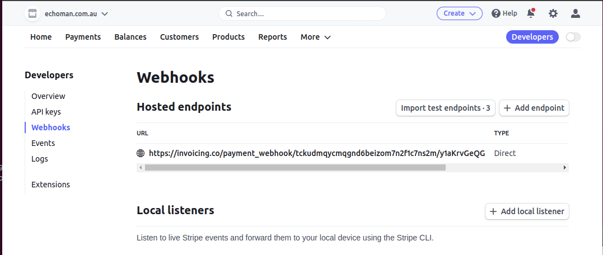
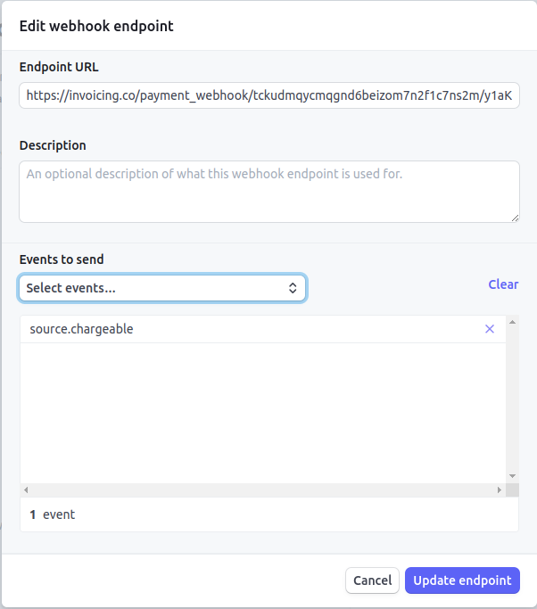

# Connect Stripe on hosted Invoice Ninja

On the hosted app, Stripe is connected with Stripe Connect (OAuth), so you can accept card payments without pasting secret API keys into Invoice Ninja.

## How do I connect Stripe? {#stripe-integration}

Invoice Ninja uses Stripe Connect so you can authorize your Stripe account securely. If you migrated a company from v4, a Stripe gateway may already appear in the list, but you still need to authorize it with Stripe.

1. Go to **Settings > Payment Settings**. The page title is **Online Payments** (route `#/settings/online_payments`). The page has a **Status** filter (**Active**, **Archived** or **Deleted**), an **Add Payment Gateway** button, and a list with **Status**, **Label** and **Test Mode** columns.
2. If **Stripe Connect** is not already in the gateway list, click **Add Payment Gateway** and choose **Stripe Connect**. Invoice Ninja opens a Stripe login so you can connect an existing Stripe account or create a new one.
3. If **Stripe Connect** is already in the list but is not yet authorized, open that gateway, click **Gateway Setup**, sign in to Stripe, and select the Stripe account to connect.

For payment methods you can turn on after Stripe is connected, and for other providers, see [Payment Gateways](/docs/user-guide/gateways).

## How do I set up Stripe webhooks? {#stripe-webhooks}

You should set up webhooks so Stripe can tell Invoice Ninja when a payment finishes. That helps complete a payment if the client leaves checkout early, or if the connection between Stripe and Invoice Ninja drops.

1. In Invoice Ninja, open the Stripe gateway from **Settings > Payment Settings** (the **Online Payments** page). The webhook details are shown on that Stripe page.
2. Copy the webhook URL shown there.

3. Sign in to Stripe and go to **Developers > Webhooks**.

4. Add your Invoice Ninja webhook URL, and enable these event types:

:::info
source.chargeable  
charge.succeeded  
charge.failed  
customer.source.updated  
payment_intent.processing  
payment_intent.succeeded  
payment_intent.payment_failed  
payment_intent.partially_funded
:::

## Related

- [Payment Gateways](/docs/user-guide/gateways)
- [How do payment settings and automatic billing work?](/docs/user-guide/basic-settings#payment_settings)
- [Set up your hosted Invoice Ninja account](/docs/hosted/hosted-quickstart#configure-stripe-payment-gateway)
