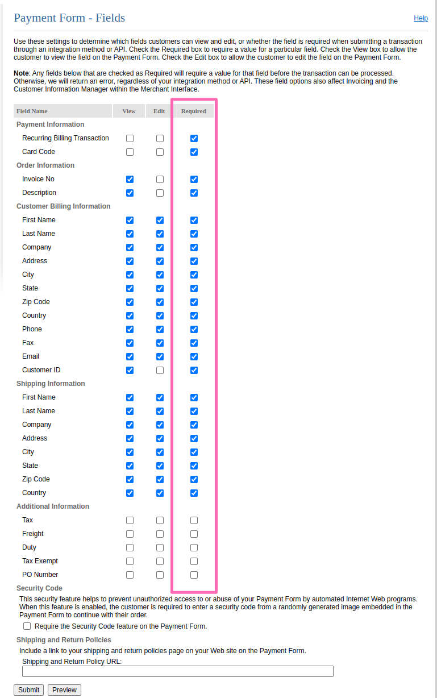

# Fix hosted Authorize.Net payment form errors

If an Authorize.Net (Auth.net) payment fails because a field is required, the usual fix is on the Auth.net payment form, not in Invoice Ninja.

## How do I fix Authorize.Net required-field errors? {#authnet}

### What does a "CardCode is required" or similar error mean? {#cardcode-is-required-or-similar}

You may see a payment error that names a missing field, for example:

:::info
There was an error processing your payment [33]. Please try again later.  
Message:  
Customer ID is required
:::

That usually means the payment form in Auth.net has one or more fields marked as required. Invoice Ninja does not send every Auth.net form field, so those required checkboxes need to be turned off.

1. Sign in to Auth.net.
2. Go to **Account > Payment Forms > Form Fields**.
3. You will see a list of fields with required checkboxes, like this:

:::warning
Turn off the required checkboxes, then save the form in Auth.net.
:::

For adding or managing the Authorize.Net gateway in Invoice Ninja, see [Payment Gateways](/docs/user-guide/gateways). Go to **Settings > Payment Settings**. The page title is **Online Payments** (route `#/settings/online_payments`). It has a **Status** filter (**Active**, **Archived** or **Deleted**), an **Add Payment Gateway** button, and a list with **Status**, **Label** and **Test Mode** columns. Do not add or change a gateway unless you intend to connect Authorize.Net.

## Related

- [Payment Gateways](/docs/user-guide/gateways)
- [How do payment settings and automatic billing work?](/docs/user-guide/basic-settings#payment_settings)
- [Connect Stripe on hosted Invoice Ninja](/docs/hosted/hosted-stripe)
