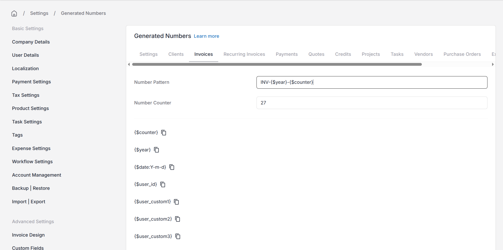

import VideoPlayer from "@site/src/components/VideoPlayer";

Advanced Settings is where Invoice Ninja becomes *yours*. Once [Basic Settings](/docs/user-guide/basic-settings) has your company, localization, and defaults in place, this is the area you open when you want documents that look the part, numbering that matches your accountant's expectations, emails that read in your voice, and a client portal that feels like your own.

You don't need to touch every cluster below — most freelancers set up Invoice Design and Email Settings once and leave the rest at their defaults. Small businesses tend to reach for Generated Numbers, Templates & Reminders, and User Management as they grow. Agencies with many clients often lean on Group Settings and Payment Links to scale without duplicating work.

## Invoice Design {#invoice_design}

Invoice Design controls how your invoices, quotes, and credits look on the page — the template, the fonts, the colours, and which fields appear in each section. This is usually the first Advanced Settings cluster anyone opens, because getting your brand right on the first document sent to a client matters. For deeper PDF work (custom HTML/CSS templates, variable placeholders) see [Custom Fields & PDF Customization](../advanced-topics/custom-fields).

### General Settings

#### Customize & Preview

This button opens an advanced template code editor with a live preview. Full instructions live under [PDF Customizations](https://invoiceninja.github.io/en/custom-fields/). Use the preview to try designs before committing to one.

#### Template Settings

| Field | What it does |
|---|---|
| Invoice Design | Default design template for invoices. |
| Quote Design | Default design template for quotes. |
| Credit Design | Default design template for credits. |
| Page Layout | Portrait or landscape. |
| Page Size | Preformats the PDF for common printer sizes. A4 is the default; pick another only if you have specific in-house print requirements. |
| Font Size | Default 7. Adjust to taste. |
| Primary Font | Default Roboto. Used as the primary document font. |
| Secondary Font | Default Roboto. Used for secondary text. |
| Primary Color | Default `#0c45a3`. Main accent colour used by templates. |
| Secondary Color | Default `#7081e0`. Secondary accent colour. |
| Empty Columns | Default Show. Hide item-list columns that have no values. |

### Client Details, Company Details, Invoice Details, etc.

Each tab along the top of Invoice Design corresponds to a *section* of the generated document. Add or remove fields here to decide exactly what appears in that section — useful when your region requires specific data on an invoice (for example a VAT number or tax registration) or when you'd rather hide fields that aren't relevant to your business.

- **Add Field** — pick from available record values to add to that section.
- **Reset** — restore the default field list for the section.

The tabs available are:

- **Client Details** — fields printed in the client-details block.
- **Company Details** — fields printed in the company-details block.
- **Company Address** — usually rendered separately from company details, so it gets its own tab.
- **Invoice Details** — fields sourced from the invoice record (number, date, due date, and so on).
- **Quote Details** — same idea, populated from the quote record.
- **Credit Details** — same idea, populated from the credit record.
- **Product Columns** — columns shown for product line items.
- **Task Columns** — columns shown for task line items.
- **Total Fields** — the accounting totals block at the foot of the document.

## Create custom invoice fields and other record fields {#custom_fields}

<VideoPlayer src="/assets/videos/advanced/custom_fields/custom_fields.mpd" isDash={true} id="custom-fields-video" />

To add extra invoice fields, open **Custom Fields**, select the **Invoices** tab, and name a field to activate it. Choose its type from the options below. For using existing placeholders in a PDF design, see [PDF templates and custom field placeholders](/docs/advanced-topics/custom-fields).

Custom Fields let you add up to four extra fields to each record type (clients, invoices, products, and so on), so Invoice Ninja fits the details your business actually tracks. A freelancer might add a certification expiry to their company record; a small business might record a licence number against each client; an agency might tag products with a SKU or warranty period. Fields can be shown on PDFs via placeholders (see [Clients](/docs/user-guide/clients#how-do-i-add-custom-fields-to-clients)) or kept internal.

To activate a field, give it a name. Leave the name empty and the field disappears from forms and records.

Each of the four slots accepts one of five types:

- **Single-line Text** — a short free-text field.
- **Multi-line Text** — for longer notes.
- **Switch** — a true/false toggle. Good for membership status, opt-ins, or flags.
- **Dropdown** — a select menu populated from a comma-separated list you provide.
- **Date** — a date picker. Good for expiry dates or manufacture dates.

Tabs at the top of the page scope those four slots per entity:

- **Company** — fields against your own company record.
- **Clients** — applies to clients and their nested contacts.
- **Products** — describe items in your inventory.
- **Invoices** — four custom fields plus a **Surcharge** field (a named, taxable-or-not flat fee that appears above the tax dropdowns on every invoice).
- **Payments** — extra fields on payment records.
- **Vendors** — describe suppliers — for example, your credit terms with them.
- **Expenses** — handy for a tax-category field at year end.
- **Users** — employee-level fields, useful if you run a team through Tasks.

## Generated Numbers {#generated_numbers}

<div className="generated-number-guide">

Generated Numbers controls the identifiers assigned to new invoices, quotes, clients, and other records. You can add a prefix, include the year, continue an existing sequence, or give groups and clients their own numbering rules.

Start with the [quick setup](#set-up-your-first-number-pattern), choose a [ready-to-use pattern](#number-pattern-examples), or learn how to [override company settings for a group or client](#numbering-overrides).

### Set up your first number pattern

For invoice numbers such as `INV-2026-0001`:

1. Open **Settings > Generated Numbers > Settings** at the company level.


2. Set **Number Padding** to the option showing `0001` (four digits). Choose **When Saved** under **Generate Number** if you want invoices numbered as soon as you save them.
3. Open the **Invoices** tab and enter this **Number Pattern**:

   ```text
   INV-{$year}-{$counter}
   ```





4. Set **Number Counter** to the next number you want to use. For a new sequence, use `1`; if your last invoice was `INV-2026-0150`, use `151`.
5. Click **Save**. The next invoice numbered in 2026 will be `INV-2026-0001`, or `INV-2026-0151` if you continued the existing sequence, provided that number is unused.

Type variables exactly as shown, including the braces and dollar sign. Text outside variables stays as you type it: `INV-` is a fixed prefix, while `{$year}` and `{$counter}` are replaced with values. These numbering variables have their own syntax; the [PDF custom-field list](../advanced-topics/custom-fields#custom-fields) is a separate reference.

Changing a pattern affects newly generated numbers. It does not renumber existing records or replace a number you entered manually.

### Number pattern examples

These examples assume the next counter is **1**, padding is **4**, and the generation date is **16 November 2026** in the company timezone.

| Goal | Copy this number pattern | Example result | Additional setup |
|---|---|---|---|
| Simple sequence | `{$counter}` | `0001` | None. |
| Fixed prefix | `INV-{$counter}` | `INV-0001` | Use another prefix, such as `QUO-`, in the relevant record's tab. |
| Year in the number | `INV-{$year}-{$counter}` | `INV-2026-0001` | To restart annually, also configure **Reset Counter** and **Next Reset**. |
| Year and month | `INV-{$date:Y-m}-{$counter}` | `INV-2026-11-0001` | To restart monthly, also configure a monthly reset and **Next Reset**. |
| Separate sequence per client | `{$client_number}-INV-{$client_counter}` | `C001-INV-0001` | Use for invoices or other client-linked records. Give each client a unique client number, such as `C001`. |
| Separate sequence for a group | `VIP-{$year}-{$group_counter}` | `VIP-2026-0001` | Set this in the VIP group's invoice settings; assign clients to that group. Give other groups different prefixes. |

Adding a year or month changes the text in the number; it does **not** reset the counter by itself.

### Numbering settings


The **Settings** tab contains the shared numbering options. Each record type has its own tab for its pattern and next counter.

| Setting | How to use it |
|---|---|
| **Number Pattern** | The text and variables used to build a new number. An empty pattern uses the counter. Normally, if you omit a counter variable, Invoice Ninja adds the counter at the end. Include it explicitly to control its position. |
| **Number Counter** | The next value to try, rather than the number of records you have. Use it to continue numbering after migrating from another system. |
| **Number Padding** | Minimum width of the counter, with leading zeros. The default is **4**, so `1` becomes `0001`. It does not shorten longer numbers: `10000` stays `10000`. |
| **Generate Number** | **When Saved** or **When Sent** for invoices, quotes, credits, and purchase orders. With **When Sent**, a draft can remain unnumbered until sent or marked as sent. Payments and recurring invoice records are numbered when saved. |
| **Recurring Prefix** | Extra text placed before the invoice pattern when a recurring invoice generates an invoice. For example, `R-` plus `INV-{$counter}` produces `R-INV-0001`. |
| **Shared Invoice/Quote Counter** | Quotes draw from the invoice counter, while retaining their quote pattern. |
| **Shared Invoice/Credit Counter** | Credits draw from the invoice counter, while retaining their credit pattern. Enable both shared-counter options to share a sequence across invoices, quotes, and credits. |
| **Reset Counter** and **Next Reset** | Choose a frequency and the next reset date. A due reset is applied when numbering is next generated. Use `{$year}` for annual resets, or `{$date:Y-m}` for monthly resets, to distinguish the new sequence from earlier periods. |

Automatic resets do not reset client numbers, vendor numbers, or the recurring invoice record counter. The **Recurring Invoices** tab controls the recurring record's own number; invoices it generates use the **Invoices** pattern and counter, with **Recurring Prefix** added.


### Company, group, and client overrides {#numbering-overrides}

For client-based numbering, each setting is resolved in this order:

1. **Client override**, if enabled for that field.
2. **Group override**, if the client belongs to a group and that field is overridden there.
3. **Company setting**, for everything else.

The order applies separately to each field. A client can override its invoice pattern while inheriting the group's padding and the company's generation timing. Later company changes flow through only where no group or client override takes precedence.

#### Set an override for a group

1. Open **Settings > Group Settings**, create or open a group, and choose **Configure Settings**.
2. Open **Generated Numbers**, then the relevant tab, such as **Invoices**.
3. Select the checkbox beside **Number Pattern**, enter the group's pattern, and click **Save**. Select other fields' checkboxes only when you want to override those too.
4. Edit each client's details and select this group in the **Group** field. Save the client.

For example, set a VIP group's invoice pattern to `VIP-{$year}-{$counter}`. Members receive the VIP prefix, but still draw from the company's invoice counter. A client with its own invoice-pattern override keeps that override.

#### Set an override for one client

1. Open the client's action menu and choose **Settings**.
2. Open **Generated Numbers > Invoices** (or another applicable tab).
3. Select the checkbox beside **Number Pattern**, enter the client's pattern, and click **Save**.

To remove an override, clear its checkbox and save. The field then inherits from the next level. Clearing only the text is not the way to remove an override. Check the **Group Settings** or **Client Settings** banner to confirm whose settings you are editing; use its **×** button to return to company settings after saving.

#### Choose whether the sequence is shared or separate

Overriding a pattern changes its format. The counter variable determines where the sequence is kept:

| Counter variable | Sequence used | Where to set its next counter |
|---|---|---|
| `{$counter}` | Company sequence for that record type, even inside a group or client pattern override. | Company **Generated Numbers**, in the relevant record's tab. |
| `{$group_counter}` | One sequence shared by clients in the same group. Use it with clients assigned to a group. | That group's **Configure Settings > Generated Numbers**, in the relevant tab. Enable **Number Counter** to set a starting value. |
| `{$client_counter}` | A separate sequence for each client. | That client's **Settings > Generated Numbers**, in the relevant tab. Enable **Number Counter** to set a starting value. |

For a VIP group to start its own invoice sequence at `0001`, use `VIP-{$year}-{$group_counter}` and set the group's invoice **Number Counter** to `1`. For every client to have its own sequence, a group can instead supply `{$client_number}-INV-{$client_counter}`; each member then gets its own counter. A new group or client counter starts at `1` unless already set.

Use one counter variable per pattern. Include a unique group prefix or client number, because invoice numbers must be unique across the company, including across clients and groups. If you want periodic resets for a separate sequence, configure **Reset Counter** and **Next Reset** at the same group or client level as that sequence.

Group/client numbering overrides apply to clients, invoices, recurring invoice records, quotes, credits, payments, and projects linked to a client. Vendors, tasks, expenses, recurring expenses, purchase orders, and projects without a client use company numbering settings and counters, even when a record has a client link.

### Available Variables

Copy the full placeholder, including `{$` and `}`. The lists below include variables beyond those shown under each tab in the app.

#### Counter and date variables

| Variable | Meaning | Example value |
|---|---|---|
| `{$counter}` | The counter selected for this pattern, with number padding applied. | `0001` |
| `{$client_counter}` | Select a separate client counter, as explained under [overrides](#numbering-overrides). | `0001` |
| `{$group_counter}` | Select the client's group counter, as explained under [overrides](#numbering-overrides). | `0001` |
| `{$year}` | Four-digit year when the number is generated, in the company timezone. | `2026` |
| `{$date:Y-m-d}` | Generation date in the company timezone, using the format after `date:`. | `2026-11-16` |

Counter selection by client or group applies only to the client-based record types listed above. For company-based records, use `{$counter}`.

You can customize the date format:

| Date placeholder | Example on 16 November 2026 |
|---|---|
| `{$date:Y}` | `2026` |
| `{$date:y}` | `26` (two-digit year) |
| `{$date:Y-m}` | `2026-11` |
| `{$date:Ym}` | `202611` |
| `{$date:Ymd}` | `20261116` |

Date variables use the time of number generation, even for a backdated invoice. A group or client's timezone override does not change these date values. Use one date-format placeholder per pattern: combine components as `{$date:Y-m}` rather than separate `{$date:Y}` and `{$date:m}` placeholders, as only the first distinct date format is expanded.

#### Client variables

These use the client being numbered or the client linked to the record. They are also available on tasks and expenses when a client is linked, even though those records use company counters.

| Variable | Meaning | Example value |
|---|---|---|
| `{$client_number}` | The client's **Number**, which must already exist if you use it in another record's pattern. Avoid using it to generate that same client's number. | `C001` |
| `{$client_id_number}` | The client's **ID Number**; normally falls back to the client number if the ID Number is empty. | `ACME` |
| `{$client_custom1}`, `{$client_custom2}`, `{$client_custom3}`, `{$client_custom4}` | The value in the corresponding client custom field, rather than its label. | `NORTH` |

For example, `{$client_custom1}-{$counter}` produces `NORTH-0001` when the client's first custom field contains `NORTH`. Set up the field under **Settings > Custom Fields > Clients**, then fill in its value on the client.

#### Vendor and expense variables

| Variable | Where it works | Meaning |
|---|---|---|
| `{$vendor_id_number}` | Vendor numbers; ordinary expenses with a linked vendor. | The vendor's **ID Number**. |
| `{$vendor_number}` | Ordinary expenses with a linked vendor. | The vendor's **Number**. |
| `{$vendor_custom1}`, `{$vendor_custom2}`, `{$vendor_custom3}`, `{$vendor_custom4}` | Ordinary expenses with a linked vendor. | The corresponding vendor custom-field value. |
| `{$expense_id_number}` | Ordinary expenses. | Normally empty on standard expense records. It does not insert the linked client or vendor's ID Number; use `{$client_id_number}` or `{$vendor_id_number}` for those values. |

Vendor number/custom-field variables do not currently resolve in a vendor's own number pattern, purchase order patterns, or recurring expense patterns. Use `{$vendor_id_number}` for a vendor's own pattern; purchase orders and recurring expenses can use the common counter, date, and user variables.

#### User variables and older aliases

| Variable | Meaning | Example value |
|---|---|---|
| `{$user_id}` | Internal user ID, with a minimum of two digits. This is not a user name. | `03` |
| `{$user_custom1}`, `{$user_custom2}`, `{$user_custom3}`, `{$user_custom4}` | Value in the corresponding user custom field. An unset value becomes empty text. | `SALES` |

For normal client-based numbering, these user values come from the **client's creator**, who may differ from the person creating the invoice, quote, payment, or project. For company-based numbering, they come from the record's creator. They do not refer to the assigned user or necessarily the person currently logged in.

Older supported spellings are `{$clientCounter}`, `{$userId}`, `{$clientCustom1}`, `{$clientCustom2}`, and `{$clientIdNumber}`. Use the underscored spellings above for new patterns. Use `{$group_counter}` rather than `{$groupCounter}`, which is not replaced.

When a quote is converted using a shared invoice/quote counter, Invoice Ninja tries to reuse its counter value for the invoice. In this case, `{$client_id_number}` needs a filled-in client ID Number, and user custom-field placeholders can remain unresolved. Prefer counter/date patterns if you need consistent results through that conversion.

### Troubleshooting generated numbers

- **A variable appears literally in the number:** check its spelling, braces, and applicability above. For example, the PDF variable `$client.number` is not the numbering variable `{$client_number}`. Variables that need a linked client or vendor can remain unresolved when that relationship is missing.
- **Part of the number is empty:** fill in the referenced custom field or ID Number. A field that exists but has no value can produce empty text; it does not automatically insert its label.
- **The prefix or padding is unexpected:** check the client's overrides, its group's overrides, and the active settings banner. For recurring-generated invoices, also check **Recurring Prefix**.
- **The date differs from the invoice date:** dates in number patterns reflect generation time in the company timezone. Check **Generate Number** if an invoice was saved in one period and numbered when sent in another.
- **The counter skips values or does not restart at 1:** the next number may already be in use. Invoice Ninja checks for existing numbers of the same record type across the company, including archived and deleted records, and advances to find an unused number. Repeated collisions can result in an extra suffix. Use distinct prefixes for separate sequences and matching date components for resets.
- **Changing a group/client counter has no effect:** check the pattern's counter variable. `{$counter}` still uses the company counter; a separate sequence needs `{$group_counter}` or `{$client_counter}`. Also check whether invoices, quotes, or credits share their counter.

Before changing a live sequence, note its current pattern and next counter. Test the new format on the next intended record and check the saved number; deleting a test record does not make its number available for reuse.

</div>

## Email Settings {#email_settings}

Email Settings shapes how every automated message leaves your system — the reply-to address, signature, attachments, and send timing. It's worth a visit early on: a tidy reply-to and signature make client conversations much smoother, and decisions about PDF and UBL attachments can matter for compliance. For sending e-invoices in the correct format per jurisdiction, see [E-Invoicing](/docs/user-guide/einvoicing).

| Field | What it does |
|---|---|
| Email Provider | The service used to send your mail. Picking a provider reveals its credential fields (below). The available options differ between the hosted platform and self-hosted installs. |
| Reply-To Name | Name shown in the reply-to header — for example, the contact for support questions. |
| Reply-To Email | Address replies get routed to. |
| From Name | Sender name shown on outgoing mail. |
| BCC Email | Comma-separated list of addresses blind-copied on outgoing emails. Recipients can't see these. |
| Email Design | Visual template used for emails. |
| Email Signature | Appended to every company email. Multi-line; HTML is respected. |
| Send Time | Hour of day (in the client's timezone) at which scheduled emails send. For example, `9` sends at 9am local to each client. |
| Attach PDF | Attach the PDF to the email. Off by default — emails include a portal link instead. |
| Attach Documents | Attach any files uploaded under the record's Documents tab. |
| Attach UBL | Attach a standalone UBL XML alongside the PDF. Useful if a recipient's system reads XML but not the XML embedded inside PDFs. |
| Enable E-invoice | Turn on regional e-invoice generation, then pick the standard your jurisdiction requires. |

### Email Provider

The **Email Provider** dropdown controls where your mail is sent from, and each choice exposes its own credential fields:

| Provider | Fields you supply | Notes |
|---|---|---|
| Default | None | Hosted: the built-in Invoice Ninja mail service. Self-hosted: the server's `.env` `MAIL_*` configuration. |
| Gmail / Microsoft (OAuth) | Sending user | Hosted only, Pro/Enterprise — send from your own connected Google or Microsoft account. See [Hosted Mail](/docs/hosted/hosted-mail). |
| SMTP | Host, Port, Encryption, Username, Password, Local Domain, Verify Peer | Includes a **Send Test Email** button to validate the configuration. |
| Postmark | Secret (server API token) | — |
| Mailgun | Secret, Domain, Endpoint (US / EU) | — |
| Brevo | Secret (API key) | — |
| Amazon SES | Access Key, Secret Key, Region, From Address, Topic ARN | Self-hosted. |
| From Email | The custom sending address used by Postmark, Mailgun, Brevo and SMTP. | Must be an address your provider is authorized to send from. |

To track delivery, bounces and spam complaints from Postmark, Mailgun or SES, see [Webhook configuration](/docs/hosted/hosted-mail#webhook-configuration-delivery--bounce-tracking) (hosted) or the [Mail Webhooks](/docs/self-host/self-host-installation#mail-webhooks-delivery-bounce--complaint-tracking) guide (self-hosted).

:::warning
**NOTE** If you are selecting Hour 24, 12:00am is technically the next day, in order to prevent emails from being dispatched technically a day later, this system will adjust the send time slightly so that it is scheduled to send just before midnight.
:::

## Client Portal {#client_portal}

Client Portal settings govern the self-service site your contacts log into to view invoices, pay, download receipts, and approve quotes. Everything here is optional but high-impact — enabling online signatures, a Terms of Service link, or a custom header can visibly raise the polish of your client experience. For the full tour of the portal itself, see [Client Portal](/docs/user-guide/client-portal).

### Settings

Basic behaviour and visibility.

- **Client Portal** — master switch. When off, portal links show a blocked page. Usually on.
- **Tasks** — off by default. Turn on to let clients view their assigned tasks (description, project, status, duration), whether invoiced or not.
- **Client Registration** — allow visitors to self-register and create their own client record. Useful if you want a sign-up link on your site.
- **Document Upload** — let clients upload files (signed contracts, PO paperwork) straight into their client record.
- **Storefront** — generates an API key so another app or your own website can create invoices automatically on your behalf.
- **Terms of Service** — multi-line text shown as a linked footer on every portal page.
- **Privacy Policy** — same idea, sitting beside Terms of Service.

### Authorization

Features that add accountability around payments and approvals.

- **Password Protect Invoices** — off by default. When on, clients set a password on first view and re-enter it afterwards.
- **Invoice Terms Checkbox** — client must tick an acceptance box before paying.
- **Quote Terms Checkbox** — same, before approving a quote.
- **Invoice Signature** — require a drawn signature before paying an invoice.
- **Quote Signature** — require a drawn signature before approving a quote.
- **Show on PDF** — show the captured signature on the PDF once signed.

<VideoPlayer src="/assets/videos/advanced/signatures/signatures.mpd" isDash={true} id="signatures-video" />

### Messages

Greetings and notices shown at key pages in the portal.

- **Dashboard** — first message the client sees on logging in.
- **Unpaid Invoice** — shown above an unpaid invoice.
- **Paid Invoice** — shown above a paid invoice.
- **Unapproved Quote** — shown above a quote awaiting approval.

### Customize

Appearance tweaks beyond the template.

- **Header** — text shown in a bar at the top of every portal page.
- **Footer** — text shown in a bar at the foot of every portal page.
- **Custom CSS** — CSS overrides for portal colors and styles, available on self-hosted installations.
- **Custom JavaScript** — any JS you want embedded on portal pages.

For setup instructions, supported CSS variables and selectors, and examples, see [Client Portal → Customization](/docs/user-guide/client-portal#customization).

## Email templates and payment reminders {#templates_and_reminders}

Templates & Reminders is where you fine-tune the subject line and body of every system-sent email — invoices, quotes, payments, and the three reminder tiers for overdue work. This is the cluster that lets you sound like a human rather than a robot, and is the main tool small businesses and agencies use to stay on top of late payers without chasing invoices manually.

- **Template** — dropdown to pick which email to edit: Invoice, Quote, Payment, Reminder 1, 2, 3, and so on. Selecting a reminder template reveals extra options (see below).
- **Subject** — email subject line. Default for invoices: `New invoice $number from $company.name`. Merge tags from the tabs below pull in live data.
- **Body** — HTML body of the email. The default invoice body is:

     `"<p>To view your invoice for $amount, click the link below.</p><div class="center">$view_link</div>".`

     Basic HTML is supported, and the merge-tag tabs below add fields from the document, client, contact, your company, or the sending user. The Invoice and Quote templates expose slightly different fields — they pull from the document they're tied to. Check the **Preview** tab to see the rendered result.

### Configure payment reminders and late fees {#reminder-templates}

Use **Settings > Templates & Reminders** to schedule automatic follow-up on unpaid invoices. Select **Reminder 1**, **Reminder 2**, or **Reminder 3**, choose the **Days** and **Schedule**, and enable **Send Email**. The late-fee settings below apply to overdue invoices; they are separate from [gateway processing fees](/docs/user-guide/gateways#limitsfees).

Selecting Reminder 1, 2, or 3 exposes scheduling and late-fee options. This is how automatic follow-up on overdue invoices is configured.

- **First, Second, and Third Reminders**
  - **Days** — integer number of days offset from the invoice date or due date.
  - **Schedule** — when the offset is measured from:
    *After the invoice date* — days after the invoice was issued.
    *Before the due date* — days before it falls due.
    *After the due date* — days after it fell due.
  - **Send Email** — toggle automatic sending on or off.
  - **Late Fee Amount** — flat dollar amount added to the balance.
  - **Late Fee Percent** — percentage of the remaining balance added.

- **Endless Reminders**
  - **Send Email** — toggle the unlimited-repeat reminder that kicks in after Reminder 3.
  - **Frequency** — how often the endless reminder fires.

## Group Settings {#group_settings}

Group Settings lets you bundle clients together and override company defaults for just that bundle. It shines when an agency has VIP clients on a different invoice design, when a small business serves clients across two countries who each need local currency and language, or when a subset of clients have custom payment terms. Groups sit between company-wide defaults and per-client overrides — a client's own settings always win, a group's settings fill in the gaps, and company defaults apply last.

Create a group with the **+** icon in the Group Settings panel. Name it, save it, then open it. You'll see an **Overview** tab (with **Clients** and **Configure Settings** buttons) and a **Documents** tab (admin-only file uploads).

To move a client out of a group, edit the client and change or clear the group field.

### Configure Settings

In Configure Settings, select a field's override checkbox to set it for group members. Leave the checkbox clear to inherit the company setting. A client's own override takes precedence over its group's setting.

- **Company Details** — group-specific invoice terms, footers, and autobill rules.
- **Localization** — currency, timezone, and language for group members.
- **Payment Settings** — autobill and over/under-payment rules, plus group-specific gateways (see [Payment Gateways](/docs/user-guide/gateways)).
- **Task Settings** — task rate and portal presentation for the group.
- **Invoice Design** — different template for the group.
- **Generated Numbers** — override number formats and choose whether to share the company counter or use a separate group sequence. See [Company, group, and client overrides](#numbering-overrides) for setup and examples.
- **Email Settings** — override the outbound email defaults.
- **Client Portal** — custom portal experience for group members.
- **Templates & Reminders** — tighter or looser reminder behaviour, custom messaging.
- **Payment links** — view and edit group-specific payment link settings.
- **Workflow Settings** — UI-workflow tweaks for invoices and quotes from group members.

## Payment links {#payment_links}

Payment Links are shareable checkout URLs — a single link that lets a client sign up for a subscription, pay a one-off setup fee, start a free trial, or buy a product from your storefront. They're how small businesses sell recurring services (retainers, memberships, SaaS plans) without hand-crafting a new invoice every month. For setting up the gateways that actually take the money, see [Payment Gateways](/docs/user-guide/gateways).

The Payment Links panel has three views: the list, the detail view (where you grab the shareable URL and see related invoices), and the edit view. Create new links with the **+** icon.

When editing, you'll see three tabs.

### Overview

- **Name** — shown to clients on the checkout page.
- **Group** — assign the link to a group to make it visible only to that group's members (great for VIP-only plans). Unassigned links are visible to clients with no group.
- **Products** — one-time purchases bundled with the sign-up — for example, a setup fee.
- **Recurring Products** — products that bill on the recurring schedule — for example, the monthly plan fee.

### Settings

- **Frequency** — how often clients are charged.
- **Auto bill**
  - *Enabled* — payment is attempted automatically if a method is on file.
  - *Enabled by default* — client sees the "store my card" option pre-selected.
  - *Disabled by default* — client sees the option unselected.
  - *Disabled* — no stored-payment option at all.
- **Promo Code** — optional code for a discount at checkout.
- **Promo Discount** — either a flat amount or a percentage off the period.
- **Return URL** — where the client is sent once sign-up is complete.
- **Allow Query Overrides** — let API callers append parameters to the checkout URL, useful when wiring the link into your own storefront.
- **Allow Plan Changes** — let subscribed clients switch between plans. Targets must share the same group. You can allow switching *out* of plan A into B while blocking switching out of B, by leaving this off on B.
- **Allow Cancellation** — let clients cancel from the portal, optionally with a refund window.
- **Trial Enabled** — turn "Pay Now" into "Start Free Trial" (no payment details required up front). Pair with a **Trial Duration** to avoid indefinite trials.
- **Per Seat Enabled** — cap sign-ups to a maximum seat count.

### Webhook

Webhooks fire outbound when a client signs up to the link, so your own systems can react.

- **Webhook URL** — destination service.
- **REST Method** — pick one:
  - **POST** — creating a new remote record.
  - **PUT** — replacing an existing remote record.

Below, add as many HTTP header key/value pairs as you need (JSON payload):

- **Header Key** — header name, matching what Invoice Ninja's JSON API expects.
- **Header Value** — value for that header.

## Workflow Settings {#workflow_settings}

Workflow Settings cuts repetitive clicks by automating what happens when an invoice or quote changes state. Most teams enable locking and auto-archive once they've settled into a routine — it keeps the admin list clean and prevents accidental edits to sent or paid documents.

### Invoices

- **Auto Email** — on by default. Email clients automatically when a recurring invoice spawns a new invoice.
- **Auto Archive** — off by default. Archive invoices once fully paid.
- **Lock Invoices** — prevent edits to invoices after a trigger:
  - **Off** — no locking.
  - **When Sent** — lock once sent.
  - **When Paid** — lock once fully paid.

### Quotes

- **Automatically Convert** — on by default. Convert a quote into an invoice automatically on client approval.
- **Auto Archive** — off by default. Archive quotes once they've been converted.

## User Management {#user_management}

User Management is where you add teammates, decide what they can see, and control the notifications they receive. Solo freelancers rarely open it; small businesses use it when the first employee or bookkeeper joins; agencies live in it. Users each have their own login and permission set, so you can give, say, a bookkeeper access to payments and reports without letting them edit clients.

The panel has three views: the user list, a detail view of one user (with buttons filtering by records they own or created), and the edit view with three tabs.

### Details

- **First Name** — the user's first name.
- **Last Name** — the user's last name.
- **Email** — login address. The user receives a verification email when first invited.
- **Phone** — optional reference field.

### Notifications

Every system event (invoice created, quote viewed, payment received, payment failed, and so on) can trigger an email to this user. Pick one of:

- **None** — no email.
- **Owned by User** — email only when the event happens on a record the user owns.
- **All Records** — email on every occurrence, regardless of owner.

### Permissions

- **Administrator** — on/off switch for full admin rights.
  - When off, a grid of per-category permissions appears: grant **View**, **Create**, or **Edit** across clients, invoices, quotes, tasks, vendors, products, and so on.

### Archive/Delete User

   - The user's account becomes inactive but all their data is preserved
   - The user can no longer log in
   - Their historical data remains linked to records they created
   - Can be restored later if needed

### **Remove User**
   - Permanently removes the users access to the company.
   - All their data remains and is still assigned to them, but they no longer can access the company they have been removed from.

:::warning
Archive/Delete/Remove actions effectively disable the users access to the company. The user can later be reattached to any company within the account.
:::
