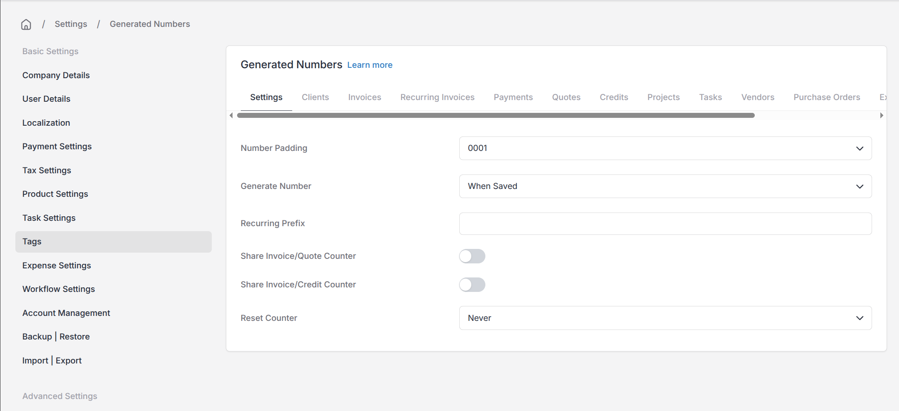
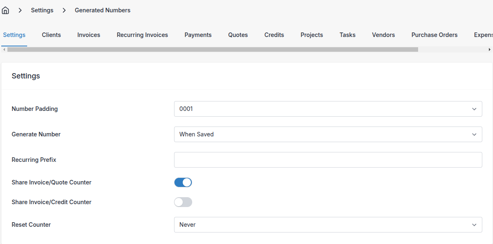
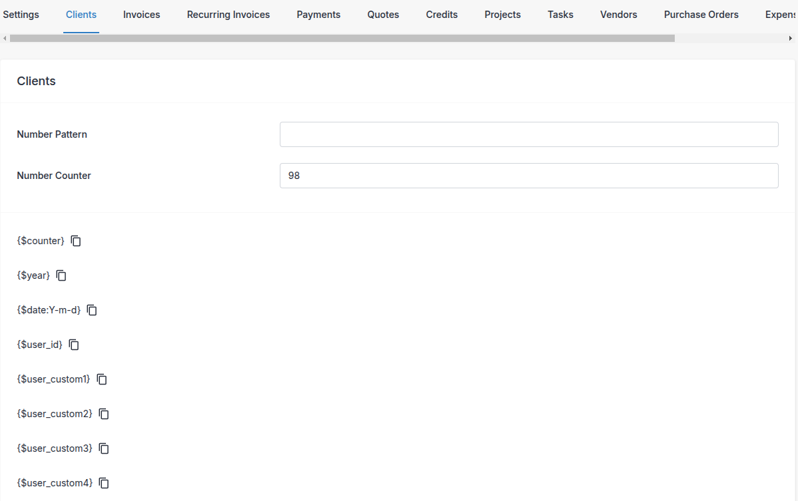

import VideoPlayer from "@site/src/components/VideoPlayer";

# Advanced Settings: customize designs, emails, numbering and your team

Advanced Settings is where Invoice Ninja becomes yours. Once [Basic Settings](/docs/user-guide/basic-settings) has your company, localization and defaults in place, this is the area you open when you want documents that look the part, numbering that matches your accountant's expectations, emails that read in your voice, and a client portal that feels like your own.

You do not need to touch every section below. Many people set up Invoice Design and Email Settings once and leave the rest at their defaults. Generated Numbers, Templates & Reminders and User Management become useful as you grow. If you have many clients, Group Settings and Payment Links can help you scale without duplicating work.

The Advanced Settings group in the left menu (it has a Pro badge) also includes [E-Invoicing](/docs/user-guide/einvoicing), [Credit Cards & Banks](/docs/user-guide/banking), Schedules, and System Logs. [Workflow Settings](/docs/user-guide/basic-settings#workflow_settings) appears under Basic Settings in the app.

## How do I change how invoices look? {#invoice_design}

Invoice Design controls how your invoices, quotes and credits look on the page: the template, the fonts, the colors, and which fields appear in each section. This is usually the first Advanced Settings page anyone opens, because getting your brand right on the first document sent to a client matters.

Go to **Settings > Invoice Design** (route `#/settings/invoice_design`). A live PDF preview sits on the right of the page. For deeper PDF work (custom HTML/CSS templates and variable placeholders), see [Custom Fields and PDF Customization](/docs/advanced-topics/custom-fields).

### General Settings

The **General Settings** tab includes these design and layout fields:

| Field | What it does |
|---|---|
| Invoice Design | Default design template for invoices. |
| Quote Design | Default design template for quotes. |
| Credit Design | Default design template for credits. |
| Purchase Order Design | Default design template for purchase orders. |
| Statement Design | Default design template for statements. |
| Delivery Note Design | Default design template for delivery notes. |
| Payment Receipt Design | Default design template for payment receipts. |
| Payment Refund Design | Default design template for payment refunds. |
| Page Layout | Portrait or landscape. |
| Page Size | Preformats the PDF for common printer sizes, such as A4. |
| Font Size | The base font size for the document. |
| Logo Size | The size of the logo on the document (for example as a percent). |
| Primary Font and Secondary Font | Fonts used for primary and secondary text. |
| Primary Color and Secondary Color | Accent colors used by the template. |
| Show Paid Stamp | Show a paid stamp on the document. |
| Show Shipping Address | Show the shipping address on the document. |
| Embed Images/Documents | "Include attached images/pdfs in the invoice." |
| Empty Columns | **Hide** or **Show** item-list columns that have no values. |
| Page Numbering | Show page numbers on the PDF. |

### Custom Designs

The **Custom Designs** tab has a **New Design** button and a list of saved designs (Name and Active). Use this when you want a design of your own, rather than one of the built-in templates.

### Which sections of the document can I customize?

The remaining tabs along the top correspond to a section of the generated document. Add or remove fields here to decide exactly what appears in that section. This is useful when your region requires specific data on an invoice (for example a VAT number or tax registration), or when you would rather hide fields that are not relevant to your business.

The tabs are **Client**, **Company**, **Company Address**, **Invoice**, **Quote**, **Credit**, **Vendor**, **Purchase Order**, **Invoice Product Columns**, **Quote Product Columns**, **Task Columns** and **Total Fields**.

Some of those tabs use a "Details" heading inside the page (for example **Client Details** and **Company Details**), with Fields and Variables. Invoice Product Columns includes Item, Description, Quantity, Unit Cost and Line Total, plus a **Share Invoice/Quote Columns** option. Total Fields includes Subtotal, Total Taxes, Total, Paid to Date and Balance Due.

## How do I add custom fields? {#custom_fields}

<VideoPlayer src="/assets/videos/advanced/custom_fields/custom_fields.mpd" isDash={true} id="custom-fields-video" />

Custom Fields let you add up to four extra fields to each record type, so Invoice Ninja can track the details your business actually needs. Fields can be shown on PDFs via placeholders (see [Clients](/docs/user-guide/clients#how-do-i-add-custom-fields-to-clients)) or kept internal. For using existing placeholders in a PDF design, see [PDF templates and custom field placeholders](/docs/advanced-topics/custom-fields).

Go to **Settings > Custom Fields** (route `#/settings/custom_fields/company`). To add extra invoice fields, open the **Invoices** tab, name a field to activate it, and choose its type. Leave the name empty and the field disappears from forms and records.

The entity tabs are **Company**, **Clients**, **Products**, **Invoices**, **Payments**, **Projects**, **Tasks**, **Vendors**, **Expenses** and **Users**.

Each tab has four slots. The placeholder is the entity name plus "Field" (for example Invoice Field). Each slot has a type dropdown. The types are **Single-line text**, **Multi-line text**, **Switch**, **Dropdown** and **Date**.

The **Invoices** tab also has four **Surcharge Field** inputs after those slots. Each surcharge has a **Charge taxes** toggle.

## How do generated numbers work? {#generated_numbers}

<div className="generated-number-guide">

Generated Numbers controls the identifiers assigned to new invoices, quotes, clients and other records. You can add a prefix, include the year, continue an existing sequence, or give groups and clients their own numbering rules.

Go to **Settings > Generated Numbers** (route `#/settings/generated_numbers`). The tabs are **Settings**, **Clients**, **Invoices**, **Recurring Invoices**, **Payments**, **Quotes**, **Credits**, **Projects**, **Tasks**, **Vendors**, **Purchase Orders**, **Expenses** and **Recurring Expenses**.

Start with the [quick setup](#set-up-your-first-number-pattern), choose a [ready-to-use pattern](#number-pattern-examples), or learn how to [override company settings for a group or client](#numbering-overrides).

### Set up your first number pattern

For invoice numbers such as `INV-2026-0001`:

1. Open **Settings > Generated Numbers > Settings** at the company level.



2. Set **Number Padding** to the width you want for the counter (leading zeros). Choose **When Saved** under **Generate Number** if you want invoices numbered as soon as you save them. The other option is **When Sent**.
3. Open the **Invoices** tab and enter this **Number Pattern**:

   ```text
   INV-{$year}-{$counter}
   ```


4. Set **Number Counter** to the next number you want to use. For a new sequence, use `1`. If your last invoice was `INV-2026-0150`, use `151`.
5. Click **Save**. The next invoice numbered in 2026 will be `INV-2026-0001`, or `INV-2026-0151` if you continued the existing sequence, provided that number is unused.

Type variables exactly as shown, including the braces and dollar sign. Text outside variables stays as you type it: `INV-` is a fixed prefix, while `{$year}` and `{$counter}` are replaced with values. These numbering variables have their own syntax. The [PDF custom-field list](/docs/advanced-topics/custom-fields#custom-fields) is a separate reference.

The Invoices tab lists a subset of variables with copy icons (`{$counter}`, `{$year}`, `{$date:Y-m-d}`, `{$user_id}`, and `{$user_custom1}` through `{$user_custom4}`), plus a **Click here to see all variables** link for the full list.

Changing a pattern affects newly generated numbers. It does not renumber existing records or replace a number you entered manually.

### Number pattern examples

These examples assume the next counter is **1**, padding is four digits, and the generation date is **16 November 2026** in the company timezone.

| Goal | Copy this number pattern | Example result | Additional setup |
|---|---|---|---|
| Simple sequence | `{$counter}` | `0001` | None. |
| Fixed prefix | `INV-{$counter}` | `INV-0001` | Use another prefix, such as `QUO-`, in the relevant record's tab. |
| Year in the number | `INV-{$year}-{$counter}` | `INV-2026-0001` | To restart annually, also configure **Reset Counter** and **Next Reset**. |
| Year and month | `INV-{$date:Y-m}-{$counter}` | `INV-2026-11-0001` | To restart monthly, also configure a monthly reset and **Next Reset**. |
| Separate sequence per client | `{$client_number}-INV-{$client_counter}` | `C001-INV-0001` | Use for invoices or other client-linked records. Give each client a unique client number, such as `C001`. |
| Separate sequence for a group | `GRP-{$year}-{$group_counter}` | `GRP-2026-0001` | Set this in that group's invoice settings, and assign clients to the group. Give other groups different prefixes. |

Adding a year or month changes the text in the number. It does **not** reset the counter by itself.

### Numbering settings



The **Settings** tab contains the shared numbering options. Each record type has its own tab for its pattern and next counter.

| Setting | How to use it |
|---|---|
| **Number Pattern** | The text and variables used to build a new number. An empty pattern uses the counter. Include a counter variable explicitly to control its position. |
| **Number Counter** | The next value to try, rather than the number of records you have. Use it to continue numbering after migrating from another system. |
| **Number Padding** | Minimum width of the counter, with leading zeros, so `1` can become `0001` or `00001`, depending on the width you choose. Longer numbers are not shortened. |
| **Generate Number** | **When Saved** or **When Sent**. With **When Sent**, a draft can remain unnumbered until sent or marked as sent. |
| **Recurring Prefix** | Extra text placed before the invoice pattern when a recurring invoice generates an invoice. For example, `R` plus `INV-{$counter}` produces `RINV-0001` if you type `R` with no hyphen, or `R-INV-0001` if the prefix is `R-`. |
| **Share Invoice/Quote Counter** | Quotes draw from the invoice counter, while retaining their quote pattern. |
| **Share Invoice/Credit Counter** | Credits draw from the invoice counter, while retaining their credit pattern. Enable both share-counter options to share a sequence across invoices, quotes and credits. |
| **Reset Counter** and **Next Reset** | Choose a frequency (for example Annually) and the next reset date. A due reset is applied when numbering is next generated. Use `{$year}` for annual resets, or `{$date:Y-m}` for monthly resets, to distinguish the new sequence from earlier periods. |

Automatic resets do not reset client numbers, vendor numbers, or the recurring invoice record counter. The **Recurring Invoices** tab controls the recurring record's own number. Invoices it generates use the **Invoices** pattern and counter, with **Recurring Prefix** added.



### Company, group, and client overrides {#numbering-overrides}

Company numbering is the default. A group can override it for its members, and a single client can override both. A client's own settings always win, a group's settings fill in the gaps, and company defaults apply last.

#### Set an override for a group

1. Open **Settings > Group Settings**, then open the group.
2. Click **Configure Settings**, then **Generated Numbers**.
3. Tick the override checkbox for the setting you want to change, then enter the pattern, counter or other value.
4. Click **Save**.

#### Set an override for one client

1. Open the client, then open the Generated Numbers section on that client.
2. Tick the override checkbox, then enter the pattern, counter or other value.
3. Click **Save**.

#### Choose whether the sequence is shared or separate

| Counter variable | Sequence used | Where to set its next counter |
|---|---|---|
| `{$counter}` | Company sequence for that record type, even inside a group or client pattern override. | Company **Generated Numbers**, in the relevant record's tab. |
| `{$group_counter}` | One sequence shared by clients in the same group. Use it with clients assigned to a group. | That group's **Configure Settings > Generated Numbers**, in the relevant tab. Enable **Number Counter** to set a starting value. |
| `{$client_counter}` | A separate sequence for each client. | That client's Generated Numbers settings, in the relevant tab. Enable **Number Counter** to set a starting value. |

For a group to start its own invoice sequence at `0001`, use `GRP-{$year}-{$group_counter}` and set the group's invoice **Number Counter** to `1`. For every client to have its own sequence, a group can instead supply `{$client_number}-INV-{$client_counter}`. Each member then gets its own counter. A new group or client counter starts at `1` unless already set.

Use one counter variable per pattern. Include a unique group prefix or client number, because invoice numbers must be unique across the company, including across clients and groups. If you want periodic resets for a separate sequence, configure **Reset Counter** and **Next Reset** at the same group or client level as that sequence.

Group and client numbering overrides apply to clients, invoices, recurring invoice records, quotes, credits, payments, and projects linked to a client. Vendors, tasks, expenses, recurring expenses, purchase orders, and projects without a client use company numbering settings and counters, even when a record has a client link.

### Available Variables {#available-variables}

Copy the full placeholder, including `{$` and `}`. The lists below include variables beyond those shown under each tab in the app. Use **Click here to see all variables** on the Generated Numbers page for the in-app list.

#### Counter and date variables

| Variable | Meaning | Example value |
|---|---|---|
| `{$counter}` | The counter selected for this pattern, with number padding applied. | `0001` |
| `{$client_counter}` | Select a separate client counter, as explained under [overrides](#numbering-overrides). | `0001` |
| `{$group_counter}` | Select the client's group counter, as explained under [overrides](#numbering-overrides). | `0001` |
| `{$year}` | Four-digit year when the number is generated, in the company timezone. | `2026` |
| `{$date:Y-m-d}` | Generation date in the company timezone, using the format after `date:`. | `2026-11-16` |

Counter selection by client or group applies only to the client-based record types listed above. For company-based records, use `{$counter}`.

You can customize the date format:

| Date placeholder | Example on 16 November 2026 |
|---|---|
| `{$date:Y}` | `2026` |
| `{$date:y}` | `26` (two-digit year) |
| `{$date:Y-m}` | `2026-11` |
| `{$date:Ym}` | `202611` |
| `{$date:Ymd}` | `20261116` |

Date variables use the time of number generation, even for a backdated invoice. A group or client's timezone override does not change these date values. Use one date-format placeholder per pattern: combine components as `{$date:Y-m}` rather than separate `{$date:Y}` and `{$date:m}` placeholders, as only the first distinct date format is expanded.

#### Client variables

These use the client being numbered or the client linked to the record. They are also available on tasks and expenses when a client is linked, even though those records use company counters.

| Variable | Meaning | Example value |
|---|---|---|
| `{$client_number}` | The client's **Number**, which must already exist if you use it in another record's pattern. Avoid using it to generate that same client's number. | `C001` |
| `{$client_id_number}` | The client's **ID Number**. Normally falls back to the client number if the ID Number is empty. | `REG-100` |
| `{$client_custom1}`, `{$client_custom2}`, `{$client_custom3}`, `{$client_custom4}` | The value in the corresponding client custom field, rather than its label. | `NORTH` |

For example, `{$client_custom1}-{$counter}` produces `NORTH-0001` when the client's first custom field contains `NORTH`. Set up the field under **Settings > Custom Fields > Clients**, then fill in its value on the client.

#### Vendor and expense variables

| Variable | Where it works | Meaning |
|---|---|---|
| `{$vendor_id_number}` | Vendor numbers; ordinary expenses with a linked vendor. | The vendor's **ID Number**. |
| `{$vendor_number}` | Ordinary expenses with a linked vendor. | The vendor's **Number**. |
| `{$vendor_custom1}`, `{$vendor_custom2}`, `{$vendor_custom3}`, `{$vendor_custom4}` | Ordinary expenses with a linked vendor. | The corresponding vendor custom-field value. |
| `{$expense_id_number}` | Ordinary expenses. | Normally empty on standard expense records. It does not insert the linked client or vendor's ID Number. Use `{$client_id_number}` or `{$vendor_id_number}` for those values. |

Vendor number and custom-field variables do not currently resolve in a vendor's own number pattern, purchase order patterns, or recurring expense patterns. Use `{$vendor_id_number}` for a vendor's own pattern. Purchase orders and recurring expenses can use the common counter, date and user variables.

#### User variables and older aliases

| Variable | Meaning | Example value |
|---|---|---|
| `{$user_id}` | Internal user ID, with a minimum of two digits. This is not a user name. | `03` |
| `{$user_custom1}`, `{$user_custom2}`, `{$user_custom3}`, `{$user_custom4}` | Value in the corresponding user custom field. An unset value becomes empty text. | `SALES` |

For normal client-based numbering, these user values come from the **client's creator**, who may differ from the person creating the invoice, quote, payment or project. For company-based numbering, they come from the record's creator. They do not refer to the assigned user or necessarily the person currently logged in.

Older supported spellings are `{$clientCounter}`, `{$userId}`, `{$clientCustom1}`, `{$clientCustom2}` and `{$clientIdNumber}`. Use the underscored spellings above for new patterns. Use `{$group_counter}` rather than `{$groupCounter}`, which is not replaced.

When a quote is converted using a shared invoice/quote counter, Invoice Ninja tries to reuse its counter value for the invoice. In this case, `{$client_id_number}` needs a filled-in client ID Number, and user custom-field placeholders can remain unresolved. Prefer counter and date patterns if you need consistent results through that conversion.

### Troubleshooting generated numbers

- **A variable appears literally in the number:** check its spelling, braces and applicability above. For example, the PDF variable `$client.number` is not the numbering variable `{$client_number}`. Variables that need a linked client or vendor can remain unresolved when that relationship is missing.
- **Part of the number is empty:** fill in the referenced custom field or ID Number. A field that exists but has no value can produce empty text. It does not automatically insert its label.
- **The prefix or padding is unexpected:** check the client's overrides, its group's overrides, and the active settings banner. For recurring-generated invoices, also check **Recurring Prefix**.
- **The date differs from the invoice date:** dates in number patterns reflect generation time in the company timezone. Check **Generate Number** if an invoice was saved in one period and numbered when sent in another.
- **The counter skips values or does not restart at 1:** the next number may already be in use. Invoice Ninja checks for existing numbers of the same record type across the company, including archived and deleted records, and advances to find an unused number. Repeated collisions can result in an extra suffix. Use distinct prefixes for separate sequences and matching date components for resets.
- **Changing a group or client counter has no effect:** check the pattern's counter variable. `{$counter}` still uses the company counter. A separate sequence needs `{$group_counter}` or `{$client_counter}`. Also check whether invoices, quotes or credits share their counter.

Before changing a live sequence, note its current pattern and next counter. Test the new format on the next intended record and check the saved number. Deleting a test record does not make its number available for reuse.

</div>

## How do I set up outgoing email? {#email_settings}

Email Settings shapes how every automated message leaves your system: the reply-to address, signature, attachments and send timing. A tidy reply-to and signature make client conversations much smoother, and decisions about PDF and UBL attachments can matter for compliance. For sending e-invoices in the correct format per jurisdiction, see [E-Invoicing](/docs/user-guide/einvoicing).

Go to **Settings > Email Settings** (route `#/settings/email_settings`).

| Field | What it does |
|---|---|
| **Show Email Footer** | A toggle at the top of Email Settings. |
| **Attach PDF** | Attach the PDF to the email. When this is off, emails include a portal link instead. |
| **Attach Documents** | Attach any files uploaded under the record's Documents tab. |
| **Attach UBL/E-Invoice** | Attach a UBL or e-invoice file. A "For more e-invoice settings please navigate here." link goes to the e-invoice settings. |
| **Email Provider** | The service used to send your mail. The available options differ between the hosted platform and self-hosted installs. |
| **From Name** | Sender name shown on outgoing mail. |
| **Reply-To Name** | Name shown in the reply-to header. |
| **Reply-To Email** | Address replies get routed to. |
| **BCC Email** | "Comma separated list" of addresses blind-copied on outgoing emails. Recipients cannot see these. |
| **Send Time** | The time of day at which scheduled emails send. |
| **Email Design** | Visual template used for emails. |
| **Email Signature** | Appended to every company email. This is a rich-text field. |

### Email Provider

The **Email Provider** dropdown controls where your mail is sent from. On the hosted app, the options are **Default (Postmark)**, **Mailgun (Hosted)**, **Amazon SES (Hosted)**, **Gmail (OAuth)**, **Microsoft (OAuth)**, **Postmark**, **Mailgun**, **Brevo** and **SMTP**.

Leave the current provider selected unless you intend to change how mail is sent. Do not enter credentials or click a test-email button unless you mean to send a test. For connecting Gmail or Microsoft, see [Hosted Mail](/docs/hosted/hosted-mail). To track delivery, bounces and spam complaints, see [Webhook configuration](/docs/hosted/hosted-mail#webhook-configuration-delivery--bounce-tracking) (hosted) or the [Mail Webhooks](/docs/self-host/self-host-installation#mail-webhooks-delivery-bounce--complaint-tracking) guide (self-hosted).

## How do I configure the client portal? {#client_portal}

Client Portal settings govern the self-service site your contacts log into to view invoices, pay, download receipts and approve quotes. Everything here is optional but high-impact. For the full tour of the portal itself, see [Client Portal](/docs/user-guide/client-portal).

Go to **Settings > Client Portal** (route `#/settings/client_portal`). The tabs are **Settings**, **Authorization**, **Registration**, **Messages** and **Customize**.

### Settings

| Setting | What it does |
|---|---|
| **Portal Mode** | "The subdomain is used in the client portal to personalize links to match your brand. ie, https://your-brand.invoicing.co." |
| **Subdomain** | The company subdomain used in portal URLs. |
| **Login URL** | The portal login address, shown for reference. |
| **Client Portal** | Master switch for the portal. Leave this on unless you mean to block portal access. |
| **Client Document Upload** | "Enable clients to upload documents." |
| **Vendor Document Upload** | "Enable vendors to upload documents." |
| **Accept Purchase Order Number** | "Enable clients to provide a PO number when approving a quote." |
| **Display HTML Version When Viewing On Mobile** | "For improved visualization, displays a HTML version of the invoice/quote when viewing on mobile." |
| **Use Item Notes for HTML View** | "Preference the item Description over the item title if displaying the invoice in HTML." |
| **Dashboard** | "Show/hide the dashboard page in the client portal." |
| **Allow Clients To Update Their Profile** | "Allow clients to update their profile information from the client portal." |
| **Terms of Service** | Multi-line text shown as a linked footer on portal pages. |
| **Privacy Policy** | The same idea, sitting beside Terms of Service. |

Client registration is not on this tab. It has its own **Registration** tab.

### Authorization

Features that add accountability around payments and approvals.

| Setting | What it does |
|---|---|
| **Password Protect Invoices** | "Allows you to set a password for each contact. If a password is set, the contact will be required to enter a password before viewing invoices." |
| **Invoice Terms Checkbox** | "Require client to confirm that they accept the invoice terms." |
| **Quote Terms Checkbox** | "Require client to confirm that they accept the quote terms." |
| **Invoice Signature** | "Require client to provide their signature." |
| **Quote Signature** | "Require client to provide their signature." |
| **Purchase Order Signature** | "Require vendor to provide their signature." |
| **Show on PDF** | "Show the client signature on the invoice/quote PDF." |

These signature options are drawn signatures the client or vendor adds in the portal before paying, approving or accepting.

<VideoPlayer src="/assets/videos/advanced/signatures/signatures.mpd" isDash={true} id="signatures-video" />

### Registration

**Registration** includes a **Client Registration** toggle ("Enable clients to self register in the portal"), a **Registration URL** (in the form `/client/register?company_key=...`), and per-field controls. Fields can be set to **Required** or **Hidden**. The field list includes First Name, Last Name, Email, Phone, Password, Name, Website, Street, Apt/Suite, City, State/Province, Postal Code, Country, Currency, First Custom, Second Custom, Third Custom, Fourth Custom, Public Notes and VAT Number.

### Messages

Greetings and notices shown at key pages in the portal: **Dashboard**, **Unpaid Invoice**, **Paid Invoice** and **Unapproved Quote**.

### Customize

On the hosted app, **Customize** has **Header** and **Footer** only. There is no Custom CSS box and no Custom JavaScript box on hosted.

Custom CSS for portal colors and styles is available on self-hosted installations. For setup instructions, supported CSS variables and selectors, and examples, see [Client Portal customization](/docs/user-guide/client-portal#customization).

## How do I edit email templates and payment reminders? {#templates_and_reminders}

Templates & Reminders is where you fine-tune the subject line and body of every system-sent email: invoices, quotes, payments, and the reminder tiers for overdue work. This is the main tool for staying on top of late payers without chasing invoices by hand.

Go to **Settings > Templates & Reminders** (route `#/settings/templates_and_reminders`). The top-level tabs are **Invoice**, **Quote**, **Credit**, **Purchase Order**, **Payment**, **Statement**, **Reminders** and **Custom**.

Each template has a **Subject** and a **Body** (a rich-text editor). A **Variables** card lists merge tags in groups such as Invoice, Client, Contact and Company (for example `$amount`, `$balance`, `$client.name`, `$contact.email` and `$company.name`). A preview card below shows the rendered subject and body.

The default Invoice subject is `New Invoice $number $balance`.

### How do I configure payment reminders and late fees? {#reminder-templates}

Open the **Reminders** tab. The sub-buttons are **First Reminder**, **Second Reminder**, **Third Reminder**, **Endless Reminder** and **First Quote Reminder**.

The late-fee settings apply to overdue invoices. They are separate from [gateway processing fees](/docs/user-guide/gateways#limitsfees).

**First**, **Second** and **Third Reminder**, and **First Quote Reminder**, use these fields:

| Setting | What it does |
|---|---|
| **Days** | Integer number of days offset from the invoice date or due date. |
| **Schedule** | When the offset is measured from: **Disabled**, **After the invoice date**, **Before the due date**, or **After the due date**. |
| **Send Email** | Toggle automatic sending on or off. |
| **Late Fee Amount** | A flat amount added to the balance. |
| **Late Fee Percent** | A percentage of the remaining balance added. |

Do not turn **Send Email** on for reminders unless you intend invoices in this company to start receiving reminder emails.

**Endless Reminder** has **Send Email** and **Frequency**. The frequency options are Daily, Weekly, Two weeks, Four weeks, Monthly, Two months, Three months, Four months, Six months, Annually, Two years and Three Years.

## How do group settings work? {#group_settings}

Group Settings lets you bundle clients together and override company defaults for just that bundle. It is useful when some clients need a different invoice design, when you serve clients in two countries who each need a local currency and language, or when a subset of clients have custom payment terms.

Groups sit between company-wide defaults and per-client overrides. A client's own settings always win, a group's settings fill in the gaps, and company defaults apply last.

Go to **Settings > Group Settings** (route `#/settings/group_settings`). The list has **Filter**, **Lifecycle**, **New Group**, and columns for Status, Name and Actions.

**New Group** opens an unsaved form (`#/settings/group_settings/create`) with a **Name** field. Name the group, save it, then open it.

An existing group opens as **Edit Group**, with tabs **Overview**, **Clients** and **Documents**. Overview has the group **Name** and a **Configure Settings** button. The Clients tab lists the group's clients, with **New Client**, Filter and Lifecycle. The Documents tab is for file uploads (**Drop files or click to upload**).

To move a client out of a group, edit the client and change or clear the group field.

### Configure Settings

**Configure Settings** opens the settings screens in group mode. A banner at the top of the left menu shows the group name, with an X to exit. Fields show an override checkbox beside each label. Tick the checkbox to set that value for group members. Leave it clear to inherit the company setting. A client's own override takes precedence over its group's setting.

The override areas listed in group mode are:

- Basic Settings: **Company Details**, **Localization**, **Payment Settings**, **Tax Settings**, **Task Settings** and **Workflow Settings**.
- Advanced Settings: **Invoice Design**, **Generated Numbers**, **Client Portal**, **Email Settings** and **Templates & Reminders**.

There is no Payment Links area in group Configure Settings. For group and client numbering overrides, see [Company, group, and client overrides](#numbering-overrides).

## How do payment links work? {#payment_links}

Payment Links are shareable checkout URLs. A single link can let a client pay a one-off amount, start a recurring plan, or buy a product. For the full guide, including the checkout page and lifecycle, see [Payment Links](/docs/user-guide/subscriptions). For the gateways that take the money, see [Payment Gateways](/docs/user-guide/gateways).

Payment Links live under **Settings > Payment Links** (route `#/settings/subscriptions`). The create button is **New Payment Link**. List columns include Name, Price, **Purchase Page** (a link plus a copy icon) and Actions. Filters are **Filter** and **Lifecycle** (Active, Archived, Deleted).

The edit tabs are **Overview**, **Settings**, **Webhook** and **Steps**.

### Overview

| Field | What it does |
|---|---|
| **Name** | Shown to clients on the checkout page. Required. |
| **Group** | Assign the link to a group to make it visible only to that group's members. |
| **Assigned User** | The teammate responsible for the link. |
| **Products** | One-time purchases bundled with the sign-up. |
| **Recurring Products** | Products that bill on the recurring schedule. |
| **Optional Products** and **Optional Recurring Products** | Extra items the client can add at checkout. |
| **Purchase Page** | The public checkout URL, with a copy icon, shown after the link is saved. |

The public URL pattern is `https://<your-subdomain>.invoicing.co/client/subscriptions/<id>/purchase`.

### Settings

| Field | What it does |
|---|---|
| **Frequency** | How often clients are charged. |
| **Remaining Cycles** | How many billing cycles remain. |
| **Auto Bill** | Whether payment is attempted automatically if a method is on file. |
| **Promo code** and **Promo Discount** | An optional code and a discount (percent or amount). |
| **Registration Required** | "Require clients to register." |
| **Use Inventory Management** | "Require products to be in stock." |
| **Return URL** | Where the client is sent once sign-up is complete. |
| **Allow Query Overrides** | Let API callers append parameters to the checkout URL. |
| **Allow Plan Changes** | Let subscribed clients switch between plans. |
| **Allow Cancellation** | Let clients cancel from the portal. |
| **Trial Enabled** | Enable a trial on the link. |
| **Per Seat Enabled** | Enable per-seat sign-ups. |

### Webhook

The Webhook tab has a **Webhook URL**, a **REST Method**, and **Add Header** (Header Key and Header Value). It does not list per-event endpoints.

### Steps

The **Steps** tab has **Authentication**, **Other steps**, and **Order**, with this help text: "The order of the steps is important. The first step should not depend on any other step. The second step should depend on the first step, and so on." The steps shown were Cart and Login or Register.

## Where is Workflow Settings? {#workflow_settings}

**Workflow Settings** is listed under Basic Settings in the app, after Expense Settings (route `#/settings/workflow_settings`). The tabs are **Invoices** and **Quotes**, with Auto Email, Stop On Unpaid, Auto Archive, invoice locking, Auto Convert and related options.

See [Workflow Settings](/docs/user-guide/basic-settings#workflow_settings) for the full field list and help text.

## How do I add teammates and set their permissions? {#user_management}

User Management is where you add teammates, decide what they can see, and control the notifications they receive. Users each have their own login and permission set, so you can give a bookkeeper access to payments and reports without letting them edit clients.

Go to **Settings > User Management** (route `#/settings/users`). The list has **Filter**, **Lifecycle**, **New User**, and columns for name and email. Click a name to open the user. Do not click **New User** unless you intend to invite someone.

The edit page is **Edit User**, with tabs **Details**, **Notifications** and **Permissions**.

### Details

| Field | What it is for |
|---|---|
| **First Name** | The user's first name. |
| **Last Name** | The user's last name. |
| **Email** | Login address. |
| **Phone** | Optional reference field. |
| **Login Notification** | "Sends an email notifying that a login has taken place." |

### Notifications

Each event has an Email dropdown. The options are **All records**, **Owned by user** and **None**. An **All Events** row can set every event at once.

The event list includes Invoice Created, Invoice Sent, Invoice Viewed, Invoice Late, Inventory Threshold, Payment Success, Payment Failure, Payment Manual, Purchase Order Created, Purchase Order Sent, Purchase Order Viewed, Purchase Order Accepted, Quote Created, Quote Sent, Quote Viewed, Quote Approved, Quote Expired, Quote Rejected, Credit Created, Credit Sent and Credit Viewed.

### Permissions

These toggles sit above the permission grid:

| Setting | What it does |
|---|---|
| **Administrator** | "Allow user to manage users, change settings and modify all records." |
| **View Dashboard** | Access to the dashboard. |
| **Reports** | "Allow user to access the reports, data is limited to available permissions." |
| **Disable Emails** | "Prevents a user from sending emails from the system." |

When Administrator is off, a grid is shown. The columns are **Create**, **View** and **Edit**. The rows are All, Client, Product, Invoice, Payment, Recurring Invoice, Quote, Credit, Project, Task, Vendor, Expense, Transaction, Purchase Order and Recurring Expense.

### Archive, delete, remove or purge a user

The **Actions** menu on the edit page has **Resend Email**, **Remove**, **Archive**, **Delete** and **Purge**.

**Archive** or **Delete** makes the user inactive, but their data is preserved and can be restored later. **Remove** takes away the user's access to this company, while leaving their data assigned to them. **Purge** is a stronger removal. **Resend Email** sends the confirmation or invitation email again.

Do not use Remove, Archive, Delete or Purge unless you intend to change that user's access.

## Related

- [Basic Settings](/docs/user-guide/basic-settings)
- [Payment Gateways](/docs/user-guide/gateways)
- [Payment Links](/docs/user-guide/subscriptions)
- [Client Portal](/docs/user-guide/client-portal)
- [Custom Fields and PDF Customization](/docs/advanced-topics/custom-fields)
- [E-Invoicing](/docs/user-guide/einvoicing)
- [Banking](/docs/user-guide/banking)
- [Hosted Mail](/docs/hosted/hosted-mail)
