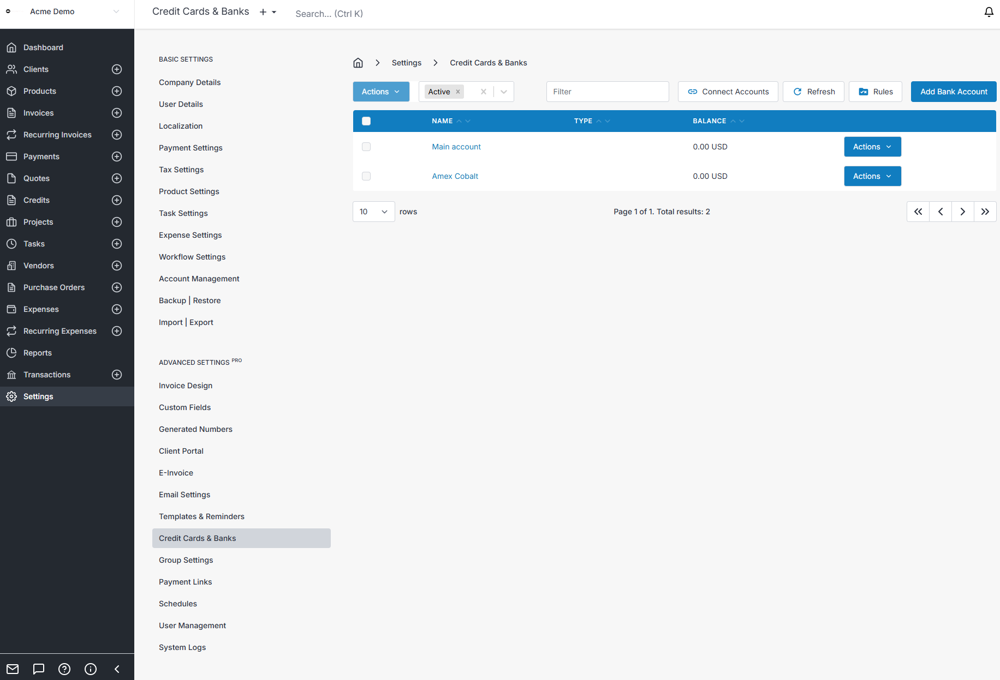
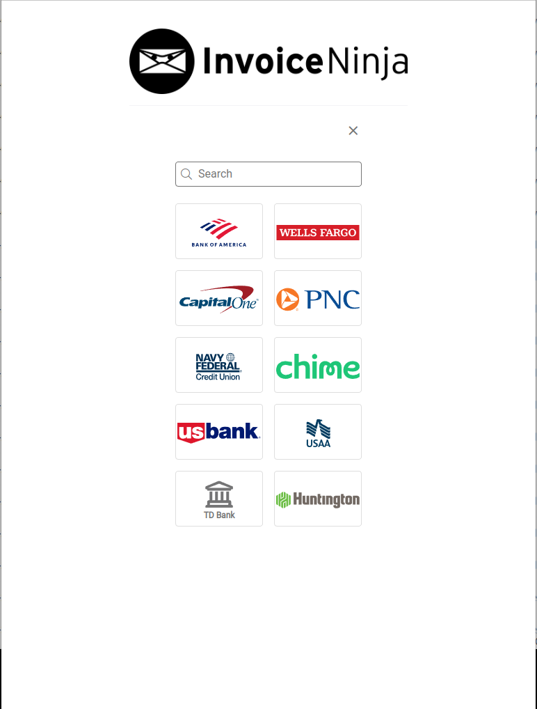
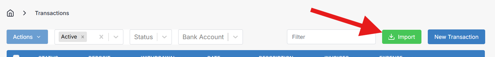
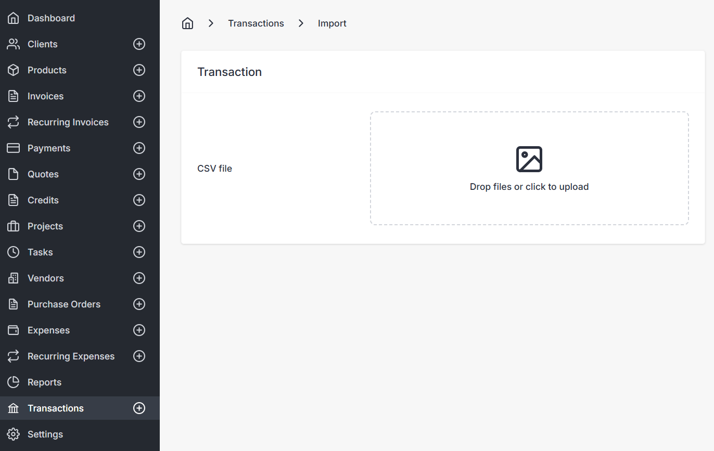
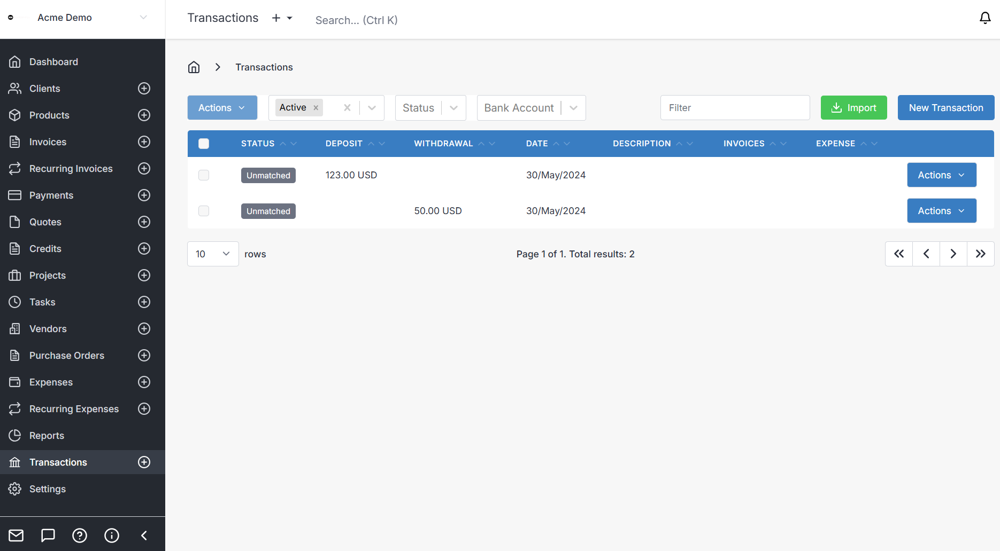
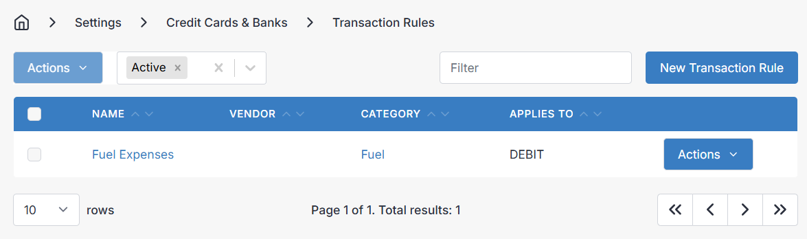
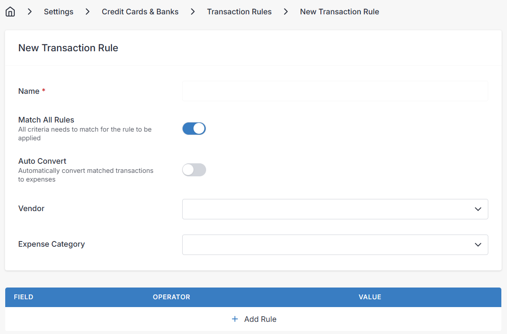
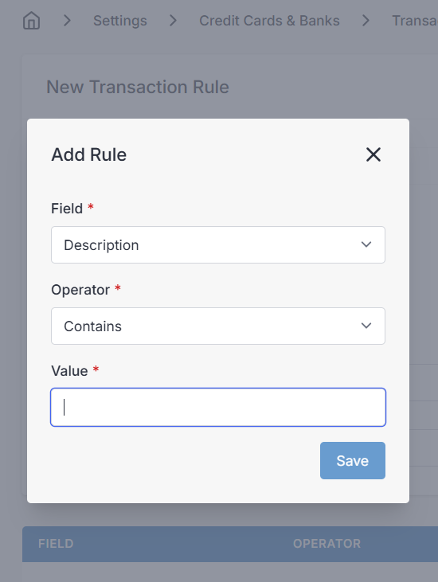

import VideoPlayer from "@site/src/components/VideoPlayer";

# Banking: connect your bank and match transactions automatically

Invoice Ninja's banking integration pulls your bank transactions into Invoice Ninja so you can match money coming in to invoices and categorise money going out as expenses, without retyping each line. You connect an account (or upload a CSV), your transactions appear in the **Transactions** list, and rules can do most of the matching work for you.

## How does banking work?

Every bank transaction in Invoice Ninja goes through the same three-step lifecycle.

1. **Imported:** a transaction arrives through a connected bank, a CSV you upload, or a line you enter by hand. It starts with a status of **Unmatched**.
2. **Matched:** the transaction is linked to something in your account, such as an invoice, a payment, or a vendor and expense category.
3. **Converted:** a real financial record has been created from the transaction: a **Payment** or an **Expense**, depending on the direction.

You do not have to use rules. Rules are a way to skip the manual step when the same pattern comes up repeatedly.

### What do the transaction statuses mean?

The **Transactions** list can filter by these statuses (and also by Deposits or Withdrawals):

| Status | What it means |
|---|---|
| **Unmatched** | Nothing has been linked to this transaction yet. |
| **Matched** | A match has been suggested or linked, but a payment or expense may not have been created yet. |
| **Converted** | A payment or expense record has been created from this transaction. A link to that record appears in the list. |

## How do I connect a bank account?

Go to **Settings > Credit Cards & Banks** (under Advanced Settings). The page lists any accounts already added, with Name, Type and Balance. The toolbar has **Connect Accounts**, **Refresh**, **Rules** and **Add Bank Account**.

To link a live bank, click **Connect Accounts**. Invoice Ninja can connect through bank-data providers: Yodlee is used for many US banks on the hosted Enterprise plan, and GoCardless for many banks in the EU and UK. The exact provider screen opens from **Connect Accounts**.

<VideoPlayer src="/assets/videos/banking/banking.mpd" isDash={true} id="banking-video" />

**Add Bank Account** is also on this page, for adding an account without starting **Connect Accounts**. Each row has an **Actions** menu with **Edit**, **Archive** and **Delete**.

**Refresh** is on the same toolbar, for updating transactions from a connected bank.

### How do I import a CSV instead?

If your bank is not supported, or you prefer not to link a live account, you can import transactions from a CSV file exported by your bank.

1. Add a bank account under **Settings > Credit Cards & Banks** if you do not already have one, so the transactions have somewhere to land.
2. Go to **Transactions** and click **Import**.
3. Upload the CSV. Invoice Ninja shows a mapping table so you can match each file column to a transaction field (for example Transaction - Date, Transaction - Description and Transaction - Amount).
4. Choose a **Bank Account**, then click **Import**.

## Where do I work with the imported transactions?

Once transactions are in the system, they appear under **Transactions** in the left menu.

From here you can filter the list, add a transaction by hand, import a CSV, open **Rules**, convert withdrawals to expenses, or create an invoice from a deposit. For the day-to-day steps, see [Transactions](/docs/user-guide/transactions).

## How do bank rules work? {#bank-rules}

Bank rules automate matching so you do not have to process each transaction by hand. There are two kinds, set with **Applies To**:

| | Credit rules (money in) | Debit rules (money out) |
|---|---|---|
| **Applies To** | **Credit** | **Debit** |
| **Purpose** | Link or create a payment from a deposit | Convert a withdrawal to an expense |
| **Value** | A list of invoice, payment or client fields | Free text (when the field is a description) |
| **Vendor and category** | Not shown | Optional **Vendor** and **Expense Category** |
| **Auto Convert** | "Automatically link or create a payment matching these rules." | "Automatically convert matched transactions to expenses." |

### How do I create a rule?

1. Go to **Settings > Credit Cards & Banks** and click **Rules**, or click **Rules** on the Transactions list. The page title is **Transaction Rules**.
2. Click **New Transaction Rule**.
3. Enter a **Name**, and set **Applies To** to **Credit** or **Debit**.
4. Leave **Auto Convert** off until you have tested the rule.
5. Click **Add Rule** to add a condition, then save.

Every rule has these settings:

| Setting | What it is for |
|---|---|
| **Name** | A label for your own reference (required). |
| **Applies To** | **Debit** (money out) or **Credit** (money in). The default is Debit. |
| **Match All Rules** | When this is on, every condition must be true. The help text is "All criteria needs to match for the rule to be applied." |
| **Auto Convert** | When on, Invoice Ninja creates or links the payment (credit) or creates the expense (debit) automatically. Leave this off until you are confident in the matches. |
| **Vendor** and **Expense Category** | Debit rules only. Both are optional. |
| Conditions | One or more rules in a Field / Operator / Value table. |

The Transaction Rules list columns are Name, Vendor, Category and Applies To. Each row has **Edit**, **Archive** and **Delete**. The list also has a **Filter** box and a **Lifecycle** filter.

### What does a condition look like?

Click **Add Rule**. Each condition has three parts:

| Part | What it is |
|---|---|
| **Field** | What the rule looks at: **Description**, **Amount**, **Participant** or **Participant name**. These four fields are available on both credit and debit rules. |
| **Operator** | How it compares. |
| **Value** | What it compares against. On a credit rule this is a list of invoice, payment or client fields. On a debit rule it is a text box (for description fields). |

Text operators (for Description, Participant and Participant name):

| Operator | What it does |
|---|---|
| **Contains** | The field includes the value. |
| **Starts with** | The field begins with the value. |
| **Is** | An exact match. |
| **Is empty** | The field has no value. |

Amount operators: `<`, `<=`, `=`, `>`, `>=`.

### How do money-in (credit) rules work?

Set **Applies To** to **Credit**. Vendor and Expense Category are hidden.

When the Field is **Description**, **Value** is a list you pick from:

| Value | What it compares to |
|---|---|
| **Invoice Number** | An invoice number |
| **PO Number** | A purchase order number on an invoice |
| **Invoice Amount** | An invoice amount |
| **Payment Amount** | A payment amount |
| **Transaction Reference** | A payment reference |
| **ID Number** | A client ID number |
| **Client Email** | A client email address |

For example, a condition of Description / Contains / Invoice Number looks for an invoice number in the bank description. Leave **Auto Convert** off at first, review the results, then turn it on if the matches are correct.

### How do money-out (debit) rules work?

Set **Applies To** to **Debit**. You can optionally pick a **Vendor** and an **Expense Category**. The Value for a description condition is free text, so you can match words that appear on your bank statement, for example `RENT` or `HOSTING`.

**Auto Convert**, when on, creates an expense from the matched withdrawal, using the vendor and category if you set them.

### What happens when a rule matches?

The transaction moves on from **Unmatched**. If **Auto Convert** is on, Invoice Ninja creates or links the related payment (credit) or creates the expense (debit), and the transaction can show as **Converted**.

:::warning
**Auto Convert** creates real financial records. Test your rules with it off first, then turn it on once you are confident.
:::

## Common questions

### I already use a payment gateway. Do I still need to connect my bank?

Not for getting paid. When a client pays an invoice through a connected [payment gateway](/docs/user-guide/gateways), Invoice Ninja records the payment and marks the invoice as paid directly.

Connecting your bank is about **reconciliation**: matching the deposit that hits your actual bank account a few days later to the payment already recorded in Invoice Ninja, so your bookkeeping lines up. This is also where rules become useful, since a single gateway payout often bundles many client payments into one bank deposit.

### Can I connect more than one account from the same bank?

You can add more than one bank account in **Settings > Credit Cards & Banks**. When you use **Connect Accounts**, you can typically select the accounts your bank offers during that flow.

### Can I match a transaction by hand, without a rule?

Yes. On the [Transactions](/docs/user-guide/transactions) list you can convert a withdrawal with **Actions > Create Expense**, or use **Create Invoice** on a deposit. See that page for the exact buttons.

### I imported transactions by mistake. How do I remove them?

Delete them from the Transactions list. If a payment or expense was already created, that record stays until you remove it separately. You can also use **Unlink** on a converted transaction to disconnect it from the related record.

## Tips for reliable rules

- **Start without Auto Convert.** Save the rule, see how it behaves, then turn Auto Convert on once you are confident.
- **Be specific.** A debit rule that matches a distinctive word in the description is easier to trust than a very broad rule.
- **Use credit Value fields that uniquely identify the payment**, such as Invoice Number, when your bank description includes that information.
- **Give each rule a clear name** so you can find it again on the Transaction Rules list.

## Related

- [Transactions](/docs/user-guide/transactions): match, convert, import and delete bank lines
- [Payments](/docs/user-guide/payments): payment records
- [Expenses](/docs/user-guide/expenses): expense records created from withdrawals
- [Payment Gateways](/docs/user-guide/gateways): how clients pay you online, which is separate from bank reconciliation
