import VideoPlayer from "@site/src/components/VideoPlayer";

# Client Portal: let clients view, pay and manage their account

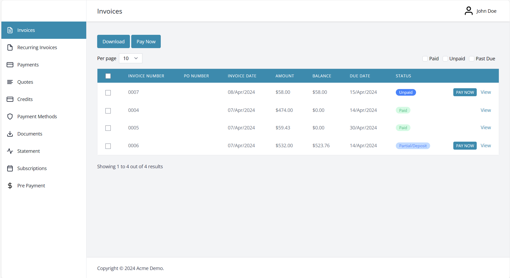

The Client Portal is the customer-facing side of Invoice Ninja: a branded, self-serve dashboard where the people you invoice can view their documents, pay online, download statements, manage saved cards and keep their own contact details up to date. Every time you email an invoice or quote, the link in that email opens the portal, so most clients end up there without being told it exists.

The portal follows the client's language.

## How do contacts sign in?

The portal is tied to [contacts](/docs/user-guide/clients#contacts), not to the client as a whole. Each contact on a client record gets their own login, which is why a client with separate Accounts Payable and Operations contacts can have both people using the portal independently.

The usual way to open a contact's portal from the admin app is the **Client Portal** link (with a copy icon) on the contact card. A saved invoice also has **View in Portal**.

The portal uses your company subdomain. The login page is:

`https://<your-subdomain>.invoicing.co/client/login`

Logins are enabled out of the box. You can also let anyone register themselves as a new client under **Settings > Client Portal > Registration**. **Client Registration** has the help text "Enable clients to self register in the portal." That tab also shows a **Registration URL** (`/client/register?company_key=...`) and lets you mark each sign-up field as Required or Hidden.

## How do I change Client Portal settings?

Go to **Settings > Client Portal**. The tabs are **Settings**, **Authorization**, **Registration**, **Messages** and **Customize**.

The **Settings** tab includes Portal Mode (for example Subdomain), your subdomain, the login URL, a **Client Portal** on/off toggle, Client Document Upload, Vendor Document Upload, Accept Purchase Order Number, mobile HTML view options, Dashboard, Allow Clients To Update Their Profile, Terms of Service and Privacy Policy.

**Authorization** includes Password Protect Invoices, Invoice Terms Checkbox, Quote Terms Checkbox, Invoice Signature, Quote Signature, Purchase Order Signature and Show on PDF.

**Messages** has text you can show on the dashboard, on unpaid and paid invoices, and on an unapproved quote.

**Customize** is covered in [How do I customize the client portal?](#customization).

The portal mirrors your Invoice Ninja configuration. Only the modules you have enabled appear to clients. Besides invoices, quotes and payments, the portal can also show [tasks](/docs/user-guide/tasks) and [projects](/docs/user-guide/projects).

## Which tabs do clients see?

The portal navigation can include Overview, Invoices, Recurring Invoices, Payments, Quotes, Credits, Payment Methods, Documents, Tasks, Projects, Statement and Subscriptions. The footer can include your Privacy Policy and Terms.

### Invoices

The Invoices tab lists invoices the client can act on or review. It is almost always the first place a client lands after clicking through from an email.

Draft invoices are left out on purpose. An invoice only becomes visible in the portal once it has left draft status, which happens when you take one of the following actions from the arrow next to **Save** on the invoice:

- **Email Invoice**: sends the invoice and marks it as sent in the same step.
- **Mark Sent**: changes the status to sent without emailing, so the invoice appears in the portal as unpaid.
- **Mark Paid**: marks the invoice as paid and files it in the client's portal history.

On the Invoices tab, clients can filter by Paid, Unpaid and Overdue. Columns include Invoice Number, PO Number, Invoice Date, Amount, Balance, Due Date and Status. For an unpaid invoice, the row actions are **View** and **Pay Now**. There are also **Download** and **Pay Now** buttons at the top of the list.

If a client cannot see an invoice, the usual cause is that the record is still a draft. See [Invoices](/docs/user-guide/invoices) for the full invoice lifecycle.

### Recurring Invoices

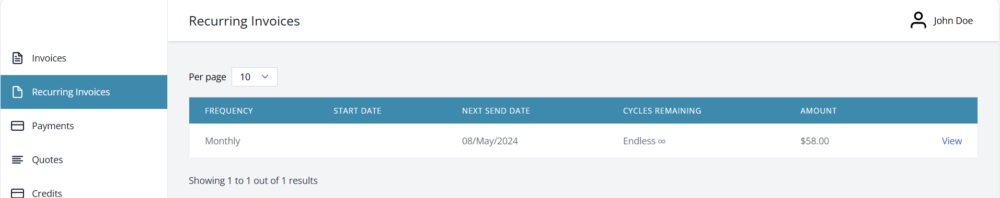

The Recurring Invoices tab shows the client any active schedule you have set up for them. Columns include Frequency, Start Date, Next Send Date, Remaining Cycles and Amount. See [Recurring Invoices](/docs/user-guide/recurring-invoices) for how to set one up.

### Payments

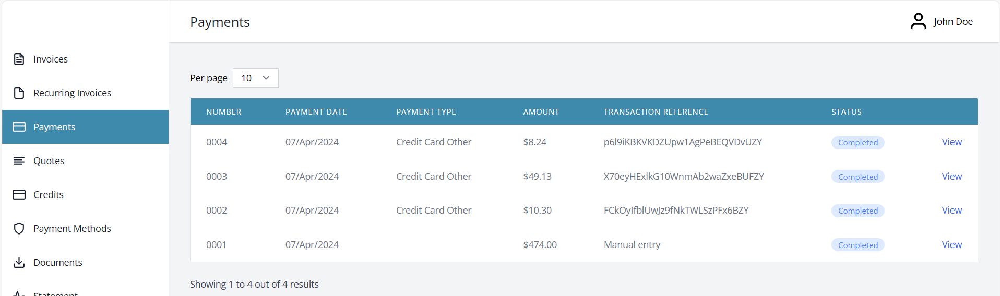

Payments shows the client's payment history. Columns include Number, Payment Date, Payment Type, Amount, Transaction Reference and Status.

### Quotes

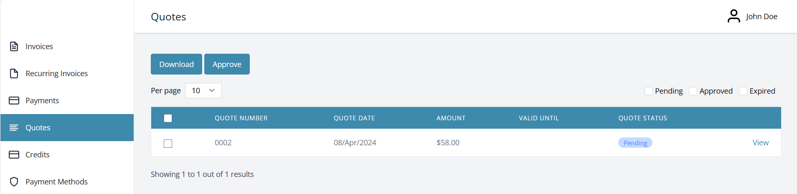

Clients use the Quotes tab to review anything you have proposed. They can **Download** a quote, **Approve** it or **Reject** it. Filters include Pending, Confirmed, Expired, Rejected and Cancelled. Columns include Quote Number, Quote Date, Amount, Valid Until and Quote Status.

Once a quote is approved, Invoice Ninja can convert it to an invoice and take the client on to payment. For the other side of this flow, see [Quotes](/docs/user-guide/quotes).

### Credits

The Credits tab shows any credits sitting on the client's account, typically from a refunded invoice or a goodwill adjustment. Columns include Credit Number, Amount, Balance, Credit Date and Notes. See [Credits](/docs/user-guide/credits) for how credits are issued and applied.

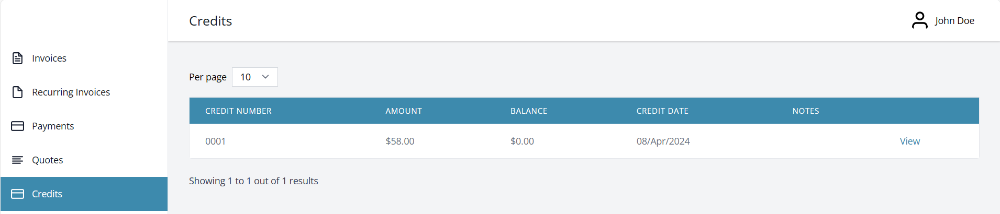

### Payment Methods

The Payment Methods tab is where clients review the cards and bank accounts they have saved for faster checkout, and where they can add new ones. The button is **Add Payment Method**. Saving a payment method is only possible when the underlying gateway supports it. See [Payment Gateways](/docs/user-guide/gateways) for gateway capabilities.

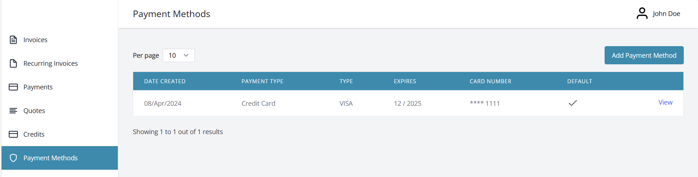

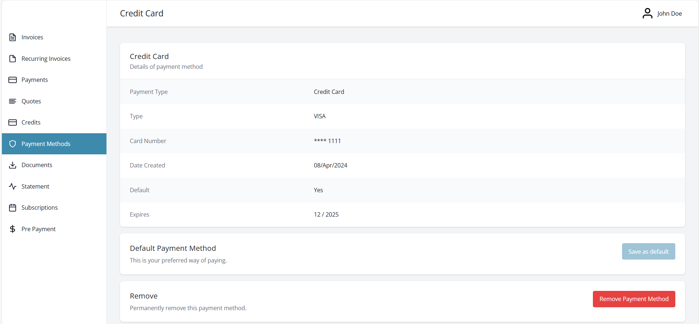

Columns include Created, Payment Type, Type, Expires, Card Number and Default.

#### How are credit card details stored?

Card numbers are never stored by Invoice Ninja. The details are captured directly by the payment gateway, which returns a token that Invoice Ninja uses to charge the card later. This is what keeps your setup out of PCI scope. For a fuller explanation of how tokenisation works, see [Stripe's overview](https://stripe.com/resources/more/payment-tokenization-101).

#### How can I enter a credit card on file for my client manually?

If a client has given you card details over the phone or in person and you would like to save them for future charges, open the **Client Portal** link on that contact and go to **Payment Methods > Add Payment Method**. The card is captured by the gateway in exactly the same way as if the client had entered it themselves.

### Documents

The Documents tab is where clients see files you have shared with them, typically contracts, statements of work, or supporting documents attached to an invoice or quote.

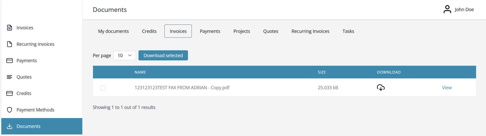

When you upload a file on an invoice's **Documents** tab, it is visible to the client by default (an unlocked padlock icon). To hide it, open that document's **Actions** menu and choose **Set private**. The menu also includes **View**, **Download** and **Delete**.

A document on a draft invoice does not appear in the portal until the invoice is marked sent or otherwise leaves draft. In the portal Documents tab, invoice files can appear after the client chooses the **Invoices** type filter. Other filters include Credits, Payments, Projects, Quotes, Recurring Invoices and Tasks. Clients can also download selected files.

### Statement

Statements let the client generate a PDF summary of their invoices and payments for a date range they choose.

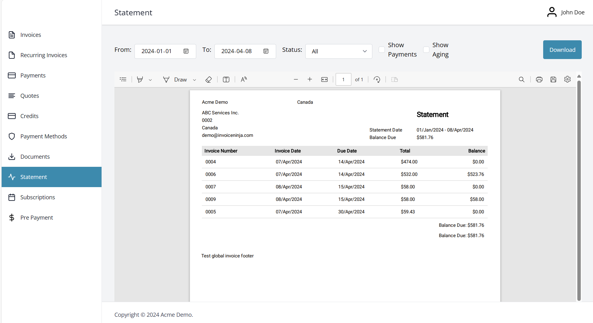

The form includes **From**, **To**, Status (All, Paid or Unpaid), **Show Payments**, **Show Aging** and **Download**.

### Subscriptions

If the client signed up through a [Payment Link](/docs/user-guide/subscriptions), the Subscriptions tab is where that subscription appears. Columns include Status, Subscription, Frequency, Amount, Auto Bill and Next Send Date. Whether the client can cancel or change plans depends on **Allow Cancellation** and **Allow Plan Changes** on the Payment Link.

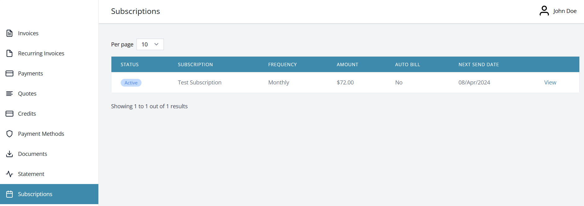

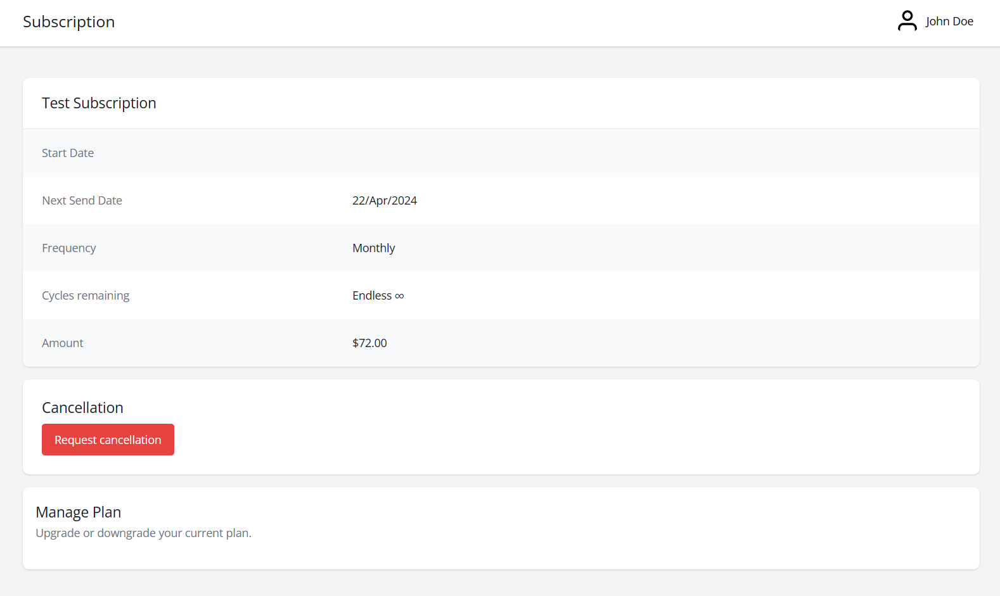

### Can a client pay me without an invoice?

Yes, if you turn on **Client Initiated Payments** under **Settings > Payment Settings**. The help text is "Support making a payment in the client portal without an invoice."

While this setting is off, the portal has no pre-payment item. There is no **Minimum Payment Amount** label on Payment Settings. **Minimum Under Payment Amount** is a different setting, used with **Allow Underpayment** when a client pays less than the invoice total.

A payment made without an invoice lands in your [Payments](/docs/user-guide/payments) list as an unapplied payment: money received but not yet matched to an invoice. When you are ready to use it, open the payment and choose **Apply Payment** from the row **Actions** menu, then pick the invoice or invoices to apply it against.

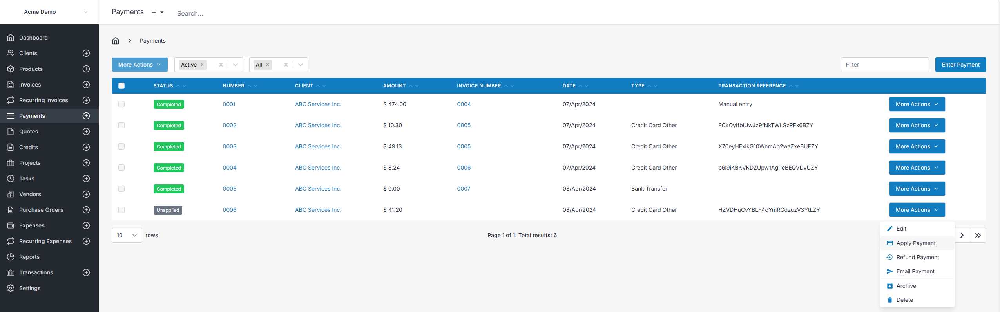


## How do I customize the client portal? {#customization}

On Invoice Ninja's hosted service, **Settings > Client Portal > Customize** has **Header** and **Footer** fields only. There is no Custom CSS box on the hosted app.

On a **self-hosted** installation, you can change the client portal's colors and selected styles by pasting CSS into the Custom CSS setting. Start with the example below, replace the colors with your own, or choose one of the [10 copy-and-paste themes](#copy-and-paste-themes). You do not need to edit application files.

This feature uses the existing self-hosted customization access. It does not enable Custom CSS on Invoice Ninja's hosted service or add a visual theme editor.

<VideoPlayer src="/assets/videos/client_portal/theme/client_portal_theming.mpd" isDash={true} id="client-portal-theming" />


### Apply your colors

1. Sign in to Invoice Ninja as an administrator and open **Settings > Client Portal > Customize**.
2. Copy any existing **Custom CSS** into a separate document so you can restore it.
3. Paste the following into Custom CSS. Paste only the CSS, without `<style>` tags. If you already have customizations, add this below them.
4. Replace the color codes as desired, then save.
5. Open your client portal and refresh it to see the result. Check both a desktop window and a narrow mobile window.

```css
[data-portal="client"] {
    --portal-primary: #176b55;
    --portal-page-background: #edf4f1;
    --portal-surface: #ffffff;
    --portal-navigation-background: #173b32;
    --portal-navigation-text: #ffffff;
    --portal-navigation-hover: #285447;
    --portal-navigation-active-background: #176b55;
    --portal-navigation-active-text: #ffffff;
    --portal-table-header-background: #173b32;
    --portal-table-header-text: #ffffff;
    --portal-button-text: #ffffff;
    --portal-button-radius: 8px;
    --portal-input-border: #a3b9af;
}
```

A color code such as `#176b55` represents a color. Keep the punctuation and property names as shown. Remove any line you do not want to customize. Removing every added rule restores the previous appearance; existing custom CSS still applies.

Use contrasting text and background colors. After saving, check menu links, table headings, buttons, keyboard focus, and disabled controls. Changes apply immediately to visitors after they refresh; there is no separate Publish step.

### What each option changes

| Option | Changes |
| --- | --- |
| `--portal-primary` | Elements using the portal's primary background or text color, including most primary buttons. Defaults to the existing primary color setting. |
| `--portal-page-background` | The main background around signed-in portal content. |
| `--portal-surface` | The shared signed-in header and footer backgrounds. |
| `--portal-navigation-background` | The menu behind navigation links, on desktop and mobile. |
| `--portal-navigation-text` | Inactive navigation link text. |
| `--portal-navigation-hover` | Inactive navigation link background when hovered. |
| `--portal-navigation-active-background` | The selected navigation link background. Defaults to the portal primary color. |
| `--portal-navigation-active-text` | The selected navigation link text. |
| `--portal-table-header-background` | Entity table headings that normally use the primary color. |
| `--portal-table-header-text` | Entity table headings that normally use white text. |
| `--portal-button-text` | Primary button text. |
| `--portal-button-radius` | Standard button corners. Buttons with an explicit corner style keep that style. Use a length such as `4px` or `8px`. |
| `--portal-input-border` | Borders on fields using the shared input style. |

These options cover shared portal elements, not every color on every page. For example, navigation icons, the logo area, status badges, and task detail subheadings keep their existing colors unless you target them separately. This is not a complete dark theme.

### Copy-and-paste themes

Choose one of these 10 themes for a ready-made starting point. Each CSS block includes all 13 portal variables, so you can copy a complete theme without assembling individual settings.

1. Open **Settings > Client Portal > Customize** on your self-hosted installation.
2. Back up your existing **Custom CSS**.
3. Use the copy button on your chosen CSS block, then paste it into **Custom CSS**, without `<style>` tags. Replace the starter color block or a previous theme block with your choice. Keep unrelated customizations you still need.
4. Save, then refresh the client portal. Check desktop and mobile views, buttons, navigation, and forms.

Use one theme block at a time. Existing rules that style individual elements can still override these variables; see [If a change does not appear](#if-a-change-does-not-appear). To switch themes, replace the entire theme block with another one below.

All themes keep the page, header, and footer light so they work with the portal's existing text colors. They style the shared elements described in [What each option changes](#what-each-option-changes); navigation icons, the logo area, and status badges retain their existing styling.

Click a preview to open the full-size screenshot, or a theme name to jump to its copy-and-paste CSS.

| Theme | Preview | Appearance |
| --- | --- | --- |
| [Ocean Blue](#ocean-blue) | [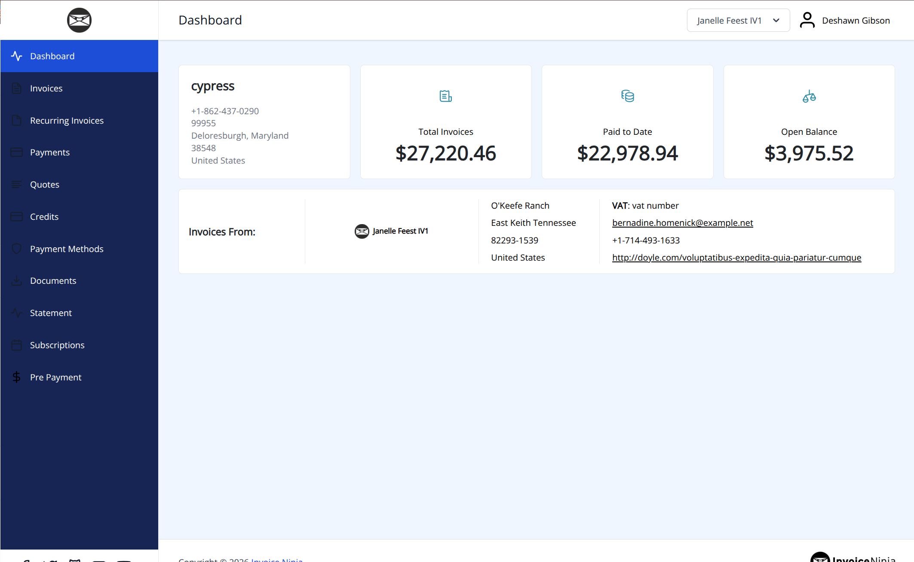](/assets/images/client_portal/themes/ocean_blue_theme.png) | Deep blue navigation, a pale blue page, and crisp blue buttons. Button corners: **6px**. |
| [Forest Green](#forest-green) | [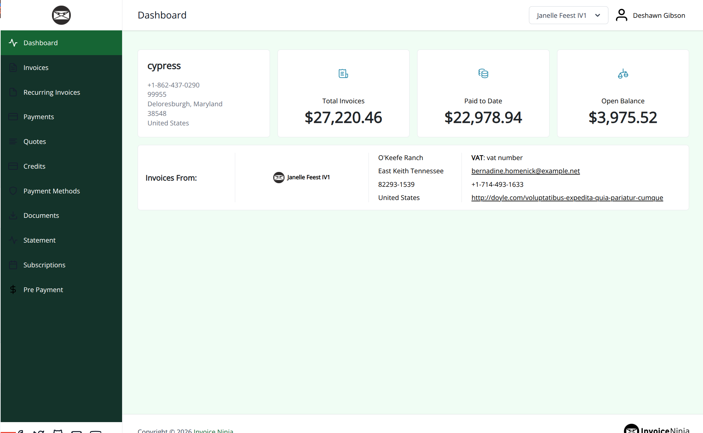](/assets/images/client_portal/themes/forest_green_theme.png) | Evergreen navigation with soft green surroundings and rounded buttons. Button corners: **8px**. |
| [Royal Violet](#royal-violet) | [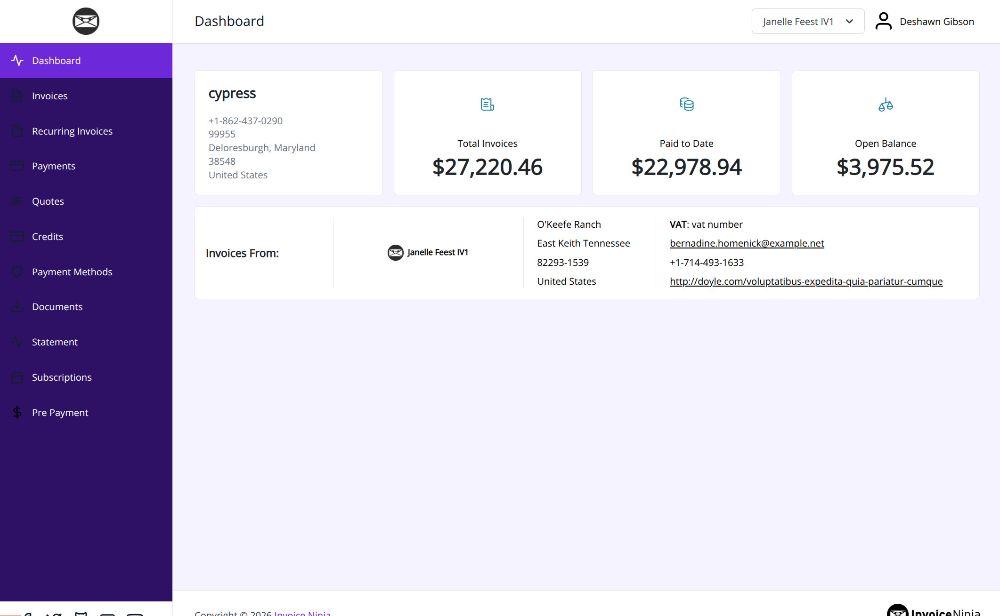](/assets/images/client_portal/themes/royal_violet_theme.png) | Rich violet accents, a pale lavender page, and softly rounded buttons. Button corners: **10px**. |
| [Warm Terracotta](#warm-terracotta) | [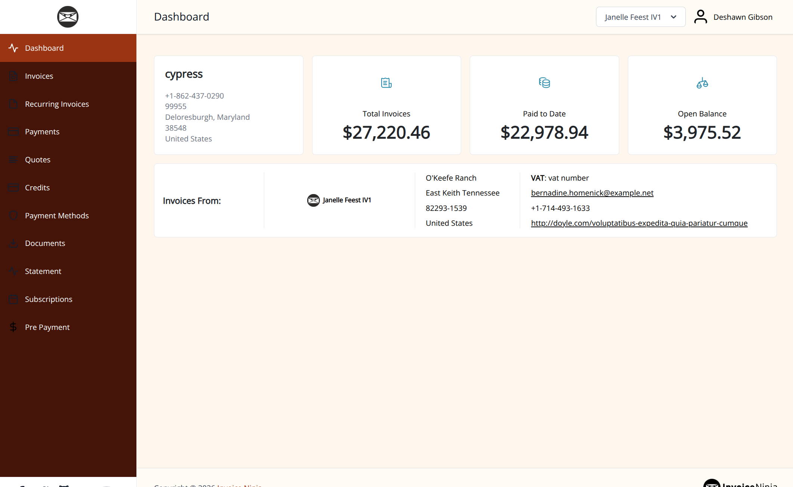](/assets/images/client_portal/themes/warm_terracotta_theme.png) | Earthy red buttons and brown navigation against a warm cream page. Button corners: **6px**. |
| [Graphite](#graphite) | [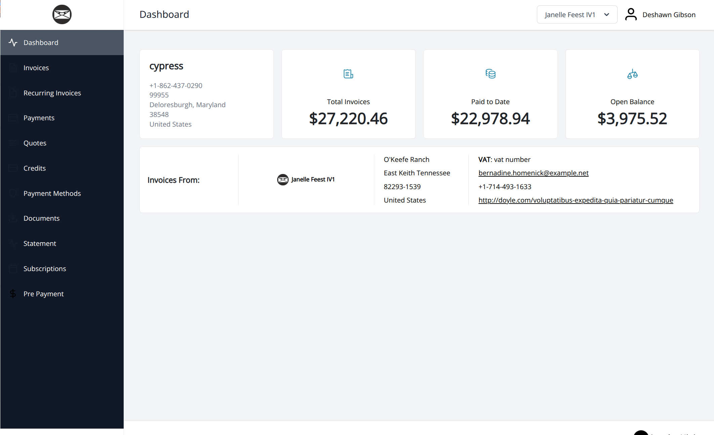](/assets/images/client_portal/themes/graphite_theme.png) | Neutral charcoal navigation, gray accents, and square button corners. Button corners: **Square**. |
| [Coastal Teal](#coastal-teal) | [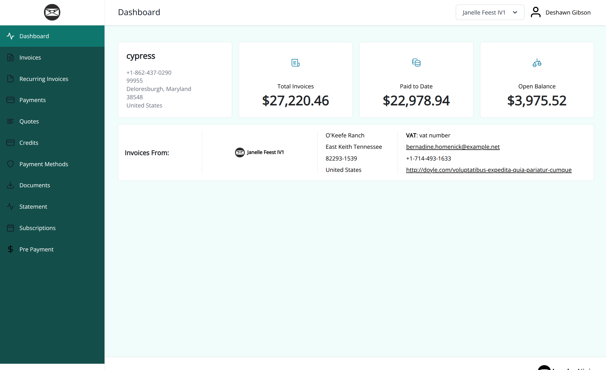](/assets/images/client_portal/themes/coastal_teal_theme.png) | Dark teal navigation, fresh aqua surroundings, and pill-shaped standard buttons. Button corners: **Pill-shaped**. |
| [Burgundy](#burgundy) | [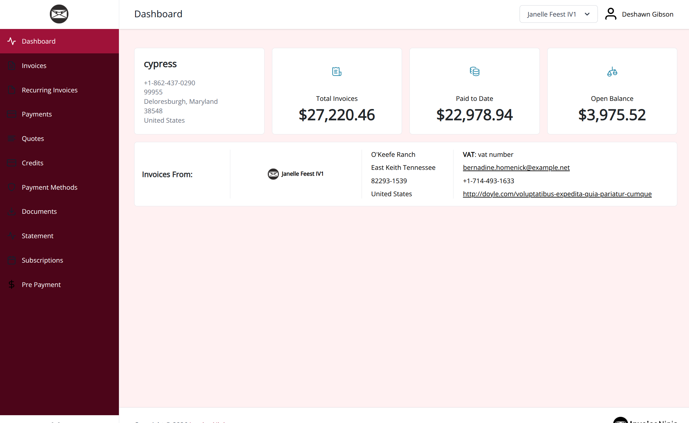](/assets/images/client_portal/themes/burgundy_theme.png) | Wine-colored navigation and buttons with a pale rose page background. Button corners: **4px**. |
| [Golden Sand](#golden-sand) | [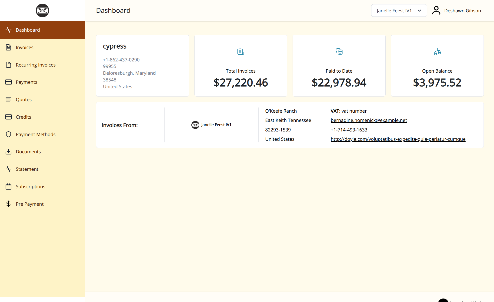](/assets/images/client_portal/themes/golden_sand_theme.png) | Light sand navigation, dark brown text, and amber-brown buttons. Button corners: **8px**. |
| [Nordic Slate](#nordic-slate) | [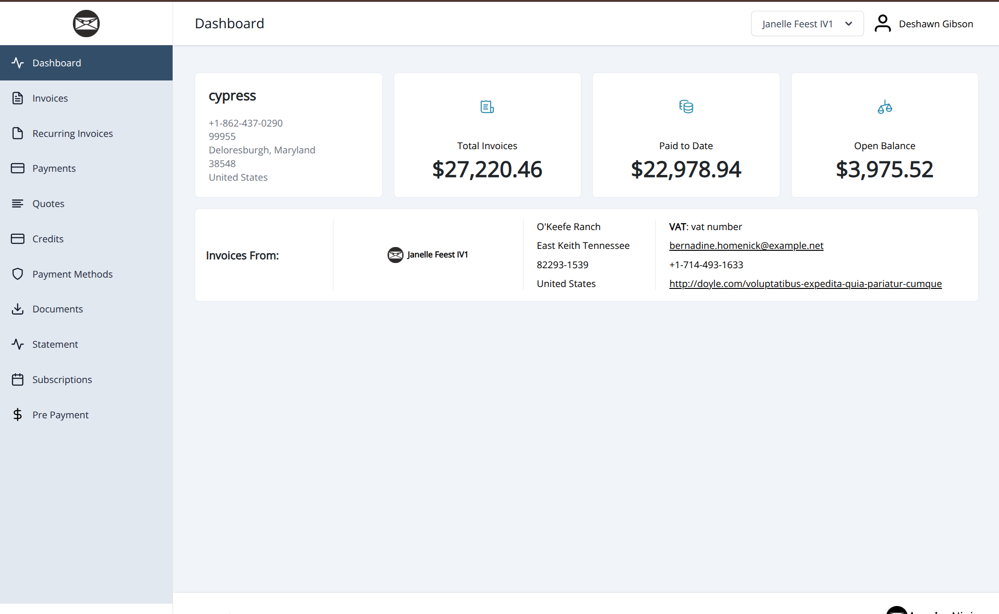](/assets/images/client_portal/themes/nordic_slate_theme.png) | Light slate navigation and muted blue accents for a restrained appearance. Button corners: **4px**. |
| [Rose Garden](#rose-garden) | [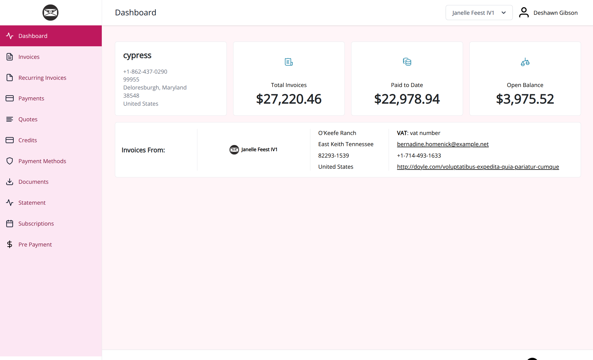](/assets/images/client_portal/themes/rose_garden_theme.png) | Light pink navigation, deep rose buttons, and generous button curves. Button corners: **12px**. |

#### Ocean Blue

Deep blue navigation, a pale blue page, and crisp blue buttons.

```css
[data-portal="client"] {
    --portal-primary: #1d4ed8;
    --portal-page-background: #eff6ff;
    --portal-surface: #ffffff;
    --portal-navigation-background: #172554;
    --portal-navigation-text: #ffffff;
    --portal-navigation-hover: #1e3a8a;
    --portal-navigation-active-background: #1d4ed8;
    --portal-navigation-active-text: #ffffff;
    --portal-table-header-background: #172554;
    --portal-table-header-text: #ffffff;
    --portal-button-text: #ffffff;
    --portal-button-radius: 6px;
    --portal-input-border: #64748b;
}
```

#### Forest Green

Evergreen navigation with soft green surroundings and rounded buttons.

```css
[data-portal="client"] {
    --portal-primary: #166534;
    --portal-page-background: #f0fdf4;
    --portal-surface: #ffffff;
    --portal-navigation-background: #14332a;
    --portal-navigation-text: #ffffff;
    --portal-navigation-hover: #245343;
    --portal-navigation-active-background: #166534;
    --portal-navigation-active-text: #ffffff;
    --portal-table-header-background: #14332a;
    --portal-table-header-text: #ffffff;
    --portal-button-text: #ffffff;
    --portal-button-radius: 8px;
    --portal-input-border: #648273;
}
```

#### Royal Violet

Rich violet accents, a pale lavender page, and softly rounded buttons.

```css
[data-portal="client"] {
    --portal-primary: #6d28d9;
    --portal-page-background: #f5f3ff;
    --portal-surface: #ffffff;
    --portal-navigation-background: #2e1065;
    --portal-navigation-text: #ffffff;
    --portal-navigation-hover: #4c1d95;
    --portal-navigation-active-background: #6d28d9;
    --portal-navigation-active-text: #ffffff;
    --portal-table-header-background: #4c1d95;
    --portal-table-header-text: #ffffff;
    --portal-button-text: #ffffff;
    --portal-button-radius: 10px;
    --portal-input-border: #84739c;
}
```

#### Warm Terracotta

Earthy red buttons and brown navigation against a warm cream page.

```css
[data-portal="client"] {
    --portal-primary: #9a3412;
    --portal-page-background: #fff7ed;
    --portal-surface: #fffbf5;
    --portal-navigation-background: #431407;
    --portal-navigation-text: #ffffff;
    --portal-navigation-hover: #7c2d12;
    --portal-navigation-active-background: #9a3412;
    --portal-navigation-active-text: #ffffff;
    --portal-table-header-background: #7c2d12;
    --portal-table-header-text: #ffffff;
    --portal-button-text: #ffffff;
    --portal-button-radius: 6px;
    --portal-input-border: #947665;
}
```

#### Graphite

Neutral charcoal navigation, gray accents, and square button corners.

```css
[data-portal="client"] {
    --portal-primary: #374151;
    --portal-page-background: #f3f4f6;
    --portal-surface: #ffffff;
    --portal-navigation-background: #111827;
    --portal-navigation-text: #ffffff;
    --portal-navigation-hover: #374151;
    --portal-navigation-active-background: #4b5563;
    --portal-navigation-active-text: #ffffff;
    --portal-table-header-background: #1f2937;
    --portal-table-header-text: #ffffff;
    --portal-button-text: #ffffff;
    --portal-button-radius: 0px;
    --portal-input-border: #6b7280;
}
```

#### Coastal Teal

Dark teal navigation, fresh aqua surroundings, and pill-shaped standard buttons.

```css
[data-portal="client"] {
    --portal-primary: #0f766e;
    --portal-page-background: #f0fdfa;
    --portal-surface: #ffffff;
    --portal-navigation-background: #134e4a;
    --portal-navigation-text: #ffffff;
    --portal-navigation-hover: #115e59;
    --portal-navigation-active-background: #0f766e;
    --portal-navigation-active-text: #ffffff;
    --portal-table-header-background: #134e4a;
    --portal-table-header-text: #ffffff;
    --portal-button-text: #ffffff;
    --portal-button-radius: 999px;
    --portal-input-border: #58817d;
}
```

#### Burgundy

Wine-colored navigation and buttons with a pale rose page background.

```css
[data-portal="client"] {
    --portal-primary: #9f1239;
    --portal-page-background: #fff1f2;
    --portal-surface: #ffffff;
    --portal-navigation-background: #4c0519;
    --portal-navigation-text: #ffffff;
    --portal-navigation-hover: #881337;
    --portal-navigation-active-background: #9f1239;
    --portal-navigation-active-text: #ffffff;
    --portal-table-header-background: #881337;
    --portal-table-header-text: #ffffff;
    --portal-button-text: #ffffff;
    --portal-button-radius: 4px;
    --portal-input-border: #99717b;
}
```

#### Golden Sand

Light sand navigation, dark brown text, and amber-brown buttons.

```css
[data-portal="client"] {
    --portal-primary: #92400e;
    --portal-page-background: #fffbeb;
    --portal-surface: #fffdf7;
    --portal-navigation-background: #fef3c7;
    --portal-navigation-text: #451a03;
    --portal-navigation-hover: #fde68a;
    --portal-navigation-active-background: #92400e;
    --portal-navigation-active-text: #ffffff;
    --portal-table-header-background: #78350f;
    --portal-table-header-text: #ffffff;
    --portal-button-text: #ffffff;
    --portal-button-radius: 8px;
    --portal-input-border: #967443;
}
```

#### Nordic Slate

Light slate navigation and muted blue accents for a restrained appearance.

```css
[data-portal="client"] {
    --portal-primary: #334e68;
    --portal-page-background: #f1f5f9;
    --portal-surface: #ffffff;
    --portal-navigation-background: #e2e8f0;
    --portal-navigation-text: #1e293b;
    --portal-navigation-hover: #cbd5e1;
    --portal-navigation-active-background: #334e68;
    --portal-navigation-active-text: #ffffff;
    --portal-table-header-background: #334e68;
    --portal-table-header-text: #ffffff;
    --portal-button-text: #ffffff;
    --portal-button-radius: 4px;
    --portal-input-border: #64748b;
}
```

#### Rose Garden

Light pink navigation, deep rose buttons, and generous button curves.

```css
[data-portal="client"] {
    --portal-primary: #be185d;
    --portal-page-background: #fff5f8;
    --portal-surface: #ffffff;
    --portal-navigation-background: #fce7f3;
    --portal-navigation-text: #831843;
    --portal-navigation-hover: #fbcfe8;
    --portal-navigation-active-background: #be185d;
    --portal-navigation-active-text: #ffffff;
    --portal-table-header-background: #9d174d;
    --portal-table-header-text: #ffffff;
    --portal-button-text: #ffffff;
    --portal-button-radius: 12px;
    --portal-input-border: #a16b83;
}
```

### Style a particular area

A selector names the part of the page you want to change. The portal provides stable names so your CSS does not need to depend on its layout or utility classes.

For example, add a border underneath the header:

```css
[data-portal="client"] [data-portal-target="header"] {
    border-bottom: 2px solid #176b55;
}
```

Change the headings only in the invoice table:

```css
[data-portal="client"] [data-portal-table="invoices"] {
    --portal-table-header-background: #244b72;
}
```

The following names are supported. Start each selector with `[data-portal="client"]` as in the examples, to keep your changes within the client portal.

| Target | Selector |
| --- | --- |
| Signed-in layout | `[data-portal-target="shell"]` |
| Header | `[data-portal-target="header"]` |
| Sidebar | `[data-portal-target="sidebar"]` |
| Navigation menu | `[data-portal-target="navigation"]` |
| Navigation links | `[data-portal-target="navigation-link"]` |
| Selected navigation link | `[data-portal-target="navigation-link"][aria-current="page"]` |
| Company logo in the sidebar | `[data-portal-target="logo"]` |
| Main content | `[data-portal-target="content"]` |
| Page heading area | `[data-portal-target="page-header"]` |
| Footer | `[data-portal-target="footer"]` |
| Entity tables | `[data-portal-target="table"]` |
| Table pagination, when shown | `[data-portal-target="pagination"]` |
| Standard buttons | `.button` |
| Button styles | `.button-primary`, `.button-secondary`, `.button-danger`, `.button-link` |
| Shared form controls | `.input`, `.input-label`, `.form-select`, `.form-checkbox` |
| Alerts and validation | `.alert`, `.validation` |
| Status badges | `.badge` |

To select only one sidebar, append `[data-portal-variant="desktop"]` or `[data-portal-variant="mobile"]` to its target. Both variants can exist in the page, even when only one is visible.

Individual table names are `invoices`, `quotes`, `payments`, `credits`, `recurring-invoices`, `payment-methods`, `documents`, `projects`, `tasks`, `subscriptions`, `subscriptions-recurring-invoices`, and `purchase-orders`. Task detail tables also use `tasks`. You can use ordinary CSS descendants such as `thead`, `tbody`, `tr`, and `td` within a table target.

Keep existing selectors if they already work. The new names are additional hooks; existing classes and IDs remain available.

### More customization examples

Add these examples below your portal-wide rules in **Custom CSS**. Each example can be used on its own. Replace the colors and sizes to match your branding, and keep the `[data-portal="client"]` prefix so the rules stay within the portal.

#### Give navigation links rounded corners

This changes the shape and spacing of links in both navigation menus. The navigation color variables in the starter example still control their colors.

```css
[data-portal="client"] [data-portal-target="navigation-link"] {
    border-radius: 6px;
    margin-block: 4px;
}
```

#### Underline the selected navigation link

Use `aria-current="page"` to style the current page's link. An underline gives clients another way to identify the selected page alongside its background color.

```css
[data-portal="client"] [data-portal-target="navigation-link"][aria-current="page"] {
    text-decoration: underline;
    text-underline-offset: 4px;
}
```

#### Use different heading colors for invoices and quotes

Set table-heading variables on a named table to override the portal-wide values for that table only. Other tables keep the values from your root rule.

```css
[data-portal="client"] [data-portal-table="invoices"] {
    --portal-table-header-background: #244b72;
    --portal-table-header-text: #ffffff;
}

[data-portal="client"] [data-portal-table="quotes"] {
    --portal-table-header-background: #654080;
    --portal-table-header-text: #ffffff;
}
```

#### Add row separators to the invoice table

Ordinary CSS table selectors work inside a named table target. This adds a light border beneath the body cells in the invoice table.

```css
[data-portal="client"] [data-portal-table="invoices"] tbody td {
    border-bottom: 1px solid #d5e2dc;
}
```

#### Style the mobile sidebar separately

Append the mobile variant to the sidebar selector when a change should apply only to that sidebar. This adds an inset border without changing its width. Use `desktop` instead of `mobile` to target the desktop sidebar.

```css
[data-portal="client"] [data-portal-target="sidebar"][data-portal-variant="mobile"] {
    box-shadow: inset 0 0 0 1px #a3b9af;
}
```

The variant identifies a sidebar, rather than a screen width. For a change to another element based on the window width, use a media query. For example, this reduces the page heading area's bottom margin in windows up to 640 pixels wide:

```css
@media (max-width: 640px) {
    [data-portal="client"] [data-portal-target="page-header"] {
        margin-bottom: 12px;
    }
}
```

#### Make shared input borders easier to see on focus

This example adds an outline when a shared text input or select receives focus, helping keyboard users see which control they are editing. Choose an outline color that contrasts with your field backgrounds, and preserve visible focus indicators when adding other styles.

```css
[data-portal="client"] .input:focus,
[data-portal="client"] .form-select:focus {
    outline: 2px solid #176b55;
    outline-offset: 2px;
}
```

### Where your changes apply

Company Custom CSS is used on the login pages. Signed-in pages use the client's Custom CSS if set, otherwise the group's, otherwise the company's. These CSS fields replace one another; they are not combined. If a client's portal looks different, check its client and group settings for an override.

Login pages have the `[data-portal="client"]` root and shared component styles, but do not have the signed-in sidebar, header, or table targets. The variables only affect elements present on that page.

Portal CSS does not change invoice PDFs, email designs, or the contents of payment-provider frames. It also does not recolor image files. Customizing those requires their separate design or provider settings.

### If a change does not appear

- Confirm you are using a self-hosted installation with access to Custom CSS.
- Refresh the client portal after saving. Check whether a client or group override replaces the company CSS.
- Check that each declaration ends with a semicolon and each block closes with `}`.
- Look for older CSS rules that set the same colors, especially rules containing `!important`.
- Check the option's coverage above. For a specific element, use its named target instead.

To undo your changes, remove the rules you added, restore your saved CSS if needed, save, and refresh the portal.

## Related

- [Clients](/docs/user-guide/clients#contacts): each contact gets their own portal login
- [Invoices](/docs/user-guide/invoices): drafts stay hidden until you mark them sent or paid
- [Quotes](/docs/user-guide/quotes): clients can approve or reject a quote in the portal
- [Payments](/docs/user-guide/payments): payment history and unapplied payments
- [Payment Gateways](/docs/user-guide/gateways): saved cards and Pay Now
- [Payment Links](/docs/user-guide/subscriptions): the Subscriptions tab in the portal
- [Payment Settings](/docs/user-guide/basic-settings#payment_settings): Client Initiated Payments and related options
