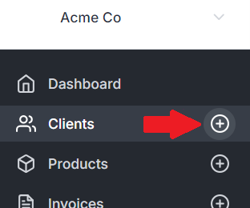
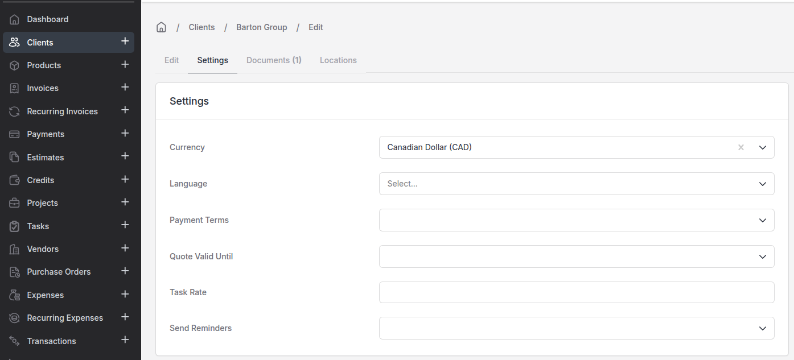
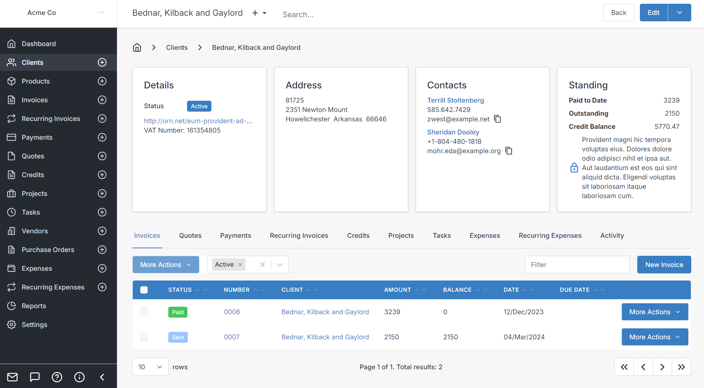
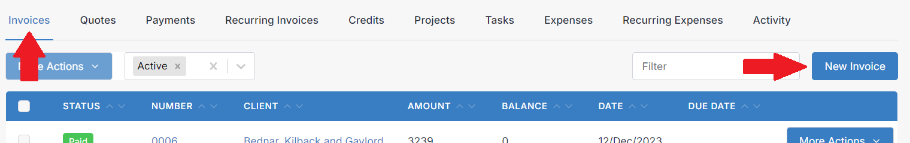
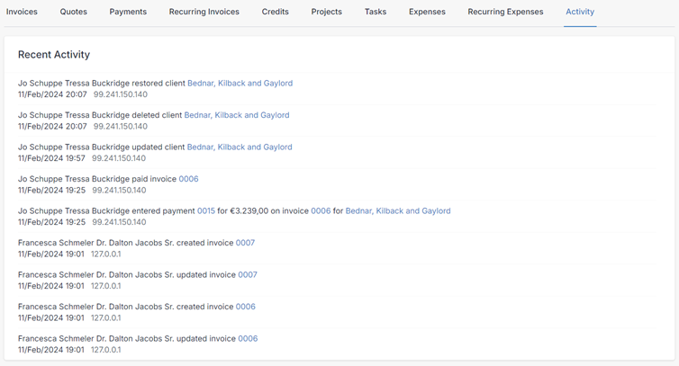
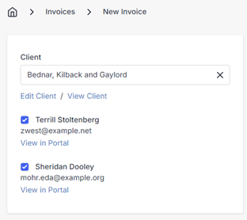
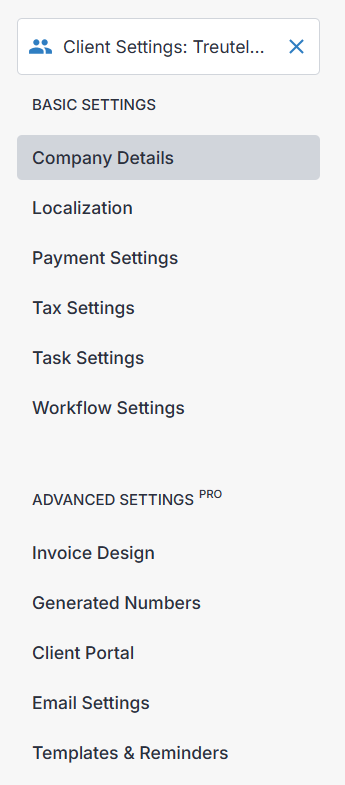
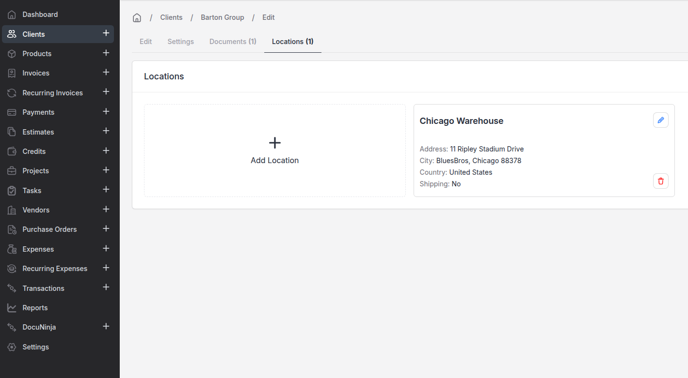

# Clients: add and manage the people and businesses you bill

A client is anyone you sell to and send invoices, quotes or credits to. You need a client before you can bill someone, so this is usually the first thing you set up in Invoice Ninja.

Here is a short video on adding a client:

<video width="100%" controls>
  <source src="/assets/videos/clients/create_client.mp4" type="video/mp4" />
</video>

## What is a client in Invoice Ninja?

A client can be a person or a company. Each client has one or more contacts, the people you actually email.

- If you only fill in a contact, the contact's name is used as the client's display name.
- If you fill in the client's name, that name is used instead.

## How do I add a new client?

You can add a client in any of these ways:

1. Go to **Clients** and click **New Client** (top right).
2. Click the small **+** next to **Clients** in the left menu (shown below).
3. Import a spreadsheet: on the **Clients** list, click **Import**. See [Import and Export](/docs/advanced-topics/import-and-export).
4. Let clients sign up themselves in the [Client Portal](/docs/user-guide/client-portal). Turn this on under **Settings > Client Portal > Registration** with the **Client Registration** toggle. The same tab shows your **Registration URL** and lets you mark each sign-up field as required or hidden.
5. Connect another tool, such as Zapier, Make or APISync, or build your own connection with the [API Documentation](https://invoiceninja.github.io/docs/api-reference/invoice-ninja-api-reference). (An API lets other software send data into Invoice Ninja automatically.)



## What is the difference between client ID, client number and ID number?

Every client has three different identifiers. They are easy to mix up, so here is what each one is for:

| Field | Placeholder | Example | What it is for |
|---|---|---|---|
| **ID** | `$client.id` | 7WR07SC | Created automatically and used by the API. Not meant for people to read. |
| **Number** | `$client.number` | 0001 | Created automatically. You can change the pattern in the **Clients** section of **Settings > Generated Numbers**. |
| **ID Number** | `$client.id_number` | Your choice | A normal field you fill in, for example the client's number from another system or a membership ID. |

A placeholder is a code like `$client.number` that you can put in an invoice design. Invoice Ninja swaps it for the real value on the PDF.

## Where do I see all my clients?

Click **Clients** in the left menu of the admin portal (the screen you and your team use, not the one your clients see). From the list you can:

- Search with the **Filter** box
- Show archived or deleted clients with the **Lifecycle** filter
- Add or remove columns with **Columns**
- Import clients from a file with **Import**
- Create a client with **New Client**

Each row has an **Actions** menu on the right with **Edit**, **View Statement** (the client's statement), **Client Portal**, **Clone**, **Add Comment**, **Settings**, **New Resource**, **Merge**, **Archive**, **Delete** and **Purge**. For archived or deleted clients it shows **Edit**, **Add Comment**, **Restore** and **Purge**.

## How do I edit a client?

<video width="100%" controls>
  <source src="/assets/videos/clients/get_to_edit_client.mp4" type="video/mp4" />
</video>

There are two ways:

- **From the client's page:** click **Edit** at the top right.
- **From the client list:** open the row's **Actions** menu and choose **Edit**.

The edit form has four tabs along the top: **Edit** (details, contacts and address), **Settings**, **Documents** and **Locations**.

## How do I invoice a client in a different currency?

Every client uses your company's currency unless you change it.

1. Open the client and click **Edit**.
2. Go to the **Settings** tab at the top of the form.
3. In the **Settings** card, pick the **Currency**.
4. Click **Save**.



**Important:** currency is set per client, not per document. When you change a client's currency, every document for that client uses the new currency, including all existing and future invoices, quotes, credits and payments. You cannot set a different currency on a single document. If you need a one-off document in another currency, create a separate client record for it.

## Archive, delete or purge: which one should I use?

| Action | What it does | Can I undo it? |
|---|---|---|
| **Archive** | Hides the client from your normal lists. Nothing else changes. Invoices, payments, report totals and history all stay. | Yes, with **Restore** |
| **Delete** | Hides the client and leaves their invoices, payments, credits and related transactions out of your report totals, as if they never happened. The data is flagged as deleted, not erased. | Yes, with **Restore** |
| **Purge** | Permanently wipes the client and all their data: contacts, invoices, quotes, payments, credits and related records. | No, never |

In short: use **Archive** to tidy your client list without changing any totals. Use **Delete** when you want a client's activity left out of your reports. Use **Purge** only when you are certain you no longer need the data, for example to meet a data-removal request.

### How do I archive, delete or purge a client?

1. Open the client.
2. Click the arrow next to **Edit** and choose **Archive**, **Delete** or **Purge**.

You can also do this from the row's **Actions** menu on the client list.

### How do I restore an archived or deleted client?

1. On the client list, open the **Lifecycle** filter, tick **Archived** (or **Deleted**) and click **Apply**.
2. In the client's row, open the **Actions** menu and choose **Restore**.

The client comes back to your active list with all data unchanged.

## How do I merge duplicate clients?

If the same client was added twice (for example, once when they signed up in the client portal and once by hand), you can combine the two records.

1. Open the client you want to merge.
2. Click the arrow next to **Edit** and choose **Merge**.
3. In the **Merge Into** window, pick the **Client** to merge into and click **Merge**.

All the data moves into one record.

## What can I see on a client's page?

Open a client by clicking their name in the client list, or by following a link from a related invoice, project, task or transaction.

### Overview panels

At the top of the page are four panels:

- **Details:** currency, status and client number.
- **Address:** the client's address.
- **Contacts:** each contact's name and email, plus a **Client Portal** link with a copy icon, handy for sending a contact straight to their portal.
- **Standing:** **Paid to Date**, **Outstanding**, **Credit Balance** and **Payment Balance**.

Click the gear icon to choose which panels to show (**Edit Columns**). You can also add **Public Notes** and **Private Notes** panels.



### Tabs

Below the panels are tabs that show records for this client: **Invoices**, **Quotes**, **Payments**, **Recurring Invoices**, **Credits**, **Projects**, **Tasks**, **Expenses**, **Recurring Expenses**, **History / Activity**, **Documents** and **Settings**.

### How do I create an invoice (or other record) for this client?

1. Open the client.
2. Select a tab, for example **Invoices**.
3. Click its **New** button, for example **New Invoice**.



In the desktop and mobile apps, hover over a category and long press (click and hold) to create a new invoice, quote, payment and so on. On a phone or tablet, touch and hold anywhere on the button. A normal click or tap shows the filtered list instead.


### What does the History / Activity tab show?

This tab has two parts:

- **Email History:** the emails sent to this client.
- **Recent Activity:** a timeline of everything that happened with this client, such as debits and credits on their account, new or changed records, and the invoices, quotes and other documents connected to them. Each entry names the user who did it, so you can see who did what, and when. Record numbers are links to the record. Turn on **Comments Only** to see just comments, or click **Add Comment** to add one.



### How do I add documents to a client?

Use documents for files such as terms of service or contracts. Both you (in the admin portal) and your client (in the client portal) can see them.

1. Open the client and click **Edit**.
2. Go to the **Documents** tab.
3. Drop files onto the upload box, or click it to choose them.

The **Documents** tab on the client's page lists the uploaded files.

**Self-hosted users:** uploaded documents are saved in the `public/storage` directory, in folders with hashed names. Back up this directory together with your database so you don't lose them.

### What is on the Settings tab?

The **Settings** tab on the client's page shows, read-only, which **Client Settings** and **Group Settings** are in effect for this client. To change them, see [How do I change settings for just one client?](#how-do-i-change-settings-for-just-one-client)

## What information can I store for a client?

Most fields are optional, and some are filled in automatically. Collect only what your business needs.

### Company Details

| Field | What it is for |
|---|---|
| **Status** | The client's status. |
| **Name** | A person, group, organization or business. If you leave it empty, the first contact's name is used. |
| **Number** | Created automatically for tracking. Instead of editing numbers by hand, change the pattern in the **Clients** section of **Settings > Generated Numbers**. |
| **Group** | The settings group the client belongs to. See [groups](#how-do-i-apply-the-same-settings-to-many-clients-groups). |
| **Assigned User** | The team member responsible for this client. |
| **Tags** | Labels to help you group and find clients. |
| **ID Number** | Optional. Any ID that matters to your business, such as a membership number. |
| **VAT Number** | The client's Value Added Tax ID, mostly used in the European Union. |
| **Website** | The client's website, for reference. |
| **Phone** | The main phone number for the client, separate from each contact's phone. |
| **Routing ID** | The e-invoice routing number, the address used to find this client when delivering e-invoices. See [E Invoicing](/docs/user-guide/einvoicing). |
| **Valid VAT Number** | Turn on if the client gave you a valid VAT number. In some places this changes how tax is applied. Only works when **Calculate Taxes** is on under **Settings > Tax Settings**. |
| **Tax Exempt** | Turn on and no tax is applied by default on this client's invoices. Only works when **Calculate Taxes** is on under **Settings > Tax Settings**. |
| **Classification** | Optional, for your own records: Individual, Business, Company, Partnership, Trust, Charity, Government or Other. |

### Contacts

A client can have as many contacts as you like. Click **+Add contact** to add another one. They appear in the **Contacts** panel on the client's page.

Only you can add contacts, from the admin portal. Clients cannot add contacts themselves in the client portal.

| Field | What it is for |
|---|---|
| **First Name** and **Last Name** | The person's name. The first contact's name becomes the client name if you leave the client name empty. |
| **Email** | The contact's email address. It is also their login for the client portal. |
| **Phone** | The contact's phone number, for reference. |
| **Add to Invoices** | Include this contact on invoices and quotes by default. |
| **CC Only** | Add the contact as a CC (copy) recipient on emails. |
| **Authorized to sign** | Marks this contact as allowed to sign documents for the client. |

You can email an invoice or quote to several contacts at once. On a new invoice, each contact has a checkbox under **Contacts**, and contacts with **Add to Invoices** turned on are ticked automatically:



### Address

The **Address** section has two tabs:

- **Billing Address:** the standard address fields. This address usually appears on invoices and other documents for the client.
- **Shipping Address:** the same fields for a delivery address. Click **Copy Billing** to copy the billing address across.

### Settings tab

The edit form's **Settings** tab has three cards.

**Settings**

| Field | What it is for |
|---|---|
| **Currency** | The default currency for this client's invoices and payments. |
| **Language** | The client's preferred language. Invoices and other documents are created in this language. |
| **Payment Terms** | The default time the client has to pay, if you have a regular arrangement. Use **Configure** to manage the list of terms. |
| **Quote Valid Until** | The default length of time you honour the prices in your quotes. |
| **Task Rate** | The default hourly rate for [tasks](/docs/user-guide/tasks) you do for this client. |
| **Send Reminders** | Turn email reminders, such as for unpaid invoices, on or off for this client. Set the reminder rules under **Settings > Templates & Reminders**. |

**Classify**

- **Company Size:** how big the organization, school or business is.
- **Industry:** the industry the client works in.

**Notes**

- **Public Notes:** usually included on future invoices, quotes and other documents for this client.
- **Private Notes:** only users of the admin portal can ever see these.

## How do I change settings for just one client?

1. Open the client.
2. Click the arrow next to **Edit** (or use the row's **Actions** menu on the list) and choose **Settings**.

A **Client Settings** banner with the client's name shows you are changing settings for this client only. You can override Company Details, Localization, Payment Settings, Tax Settings, Task Settings and Workflow Settings. On Pro plans you can also override Invoice Design, Generated Numbers, Client Portal, Email Settings and Templates & Reminders.



## How do I bill one client at different addresses (locations)?

A **location** is a named extra address saved on a client. Locations can be used on invoices, quotes, credits, recurring invoices and purchase orders for that client, to replace the default business or shipping address on that one document.

Locations help when a client has:

- Several sites, branches or franchise stores that each need their own invoice address
- A ship-to address that changes from order to order
- A head office that pays, with delivery addresses that vary per shipment
- Sites in different tax areas (for example, different US states) that each need tax worked out locally

There is no limit on how many locations a client can have. Only admin portal users can manage locations. Clients cannot see or edit them in the client portal.

### How do I add a location?

1. Open the client and click **Edit**.
2. Go to the **Locations** tab at the top of the form.
3. Click **Add Location**.
4. Fill in the fields below and click **Save**.



| Field | What it is for |
|---|---|
| **Name** | A label for the location, such as "Sydney Warehouse" or "Head Office". It must be unique across all locations in your company. |
| **Street / Apt/Suite / City / State/Province / Postal Code / Country** | The address shown on any document this location is assigned to, instead of the client's default address. |
| **Shipping Address** | On: the location replaces the **Shipping Address**. Off: it replaces the business address. A client can have locations for each. |

Need more, such as a site contact, delivery instructions or an internal reference? Set up to four **Location** custom fields under **Settings > Custom Fields > Clients**. You can print them on PDFs with the placeholders below.

### How do I use a location on an invoice, quote or credit?

When you create or edit an invoice for a client that has locations, a **Location** dropdown appears under the client. Pick one of the client's locations. Its address replaces the client's default address on the PDF and in any emails for that document. It works the same way on quotes, credits, recurring invoices and purchase orders.


If you don't pick a location, the document uses the client's default **Billing Address** and **Shipping Address**. Clients without locations don't show the dropdown.

### How are taxes worked out for locations?

If **Calculate Taxes** is on under **Settings > Tax Settings**, each location gets its own **tax nexus** (the place where that site is registered for tax), based on its address. Documents that use the location are taxed by that location's rules, not the client's default address. That is how one client with sites in several US states can be billed with the right state tax on each document.

If **Calculate Taxes** is off, the tax nexus on locations has no effect.

### Which placeholders can I use for locations?

If you customize your invoice templates, these placeholders show the selected location's details. If no location is selected, they show the client's default address.

**Business address**

```bash
$address1
$address2
$city
$state
$postal_code
$country
$city_state_postal
$postal_city_state
$postal_city
```

**Shipping address**

```bash
$shipping_address1
$shipping_address2
$shipping_city
$shipping_state
$shipping_postal_code
$shipping_country
```

**Location name and custom fields**

```bash
$location_name
$shipping_location_name
$location1
$location2
$location3
$location4
```

## How do contacts use the client portal?

The client portal is the website where your clients view and pay their invoices. Here is how contacts fit in:

- **Each contact has their own login.** They sign in with the email you entered for them, and can set their own password and personal details, whichever client they belong to.
- **Self-registration creates a new client.** When someone signs up in the client portal, their name and email are added as a contact under a new client. After signing in, they can edit the client details, such as company name and contact information, in the **Profile** menu.
- **One email, one contact.** Contact emails are treated as unique. If someone tries to sign up with an email that is already a contact for another client, they must use a different email address, or have their email removed from the other client first.

See [Client Portal](/docs/user-guide/client-portal) for more.

## How do I apply the same settings to many clients (groups)?

If many clients share the same settings, such as currency or email reminders, create a group under **Settings > Group Settings** (click **New Group**). Then pick that group in each client's **Group** field.

For most settings, Invoice Ninja checks in this order:

1. The client's own setting
2. The setting of the client's group, if it has one
3. Your company's default setting

The benefit: when a setting changes later, you update it in one place instead of client by client. Without groups, changing many clients at once means using the API or an integration tool.

## How do I add custom fields to clients?

Go to **Settings > Custom Fields > Clients**. You can add up to 4 client fields, 4 contact fields and 4 location fields.

To show client and contact fields on the invoice PDF, use these placeholders:

**Client placeholders**

```bash
$client.custom1
$client.custom2
$client.custom3
$client.custom4
```

**Contact placeholders**

```bash
$contact.custom1
$contact.custom2
$contact.custom3
$contact.custom4
```

## Related

- [Invoices](/docs/user-guide/invoices)
- [Quotes](/docs/user-guide/quotes)
- [Credits](/docs/user-guide/credits)
- [Payments](/docs/user-guide/payments)
- [Client Portal](/docs/user-guide/client-portal)
- [Vendors](/docs/user-guide/vendors)
- [Import and Export](/docs/advanced-topics/import-and-export)
- [E Invoicing](/docs/user-guide/einvoicing)
- [API Documentation](https://invoiceninja.github.io/docs/api-reference/invoice-ninja-api-reference)
