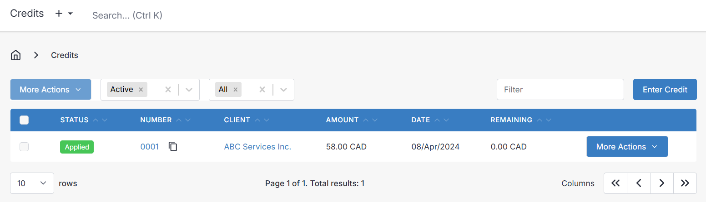
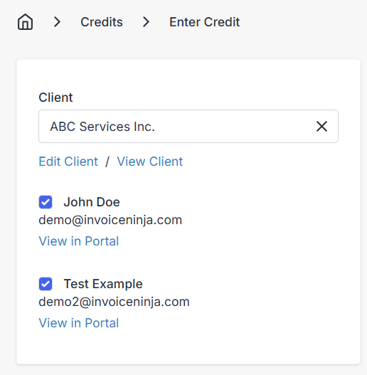
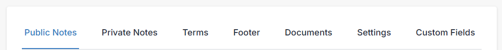

# Credits: give clients a balance they can use on future invoices

A credit is money you owe a client that sits on their account until you use it against an invoice. Use one for a refund given as store credit, a goodwill gesture after a service issue, or a voucher for a product or a flat amount.

## How do credits work?

- A credit lives on the [client](/docs/user-guide/clients) record, not on a single invoice. That means you can spread one credit across several future invoices, or use it all at once.
- When you apply a credit, it behaves like a payment. That's why applied credits also show up in your [payments](/docs/user-guide/payments) list and reports.
- A credit has no effect on any balance until it's sent (emailed or marked as sent).

**Before you start:** look at your [Payment Settings](/docs/user-guide/basic-settings/#payment_settings). The options there control how credits are offered to clients at checkout and whether they're applied automatically. Getting these right makes credits much easier for your clients to understand.

## How do I view a credit?

Click **Credits** in the left menu, then click a credit number to open it. The form is a lot like an [invoice](/docs/user-guide/invoices) or a [quote](/docs/user-guide/quotes), so once you know one, the others feel familiar. The tabs along the top are **Edit**, **Documents**, **Settings**, **Activity** and **History**.

## What can I do with a credit?

Click the arrow next to **Save** on the credit, or use the row's **Actions** menu on the list.

| Action | What it does |
|---|---|
| **View PDF** / **Print PDF** / **Download PDF** | Shows, prints or saves the credit PDF |
| **Email Credit** | Sends the credit to the contacts ticked to receive it |
| **Schedule** | Sends the credit automatically at a later date and time |
| **Client Portal** | Shows the credit exactly as your client sees it in the [Client Portal](/docs/user-guide/client-portal) |
| **Mark Sent** | Changes a draft to sent without emailing it. Only appears on drafts. |
| **Apply Credit** | Opens the **Enter Payment** screen with this credit already ticked, so you can use it on one or more invoices. See [How do I apply a credit to an invoice?](#how-do-i-apply-a-credit-to-an-invoice) |
| **Clone To** | Copies the credit into a new **Credit**, **Invoice**, **Quote**, **Recurring Invoice** or **Purchase Order** |
| **Run Template** | Runs one of your custom [templates](/docs/advanced-topics/templates) on the credit. Only appears once you've created a template. |
| **Archive** / **Delete** | Tidies up or removes the credit. See [What do the credit statuses mean?](#what-do-the-credit-statuses-mean) |

## How do I create a credit?

There are two ways, depending on whether the credit is tied to an invoice.

| You want to | Do this |
|---|---|
| Give a credit that isn't tied to an invoice, such as a goodwill gesture or a prepaid retainer | Click **Enter Credit** on the credits list and fill it in |
| Reverse a whole invoice without retyping it | Open the invoice, click the arrow next to **Save**, choose **Clone To** and pick **Credit**. The items, quantities and prices come across automatically. |

Creating a credit from scratch:

<video width="100%" controls>
  <source src="/assets/videos/credits/create_credit.mp4" type="video/mp4" />
</video>

Creating a credit from an invoice:

<video width="100%" controls>
  <source src="/assets/videos/credits/create_credit_from_invoice.mp4" type="video/mp4" />
</video>

### Who is the credit for?

1. Pick the client in the **Client** dropdown. Every credit needs one, because a credit is a balance on that client's account.
2. Check which contacts get the credit email under **Contacts**. Contacts with **Add to Invoices** turned on in the client record are ticked automatically. Each contact has an **Authorized to sign** checkbox and, once the credit is saved, a **View in Portal** link.

### Which credit details do I fill in?

| Field | What it is for |
|---|---|
| **Credit Date** | The date the credit takes effect. Defaults to today. |
| **Valid Until** | Optional. An expiry date, if you only want to honor the credit for a limited time. |
| **Partial/Deposit** | Optional. A partial amount, if you don't want the whole credit available at once. |
| **Tags** | Optional. Labels you can use to find or group credits later. |
| **Credit Number** | Created automatically from the pattern under **Settings > Generated Numbers > Credits**. Shows "Auto Generate" until you save. |
| **PO #** | Optional. Your client's own purchase order reference. |
| **Discount** | A percentage or flat amount taken off the credit total. Most often used when a credit is cloned from an invoice that already had a discount. |

### How do I add line items?

Line items work just like on an invoice. Each row has:

| Column | What it is for |
|---|---|
| **Item** | The product, task or expense the credit is for |
| **Description** | Free text. Markdown (simple formatting codes for bold, lists and so on) shows as formatting when **Enable Markdown** is on under **Settings > Account Management**. |
| **Quantity** | How many units or hours to multiply the unit cost by |
| **Unit Cost** | The price per unit, or the hourly rate for a task |
| **Line Total** | The quantity multiplied by the unit cost |

### What goes in the tabs below the line items?

| Tab | What it is for | Can the client see it? |
|---|---|---|
| **Public Notes** | The reason for the credit, so there's no confusion later. Printed on the PDF. | Yes |
| **Private Notes** | Notes for your team only. Never on the PDF or in the client portal. | No |
| **Terms** | Any conditions attached to the credit. Turn on **Save as default terms** to fill them in on future credits. | Yes |
| **Footer** | Disclaimers or fine print at the bottom of the PDF. Turn on **Save as default footer** to fill them in on future credits. | Yes |
| **Custom Fields** | Extra fields you've set up for credits | Depends on the field |

### How do I attach files to a credit?

Open the **Documents** tab and upload contracts, photos or supporting paperwork. Your client can open them in the [Client Portal](/docs/user-guide/client-portal).

### What is on the Settings tab?

These options override your company defaults for this credit only:

- **Project:** links the credit to a [project](/docs/user-guide/projects).
- **Exchange Rate:** when the client's currency differs from yours, sets the rate used to convert the total.
- **Design:** picks a built-in or custom PDF design. Manage designs under **Settings > Invoice Design**.
- **Assigned User:** the user the credit is recorded against. Useful for reporting and for limiting who can see the record.
- **Vendor:** links the credit to a [vendor](/docs/user-guide/vendors).
- **Inclusive Taxes:** when on, tax is treated as already included in the line prices instead of added on top.

## How do I apply a credit to an invoice?

Applying a credit is how the balance on the client's account actually gets used.

1. Open the credit.
2. Click the arrow next to **Save** and choose **Apply Credit**. The **Enter Payment** screen opens with the client filled in and this credit already ticked.
3. Tick the invoice, or invoices, to use the credit on. The invoice balance is filled in for you; you can lower it if you're only using part of the credit.
4. Click **Save**.

From now on the credit behaves like a payment, so it also appears in your [Payments](/docs/user-guide/payments) list. You can also use a credit while you enter a cash payment; see [How do I use a client's credit in a payment?](/docs/user-guide/payments#how-do-i-use-a-clients-credit-in-a-payment)

<video width="100%" controls>
  <source src="/assets/videos/credits/applying_credit_to_invoice.mp4" type="video/mp4" />
</video>

## What do the credit statuses mean?

The status tells you at a glance whether a credit can still be edited, whether any balance is left and whether it's active on the client's account. The **Status** filter on the list offers Draft, Sent, Partial/Deposit and Applied.

| Status | What it means | Can I still use it? |
|---|---|---|
| **Draft** | Being prepared. Your client can't see it and it isn't on their account yet. | No, send it first |
| **Sent** | Emailed or marked as sent. Now it's on the client's account. | Yes |
| **Partial/Deposit** | Some of it has been used, and a balance is left | Yes, the remaining balance |
| **Applied** | All of it has been used | No, nothing is left |
| **Archived** | Hidden from your normal list | |
| **Deleted** | Removed from reports, but can still be restored | |

### What does Draft mean?

Every credit starts as a draft. You can edit it freely, your client can't see it and nothing is linked to their account yet. A draft only becomes real once you email it or mark it as sent.

:::warning
Once you email a credit or mark it as sent, you can't change it back to a draft.
:::

### What does Partial/Deposit mean?

Some of the credit has been used on one or more invoices, but there's still a balance. The amount left is the **Remaining** column on the credits list, and **Balance** in the totals on the credit.

### Can I refund a credit that's already been applied?

Not directly. To give back a credit that was used on an invoice, [reverse that invoice](/docs/user-guide/invoices#what-does-reversed-mean). Reversing turns whatever was paid on it, from a credit or a payment, back into a new credit on the client's account.

If the invoice was paid with a mix of a payment and a credit, [refund the payment](/docs/user-guide/payments#refunds) first, then reverse the invoice.

### What happens when I delete a credit?

Deleting a credit sets its status to **Deleted**. If the credit was **Partial/Deposit**, the remaining balance is removed from the client's account. Amounts already used on invoices are not touched.

Like everywhere else in Invoice Ninja, you can undo a delete with **Restore**, but while it's deleted the credit is left out of your reports. See [Archive, delete or purge: which one should I use?](/docs/user-guide/clients#archive-delete-or-purge-which-one-should-i-use)

### What does archiving a credit do?

Archiving hides a credit from your normal list. Balances and history don't change, so it's the right choice when you want a tidy list without affecting your reports. To show it again, restore it.

### How do I bring back an archived or deleted credit?

1. On the credits list, open the **Lifecycle** filter, tick **Archived** (or **Deleted**) and click **Apply**.
2. In the credit's row, open the **Actions** menu and choose **Restore**.

The credit goes back to the status it had before, with its balance and history intact.

## Related

- [Payments](/docs/user-guide/payments): applied credits show up here
- [Invoices](/docs/user-guide/invoices): where credits get used, and how reversing works
- [Clients](/docs/user-guide/clients): see a client's credit balance
- [Payment Settings](/docs/user-guide/basic-settings/#payment_settings): how credits are offered at checkout
- [Client Portal](/docs/user-guide/client-portal): what your client sees
- [Templates](/docs/advanced-topics/templates): build advanced documents from templates
