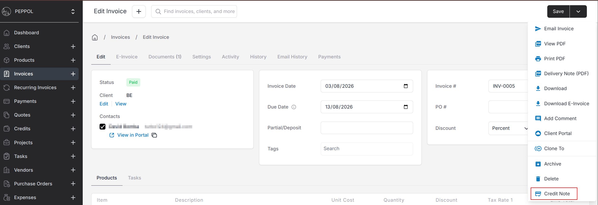
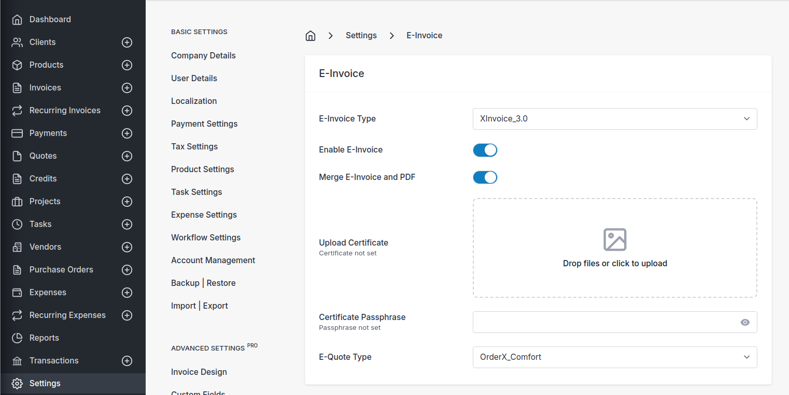

# E-Invoicing: send structured invoices and use PEPPOL

E-invoicing is the practice of sending invoices as structured, machine-readable documents rather than PDFs or paper, so your customer's accounting system can ingest them directly without anyone retyping figures. Adoption is accelerating: many jurisdictions have moved, or are moving, to mandate it for B2B and B2G transactions, and the EU has signalled that all member states will be on a standard PEPPOL network implementation by 2030.

Invoice Ninja has supported UBL-format invoices for some time, and now covers a range of e-invoice formats along with direct delivery over the PEPPOL network. Every supported standard can be downloaded straight from a regular invoice you create in Invoice Ninja, so enabling e-invoicing does not change how you invoice day to day. It only changes the shape of the document that goes out.

In some regions the invoice travels directly from you to your customer. In others (Italy is the obvious example) it has to be routed through a government clearinghouse (SDI in Italy's case), which then forwards it to the customer. If you are in one of those jurisdictions, both parties need to be registered with the relevant body, and you will need to start the process of obtaining a government routing ID if you have not already.

## Which e-invoice standards are supported?

The formats this page covers are:

- [PEPPOL (universal, cross industry and border)](#peppol)
- [ZUGFeRD / XRechnung (Germany)](#zugferd)
- [Facturae (Spain)](#facturae)
- [Verifactu (Spain)](#verifactu)
- [FatturaPA (Italy)](#fatturapa)
- [FACT1 (Romania)](#fact1)
- [EN16931 (generic)](#en16931)

## How do I open e-invoicing settings?

Go to **Settings > E-Invoicing** (route `#/settings/e_invoice`), under Advanced Settings. The page has no tabs. It has three cards: **E-Invoicing**, **Payment Means** and **Additional Tax Identifiers**. A **Learn more** link on the page goes to this user-guide article. **Settings > Email Settings** also has **Attach UBL/E-Invoice**, with the help text "For more e-invoice settings please navigate here." and that link opens this same settings page.

The E-Invoicing card has:

- **Help**, with a Learn more link
- **E-Invoice Type**, a dropdown
- **Enable E-Invoice**, a toggle

The E-Invoice Type options, in order, are:

FACT1, EN16931, XInvoice_3.0, XInvoice_2.3, XInvoice_2.2, XInvoice_2.1, XInvoice_2.0, XInvoice_1.0, XInvoice-Extended, XInvoice-BasicWL, XInvoice-Basic, Facturae_3.2.2, Facturae_3.2.1, Facturae_3.2 and FatturaPA.

When **Enable E-Invoice** is on, the same card also shows:

| Setting | What it is |
|---|---|
| **Merge E-Invoice and PDF** | A toggle, off by default, with no help text on the page. |
| **Upload Certificate** | Shown with "Certificate not set" and a **Drop files or click to upload** zone. |
| **Certificate Passphrase** | Shown with "Passphrase not set", as a password field. |
| **E-Quote Type** | A dropdown. The default value is **OrderX_Comfort**. |

The **Payment Means** card has a single **Code** dropdown (for example, "Instrument not defined"). The list includes **Credit transfer**, which is the usual EU choice (code 30 in the reference list below). The on-screen labels do not show the numeric codes.

The **Additional Tax Identifiers** card has this text: "If you are registered for VAT in other regions, you can add your VAT numbers for those regions here." It includes a **New VAT Number** row with a **Configure** button.

## What is PEPPOL? {#peppol}

PEPPOL is the closest thing to a universal e-invoicing standard: a cross-border network that lets businesses in participating countries exchange invoices without bilateral integrations. Invoice Ninja operates its own PEPPOL access point, available to both hosted and self-hosted users, which routes your e-invoices onto the network.

## How do I get started?

Each jurisdiction has its own set of fields that must be populated for an e-invoice to validate. In Germany, for example, a Payment Means field is required: that is the sending party's payment details, such as the IBAN and related bank metadata. Without it the e-invoice cannot be generated or sent. During onboarding you will have the chance to validate your data so nothing blocks delivery later.

If you are on the hosted platform, Invoice Ninja sends region-specific onboarding instructions. Self-hosted users proxy their e-invoices through the hosted platform: you register your service with Invoice Ninja, a legal entity ID is created for you, and your system then routes e-invoices through the hosted platform. For security and data privacy, the proxy only relays the data that is sent. It is never stored on the hosted side.

## What should I know before I turn e-invoicing on?

A few things are worth knowing before you enable e-invoicing, because they change how you build and handle invoices going forward:

1. All taxes must be applied at the line level. Invoice-level (total) taxes are not supported with e-invoicing. See [Line-Level vs Invoice-Level Tax](/docs/user-guide#line-level-vs-invoice-level-tax) for the reasoning behind the two modes.
2. If you do not charge VAT or tax on your invoices, you still need to apply a tax code or reason, for example a cross-border exemption, or seller with no VAT number. The e-invoice schema requires an explicit answer to "why no tax?" rather than silence.
3. Once an invoice has been *sent* it can never be modified. If something needs to change, create a new invoice or credit with the correction. This is a compliance rule, not a UI limitation: a sent e-invoice is effectively a legal document in transit.
4. To correct or reduce a sent PEPPOL invoice, you can create either a dedicated credit or a negative invoice. Both are supported. See [How do I correct a sent PEPPOL invoice?](#correcting-a-sent-peppol-invoice) below.

### How do I correct a sent PEPPOL invoice? {#correcting-a-sent-peppol-invoice}

You can correct a sent PEPPOL invoice in either of these ways.

#### Create a credit

This is the simplest option when you are crediting an existing invoice:

1. Open the original invoice.
2. Open its **Actions** menu and select **Credit Note**.
3. Review the new credit. The client, line items and original invoice reference are filled in for you.
4. Save the credit, then open its **E-Invoice** tab.
5. Check that the original invoice is shown under **Reference** and resolve any validation messages.
6. When you are ready to deliver the credit, send it.



#### Create a negative invoice

A negative invoice remains valid for PEPPOL and is sent as a credit note. Create a new invoice for the amount you need to reverse, using a negative **Quantity** and a positive **Unit Price** so the invoice total is negative.

:::warning Unit prices must never be negative
Always enter a positive **Unit Price** on PEPPOL invoices and credits.

- For a negative invoice, use a negative **Quantity** with a positive **Unit Price**.
- For a dedicated credit, use positive quantities and positive unit prices. The credit itself represents the reduction.

A negative unit price will prevent the PEPPOL document from validating.
:::

## Can I receive e-invoices?

Yes. On the hosted platform this is automatic. Self-hosted users receive inbound e-invoices via a cron that polls Invoice Ninja servers every four hours.

## What is the getting-started checklist?

### Which countries are supported?

The countries currently supported for PEPPOL delivery are:

Austria, Belgium, Denmark, Germany, Iceland, Ireland, Luxembourg, Netherlands, Norway, Sweden, Andorra, Australia, Bulgaria, Switzerland, Cyprus, Czech Republic, Estonia, Spain, Finland, France, United Kingdom, Greece, Croatia, Hungary, Italy, Japan, Liechtenstein, Lithuania, Latvia, Malaysia, New Zealand, Poland, Portugal, Romania, Singapore, Slovenia, Slovakia and the United States.

### Hosted users

1. Register with your government body if e-invoices are to be routed via a government portal.
2. Enable e-invoicing at **Settings > E-Invoicing**, and choose the **E-Invoice Type** you need.
3. Ensure your company details pass validation.
4. Generate and send e-invoices.

### Self-hosted users

1. Register with your government body if e-invoices are to be routed via a government portal.
2. Register your entity with Invoice Ninja.
3. Ensure your company details pass validation, as above.
4. Enable e-invoicing at **Settings > E-Invoicing**, and choose the **E-Invoice Type** you need.
5. Generate and send e-invoices.

## Which code lists and values do I need?

For e-invoicing there are several mandatory fields. One of them is the Payment Means: your preferred means of being paid by your client. On **Settings > E-Invoicing**, this is the **Code** dropdown on the Payment Means card. For EU users, choose **Credit transfer** (code 30 in the reference list). Some jurisdictions also require payment details such as an IBAN and BIC.

The full list of available means is listed below:

<a id="payment-means-codelist"></a>
<details>
<summary>Payment Means Codelist</summary>

1 - Instrument not defined<br/>
2 - Automated clearing house credit<br/>
3 - Automated clearing house debit <br/>
4 - ACH demand debit reversal <br/>
5 - ACH demand credit reversal <br/>
6 - ACH demand credit <br/>
7 - ACH demand debit <br/>
8 - Hold <br/>
9 - National or regional clearing <br/>
10 - In cash <br/>
11 - ACH savings credit reversal <br/>
12 - ACH savings debit reversal <br/>
13 - ACH savings credit <br/>
14 - ACH savings debit <br/>
15 - Bookentry credit <br/>
16 - Bookentry debit <br/>
17 - ACH demand cash concentration/disbursement (CCD) credit <br/>
18 - ACH demand cash concentration/disbursement (CCD) debit <br/>
19 - ACH demand corporate trade payment (CTP) credit <br/>
20 - Cheque <br/>
21 - Banker's draft <br/>
22 - Certified banker's draft <br/>
23 - Bank cheque (issued by a banking or similar establishment) <br/>
24 - Bill of exchange awaiting acceptance <br/>
25 - Certified cheque <br/>
26 - Local cheque <br/>
27 - ACH demand corporate trade payment (CTP) debit <br/>
28 - ACH demand corporate trade exchange (CTX) credit <br/>
29 - ACH demand corporate trade exchange (CTX) debit <br/>
30 - Credit transfer <br/>
31 - Debit transfer <br/>
32 - ACH demand cash concentration/disbursement plus (CCD+) credit <br/>
33 - ACH demand cash concentration/disbursement plus (CCD+) debit <br/>
34 - ACH prearranged payment and deposit (PPD) <br/>
35 - ACH savings cash concentration/disbursement (CCD) credit <br/>
36 - ACH savings cash concentration/disbursement (CCD) debit <br/>
37 - ACH savings corporate trade payment (CTP) credit <br/>
38 - ACH savings corporate trade payment (CTP) debit <br/>
39 - ACH savings corporate trade exchange (CTX) credit <br/>
40 - ACH savings corporate trade exchange (CTX) debit <br/>
41 - ACH savings cash concentration/disbursement plus (CCD+) credit <br/>
42 - Payment to bank account <br/>
43 - ACH savings cash concentration/disbursement plus (CCD+) debit <br/>
44 - Accepted bill of exchange <br/>
45 - Referenced home-banking credit transfer <br/>
46 - Interbank debit transfer <br/>
47 - Home-banking debit transfer <br/>
48 - Bank card <br/>
49 - Direct debit <br/>
50 - Payment by postgiro <br/>
51 - FR, norme 6 97-Telereglement CFONB (French Organisation for Banking Standards)  - Option A <br/>
52 - Urgent commercial payment <br/>
53 - Urgent Treasury Payment <br/>
60 - Promissory note <br/>
61 - Promissory note signed by the debtor <br/>
62 - Promissory note signed by the debtor and endorsed by a bank <br/>
63 - Promissory note signed by the debtor and endorsed by a third party <br/>
64 - Promissory note signed by a bank <br/>
65 - Promissory note signed by a bank and endorsed by another bank <br/>
66 - Promissory note signed by a third party <br/>
67 - Promissory note signed by a third party and endorsed by a bank <br/>
70 - Bill drawn by the creditor on the debtor <br/>
74 - Bill drawn by the creditor on a bank <br/>
75 - Bill drawn by the creditor, endorsed by another bank <br/>
76 - Bill drawn by the creditor on a bank and endorsed by a third party <br/>
77 - Bill drawn by the creditor on a third party <br/>
78 - Bill drawn by creditor on third party, accepted and endorsed by bank <br/>
91 - Not transferable banker's draft <br/>
92 - Not transferable local cheque <br/>
93 - Reference giro <br/>
94 - Urgent giro <br/>
95 - Free format giro <br/>
96 - Requested method for payment was not used <br/>
97 - Clearing between partners <br/>
ZZZ - Mutually defined <br/>

</details>


## What extra rules apply in each country?

Every PEPPOL country layers a few of its own rules on top of the standard. The sections below cover what each one expects in addition to the baseline fields.

Every PEPPOL country layers a few of its own rules on top of the standard. The sections below cover what each one expects in addition to the baseline fields.

### AT - Austria

#### CustomerAssignedAccountID - Mandatory for GOV clients

When you are billing a government body in Austria, the e-invoice has to include:

AccountingSupplierParty > CustomerAssignedAccountID

This is the ID of the department within the government that the e-invoice will be routed to :  without it the system has no way to direct the document internally.

### BE - Belgium

No additional requirements. When your legal entity ID is created it is automatically synced with HERMES.

### CH - Switzerland

#### Payment Means - Mandatory

The payment means tells the recipient how you would like to be paid. Using the [Payment Means](#payment-means-codelist) codelist, you must include at least ONE payment means of the Credit Transfer type.

```xml
   <cac:PaymentMeans>
      <cbc:PaymentMeansCode>30</cbc:PaymentMeansCode> <!-- code from payment means code list Credit Transfer-->
      <cac:PayeeFinancialAccount>
         <cbc:ID>DE89370400440532013000</cbc:ID> <!-- IBAN CODE -->
         <cac:FinancialInstitutionBranch>
            <cbc:ID>DEUTDEMMXXX</cbc:ID> <!-- BIC CODE -->
         </cac:FinancialInstitutionBranch>
      </cac:PayeeFinancialAccount>
   </cac:PaymentMeans>
```

### DE - Germany

#### Payment Means - Mandatory

The payment means contains information on how the seller wishes to be paid. Consult the [Payment Means](#payment-means-codelist) codelist for the right code :  for example, to declare a bank account for credit transfer:

```xml
   <cac:PaymentMeans>
      <cbc:PaymentMeansCode>30</cbc:PaymentMeansCode> <!-- code from payment means code list Credit Transfer-->
      <cac:PayeeFinancialAccount>
         <cbc:ID>DE89370400440532013000</cbc:ID> <!-- IBAN CODE -->
         <cac:FinancialInstitutionBranch>
            <cbc:ID>DEUTDEMMXXX</cbc:ID> <!-- BIC CODE -->
         </cac:FinancialInstitutionBranch>
      </cac:PayeeFinancialAccount>
   </cac:PaymentMeans>
```

### ES - Spain

*** Government registration required ***

#### Payment Means - Mandatory

The payment means contains information on how the seller wishes to be paid. Using the [Payment Means](#payment-means-codelist) codelist, you must include at least ONE payment means of the Credit Transfer type.

```xml
   <cac:PaymentMeans>
      <cbc:PaymentMeansCode>30</cbc:PaymentMeansCode> <!-- code from payment means code list Credit Transfer-->
      <cac:PayeeFinancialAccount>
         <cbc:ID>DE89370400440532013000</cbc:ID> <!-- IBAN CODE -->
         <cac:FinancialInstitutionBranch>
            <cbc:ID>DEUTDEMMXXX</cbc:ID> <!-- BIC CODE -->
         </cac:FinancialInstitutionBranch>
      </cac:PayeeFinancialAccount>
   </cac:PaymentMeans>
```

#### Due Date - Mandatory

The invoice MUST have a due date set.

#### Government bound e-invoices

If sending to a Spanish government body, the property:

AccountingCustomerParty > PublicIdentifiers

must be set.

### FI - Finland

Finland requires some special mapping of relevant IDs, the following client fields should be used for these:

| Field | Scheme | Example |
|-------|--------|---------|
| Routing ID | FI:OPID (operator) | `003702554123` |
| ID Number | FI:OVT | `003703854172` |
| VAT Number | FI:VAT | `FI06874602` |


### FR - France

The SIRET / 0009 identifier of the final recipient must be included in the `invoice.accountingCustomerParty.publicIdentifiers` array.

### IT - Italy

No special requirements.

### NL - Netherlands

When sending to government bodies the following property must be configured:

accountingSupplierParty > party > contact > email

### PL - Poland

*** Government registration required ***

### RO - Romania

*** Government registration required ***

#### Special codes for county

The county field for a Romanian address must use the ISO3166-2:RO codes :  for example, "RO-AB" or "RO-AR". Do not omit the country prefix, as validation will reject the document.

#### Special codes for city

For county RO-B the city field must be one of SECTOR1 through SECTOR6.

### SE - Sweden

Receiver needs to be registered with Svefaktura to receive the e-invoice.


## What is ZUGFeRD? {#zugferd}



ZUGFeRD is the German hybrid format: a regular PDF with the structured e-invoice XML embedded inside it, which means a single document works for both humans and machines. Turn it on from **Settings > E-Invoicing** by choosing the **XInvoice** type you need (the E-Invoice Type list includes XInvoice_3.0 through XInvoice_1.0, plus XInvoice-Extended, XInvoice-BasicWL and XInvoice-Basic), and turn on **Enable E-Invoice**. If you would like the XML carried inside the PDF itself rather than as a separate file, turn on **Merge E-Invoice and PDF** (this toggle appears once e-invoicing is enabled) before saving.

ZUGFeRD does not accept negative-valued invoices. If you have historically used a negative invoice to represent a credit, that will not work here. You will need to create a dedicated credit with matching *positive* values reflecting the credit you are assigning. See [Credits](/docs/user-guide/credits) for how credits work.

## What is Facturae? {#facturae}

Spanish Facturae documents are supported and generate valid output. These can be uploaded into the FACe system. The E-Invoice Type list includes **Facturae_3.2.2**, **Facturae_3.2.1** and **Facturae_3.2**.

## What is Verifactu? {#verifactu}

Your day-to-day invoicing flow inside Invoice Ninja does not change, but there are a few important behaviours to be aware of because Verifactu is a submission-based system with stricter document lifecycle rules:

**1. Power of Attorney.** For Invoice Ninja to submit invoices to AEAT on your behalf, AEAT requires you to grant permission. This is done directly on the AEAT website by searching for Invoice Ninja in the list of registered providers.

**2. Document submission process.** Once an invoice has been submitted it cannot be modified: the document moves into a locked state. You can still cancel a submitted document using **Cancel** or **Delete** on the invoice. If you need to issue a rectification invoice (a credit), use the **Rectify** menu option. This generates a negative invoice linked to the original. Rectification invoices can themselves be cancelled, which removes the credit linked to the invoice.

Once an invoice has a rectification invoice (credit) applied to it, it cannot be deleted unless all attached credits have also been cancelled or deleted first.

**3. Verifactu tab.** After saving an invoice on the edit invoice page, a Verifactu tab appears with additional information about that invoice's validation status.

**4. Mandatory information.** For invoices to Spanish customers you must enter a NIF for the client. This is an AEAT requirement. The only exception is when no NIF is available, in which case the client's passport number can be stored in the **ID Number** field on the client record (see [Clients](/docs/user-guide/clients)). AEAT requires census data on the recipient, so sending will fail for any client missing these details.

## What is FatturaPA? {#fatturapa}

Italian e-invoices can be generated, but the SDI connection is not live yet, so this format is not currently production ready.

## What is FACT1? {#fact1}

Romanian e-invoices can be generated, but the delivery connection is not live yet, so this format is not currently production ready.

## What is EN16931? {#en16931}

Standard EN16931 documents can be generated and downloaded as needed. **EN16931** is one of the E-Invoice Type options. This is the generic European norm that underpins most national formats, so it is a useful fallback when you need a compliant structured invoice without committing to a specific country profile.

## Related

- [Taxes](/docs/user-guide/taxes)
- [Tax Settings](/docs/user-guide/basic-settings#tax_settings)
- [Email Settings](/docs/user-guide/advanced-settings#email_settings)
- [Invoices](/docs/user-guide/invoices)
- [Credits](/docs/user-guide/credits)
- [Clients](/docs/user-guide/clients)
