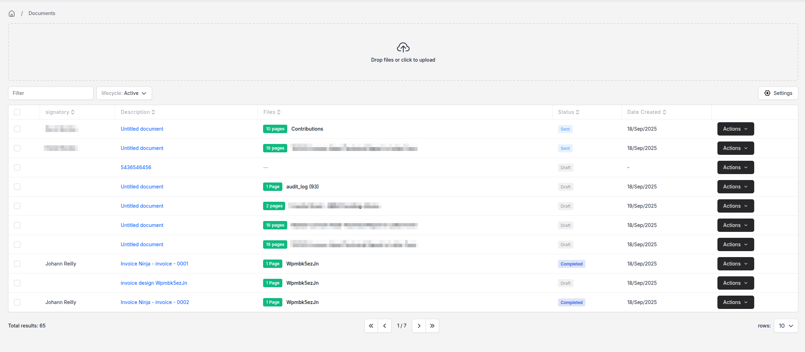
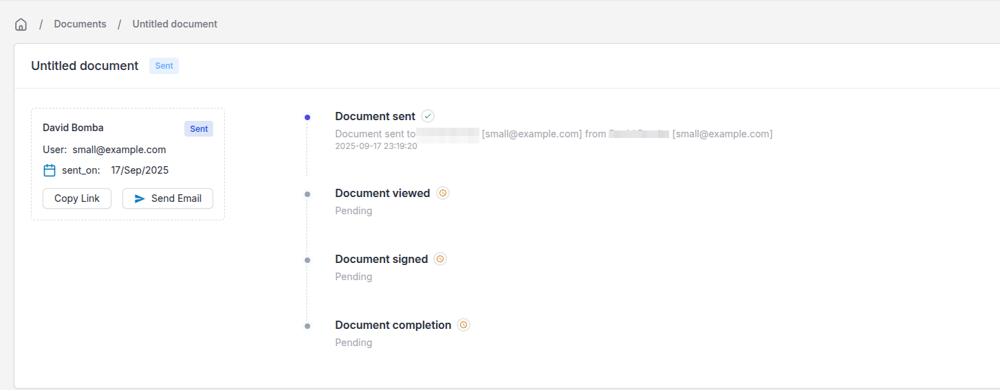
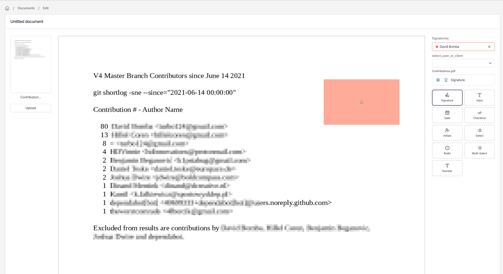
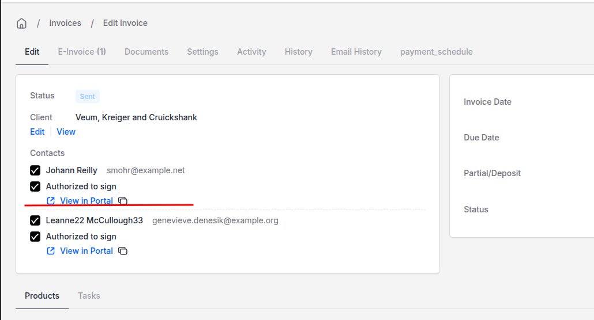
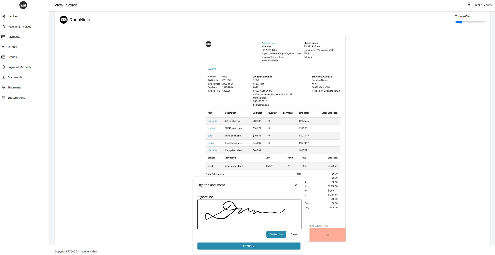
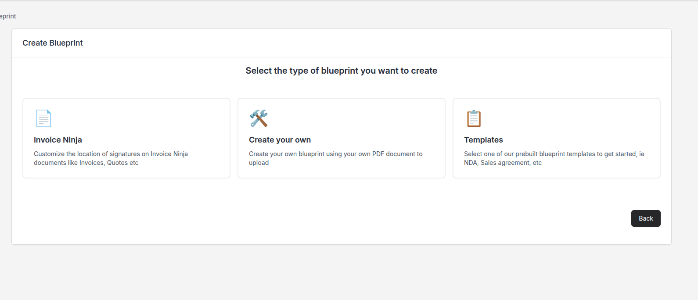
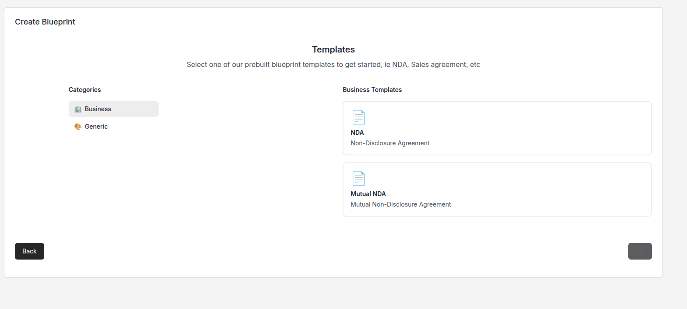
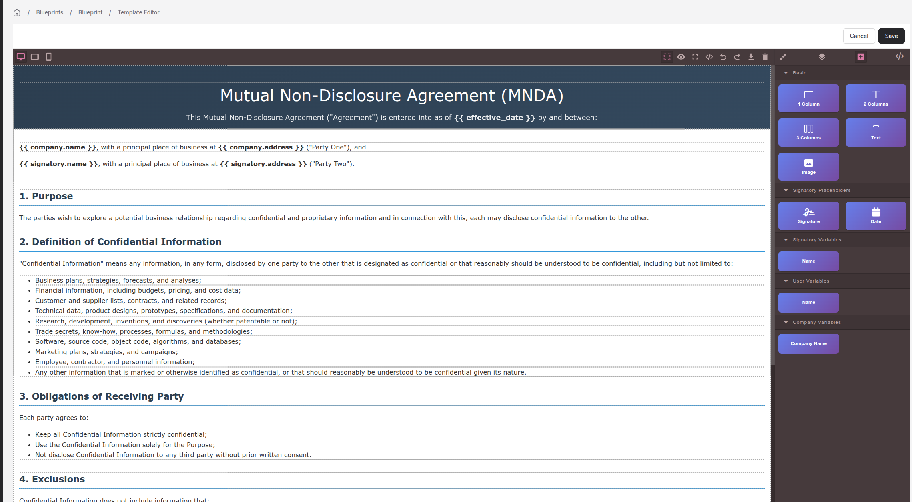
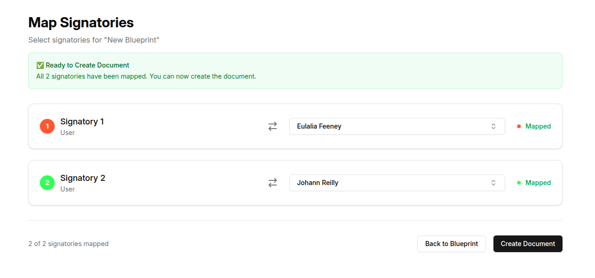

	

# E-Signatures: get documents signed with DocuNinja

DocuNinja is the sister product to Invoice Ninja for collecting e-signatures on business documents. If you have ever chased a client for a signed quote, emailed a PDF contract and hoped it came back countersigned, or needed proof that someone agreed to your terms before you started work, this is the piece that fills that gap.

It works with files you upload and with templates you reuse, including templates tied to Invoice Ninja designs such as a quote design. Signed quotes, invoices, credits and purchase orders can also trigger notification emails from DocuNinja Settings.

## What is DocuNinja? {#introduction}

DocuNinja captures legally useful e-signatures and keeps a record of what happened. Signatures captured through DocuNinja are compliant with the three standards most businesses care about: ESIGN and UETA in the United States, and eIDAS across the European Union, so the signed document holds up the same way a paper signature would.

From inside Invoice Ninja, **DocuNinja** appears in the left menu after **Reports** and before **Settings**. Opening it takes you to `#/docuninja`, with the page heading **DocuNinja**. The menu expands to **Templates** and **Users**. You create, send, track and store documents from here, using your Invoice Ninja login and permissions. It is a first-party integration, not a third-party add-on.

An **e-signature** here means a signature captured electronically on a document, with a verifiable history of who signed and when.

## Why is DocuNinja a separate product? {#why-its-a-separate-product}

DocuNinja is built and maintained by the same team, but it runs as its own application rather than a feature built into Invoice Ninja. E-signature compliance has its own legal, infrastructure and audit requirements that are easier to meet in a dedicated service. Keeping it separate also means you can use DocuNinja outside Invoice Ninja, for documents that never become invoices, or for paperwork that starts in another system.

From your point of view, that separation stays in the background. DocuNinja connects to your Invoice Ninja account and its menu sits alongside the rest of the app.

## What can I use DocuNinja to sign? {#the-three-signing-workflows}

You can upload a file, start from a template, or clone an existing document to a template and reuse it.

### How do I get an invoice, quote or purchase order signed? {#signing-invoice-ninja-documents}

Work from the **DocuNinja** menu, not from the invoice or quote edit screen. Those edit views do not have a DocuNinja, Request Signature or Authorized Signatories control. What they do have, on the Contacts card, is the same **Authorized to sign** toggle you set on the [client](/docs/user-guide/clients#contacts) or [vendor](/docs/user-guide/purchase-orders) contact.

Create or reuse a document in DocuNinja. Templates can have a Type such as **Quote Design**. When a quote, invoice, credit or purchase order is signed, DocuNinja Settings can email the client or vendor. See [Notifications](#docuninja-settings) below.

Every completed document has an **Audit Log**, which downloads as a PDF. That file is the official audit record you can keep or share as proof. There is no separate Document Certificate action.

See [Quotes](/docs/user-guide/quotes), [Invoices](/docs/user-guide/invoices) and [Purchase Orders](/docs/user-guide/purchase-orders).

### How do I use a template with Invoice Ninja data? {#custom-templates-with-variable-injection}

There is no separate prebuilt template library. Under **DocuNinja > Templates** (`#/docuninja/templates`) you can click **New Template**, open an existing row and choose **Use Template**, or choose **Clone to Template** from a document's Actions menu.

In the template editor, the **Variable** widget inserts Invoice Ninja data. Its **Template Variable** dropdown lists friendly names, grouped as Company, Sender, Signatory and Client, with the help text "Select a predefined variable to display on the document." The `{{ }}` placeholder syntax is not shown in that dropdown. It appears in **DocuNinja > Settings > Email Templates**.

### How do I get an existing PDF signed? {#uploading-an-external-document}

On the DocuNinja documents page, use **Drop files or click to upload**. In the builder you can also use **Add files**, or **Google Drive**. Then add signatories, place fields, and send the document when you are ready. Signed copies stay in the DocuNinja list, so you have one place to look when you need them later.

Do not send a document unless you intend the recipient to receive it.

## Where do I find DocuNinja in the app? {#preview}

### Documents {#documents-tab}

The documents page has no tabs. It is the list itself, with a **Filter** box, **Lifecycle**, **Status**, a **Settings** button, and the upload dropzone.

The list columns are Contact, User, Document, Files, Status and Date Created, plus the row Actions button.

**Lifecycle** options are Active, Archived and Deleted. **Status** options are Draft, Sent, Pending approval, Completed, Approved, Voided, Expired and Rejected.

On a completed document, the row **Actions** menu is **Edit**, **Timeline**, **View PDF**, **Audit Log**, **Download**, **Clone**, **Clone to Template**, **Options** and **Delete**.

### How do I track what happened to a document? {#timeline}

Open **Timeline** from the row Actions menu (route `#/docuninja/<id>`, titled **View Document**). The timeline events are **Document sent**, **Document viewed**, **Document signed** and **Document completion**. An **Expired** event can also appear.

The view shows each signatory with a status badge such as Signed, Sent or Pending, and the signed date when it applies. On a sent document you may also see **Copy Link** and **Send Email**. Use Send Email only when you intend the signer to be contacted.

**Audit Log** on the same Actions menu downloads a PDF titled Audit Log. It includes signatory events, form field values, document events, and SHA-256 hash labels, and ends with "This is an official audit record of all actions taken on this document."

### How does the document builder work? {#builder}

Opening a draft document goes to the builder (`#/docuninja/<id>/builder`, titled **Edit Document**). The header button is **Save for Later**.

On the left are page thumbnails, an **Add files** dropzone, and **Google Drive**. The centre is the document preview. On the right, **Signatories** has a **Select User or Client** dropdown, which lists clients and users, plus **Create Client**.

The **Document Checklist** for a document is:

1. Upload a document
2. Add signatories
3. Place fields on document
4. Send document

The widget palette, once a signatory is in place, is **Signature**, **Input**, **Date**, **Checkbox**, **Initials**, **Select**, **Radio**, **Multi-Select**, **Number** and **Variable**, with a **More tools** link for the later items. Click a tool, then place it on the page.

Each field has settings (the gear icon). **Required** is a radio group: **Optional**, **Always required**, or **Required when...**. An **Input** field also has **Validation Rule**: None, Length, SSN, EIN, Email, URL, ZIP, Numbers only, Letters only, or Custom Regex. **Email** is the email-address format rule. Advanced options include **Show Label**, **Border Style**, **Border Color**, and **Copy to all pages**, with the help text "Field will appear on all pages. Signer only fills it once."

### How do I choose who is allowed to sign? {#authorized-signatories}

On the [client](/docs/user-guide/clients#contacts) record, each contact has an **Authorized to sign** toggle. Vendor contacts have the same toggle. When you edit an [invoice](/docs/user-guide/invoices) or [quote](/docs/user-guide/quotes), that same checkbox also appears on the Contacts card, next to **View in Portal**.

There is no separate Authorized Signatories panel or e-signature setting on the invoice or quote itself.

In the DocuNinja builder, you still add the people who must sign with **Select User or Client** or **New Signatory**.

### What does the client see when they sign? {#signing-flow}

The signer works through the document in the [Client Portal](/docs/user-guide/client-portal).

### How do templates work? {#blueprint-wizard}

There is no Blueprints item in the menu. Signing setups you want to reuse live under **DocuNinja > Templates**. The list has **Filter**, **Lifecycle**, and **New Template**. The columns are Status, Name and Type.

Row Actions on a template are **Edit**, **Use Template**, **Options**, **Archive** and **Delete**.

### Is there a prebuilt template library? {#prebuilt-templates}

There is no separate prebuilt template library or category list. Start from **New Template**, reuse a template with **Use Template**, or turn an existing document into a template with **Clone to Template**.

### How do I edit a template? {#template-editor}

**Edit** on a template opens a drag-and-drop editor, similar to the document builder. You can add signatories with **New Signatory**, and place the same widgets: Signature, Input, Date, Checkbox, Initials, Select, Radio, Multi-Select, Number and Variable.

The template checklist ends with **Ready to use**, rather than Send document.

To fill in Invoice Ninja data, place a **Variable** widget and pick a **Template Variable**. The groups and names are:

| Group | Variables |
|---|---|
| **Company** | Company Name, Address Line 1, Address Line 2, City, State, Postal Code, Full Address |
| **Sender** | Full Name, First Name, Last Name, Email, Phone Number |
| **Signatory** | Full Name, First Name, Last Name, Email, Phone |
| **Client** | Client Name, Address Line 1, Address Line 2, City, State, Postal Code, Phone, Website, Email, VAT Number, ID Number, Public Notes |

The `{{ }}` syntax used in email templates is listed under [DocuNinja Settings](#docuninja-settings).

### How do I send a document or use a template? {#mapping-signatories}

On a document, the last checklist step is **Send document**. On a template, use **Use Template** to start a document from it, then add signatories and send only when you intend the recipient to receive it.

## What can I change in DocuNinja Settings? {#docuninja-settings}

The **Settings** button on the documents list opens DocuNinja Settings (`#/docuninja/settings/email_templates`). The sections are **Email Settings**, **Email Templates**, **Notifications**, **Widget Defaults** and **Reminder Schedules**.

**Email Settings** includes **From Name** ("Custom sender name for outgoing document emails.") and **Reply-To Email** ("Custom reply-to email address for outgoing document emails.").

**Email Templates** is where the `{{ }}` variables are listed, including `{{ company.name }}`, `{{ company.address1 }}`, `{{ document.link }}`, `{{ sender.name }}`, `{{ user.name }}` and `{{ contact.name }}`.

**Notifications** includes:

- Quote signed notification ("Email client when Quote is signed")
- Invoice signed notification ("Email client when Invoice is signed")
- Credit Signed Notification ("Email client when Credit is signed")
- Purchase order signed notification ("Email Vendor when Purchase Order is signed")
- Custom Document completed ("Email client when a Custom Document has been signed")
- **Attach Audit Log to Completed Email** ("If enabled, the audit log will be attached to the signed document completed email.")

**Widget Defaults** includes **Show Label**, **Widget Border Style** and **Widget Border Color**. **Reminder Schedules** has **Add Reminder Schedule**.

## Frequently asked questions {#faq}

### Can I customize where signatures appear on quotes and invoices? {#can-i-customise-where-signatures-appear-on-my-quotes-and-invoices}

Yes. Place the fields in the DocuNinja builder or in a template, including a template whose Type is a document design such as Quote Design. Signature placement is not configured on the invoice or quote edit screen.

### Can I capture fields other than signatures? {#can-i-capture-fields-other-than-signatures}

Yes. Alongside **Signature**, the builder and template editor include **Input**, **Date**, **Checkbox**, **Initials**, **Select**, **Radio**, **Multi-Select**, **Number** and **Variable**. An Input field can use a validation rule such as Email, and any field can be Optional, Always required, or Required when...

### Is DocuNinja SOC 2 compliant? {#is-docuninja-soc-2-compliant}

Yes. DocuNinja is certified SOC 2 compliant. Contact us for more information.

## Related

- [Client Portal](/docs/user-guide/client-portal)
- [Clients](/docs/user-guide/clients#contacts)
- [Quotes](/docs/user-guide/quotes)
- [Invoices](/docs/user-guide/invoices)
- [Purchase Orders](/docs/user-guide/purchase-orders)
- [Get Started](/docs/user-guide)
