# FAQ: common questions about invoices, payments and settings

Here are short answers to the questions people ask most often when they start sending invoices, taking payments and inviting their team. Each one points to the full page if you want more detail.

## What is the Client Portal? {#what-is-the-client-portal}

When you email a client an invoice, that email includes a link to view the invoice online in the [Client Portal](/docs/user-guide/client-portal). The portal is a self-serve dashboard where your client can view invoices, recurring invoices, payments, quotes, credits, payment methods, documents, tasks, projects and subscriptions, and can pay online.

Every client can use the portal. If you want people to sign up themselves as new clients, turn on **Client Registration** under **Settings > Client Portal**, on the **Registration** tab ("Enable clients to self register in the portal").

If you turn on **Client Initiated Payments** under **Settings > Payment Settings** (the page is titled **Online Payments**), clients can also pay you from the portal without you sending an invoice first. The help text is "Support making a payment in the client portal without an invoice".

To see the portal the way a client sees it, open the client and use the **Client Portal** link on a contact (it sits under the contact's name and email, with a copy icon beside it). An invoice row's **Actions** menu also includes **Client Portal**. The client's own overflow menu does not include **Client Portal**.

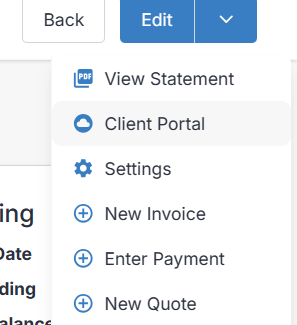

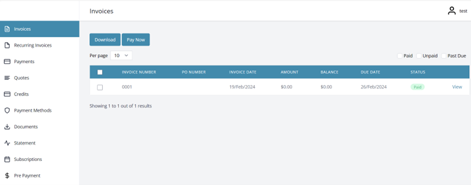

See [Client Portal](/docs/user-guide/client-portal) and [Client Portal settings](/docs/user-guide/advanced-settings#client_portal).

## What is a subdomain? {#what-is-a-subdomain}

The subdomain personalizes your client portal links to match your brand, for example `https://your-brand.invoicing.co`.

Set it under **Settings > Client Portal**, on the **Settings** tab. That tab has **Portal Mode**, **Subdomain** and **Login URL**. **Portal Mode** can be **Subdomain** or **Domain**. The help text on Portal Mode is "The subdomain is used in the client portal to personalize links to match your brand. ie, https://your-brand.invoicing.co". **Login URL** is a read-only address in the form of your portal login, with a copy icon.

Links the app generates for invoices, quotes and other documents use the subdomain you configure. If you have more than one company, you can set a different subdomain for each one, for example `companya.invoicing.co` and `companyb.invoicing.co`, so each company has its own branded link.

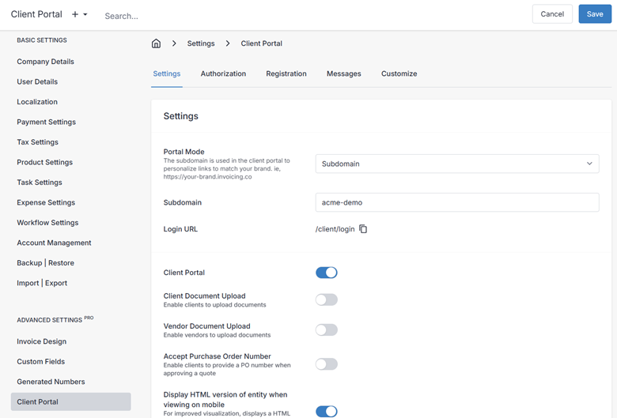

See [How do I configure the client portal?](/docs/user-guide/advanced-settings#client_portal).

## How can I accept payments online? {#how-can-i-accept-payments-online-what-is-a-payment-gateway-aka-merchant-processor}

A **payment gateway** is the service that processes online card and bank payments (sometimes called a merchant processor). Invoice Ninja integrates with the major gateways so you can accept payments in many currencies. A list of providers is on the [Invoice Ninja payments page](https://invoiceninja.com/payments/).

To accept payments online, connect a gateway to your account. See [Payment Gateways](/docs/user-guide/gateways) and [Payment Settings](/docs/user-guide/basic-settings#payment_settings).

## How do I set up automatic reminders for unpaid invoices? {#how-do-i-setup-automatic-reminders-for-unpaid-invoices}

Automatic invoice reminders are configured under **Settings > Templates & Reminders**, on the **Reminders** tab. The reminder tiers are **First Reminder**, **Second Reminder**, **Third Reminder** and **Endless Reminder**. There is also a **First Quote Reminder**.

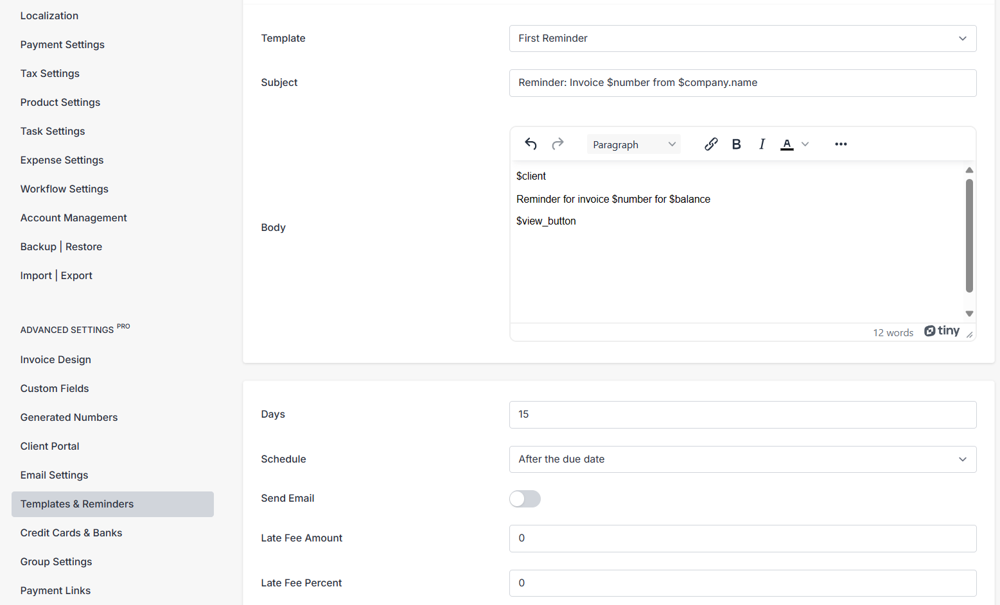

For the first, second and third reminders you can set:

- **Days:** how many days from the schedule point the reminder runs
- **Schedule:** **Disabled**, **After the invoice date**, **Before the due date**, or **After the due date**
- **Send Email:** turn this on only if you want the reminder emails to start going out
- Optional late fees, as **Late Fee Amount** and **Late Fee Percent**

See [How do I configure payment reminders and late fees?](/docs/user-guide/advanced-settings#reminder-templates).

## What is the Payments module? {#what-is-the-payments-module}

The [Payments](/docs/user-guide/payments) list records money you receive. Each payment can be linked to one or more invoices, including deposits and partial payments. A payment can also be left partly or fully unapplied if you received more than you allocated.

The list button and the unsaved form are both labeled **Enter Payment**. The form fields are **Client**, **Invoice**, **Amount received**, **Payment Date**, **Payment Type**, **Transaction Reference**, **Private Notes**, **Send Email** and **Convert currency**. The help text on Amount received is "Enter a value here if the total amount received was MORE than the invoice amount, or when recording a payment with no invoices. Otherwise this field should be left blank."

See [How do I record a payment by hand?](/docs/user-guide/payments#how-do-i-record-a-payment-by-hand).

## How can I send a payment email? {#how-can-i-send-payment-email}

If you want clients to receive an email acknowledging a payment, set that under **Settings > Payment Settings** (titled **Online Payments**).

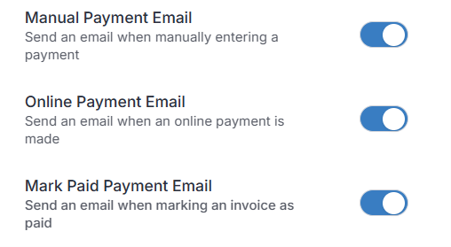

The options are:

- **Manual Payment Email:** "Send an email when manually entering a payment"
- **Online Payment Email:** "Send an email when an online payment is made"
- **Mark Paid Payment Email:** "Send an email when marking an invoice as paid"

The **Enter Payment** form also has a **Send Email** toggle, so you can choose whether to send a receipt for that one payment.

You can customize the receipt email under **Settings > Templates & Reminders**. Open the **Payment** tab. That tab has sub-buttons for **Payment**, **Partial Payment** and **Payment Failed**.

The payment email includes a button to view the invoice the payment was made against, by default.

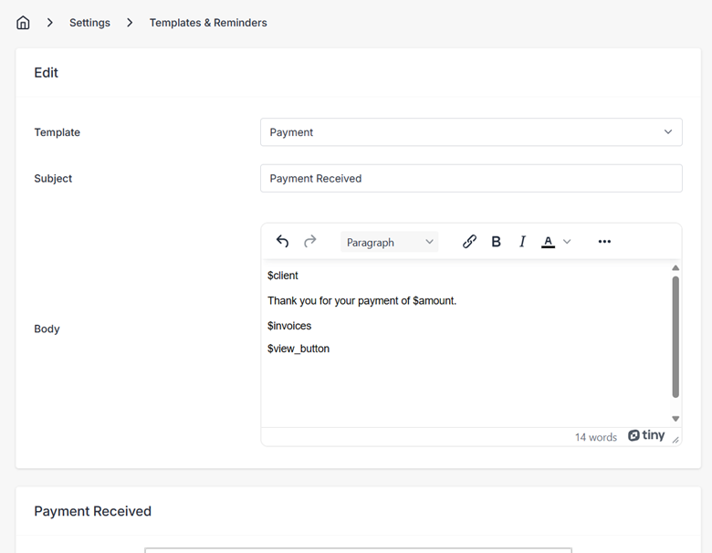

See [Payment Settings](/docs/user-guide/basic-settings#payment_settings) and [Templates & Reminders](/docs/user-guide/advanced-settings#templates_and_reminders).

## How do I turn a quote into an invoice? {#is-it-possible-to-change-a-quote-into-an-invoice-when-my-client-decides-to-proceed}

Yes. Use **Convert To** in the quote's **Actions** menu. On the quote edit page, the same item is in the arrow next to **Save**.

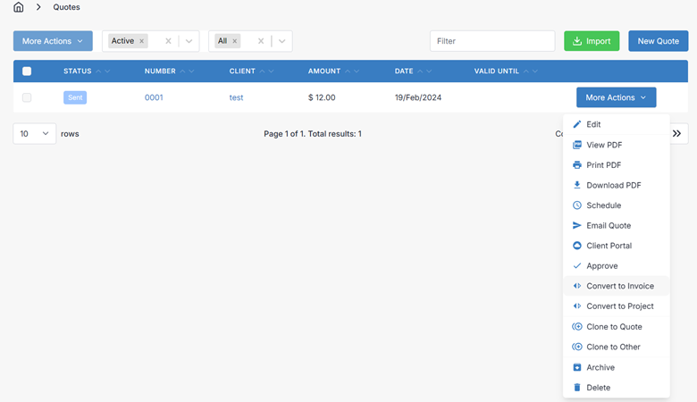

See [How do I turn a quote into an invoice?](/docs/user-guide/quotes#how-do-i-turn-a-quote-into-an-invoice).

## How can I charge late fees on overdue invoices? {#how-can-i-charge-late-fees-or-percentages-for-overdue-invoices}

Set late fees under **Settings > Templates & Reminders**, on the **Reminders** tab.

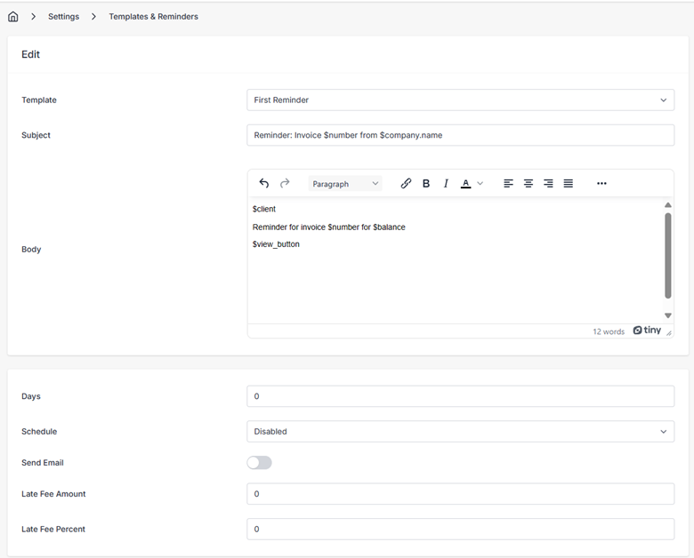

You can set a **Late Fee Amount** and a **Late Fee Percent** on **First Reminder**, **Second Reminder** and **Third Reminder**. Each tier can use a different amount or percentage. For example, the first reminder might add 5%, the second another 5%, and the third another 5%.

See [How do I configure payment reminders and late fees?](/docs/user-guide/advanced-settings#reminder-templates).

## What is the documents feature? {#what-is-the-documents-feature}

Documents are files you upload and attach to a record. Typical uses include contracts, receipts and other files you want close at hand.

On a [client](/docs/user-guide/clients#how-do-i-add-documents-to-a-client), the **Documents** tab has a **Drop files or click to upload** zone and a table of Name, Date, Type and Size. [Quotes](/docs/user-guide/quotes) and [invoices](/docs/user-guide/invoices) also have a **Documents** tab.

## How can I invoice a client in a different currency? {#i-have-some-clients-in-different-countries-how-can-i-make-an-invoice-in-a-different-currency}

The default currency for a new client comes from **Settings > Localization** (**Currency**). When you add or edit a client, you can change that client's currency on the **Settings** tab.

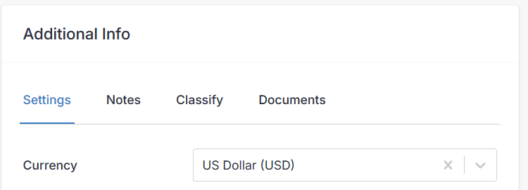

Currency is set per client, not per document. If the [payment gateway](/docs/user-guide/gateways) you connected supports that currency, the client can pay in it, and the payment records the currency they paid in.

The dashboard has a currency dropdown in the top-right toolbar, including an **All** option. You can also filter [reports](/docs/user-guide/reports) by currency.

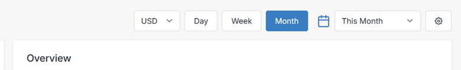

If a group of clients should share the same currency, or other settings, use groups. Create a group under **Settings > Group Settings**, then pick it on each client. See [How do I apply the same settings to many clients (groups)?](/docs/user-guide/clients#how-do-i-apply-the-same-settings-to-many-clients-groups) and [Group Settings](/docs/user-guide/advanced-settings#group_settings).

## How can I show the currency symbol or code on invoices and quotes? {#how-can-i-show-the-currency-symbol-on-invoicesquotes}

Under **Settings > Localization**, **Currency Format** is a radio pair: **Symbol: $ 1,000.00** or **Code: 1,000.00 USD**.

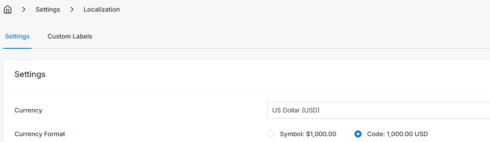

See [How do I set language, currency and dates?](/docs/user-guide/basic-settings#localization).

## How do I set up taxes? {#how-to-setup-taxes}

Invoice Ninja can record tax on invoices you send and on expenses you pay. You can apply one, two or three tax rates together, at invoice level, at line-item level, or both.

1. Go to **Settings > Tax Settings** and click **New Tax Rate**. Enter the tax name and percentage.
2. Choose how many **Invoice Tax Rates**, **Line Item Tax Rates** and **Expense Tax Rates** to allow (Disabled, One Tax Rate, Two Tax Rates or Three Tax Rates).
3. If you do not pick a **Default Tax Rate**, you will need to choose the rate yourself when you create an invoice or expense.
4. When line-item taxes are enabled, the invoice gets tax column(s) on each line.
5. Set **Inclusive Taxes** if tax is already built into the price. When exclusive is selected, the example shown is "Exclusive: 100 + 10% = 100 + 10".

You can also set a **Tax Category** on each [product](/docs/user-guide/products), such as **Physical Goods** or **Tax Exempt**, so reports can group tax by what you sold.

For calculated US sales tax, EU VAT, exemptions and the warning that turning on **Calculate Taxes** may recalculate open invoices, see [Taxes](/docs/user-guide/taxes) and [Tax Settings](/docs/user-guide/basic-settings#tax_settings).

## How can I give staff their own logins without showing them all reports? {#how-can-i-create-individual-logins-to-invoice-ninja-for-my-staff-to-make-invoices-and-use-features-but-not-see-my-businesss-total-revenues-or-reporting}

Manage extra users under **Settings > User Management**.

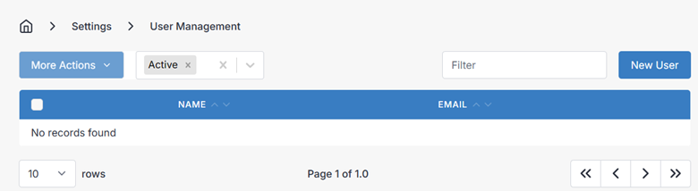

When you add a user with **New User**, the **Permissions** tab lets you choose what they can access. If you do not want them to see reports or analytics, leave **View Dashboard** and **Reports** off.

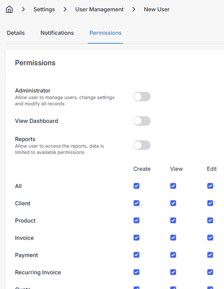

See [How do I add teammates and set their permissions?](/docs/user-guide/advanced-settings#user_management).

## What happens when I email an invoice to the client? {#what-happens-when-i-email-an-invoice-out-to-the-client}

The client receives an email with a link to open and view the invoice online, and to pay if you have a payment gateway connected. The email uses the **Invoice** template, which you can edit under **Settings > Templates & Reminders**.

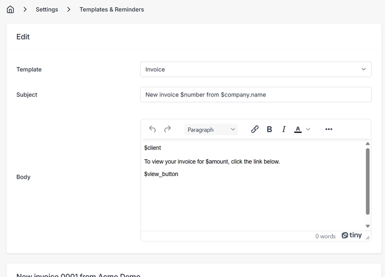

See [Email Settings](/docs/user-guide/advanced-settings#email_settings) and [Templates & Reminders](/docs/user-guide/advanced-settings#templates_and_reminders).

## How do I attach the invoice PDF to the email? {#how-to-make-the-invoice-always-included-as-a-pdf-attachment-in-the-email}

Go to **Settings > Email Settings** and turn on **Attach PDF**. That attaches a PDF of the invoice to invoice and reminder emails.

See [How do I set up outgoing email?](/docs/user-guide/advanced-settings#email_settings).

## How do I customize my invoice or quote design? {#how-do-i-customize-my-invoice-or-quote-design}

Customize the look of invoices, quotes, purchase orders and other PDFs under **Settings > Invoice Design**. On **General Settings** you can change the design, page layout and size, fonts, colors, **Show Paid Stamp**, **Page Numbering**, and **Empty Columns** (Hide or Show). Other tabs cover client, company and document fields, plus product, task and total columns.

See [How do I change how invoices look?](/docs/user-guide/advanced-settings#invoice_design).

You can also tailor designs for one client or a group of clients:

- [How do I change settings for just one client?](/docs/user-guide/clients#how-do-i-change-settings-for-just-one-client)
- [How do I apply the same settings to many clients (groups)?](/docs/user-guide/clients#how-do-i-apply-the-same-settings-to-many-clients-groups)

## What is the Assigned User field for? {#what-is-the-purpose-of-the-user-dropdown-in-invoicesquotesexpenses}

The **Assigned User** field on an invoice or quote (on the **Settings** tab) records which team member the record belongs to. You can use it in [reports](/docs/user-guide/reports), and it can also limit who is allowed to view or edit that record.

## How can I change which columns show in a list? {#how-can-i-change-which-columns-show-in-the-different-modules}

Lists such as clients, products, invoices, payments, quotes, credits and expenses have a table of records. The **Columns** button sits at the top right of the list toolbar (not at the bottom of the table). It opens an **Edit Columns** dialog, where you can **Add Column** and **Order Columns**. Some lists, such as quotes, also have a **Footer Columns** button.

For example, to show the expense category on the expenses list:

<video width="100%" controls>
  <source src="/assets/videos/faq/add_category_column_to_expenses.mp4" type="video/mp4" />
</video>

The same column choice also applies on a client's Expenses list (expenses linked to that client):

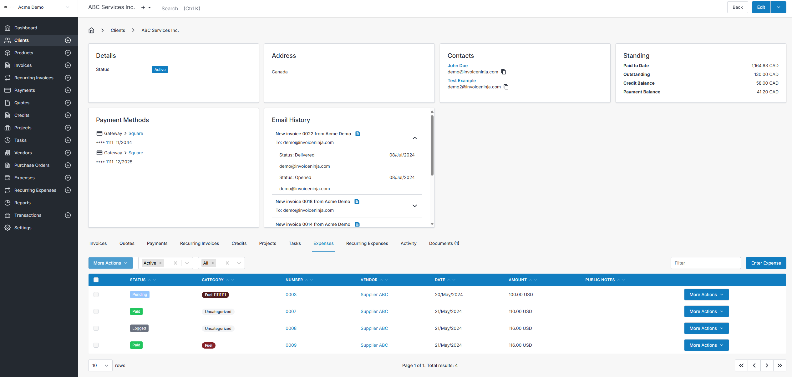

## Related

- [Get Started](/docs/user-guide)
- [Clients](/docs/user-guide/clients)
- [Invoices](/docs/user-guide/invoices)
- [Payments](/docs/user-guide/payments)
- [Payment Gateways](/docs/user-guide/gateways)
- [Client Portal](/docs/user-guide/client-portal)
- [Taxes](/docs/user-guide/taxes)
- [Basic Settings](/docs/user-guide/basic-settings)
- [Advanced Settings](/docs/user-guide/advanced-settings)
