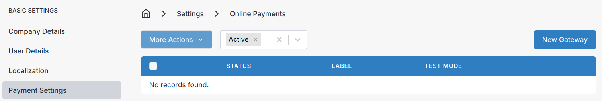
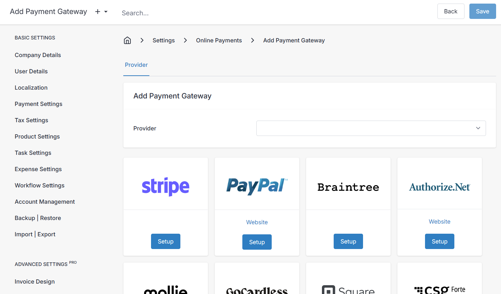
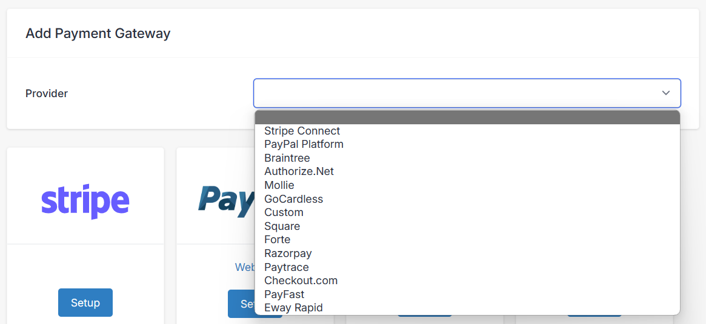

import VideoPlayer from "@site/src/components/VideoPlayer";

# Payment Gateways: connect a service so clients can pay you online

A payment gateway is the service that moves money from your client's card or bank account into yours. Invoice Ninja sits in front of the gateway: it handles the invoice, the receipt and the accounting, and the gateway handles the actual charge. Until a gateway is connected, the **Pay Now** button on your [invoices](/docs/user-guide/invoices) and in the [Client Portal](/docs/user-guide/client-portal) has nowhere to send the payment.

Once a gateway is connected, it powers online checkout on invoice emails, hosted [Payment Links](/docs/user-guide/subscriptions), Auto Bill on [recurring invoices](/docs/user-guide/recurring-invoices), and refunds from the [Payments](/docs/user-guide/payments) screen. The full marketing list of supported providers is on the [Payment Gateway Integrations](https://invoiceninja.com/payments/) page.

## How do I connect a gateway?

1. Go to **Settings > Payment Settings**. The page title is **Online Payments**.
2. Click **Add Payment Gateway**.
3. Pick a provider from the dropdown, or click **Setup** on a provider card.
4. Complete the tabs as needed, then click **Save**.

Choosing a provider adds it right away; you can delete it from the list if you added one by mistake.

Some providers, including Stripe Connect, open a login window so you can connect your account. Other providers ask you to paste API credentials from their own dashboards, or they show a **Gateway Setup** button on the **Credentials** tab.

You can connect more than one gateway. The list columns are **Status**, **Label** and **Test Mode**. Drag the handle on a row if you want to change the order.

The same Online Payments page also holds company payment options below the gateway list, including Auto Bill, payment terms, payment emails, over and under payments, and [Client Initiated Payments](/docs/user-guide/client-portal). Those options are documented with [Payment Settings](/docs/user-guide/basic-settings#payment_settings).

## How do I archive or delete a gateway?

There is no Actions menu on a gateway row until you tick the row's checkbox. Then an **Actions** button appears, with **Archive** and **Delete**.

**Delete** has no confirmation dialog, so tick only the gateway you mean to remove.

## What tabs does a gateway have?

Open a gateway to see five tabs: **Payment Provider**, **Credentials**, **Settings**, **Required Fields** and **Limits/Fees**. The edit page title is **Edit Payment Gateway**.

### Payment Provider

This tab identifies the provider and, where the gateway supports it, shows a **Webhook URL** and the events the provider can send, for example `payment_approved`.

### Credentials

This tab is how Invoice Ninja talks to the gateway. The exact fields depend on the provider: API keys, a merchant ID, a **Gateway Setup** or Connect button, and often **Test Mode**, **Threeds** (3D Secure) and a **Health Check**. Without a successful connection here, checkout cannot take a payment.

### Settings

These options control how the gateway behaves in the admin and in the client portal.

| Setting | What it is for |
|---|---|
| **Label** | A name for your own reference, shown in the admin gateway list. Useful when you have more than one gateway of the same type. |
| **Tokenize** | "Tokenize payment method for future use." Tokenisation means the gateway keeps the card or bank account on file under a token that references it, and Invoice Ninja only ever sees that token, not the card number itself. Stored tokens are what make Auto Bill and one-click payment possible in the client portal. |
| Payment type toggles | The methods this gateway can offer, which vary by provider. Examples include Credit Card, PayPal, bank transfer, Sofort, Bancontact, iDEAL, Venmo, Pay in 4 and Apple/Google Pay. Turn on only the methods you want clients to see. |

A bank-transfer style gateway may have only a **Label** on this tab.

### Required Fields

This tab is where you ask the client to fill in missing details at checkout.

| Setting | What it is for |
|---|---|
| **Client Name**, **Client Phone**, **Contact Name**, **Contact Email** | Contact details to collect if they are missing. |
| **Postal Code**, **CVV** | Card-check details the gateway may need. |
| **Billing Address**, **Shipping Address** | Address fields to show at checkout. |
| **Update Address** | "Update client's address with provided details." Writes the address the client enters back onto the [client record](/docs/user-guide/clients). |
| **Always show required fields form** | "Displays the required fields form always at checkout." |

## How do I add gateway fees or card surcharges? {#limitsfees}

To pass payment processing costs to clients, open the gateway's **Limits/Fees** tab and select a **Payment Type**. These gateway fees are separate from [late-payment fees](/docs/user-guide/advanced-settings#reminder-templates) and the [invoice Surcharge field](/docs/user-guide/advanced-settings#custom_fields).

Fees and limits are attached to a specific payment type, so card and bank transfer on the same gateway can follow different rules.

| Setting | What it is for |
|---|---|
| **Payment Type** | The method these limits and fees apply to, for example Credit Card. |
| **Min Limit** / **Max Limit** | The lowest and highest amount clients can pay with this method. Turn each limit on with **Enable min** or **Enable max**. |
| **Fee Percent** | A percentage fee added to invoices paid with this method. |
| **Fee Amount** | A flat fee, added on top of Fee Percent if you set both. |
| **Fee Cap** | The maximum the fee can reach. |
| **Adjust Fee Percent** | "Adjust percent to account for fee." Use this when you want the fee recalculated so that, after the extra amount is added, the amount you actually receive matches the invoice total. |

You are responsible for checking that surcharging is legal where you operate; ask an accountant if you are unsure.

## Which providers can I add?

The **Add Payment Gateway** list has these providers:

- Stripe Connect
- PayPal Platform
- Braintree
- Authorize.Net
- Mollie
- GoCardless
- Forte
- Razorpay
- Square
- Custom
- Rotessa
- CBA PowerBoard
- Blockonomics
- payware
- CHIP
- Helcim
- BTCPay
- Paytrace
- Checkout.com
- PayFast
- Eway Rapid

The rest of this page covers the providers we can document from the live app and from each provider's own dashboard. For any provider, the fields you fill in are on that gateway's **Credentials** tab after you add it.

## How do I set up Stripe Connect?

	

Stripe Connect is often the fastest starting point. When you pick it, Invoice Ninja opens a Stripe login so you can connect your Stripe account (or create one). Card payments through Stripe support 3D Secure (3DS) where the issuer requires it: the client is redirected to their bank's authentication page, and the payment only completes once they have confirmed.

The exact payment methods you can turn on appear on the Stripe gateway's **Settings** tab after it is connected.

## How do I set up PayPal Platform?

**PayPal Platform** is the PayPal option in the provider list. After the gateway is connected, the Settings tab includes toggles for **Credit Card**, **PayPal**, **Venmo**, **Pay in 4** and **Advanced Card Payments**, plus **Tokenize**.

## How do I set up Checkout.com?

	

Checkout.com supports card payments and several other methods. The Credentials tab includes a Secret Api Key, Public Api Key, **Test Mode**, **Threeds**, Processing Channel Id, Client Id and a Health Check. You get the keys from "The Hub" on Checkout.com: sign in, open **Settings > Channels**, pick the right business, and the keys are on that screen. See the [Checkout.com docs](https://api-reference.checkout.com/#section/Authentication) for more.

Settings include **Tokenize** and payment type toggles for Credit Card, PayPal, Sofort, **Apple/Google Pay**, Bancontact, iDEAL, GiroPay, Przelewy24 and EPS. Use **Test Mode** while your Checkout.com channel is running in test mode, not for live payments. **Threeds** turns on 3D Secure authentication for card payments.

## How do I set up Braintree?

[Braintree](https://www.braintreegateway.com/) can take cards, PayPal and bank transfer in one integration. The Credentials tab includes Merchant Id, Merchant Account Id, Public Key, Private Key, **Test Mode**, **Threeds**, Health Check and a Documentation link. In Braintree, the keys are under **API** and the merchant ID is under **Business** (gear icon at the top right). See the [Braintree docs](https://developer.paypal.com/braintree/articles/control-panel/important-gateway-credentials) for the full rundown.

Settings include **Tokenize** and toggles for Credit Card, Bank Transfer and PayPal.

## How do I take payment by bank transfer?

A **Bank Transfer** gateway does not charge a card. The Credentials tab is a text editor where you type the payment instructions you want clients to see, for example your account name and number. Settings has only a **Label**. Required Fields and Limits/Fees are still available.

## How do I set up Square?

The [Square](https://squareup.com/) integration starts when you pick Square or click **Setup** on the Square card, which adds the gateway immediately. The Credentials tab shows **Gateway Setup** and **Health Check**. Complete Gateway Setup with your Square account.

If Square asks you for dashboard values, the Application ID and Access Token live under **OAuth** in the Square Developer Dashboard, and the Location ID is under **Location**. The full walkthrough is in the [Square developer documentation](https://developer.squareup.com/docs/square-get-started).

## How do I set up Mollie?

	

Mollie is in the provider list and covers a broad set of European methods, including cards, bank transfer, KBC, Bancontact and iDEAL. After you add it, complete the Credentials tab with the values from your Mollie dashboard: the profile ID (top left) and an API key from **Developers > API Keys**, as described in the [Mollie knowledge base](https://help.mollie.com/hc/en-us/articles/115000328205-Where-can-I-find-the-live-API-key-).

If checkout returns "No suitable payment methods found," no payment methods are enabled on the Mollie side. In the [Mollie dashboard](https://mollie.com/dashboard), open Settings > Website profiles, select your profile, and enable the methods you need.

## How do I set up Paytrace?

	

[PayTrace](https://www.paytrace.net/) is listed as **Paytrace**. After you add it, complete the Credentials tab with your PayTrace API user credentials and API key. PayTrace expects you to validate against their sandbox before going live; use **Test Mode** while you are on sandbox credentials if that option is shown. More at the [PayTrace support site](https://developers.paytrace.com/support/home).

## How do I set up PayFast?

	

PayFast is in the provider list and handles card payments. After you add it, complete the Credentials tab with the values from your PayFast account. The video below walks through setup.

<VideoPlayer src="/assets/videos/gateways/payfast/payfast.mpd" isDash={true} id="payfast-video" />

## How do I set up Authorize.Net?

	

[Authorize.net](https://www.authorize.net/) is listed as **Authorize.Net**. After you add it, complete the Credentials tab with your API Login ID and Transaction Key. Sign in to your Authorize.net merchant account, go to **Settings > API Credentials & Keys**, and generate or view them. Background reading: [Authorize.net docs](https://support.authorize.net/s/article/How-do-I-obtain-my-API-Login-ID-and-Transaction-Key).

## How do I set up eWAY Rapid?

[eWAY](https://www.eway.com.au/) is listed as **Eway Rapid**. After you add it, complete the Credentials tab with the keys from the eWAY portal. Hover over **My Account** and click **API Keys**. The [eWAY knowledge base](https://go.eway.io/s/article/How-do-I-setup-my-Live-eWAY-API-Key-and-Password) has the full walkthrough.

## Can I add a custom gateway? (self-hosted)

**Custom** appears in the provider list. It is a developer option, mainly for **self-hosted** installs, where you can write PHP that talks to a provider Invoice Ninja does not support out of the box and plug it in as a custom driver.

## How do digital wallets such as Apple Pay and Google Pay work?

Apple Pay and Google Pay are not separate gateways. They are payment methods that ride on top of an existing gateway, when that provider supports them.

Checkout.com has an **Apple/Google Pay** toggle on its Settings tab. Other gateways may not show this toggle. The client usually needs a card already stored in their browser or device wallet to pay this way.

## How do I accept bitcoin with BTCPay?

**BTCPay** is in the provider list. BTCPay Server lets you accept bitcoin into your own wallet. After you add the gateway, complete the Credentials tab, following the [BTCPay setup instructions for Invoice Ninja](https://docs.btcpayserver.org/InvoiceNinja/).

## How do I set up CBA PowerBoard?

To connect the Commonwealth Bank's PowerBoard gateway, start on the PowerBoard side and then finish in Invoice Ninja.

### Where do I find the PowerBoard API credentials?

Log in to the [PowerBoard](https://powerboard.commbank.com.au/v2/auth/sign-in) portal to get your API credentials.

Open **My Company** and click **API & Settings**.

Copy the API Secret Key and API Public Key, then click the Services menu item to find your Credit Card Gateway ID.

Copy the ID highlighted next to your Credit Card Service Provider.

### How do I add PowerBoard in Invoice Ninja?

1. Go to **Settings > Payment Settings** and click **Add Payment Gateway**.
2. Pick **CBA PowerBoard** from the dropdown (this adds the gateway right away).

3. On the **Credentials** tab, enter the keys and gateway ID from the previous step, then save.

With the gateway configured, these related pages are worth a read:

- [Set gateway fees](/docs/user-guide/gateways#limitsfees)
- [Payment Links](/docs/user-guide/subscriptions)
- [Custom email servers](/docs/hosted/hosted-mail)

## How do I set up CHIP?

[CHIP](https://www.chip-in.asia/) is a Malaysian payment gateway in the provider list.

1. Sign in to your [CHIP account](https://www.chip-in.asia/).
2. In the top-right corner, open **Developers**.
3. Under **Brands**, copy your **Brand ID**.
4. Under **Keys**, select **New Live Key**, give it a title, and copy the generated key.

Then in Invoice Ninja, go to **Settings > Payment Settings**, click **Add Payment Gateway**, pick **CHIP**, and complete the **Credentials** tab with the values from CHIP. See the [CHIP guide](https://blog.chip-in.asia/docs/how-to-get-api-key-api-host-brand-id/) for the full walkthrough.

## Related

- [Payments](/docs/user-guide/payments): record, apply and refund money you receive
- [Payment Links](/docs/user-guide/subscriptions): hosted checkout URLs that use your gateways
- [Recurring Invoices](/docs/user-guide/recurring-invoices): Auto Bill with a saved card
- [Client Portal](/docs/user-guide/client-portal): where clients pay and manage saved payment methods
- [Payment Settings](/docs/user-guide/basic-settings#payment_settings): Auto Bill defaults and related company options
