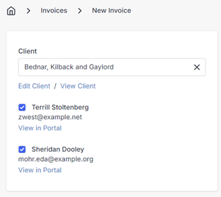
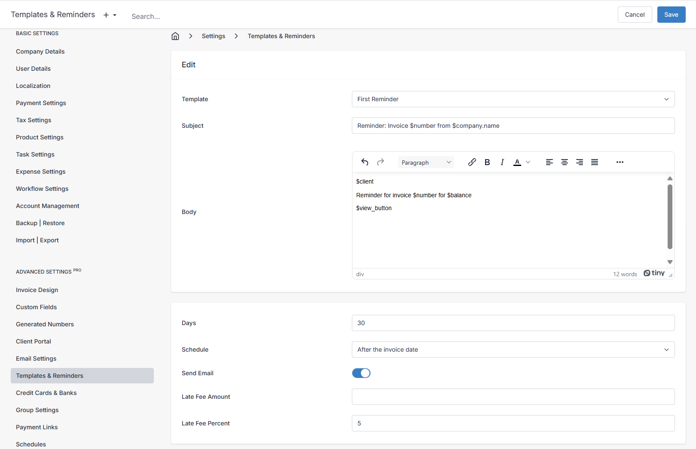

# Invoices: create, send and track the bills you send clients

An invoice is the bill you send a client: a dated, numbered record of what you delivered, what it costs and how they can pay you. You need one every time you want to get paid for work, products or costs.

In Invoice Ninja an invoice is more than a PDF. It tracks its own status, links to payments, updates the client's balance, and can send reminders, add late fees and take online payments for you. Invoices can bill for [products](/docs/user-guide/products), [tasks](/docs/user-guide/tasks) or [expenses](/docs/user-guide/expenses), carry attachments your client can open in the [Client Portal](/docs/user-guide/client-portal), and keep a full history of every change, so you always know who did what and when.

Here is a short video on creating an invoice:

<video width="100%" controls>
  <source src="/assets/videos/invoices/create_invoice_clip_react.mp4" type="video/mp4" />
</video>

## Where do I see all my invoices?

Click **Invoices** in the left menu. The list shows each invoice's **Status**, **Number**, **Client**, **Contact Email**, **Date**, **Balance** and **Due Date**. From here you can:

- Search with the **Filter** box
- Show archived or deleted invoices with the **Lifecycle** filter
- Narrow the list with the **Status** filter: **Draft**, **Paid**, **Unpaid**, **Past Due** or **Cancelled**
- Choose what to show with **Columns** and **Footer Columns**
- Import invoices from a file with **Import**
- Create an invoice with **New Invoice**

Each row has an **Actions** menu on the right with the same actions as the invoice itself (see [What can I do with an invoice?](#what-can-i-do-with-an-invoice)).

## How do I view an invoice?

| You want to see | Do this |
|---|---|
| The PDF your client receives | Open the row's **Actions** menu and choose **View PDF** |
| Every detail: line items, notes, settings, linked payments | Click the invoice number, or choose **Edit** from the **Actions** menu |
| The invoice exactly as your client sees it | Choose **Client Portal** from the **Actions** menu |

### What are the tabs at the top of an invoice?

When you open an invoice, tabs along the top show everything about it:

| Tab | What it shows | When it helps |
|---|---|---|
| **Edit** | The client, dates, line items, notes and terms | Creating or changing the invoice |
| **Documents** | Files attached to the invoice | Adding contracts, photos or timesheets |
| **Settings** | Extra options for this invoice only | Linking a project, auto bill, design and more |
| **Activity** | Every action on the invoice (created, edited, emailed, paid, refunded, cancelled) and the user who did it | You need the audit trail (the full record of who did what) |
| **History** | Every change to the invoice total, in order, and who made it | A client asks why their balance differs from an earlier PDF |
| **Email History** | Every time the invoice was emailed, to whom and when | A client says they never got the invoice |

One more tab depends on the status: **Payment Schedule** for drafts, **Payment Schedule** and **Unapplied Payments** for sent invoices, and **Payments** for paid invoices.

## What can I do with an invoice?

On the invoice screen, click the arrow next to **Save**. On the list, use the row's **Actions** menu. The choices depend on the invoice's status:

| Action | What it does | Draft | Sent | Paid |
|---|---|---|---|---|
| **Email Invoice** | Sends (or resends) the invoice to the contacts ticked to receive it | ✓ | ✓ | ✓ |
| **View PDF** / **Print PDF** / **Download** | Shows, prints or saves the PDF | ✓ | ✓ | ✓ |
| **Delivery Note (PDF)** | Opens the PDF view as a delivery note | ✓ | ✓ | ✓ |
| **Add Comment** | Adds a note to the invoice's activity | ✓ | ✓ | ✓ |
| **Mark Sent** | Changes a draft to sent without emailing it, for example when you delivered the PDF yourself | ✓ | | |
| **Mark Paid** | Records full payment for the invoice in one click | ✓ | ✓ | |
| **Enter Payment** | Records a payment against the invoice. See [Payments](/docs/user-guide/payments). | ✓ | ✓ | |
| **Client Portal** | Shows the invoice exactly as your client sees it | ✓ | ✓ | ✓ |
| **Schedule** | Sends the invoice automatically at a later date and time | ✓ | ✓ | |
| **Convert To** | Turns the invoice into a **Purchase Order** | ✓ | ✓ | ✓ |
| **Clone To** | Copies the invoice into a new **Invoice**, **Recurring Invoice**, **Quote**, **Credit** or **Purchase Order** | ✓ | ✓ | ✓ |
| **Cancel** | Writes off the invoice. See [When should I cancel an invoice?](#when-should-i-cancel-an-invoice) | | ✓ | |
| **Reverse** | Undoes a sent or paid invoice; any payments become credits. Only offered in certain circumstances. See [What does Reversed mean?](#what-does-reversed-mean) | | ✓ | ✓ |
| **Run Template** | Runs one of your custom templates on the invoice. Only appears once you've created a template. | ✓ | ✓ | ✓ |
| **Download E-Invoice** | Downloads the invoice as an e-invoice file. Only appears when e-invoicing is turned on. See [E-Invoicing](/docs/user-guide/einvoicing). | ✓ | ✓ | ✓ |
| **Archive** / **Delete** | Read [What do the invoice statuses mean?](#what-do-the-invoice-statuses-mean) first | ✓ | ✓ | ✓ |

Some actions, like Reverse, Run Template and Download E-Invoice, only show up when they apply to that invoice or when you've turned on the feature.

Archived invoices show **Restore** in the menu, just above **Delete**.

## How do I create or edit an invoice?

Click **New Invoice** on the invoice list. Creating and editing use the same screen, so everything below applies to both.

### Who is the invoice for?

Every invoice belongs to exactly one [client](/docs/user-guide/clients).

1. Pick the client in the **Client** dropdown. If they don't exist yet, choose **+ New Client** at the bottom of the list.
2. Check which contacts get the invoice under **Contacts**. A client can have several contacts (for example Accounts Payable, a project lead, a partner you copy in), and you can tick or untick each one for this invoice.
3. If the client has [locations](/docs/user-guide/clients#how-do-i-bill-one-client-at-different-addresses-locations), a **Location** dropdown appears under the client. Pick one to use that address on this invoice.

The client decides the currency, tax rules, language, payment terms and email templates the invoice uses. That's why it's worth getting the client record right before you invoice someone for the first time. Once a client is selected, **Edit** and **View** links let you jump to their record.

Contacts with **Add to Invoices** turned on in the client record are ticked automatically. Changing them here only affects this invoice, not the client's defaults. On a saved invoice, each contact also has a **View in Portal** link with a copy icon, handy when you want to share a payment link in a chat or text message.

### Which invoice details do I fill in?

| Field | What it is for |
|---|---|
| **Invoice Date** | The date shown on the PDF and used for reporting. Defaults to today. |
| **Due Date** | When full payment is due. Leave it blank and the invoice is due immediately. Until this date passes, the invoice is not overdue and won't trigger late fees or overdue reminders. |
| **Partial/Deposit** | A smaller amount due **before** the full balance. When you enter one, a **Partial Due Date** field appears for it. Use it for deposits, retainers or milestone billing. The client sees a "pay this much now" prompt in the portal, and the rest still follows the main due date. A partial payment puts the invoice in **Partial** status. |
| **Tags** | Labels to help you group and find invoices. |
| **Invoice #** | Leave it empty and it's created automatically (the box shows **Auto Generate**) from the **Number Pattern** under **Settings > Generated Numbers > Invoices**. |
| **PO #** | Your client's purchase order reference, printed on the PDF so their accounts team can match the invoice to their records. |
| **Discount** | A reduction off the invoice total. Choose **Amount** or **Percent**. |

**Invoice number, client number or ID?** Invoice Ninja tracks three kinds of "number" that are easy to confuse:

- **Invoice Number** (`$invoice.number`): what appears on the PDF.
- **Client Number** (`$client.number`): the client's own number, also created automatically and used internally.
- **ID** (`$client.id`, `$invoice.id`): short codes of letters and numbers used by the API. They are not meant for people.

If you are importing from another system, store the client's old reference in the client's **ID Number** field. That way your generated numbering stays as it is.

### How do I add line items?

The items list is the body of the invoice. Each row is something you are billing for. There are two tabs:

**Products** tab

| Column | What it is for |
|---|---|
| **Item** | The product name. Picking a [product](/docs/user-guide/products) fills in its description and unit cost. The dropdown also shows stock counts. |
| **Description** | Free text. Markdown (simple formatting codes for bold, lists and so on) is turned into formatting on the PDF when **Enable Markdown** is on under **Settings > Account Management > Overview**. |
| **Quantity** | Multiplied by the unit cost to give the line total. Up to six decimal places, so 1.25 hours or 0.333 metres both work. |
| **Unit Cost** | The price per unit |
| **Line Total** | Quantity times unit cost |

**Tasks** tab

For time-based work: **Service**, **Description**, **Rate**, **Hours** and **Line Total**. Click **Add Line** to add a row. Tasks and expenses you bill from their own records take their rate and description from there. See [Tasks](/docs/user-guide/tasks) and [Expenses](/docs/user-guide/expenses).

Tax is chosen in the totals area (**Tax**). Taxes can be set per line or for the whole invoice, and the two can differ by a cent or two on the same invoice. See [Taxes](/docs/user-guide/taxes) for why.

### What goes in the tabs below the line items?

| Tab | What it is for | Can the client see it? |
|---|---|---|
| **Public Notes** | A summary of the work, a thank-you, or details that don't fit in a line description. Printed on the PDF. | Yes |
| **Private Notes** | Internal reminders, such as "approved by Sam" or "chase before month-end". Never printed or emailed. | No |
| **Terms** | Your terms and conditions for this invoice. Turn on **Save as default terms** to reuse them on every future invoice. | Yes |
| **Footer** | Small print at the bottom of the PDF, such as bank details, disclaimers or legal notices. Turn on **Save as default footer** to reuse it. | Yes |
| **Custom Fields** | Any invoice custom fields you have set up | |

### How do I attach files to an invoice?

Open the **Documents** tab at the top of the invoice and drop files onto **Drop files or click to upload**, or click it to choose them. Attach things like contracts, photos, timesheets or delivery dockets. Your client sees them next to the invoice PDF in the [Client Portal](/docs/user-guide/client-portal).

### What is on the Settings tab?

The **Settings** tab at the top of the invoice holds options for this invoice only:

- **Project:** links the invoice to a [project](/docs/user-guide/projects) for reporting.
- **Assigned User:** the user the invoice is recorded against. Besides reporting, you can use it to limit who can see the record.
- **Exchange Rate:** when you bill in a currency other than your company's, fixes the rate used to convert totals back to your own currency for reporting.
- **Vendor:** links a [vendor](/docs/user-guide/vendors) to the invoice where relevant.
- **Auto Bill Enabled:** when on, Invoice Ninja charges the client's saved card or bank account automatically. Choose when with **Auto Bill On** (for example the due date) under **Settings > Payment Settings**. Needs a connected [payment gateway](/docs/user-guide/gateways) (the service that processes online payments) and a saved payment method for the client.
- **Inclusive Taxes:** when on, tax is treated as already included in the unit cost instead of added on top. Match this to how you quote your prices.
- **Design:** picks one of the built-in designs or a custom one you made under **Settings > Invoice Design**.

## How do I charge interest or late fees?

Late fees are not set on the invoice. They are rules for all invoices under **Settings > Templates & Reminders**, so every overdue invoice is treated the same way.

1. Go to **Settings > Templates & Reminders**.
2. Pick a reminder in **Template**: **First Reminder**, **Second Reminder**, **Third Reminder** or **Endless Reminder**.
3. Set **Days** and **Schedule** (for example 30 days after the invoice date) and turn on **Send Email**.
4. To add a fee, fill in **Late Fee Amount** (a flat fee) or **Late Fee Percent** (a percentage of the balance owing). It is added as a new line on the invoice.
5. Click **Save**.

Reminders only go out for clients with **Send Reminders** turned on. That's why a client with a special arrangement won't get fees even when their invoice is overdue.

## What do the invoice statuses mean?

Every invoice moves through a small set of statuses. The status controls what the client sees, whether the invoice counts in your reports and what you can do next. Knowing them explains why a balance moved when you didn't expect it.

| Status | What it means | Affects client balance? |
|---|---|---|
| **Draft** | Being prepared. Your client can't see it. | No |
| **Sent** | Emailed or marked as sent. Now it's real. | Yes, balance goes up |
| **Partial** | Some, but not all, of the balance is paid | Yes, shows what's still owed |
| **Paid** | Fully paid and closed | Balance owing is zero |
| **Cancelled** | Written off. Balance set to zero, payments stay linked. | Yes, balance goes down |
| **Deleted** | Removed from reports. Cancelled first if needed. | Yes, if it had a balance |
| **Reversed** | Undone. Payments become credits. | Yes, balance goes down |

### What does Draft mean?

Every invoice starts as a draft. A draft is hidden from the client, left out of the ledger (your record of what each client owes) and doesn't change the client's balance. You can build it up, change line items and come back tomorrow without anyone seeing a half-finished invoice. A draft becomes active as soon as you email it, mark it sent or mark it paid.

:::warning
Once a draft has been emailed or marked as sent, you can't turn it back into a draft. To start over, clone the invoice with **Clone To** and cancel or delete the original.
:::

### What does Sent mean?

An invoice becomes **Sent** when you email it or choose **Mark Sent**. This is the change that makes the invoice real:

- The client's balance goes up by the invoice balance.
- Reminders start counting down to the due date.
- The invoice appears in the client portal.

### What does Partial mean?

A payment has come in but hasn't covered the full balance. Either the client paid the **Partial/Deposit** amount, or a smaller [payment](/docs/user-guide/payments) or [credit](/docs/user-guide/credits) was applied. The invoice stays active, the client's balance shows only what is still owed, and later payments move it on until it's **Paid**.

### What does Paid mean?

The full balance is covered and the invoice is closed. Its balance is zero. Any further actions, such as refunds or reversals, go through the linked payment, not the invoice.

### When should I cancel an invoice?

Cancel an invoice that was sent by mistake or for work that won't go ahead. To cancel, open the invoice, click the arrow next to **Save** and choose **Cancel**.

- The invoice balance is set to zero.
- The client's balance goes down by the same amount.
- The status becomes **Cancelled**.
- Linked payments stay linked. Cancelling doesn't erase history, it just settles the account.

### What happens when I delete an invoice?

Delete is stronger than Cancel. Use it when you want an invoice fully removed from your reports. You can delete invoices that are **Draft**, **Sent**, **Partial** or **Paid**.

- If the invoice had a balance or payments, Invoice Ninja cancels it first to keep the ledger balanced, then marks it deleted. These two steps always happen together.
- `_deleted` is added to the end of the invoice number, so you can reuse the original number on a new invoice.

### What does Reversed mean?

A reversal is the accountant-friendly way to undo an invoice that has already been sent or paid. A cancellation just adjusts the balances. A reversal also re-routes any money that changed hands:

- The client's paid to date goes down by the amount paid on this invoice.
- Payments that were applied are detached from the invoice and linked to a new [credit](/docs/user-guide/credits), so the client's money isn't lost. You can apply the credit to a future invoice or refund it.
- Credits that were applied to the invoice are turned back into new credits.
- The client's balance goes down by the invoice balance, the invoice balance is set to zero and the status becomes **Reversed**.

**Careful:** after a reversal, the original links between payments and the invoice are gone for good. Reverse an invoice only when you really want to undo the transaction, not to fix a typo.

### What does archiving an invoice do?

Archiving hides an invoice from your normal lists. Everything else stays the same: the ledger, the client's balance, the payments and the reports. Think of it as tidying, not deleting. An archived invoice shows an **Archived** badge and can still be edited.

To find archived invoices, open the **Lifecycle** filter on the list, tick **Archived** and click **Apply**.

### How do I bring back an archived or deleted invoice?

Choose **Restore** from the row's **Actions** menu or the arrow next to **Save**. It undoes an archive or delete and puts the invoice back in its previous status, exactly as it was. No data is lost either way, which is why archiving and deleting are safe to use freely.

### Can Invoice Ninja archive or lock invoices for me?

Yes. Under **Settings > Workflow Settings > Invoices** you'll find **Auto Archive** (archive invoices when they are paid), **Auto Archive Cancelled Invoice** and **Lock Invoices**. If you can't change an invoice, check whether **Lock Invoices** is on.

## Related

- [Clients](/docs/user-guide/clients): the other half of every invoice
- [Payments](/docs/user-guide/payments): record, refund and match money you receive
- [Credits](/docs/user-guide/credits): apply balances to future invoices
- [Recurring Invoices](/docs/user-guide/recurring-invoices): turn a one-off invoice into a subscription
- [Quotes](/docs/user-guide/quotes): price the work first, then convert it to an invoice
- [Taxes](/docs/user-guide/taxes): set up how tax is calculated and shown
- [Payment Gateways](/docs/user-guide/gateways): get paid online
- [Client Portal](/docs/user-guide/client-portal): what your client sees when the invoice arrives
- [E-Invoicing](/docs/user-guide/einvoicing): send invoices as structured electronic files
- [Templates](/docs/advanced-topics/templates): build advanced documents from templates
