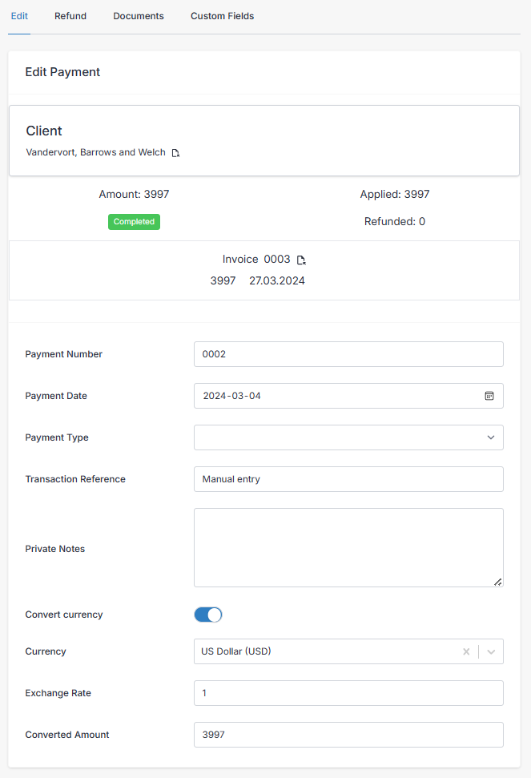

# Payments: record and manage the money clients send you

A payment is the record of money you've received from a [client](/docs/user-guide/clients), usually against one or more of their [invoices](/docs/user-guide/invoices). Linking a payment to an invoice is what moves the invoice from **Sent** to **Paid** and keeps your balances and reports accurate.

## How do payments get into Invoice Ninja?

Every payment belongs to a client, and most are linked to at least one invoice. There are three ways a payment gets recorded:

| How the client paid | What happens |
|---|---|
| Online, through the [Client Portal](/docs/user-guide/client-portal) with a connected [payment gateway](/docs/user-guide/gateways) (the service that processes card or bank payments) | The payment is created automatically and matched to the invoice they paid |
| Bank transfer, cheque, cash, or a deposit you match in [Banking](/docs/user-guide/banking) and [Transactions](/docs/user-guide/transactions) | You enter the payment yourself. See [How do I record a payment by hand?](#how-do-i-record-a-payment-by-hand) |
| Any way, for the full amount, when you just want the invoice closed | Choose **Mark Paid** on the invoice. Invoice Ninja creates a payment with **"Manual entry"** in the Transaction Reference, for the full amount. |

**Good to know:** a payment is an internal accounting record. You don't send it to the client the way you send an invoice. What the client sees is their invoice changing to paid, plus a payment confirmation email if you turn **Send Email** on.

## What do the payment statuses mean?

The status shows how much of a payment has been used on invoices.

| Status | What it means |
|---|---|
| **Unapplied** | Recorded for the client, but not linked to any invoice yet. Common for retainers, money on account or overpayments. The money waits on the client's record until you pick an invoice. |
| **Partially Unapplied** | Part of the payment is applied to an invoice, and the rest is still available to use later |
| **Completed** | Fully applied, with nothing left to use |
| **Refunded** | All or part of the payment was returned to the client |
| **Partially Refunded** | Part of the payment was returned to the client |
| **Deleted** | Removed. See [Archive, delete or restore: what's the difference?](#archive-delete-or-restore-whats-the-difference) |

## Where do I see my payments?

- Click **Payments** in the left menu to see every payment.
- Open a client and choose the **Payments** tab to see just theirs.

## How do I view a payment?

- Click the payment number to open **Edit Payment**. You'll see the status, the **Amount**, **Applied** and **Refunded** figures, each invoice and credit the payment is linked to, the payment date, payment type, transaction reference, private notes, tags and convert-currency setting.
- Click anywhere else on the row to open a side panel with **Overview**, **Activity** and **Documents**.

On the edit page, actions are in the unlabeled arrow next to **Save**. That menu can include **Refund Payment**, **Email Payment**, **Archive** and **Delete**. To apply an unapplied payment to an invoice, use **Apply Payment** in the row's **Actions** menu.

## How do I record a payment by hand?

<iframe class="video" src="https://www.youtube.com/embed/anX9l3MF-Ws" title="Video: entering a payment manually in Invoice Ninja" frameborder="0" allow="accelerometer; autoplay; clipboard-write; encrypted-media; gyroscope; picture-in-picture" allowfullscreen></iframe>

1. Go to **Payments** and click **Enter Payment**. You can also choose **Enter Payment** from an invoice's menu.
2. Pick the **Client**, or start from an **Invoice**. Every payment must belong to a client.
3. Under **Invoices**, tick the invoice (or invoices) the money is for. The amount owing is filled in for you. Lower it if the client paid less.
4. Fill in **Amount received** only if the client paid more than the invoices add up to, or if there's no invoice yet. Leave it blank for a straightforward payment.
5. Optional: under **Credits**, add any [credits](/docs/user-guide/credits) on the client's account to use as part of this payment. If the client has none, you'll see "No credits found."
6. Check the **Payment Date**, pick the **Payment Type** and add a **Transaction Reference**.
7. **Send Email** is off by default. Turn it on if the client should get a payment confirmation.
8. Click **Save**.

### Which payment details can I fill in?

| Field | What it is for |
|---|---|
| **Client** | Who paid. Required. You can also start from an **Invoice**. |
| **Amount received** | The total the client sent. Leave this blank when it matches the invoices. Fill it in only if they paid more than the invoices add up to, or when you're recording a payment with no invoice. |
| **Invoices** | The client's outstanding invoices this payment pays off, with Number, Date, Balance and Received for each |
| **Credits** | Client credits to use alongside the payment |
| **Payment Date** | The day the money arrived. Defaults to today. Your reports use this date, so change it if the money came in on another day. |
| **Payment Type** | How they paid, for example cash, bank transfer, cheque or PayPal. Handy for filtering reports later. |
| **Transaction Reference** | A bank reference, cheque number or short note about where the money came from. Payments created with **Mark Paid** show "Manual entry" here. |
| **Private Notes** | Notes only your team can see, for bookkeeping or audit trails |
| **Convert currency** | Turn on if the client paid in a different currency from yours. That reveals **Currency**, **Exchange Rate** and **Converted Amount**. |
| **Send Email** | Off by default. Turn it on to email the client a payment confirmation. |
| **Payment Number** | Created automatically when you save. It appears on the edit page. Change the pattern under **Settings > Generated Numbers > Payments**. |
| **Tags** | Optional. Labels you can use to find or group payments later. Shown when you edit a payment. |

### How do I apply one payment to several invoices?

Clients often send one lump sum to cover several invoices. Under **Invoices**, tick each invoice the payment should cover. **Received** fills in automatically from the balance; you can change it. A total at the bottom shows how many invoices you've included. The payment remembers which invoice got which share.

### What if the client paid only part of an invoice?

Enter the amount they actually sent against that invoice. The invoice shows the lower balance still owing and stays partly paid until the rest arrives. Record the rest as a second payment when it comes in.

### What if the client paid too much?

Enter the full amount in **Amount received**. Whatever is left after paying the invoices stays on the payment as **Unapplied**, and the payment's status becomes **Partially Unapplied**. The client's **Payment Balance** goes up by that leftover; no credit is created. Apply the rest to a future invoice when you raise one. There's no need to refund and re-bill.

This is also how retainers and money on account work: record the payment with no invoice, then use it up as invoices come in.

### How do I use a client's credit in a payment?

<iframe class="video" src="https://www.youtube.com/embed/74v04u4Ma1M" title="Video: using a client credit as part of a payment" frameborder="0" allow="accelerometer; autoplay; clipboard-write; encrypted-media; gyroscope; picture-in-picture" allowfullscreen></iframe>

If the client has [credits](/docs/user-guide/credits) available, add them under **Credits** while you enter the payment. The credit and the payment together pay off the invoice, which is handy when a balance is settled partly in cash and partly with store credit.

## How do I edit a payment?

1. Click the payment number to open **Edit Payment**.
2. Change the **Payment Date**, **Payment Type**, **Transaction Reference**, **Private Notes**, **Tags**, **Convert currency** or **Payment Number**. The client, amount, applied and refunded figures, and the invoice and credit lines, are display-only.
3. Click **Save**.

## How do I refund a payment? {#refunds}

1. Open the payment.
2. Open the **Refund** tab (titled **Refund Payment**), or choose **Refund Payment** from the arrow next to **Save**.
3. Pick the invoice the refund comes off. An amount is filled in for you; you can lower it for a partial refund.
4. **Send Email** is off by default. Turn it on if the client should get a receipt.
5. Click **Save**.

The refunded part is unlinked from the invoice, and the invoice balance goes back up. After a full refund the payment's status becomes **Refunded**.

You can only refund money that was **applied** to an invoice. An unapplied balance isn't refunded: you delete it or apply it somewhere else instead.

## Archive, delete or restore: what's the difference?

| Action | What it does | Can I undo it? |
|---|---|---|
| **Archive** | Hides the payment from your normal list. No numbers change. | Yes, with **Restore** |
| **Delete** | Sets the status to **Deleted**. If the payment was **Partially Unapplied** or **Completed**, its remaining balance is no longer available to the client and it's unlinked from its invoices, so those invoices show a balance owing again. | Yes, with **Restore** |
| **Restore** | Puts an archived or deleted payment back exactly as it was, links and all | |

To show an archived payment again, restore it. Restoring a completed payment returns it to **Completed**.

## Related

- [Invoices](/docs/user-guide/invoices): what payments pay off
- [Credits](/docs/user-guide/credits): balances you can use like a payment
- [Clients](/docs/user-guide/clients): see a client's payments and balance
- [Payment Gateways](/docs/user-guide/gateways): take payments online
- [Banking](/docs/user-guide/banking) and [Transactions](/docs/user-guide/transactions): match bank deposits to invoices
- [Client Portal](/docs/user-guide/client-portal): where clients pay
