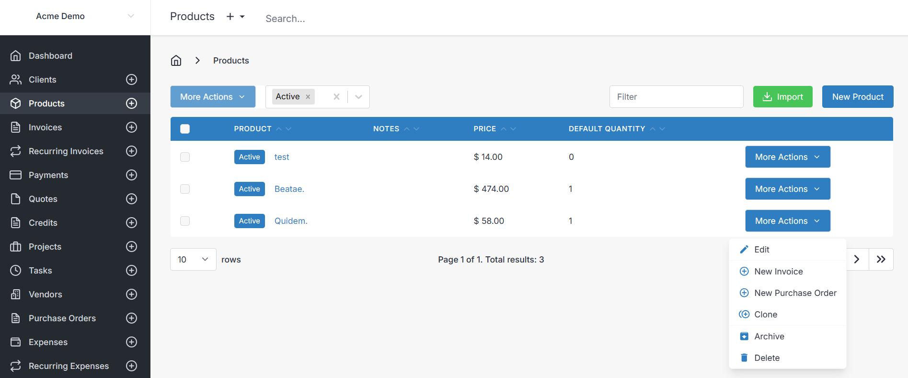
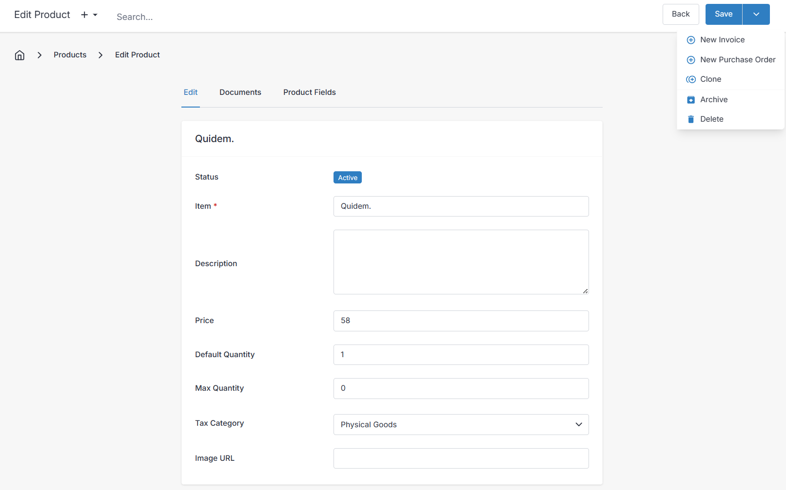
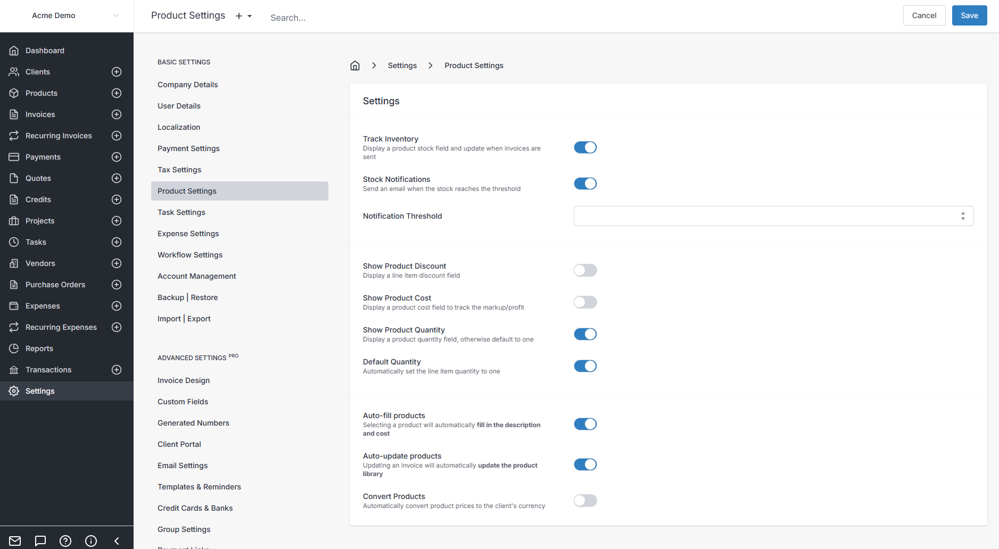
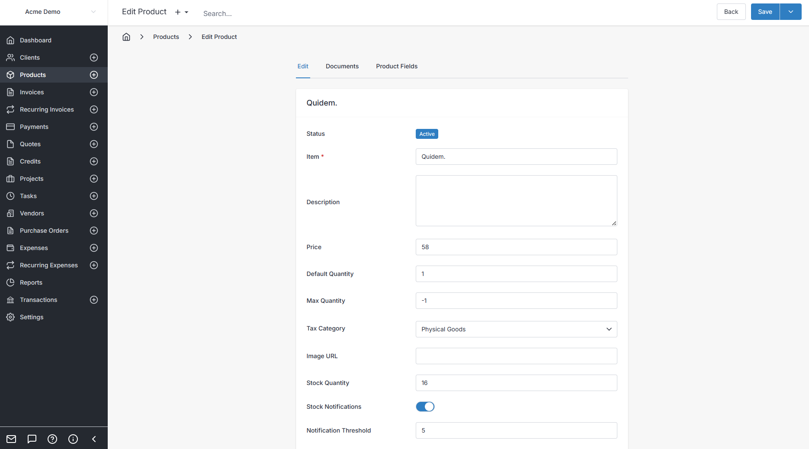

# Products: reuse items and prices on every invoice and quote

A product is a reusable line item: a name, description, price and optional tax category you can drop onto an invoice or quote instead of typing the same details again. If you bill for the same thing more than once, it is worth saving it as a product.

## When should I save a product instead of typing a line?

You can always type a line item directly onto an [invoice](/docs/user-guide/invoices#how-do-i-add-line-items) or [quote](/docs/user-guide/quotes#how-do-i-add-line-items). Nothing forces you to save a product first. Typing a one-off line is fine for work you will never bill again.

A product pays off the second time around: the wording, price and tax stay consistent, and you update the price in one place when it changes. That helps if you have a standard service menu, a fixed hourly rate, or a catalogue of goods.

Products are not only physical goods. A consulting product with the price set to your hourly rate works just as well. The quantity on the invoice then represents billable hours (up to six decimal places, so 1.25 hours is no problem).

Typing a new item onto an invoice does not, by itself, add a product to your catalogue. If you leave the invoice unsaved, the item is not created as a product.

## Where do I see all my products?

Click **Products** in the left menu. The list shows **Product**, **Stock Quantity**, **Description** and **Price**. From here you can:

- Search with the **Filter** box
- Show archived or deleted products with the **Lifecycle** filter (Active, Archived, Deleted). There is no Status filter.
- Choose what to show with **Columns**
- Import products from a file with **Import**
- Create a product with **New Product**

Each row has an **Actions** menu on the right with the same actions as the product itself (see [What can I do with a product?](#what-can-i-do-with-a-product)).

Click the product name to open it for editing. Clicking elsewhere on the row opens a side panel with **Overview** and **Documents**, plus an **Actions** menu. The Overview shows details such as Price, Default Quantity, Stock Quantity, Notes, Stock Notifications, Notification Threshold and Tax Category.

## How do I add a product?

There are a few ways, and you can mix them:

1. Go to **Products** and click **New Product**. Fill in the details below and click **Save**.
2. Import a catalogue from a CSV under **Settings > Import | Export**, or use **Import** on the products list. See [Import and Export](/docs/advanced-topics/import-and-export#can-i-update-existing-products-with-an-import).
3. Create products through the [Invoice Ninja API](https://api-docs.invoicing.co/).

### Which product details do I fill in?

| Field | What it is for |
|---|---|
| **Item** | The short name that appears on the invoice line. This is what you pick from the **Item** dropdown on an invoice or quote. Required. |
| **Description** | The longer text under the name. |
| **Tags** | Optional. Labels you can use to find or group products later. |
| **Price** | The standard unit price. |
| **Default Quantity** | The quantity filled in automatically when you add the product to a document. |
| **Max Quantity** | An optional cap on how many can be sold on one line, useful for limited stock or tiered offers. |
| **Tax Category** | Optional. Groups the product for tax, for example Physical Goods. See [Taxes](/docs/user-guide/taxes). |
| **Image URL** | Optional. A link to an image of the product. |

A saved product also shows a **Status** row. If inventory tracking is on, you will also see stock fields. See [How do I track inventory?](#how-do-i-track-inventory).

## What can I do with a product?

Once you have saved a product, click the arrow next to **Save** to see what you can do with it. On the list, use the row's **Actions** menu.

| Action | What it does |
|---|---|
| **Edit** | Opens the product so you can change its details. You can also click the product name in the list. |
| **New Invoice** | Opens a new unsaved [invoice](/docs/user-guide/invoices) with this product already added as a line. You still pick the [client](/docs/user-guide/clients). |
| **New Purchase Order** | Opens a new unsaved [purchase order](/docs/user-guide/purchase-orders) with this item already added as a line. You still pick the [vendor](/docs/user-guide/vendors). |
| **Clone** | Opens a new product form already filled in with this product's details. There is no Clone To dialog. Handy when you have several near-identical products, such as small, medium and large variants of the same item. |
| **Archive** / **Delete** | Tidies up or removes the product. See [How do I bring back an archived or deleted product?](#how-do-i-bring-back-an-archived-or-deleted-product). |

**Run Template** only appears once you have created a [template](/docs/advanced-topics/templates).

## How do I attach files to a product?

Open the **Documents** tab on the edit page or in the side panel and upload files such as product sheets, technical drawings or warranty terms. A new product you have not saved yet has no Documents tab; save it first, then upload.

**Self-hosted users:** uploaded documents live in the `public/storage` directory, under hashed folder names. Include that directory in your backups alongside the database.

## How do I add custom fields to products?

A saved product has a **Product Fields** tab, where extra fields you have set up for products appear. The unsaved create form does not show these controls.

## How do I track inventory?

If you stock physical goods, Invoice Ninja can keep count for you. The switches live under **Settings > Product Settings**:

| Setting | What it does |
|---|---|
| **Track Inventory** | Adds a stock field on each product and updates the count when invoices are sent ("Display a product stock field and update when invoices are sent"). |
| **Stock Notifications** | Sends an email when stock reaches the threshold you set ("Send an email when the stock reaches the threshold"). You can set a **Notification Threshold** on an individual product. |

When tracking is on, each product shows **Stock Quantity**, **Stock Notifications** and **Notification Threshold**. The current stock also appears on the products list and in the item picker on an invoice (for example, as a stock count next to the name).

**Mark Sent** on an invoice reduces stock by the line quantity. Deleting that invoice restores the stock.

Other options on the same settings page control how products appear and behave on invoices and quotes:

| Setting | What it does |
|---|---|
| **Show Product Discount** | "Display a line item discount field." |
| **Show Product Cost** | "Display a product cost field to track the markup/profit." |
| **Show Product Quantity** | "Display a product quantity field, otherwise default to one." |
| **Default Quantity** | "Automatically set the line item quantity to one." |
| **Auto-fill products** | "Selecting a product will automatically fill in the description and cost." |
| **Auto-update products** | "Updating an invoice will automatically update the product library." |
| **Convert Products** | "Automatically convert product prices to the client's currency." |

Leave these settings as you find them unless you intend to change how your catalogue behaves.

**Reports** includes a **Product** report and a **Product Sales** report.

Stock does not only go down. When a [purchase order](/docs/user-guide/purchase-orders) has been **Accepted**, choose **Add to Inventory** to add those quantities to stock. This action appears on accepted purchase orders only, in the row **Actions** menu and in the arrow next to **Save**. It does not appear on Sent purchase orders.

## How do I bring back an archived or deleted product?

Archiving hides a product from your normal list to keep the catalogue tidy. All the data stays put, and you can still edit and save the product without restoring it first. The **Actions** menu then offers **Restore** and **Delete**.

Deleting sets the status to **Deleted**. The product is not gone for good, and the name does not get a `_deleted` suffix. You can restore it. A deleted product's menu offers **Restore**.

1. On the product list, open the **Lifecycle** filter, tick **Archived** (or **Deleted**) and click **Apply**.
2. In the row, open the **Actions** menu and choose **Restore**.

The product goes back to **Active**, so you can use it on invoices again.

## Related

- [Invoices](/docs/user-guide/invoices#how-do-i-add-line-items): pick a product as a line item
- [Quotes](/docs/user-guide/quotes#how-do-i-add-line-items): the same product list on a quote
- [Purchase Orders](/docs/user-guide/purchase-orders): **Add to Inventory** on an accepted order
- [Import and Export](/docs/advanced-topics/import-and-export#can-i-update-existing-products-with-an-import): load or update a catalogue from a CSV
- [Taxes](/docs/user-guide/taxes): how tax categories and rates interact with invoices
- [Reports](/docs/user-guide/reports): the Product and Product Sales reports
