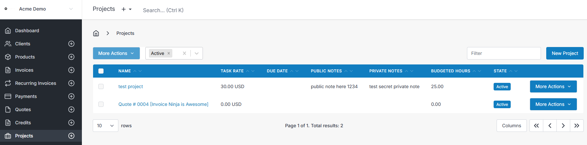
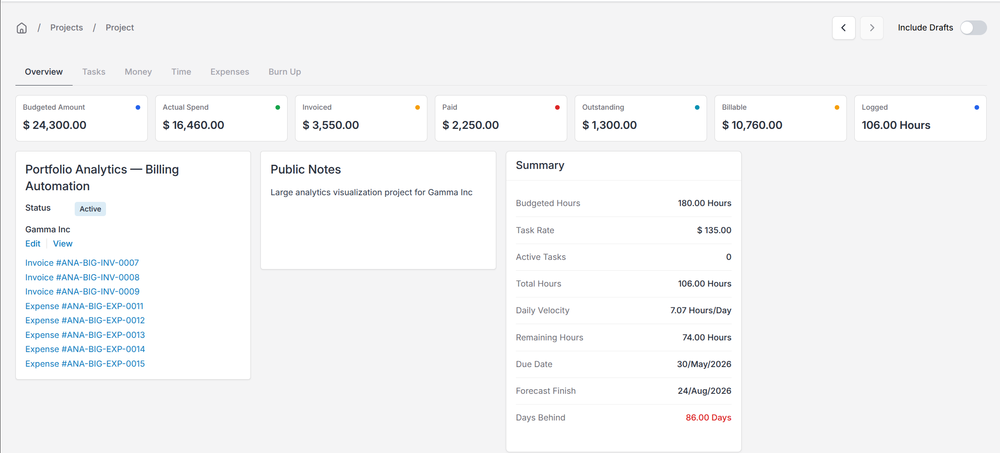
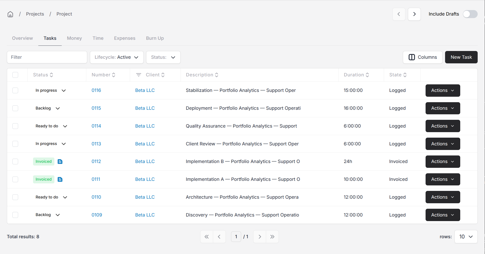
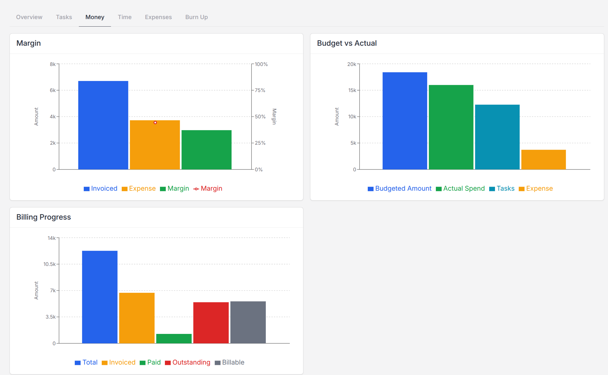
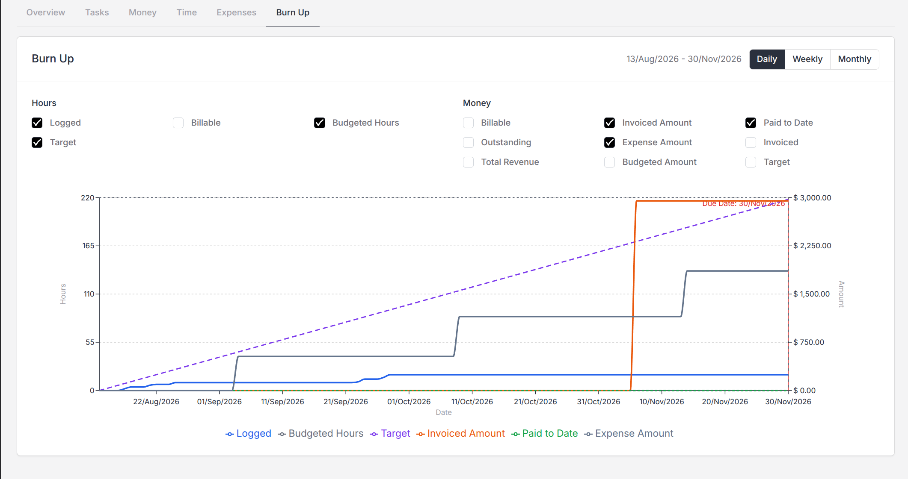
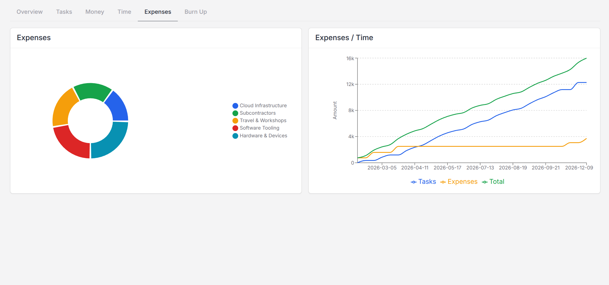
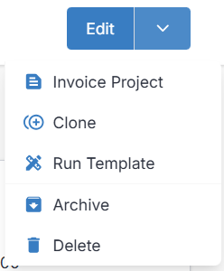
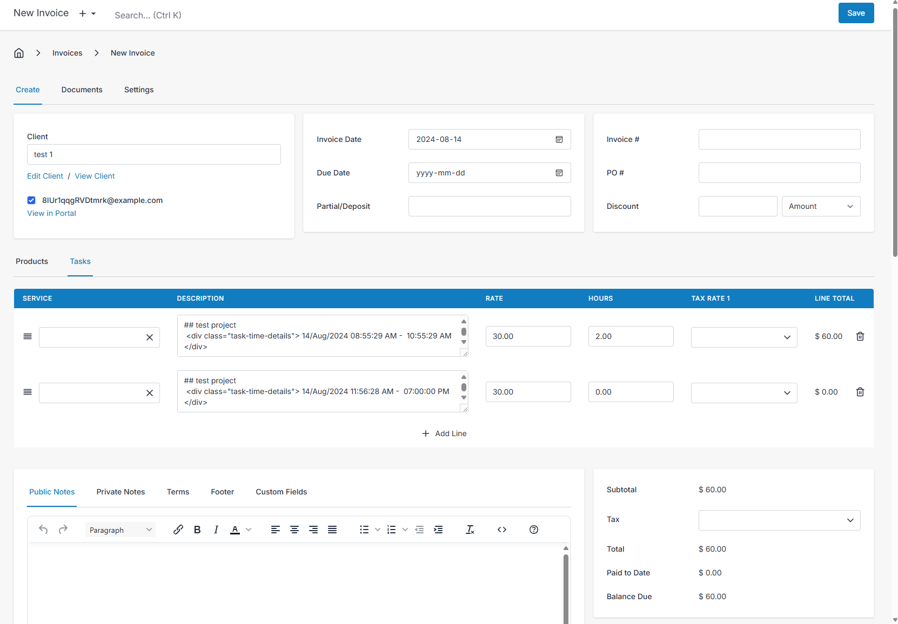

# Projects: group tasks, expenses and invoices for one engagement

A project is a container that groups everything you do for a [client](/docs/user-guide/clients) in one place: the billable hours, the costs you incurred on their behalf, and the invoices that go out. The project record itself is simple. Its value comes from what you hang off it. Once a few [tasks](/docs/user-guide/tasks) and [expenses](/docs/user-guide/expenses) are linked, you have a single place to see how much work has gone in, how much you have spent, and how close you are to the budget you agreed.

## When should I use a project?

Not every piece of work needs a project. If you are sending a one-off [invoice](/docs/user-guide/invoices) for a fixed amount (a product sale, a flat fee, a quick job), invoicing the client directly is faster and keeps your records uncluttered.

A project starts to earn its keep when:

- **Work is tracked by the hour.** A project gives your tasks a default **Task Rate**, so every new task for that engagement can inherit the right hourly rate.
- **You need to watch a budget.** Set **Budgeted Hours** up front and the project overview shows total logged hours against budget.
- **Costs accumulate over time.** Linking [expenses](/docs/user-guide/expenses) to a project keeps contractor invoices or travel bundled with the work they belong to, so nothing is forgotten at billing time.
- **You want one person accountable.** Assigning a team member to the project makes it clear who owns delivery.
- **You will invoice in stages or at the end.** When several tasks and several weeks sit between starting the work and sending the invoice, the project is what ties it all together.

## Where do I see all my projects?

Click **Projects** in the left menu. The list shows **Client**, **Name**, **Task Rate**, **Due Date**, **Public Notes**, **Private Notes**, **Budgeted Hours**, **State** and **Number**. From here you can:

- Search with the **Filter** box
- Show archived or deleted projects with the **Lifecycle** filter (Active, Archived, Deleted). There is no Status filter.
- Create a project with **New Project**

Each row has an **Actions** menu on the right with the same actions as the project itself (see [What can I do with a project?](#what-can-i-do-with-a-project)).

Clicking a row opens a side panel with **Overview** and **Documents**. The Overview includes progress (Logged, Budgeted, Remaining, Projected), details, the client, tasks, and a **View Project** button.

You can also open the **Projects** tab on a [client](/docs/user-guide/clients#what-can-i-see-on-a-clients-page) to see only that client's projects.

## How do I view a project?

Click **View Project** in the side panel (or otherwise open the project view at `#/projects/:id`). The view page has these tabs: **Overview**, **Tasks**, **Invoices**, **Quotes**, **Expenses**, **Charts** and **Burn Up**. To change the project's details, click **Edit**. The edit screen has tabs **Edit** and **Documents**.

### What does the Overview show?

The **Overview** tab shows the project's most useful totals at a glance. Amounts use the client's currency.

| Total | What it means |
|---|---|
| Budgeted Amount | The planned value of the project. For projects created in the app, this is **Budgeted Hours × Task Rate**. |
| Actual Spend | The value of work logged against the project, together with its linked expenses. |
| Invoiced | The value already invoiced for the project. |
| Paid | The amount received against those invoices. |
| Outstanding | The invoiced amount that has not yet been paid. |
| Billable | Work recorded against the project that has not yet been invoiced. |
| Logged | The total time recorded against the project. |

The **Summary** lists figures such as Budgeted Hours, Estimated Hours, Logged Hours, Remaining Estimated Hours, Unestimated Tasks, Tasks Over Estimate, Task Rate, Active Tasks, Total Hours, Daily Velocity, Remaining Hours, Due Date, Forecast Finish and Days Behind.

The project details appear alongside the summary, including the client. An **Include Drafts** toggle sits at the top right of the Overview (off by default).

### What do the other tabs show?

| Tab | What it shows |
|---|---|
| **Tasks** | The work recorded against the project, with **Filter**, **Lifecycle**, **Status** and **Columns**. **New Task** (and **+ Create**) creates a task with this project and its task rate already filled in. The client is filled in from the project after you save the task. Each row has an **Actions** menu. See [Tasks](/docs/user-guide/tasks). |
| **Invoices** | Invoices linked to the project. |
| **Quotes** | Quotes linked to the project. |
| **Expenses** | Expenses linked to the project. |
| **Charts** | **Margin**, **Budget vs Actual** and **Billing Progress**. |
| **Burn Up** | How completed work grows over the life of the project, compared with the plan. You can switch between **Daily**, **Weekly** and **Monthly**, and choose **Hours** and **Money**. A due-date marker can appear on the chart. |

A chart may show no data until tasks, time entries, expenses or invoices have been linked to the project.

## How do I create or edit a project?

1. Go to **Projects** and click **New Project**, or create a project from a [client](/docs/user-guide/clients).
2. Pick the **Client** and give the project a name. Both are required. A project belongs to one client.
3. Optionally set a due date, budgeted hours, a default task rate, a colour and notes.
4. Click **Save**. The **Project Number** is created then, from **Settings > Generated Numbers > Projects**. A new project also picks up the company **Default Task Rate** from **Settings > Task Settings** unless you type a different rate.

Most of the value comes later, from the tasks and expenses you attach.

| Field | What it is for |
|---|---|
| **Project Name** | The name of the engagement. Required. |
| **Project Number** | Created automatically when you save. It appears on the edit screen, not on the unsaved create form. Change the pattern under **Settings > Generated Numbers > Projects**. |
| **Client** | The [client](/docs/user-guide/clients) this work is for. Required. A project can only belong to one client. |
| **Assigned User** | The team member accountable for the project. |
| **Tags** | Optional. Labels you can use to find or group projects later. |
| **Color** | Optional. A colour for the project. |
| **Due Date** | The target finish date. Helpful for keeping an eye on what is coming up, and it can appear as a marker on the Burn Up chart. |
| **Budgeted Hours** | Your estimate or agreed cap on billable hours. Shown next to total logged hours on the overview. Budgeted Amount is this figure times the Task Rate. |
| **Task Rate** | The default hourly rate for new tasks on this project. Individual tasks can override it if the rate varies by role or phase. |
| **Public Notes** | Visible in the list and useful for scope summaries. |
| **Private Notes** | Internal notes. |

A saved project also shows a **Status** row on the edit screen.

### How do I attach files to a project?

Open the **Documents** tab on the edit page or in the side panel and upload files such as briefs, signed scopes and design references. A new project you have not saved yet has no Documents tab; save it first, then upload.

## What can I do with a project?

Once you have saved a project, use the arrow next to **Edit** on the view page, or the arrow next to **Save** on the edit page. On the list, use the row's **Actions** menu.

| Action | What it does |
|---|---|
| **Invoice Project** | Opens a new unsaved invoice for the project's client, with unbilled tasks as line items. See [How do I invoice a project?](#how-do-i-invoice-a-project). |
| **Create Expense** | Starts a new [expense](/docs/user-guide/expenses) for this project. |
| **Clone** | Opens a new project form already filled in with this project's details (name, client and task rate). There is no Clone To dialog. |
| **Archive** / **Delete** | Tidies up or removes the project. See [How do I bring back an archived or deleted project?](#how-do-i-bring-back-an-archived-or-deleted-project). |
| **Restore** | Brings an archived or deleted project back. |

**Run Template** only appears once you have created a [template](/docs/advanced-topics/templates).

## How do I invoice a project?

When the work is done, or you have hit a milestone worth billing:

1. Open the project.
2. Choose **Invoice Project** from the arrow next to **Edit** or **Save**, or from the **Actions** menu.
3. Review the new unsaved invoice. It is filled in with the project's client, and unbilled tasks appear as line items (rate, hours and a line total). Save the invoice when you are ready.

If you also need to bill [expenses](/docs/user-guide/expenses#how-do-i-make-an-expense-billable-to-a-client) linked to the project, add them from the expense or as lines on the invoice.

## How do I bring back an archived or deleted project?

Archiving hides a project from your normal list. All the data stays put, and you can still edit and save the project without restoring it first. The **Actions** menu then offers **Restore** and **Delete**.

Deleting sets the status to **Deleted**. The project is not gone for good, and the number does not get a `_deleted` suffix. You can restore it. A deleted project's menu offers **Invoice Project**, **Create Expense**, **Clone** and **Restore**.

1. On the project list, open the **Lifecycle** filter, tick **Archived** (or **Deleted**) and click **Apply**.
2. In the row, open the **Actions** menu and choose **Restore**.

The project goes back to **Active**.

## Related

- [Tasks](/docs/user-guide/tasks): time entries that roll up into a project
- [Expenses](/docs/user-guide/expenses#how-do-i-make-an-expense-billable-to-a-client): costs linked to a project, and how to bill them
- [Invoices](/docs/user-guide/invoices): the invoice created from a project
- [Clients](/docs/user-guide/clients#what-can-i-see-on-a-clients-page): the Projects tab on a client
- [Quotes](/docs/user-guide/quotes#what-can-i-do-with-a-quote): convert a quote into a project
