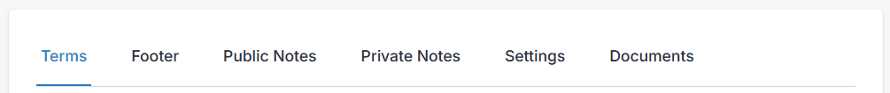
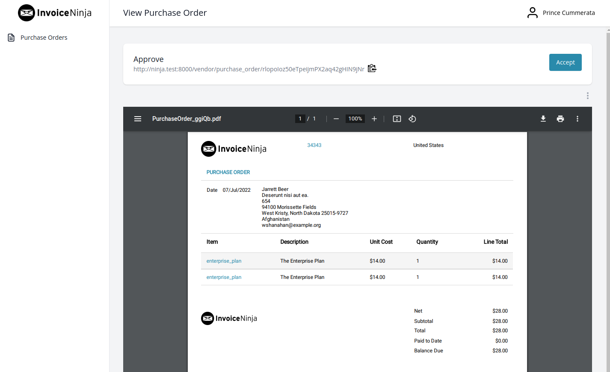

# Purchase orders: order from vendors and convert the order to an expense

A purchase order is the mirror image of an [invoice](/docs/user-guide/invoices). An invoice is something you send to a client; a purchase order is something you send to a [vendor](/docs/user-guide/vendors) to request goods or services at an agreed price. It is a written record of what you are ordering, how much you expect to pay and on what terms. Once your vendor accepts it, you both have the same numbers to point to if an invoice arrives with surprises.

Reach for a purchase order when you are buying stock, commissioning a subcontractor, ordering equipment or locking in a larger spend that needs sign-off before the money goes out. A vendor has to exist before you can raise a purchase order against them. A purchase order usually ends its life as an [expense](/docs/user-guide/expenses) on your books.

## How is a purchase order different from an invoice?

| | Invoice | Purchase Order |
|---|---|---|
| Who it is for | A [client](/docs/user-guide/clients) you bill | A [vendor](/docs/user-guide/vendors) you buy from |
| What it does | Asks the client to pay you | Asks the vendor to supply you at an agreed price |
| How it is accepted | The client pays, or you mark it paid | The vendor accepts it in the vendor portal |
| How it usually ends | A [payment](/docs/user-guide/payments) | An [expense](/docs/user-guide/expenses), once you convert it |

Creating a purchase order follows much the same flow as creating an invoice.

<video width="100%" controls>
  <source src="/assets/videos/purchase_orders/create_purchase_order.mp4" type="video/mp4" />
</video>

## Where do I see all my purchase orders?

Click **Purchase Orders** in the left menu. The list shows **Status**, **Number**, **Vendor**, **Expense**, **Amount**, **Date** and **Due Date**. The **Expense** column shows the expense if you have already converted the purchase order. From here you can:

- Search with the **Filter** box
- Show archived or deleted purchase orders with the **Lifecycle** filter
- Narrow the list with the **Status** filter: **Draft**, **Sent**, **Accepted** or **Cancelled**
- Choose what to show with **Columns**
- Import purchase orders from a file with **Import**
- Create a purchase order with **New Purchase Order**

Each row has an **Actions** menu on the right with the same actions as the purchase order itself (see [What can I do with a purchase order?](#what-can-i-do-with-a-purchase-order)). Click the number to open the purchase order.

You can also open the **Purchase Orders** tab on a [vendor](/docs/user-guide/vendors) to see only that vendor's orders. That tab has its own Lifecycle and Status filters and a **New Purchase Order** button.

## How do I create a purchase order?

1. Go to **Purchase Orders** and click **New Purchase Order**. You need a [vendor](/docs/user-guide/vendors) first; you can add one ahead of time, or choose **New Vendor** from this screen.
2. Pick the **Vendor**. Contacts with **Send Email** ticked on the vendor record are selected by default. Each contact also has an **Authorized to sign** checkbox.
3. Fill in the details, add line items, and optionally add terms, notes or files. See the sections below.
4. Click **Save**. The purchase order starts as a **Draft**. The vendor cannot see it until you email it or mark it as sent.

On a saved purchase order, each contact has a **View in Portal** link with a copy icon.

### Which details do I fill in?

| Field | What it is for |
|---|---|
| **Vendor** | Who you are buying from. Required. The dropdown ends with **New Vendor**. |
| **Purchase Order Date** | The date the order is issued. Defaults to today. |
| **Due Date** | Optional. How long the offer stands, or when you expect delivery or the vendor's invoice. |
| **Partial/Deposit** | Optional. An amount owed up front. When you enter a value, a **Partial Due Date** field appears. Handy for deposits on larger orders. |
| **PO Number** | Filled in automatically when you save. The placeholder is **Auto Generate**. Change the pattern under **Settings > Generated Numbers > Purchase Orders**. |
| **Discount** | A reduction taken off the total. The control offers **Amount**. |
| **Tags** | Optional. Labels you can use to find or group purchase orders later. |

### How do I add line items?

Each line can pull from your [Products](/docs/user-guide/products) catalogue or be typed in fresh.

| Column | What it is for |
|---|---|
| **Item** | The name of the product or service. Picking a product fills in its description and unit cost. |
| **Description** | Supporting detail for the line. |
| **Quantity** | How many you are ordering, multiplied by unit cost to give the line total. |
| **Unit Cost** | The agreed price for a single unit. |
| **Line Total** | Quantity times unit cost. |

Click **Add Item** to add a row. The totals area shows Subtotal, Total, Paid to Date and Balance, plus a Tax select.

### What goes in the tabs below the line items?

| Tab | What it is for | Can the vendor see it? |
|---|---|---|
| **Public Notes** | Extra context for the vendor, printed on the PDF. | Yes |
| **Private Notes** | Notes for your team only. Never on the PDF or in the vendor portal. | No |
| **Terms** | Conditions attached to the order, such as delivery windows or a return policy. | Yes |
| **Footer** | Disclaimers and small print at the bottom of the PDF. | Yes |

### What is on the Settings tab?

A saved purchase order has these tabs along the top: **Edit**, **Documents**, **Settings**, **Activity**, **History** and **Email History**. On a new purchase order the first tab is **Create**, alongside **Documents** and **Settings**.

These Settings options override your company defaults for this purchase order only:

- **Assigned User:** the user the purchase order is recorded against.
- **Project:** links the order to a [project](/docs/user-guide/projects) so its spend rolls up there.
- **Client:** optionally ties the order to a [client](/docs/user-guide/clients), useful when the purchase is on a client's behalf and will later be billed back to them.
- **Exchange Rate:** when the vendor bills in a different currency from yours, sets the rate used to convert the total.
- **Design:** picks a built-in or custom PDF design. Manage designs under **Settings > Invoice Design**.
- **Inclusive Taxes:** when on, tax is treated as already included in the line prices instead of added on top.

### How do I attach files?

Open the **Documents** tab and upload pictures, quotes, specs or contracts, so everything related to the order lives in one place. On a new purchase order the tab says "Save the record to upload documents."

## What can I do with a purchase order?

Click the arrow next to **Save**, or use the row **Actions** menu on the list. The row menu includes **Send Email** (and the edit page has a paper-plane icon for the same action). The arrow next to Save does not include Send Email.

| Action | What it does |
|---|---|
| **View PDF** / **Print PDF** / **Download** | Shows, prints or saves the purchase order PDF. |
| **Send Email** | Sends the purchase order to the vendor contacts ticked to receive it. Contacts with **Send Email** ticked on the vendor are selected by default. See [Vendors](/docs/user-guide/vendors). |
| **Schedule** | Sends the purchase order automatically at a later date and time. Appears on Draft and Sent purchase orders. |
| **Add Comment** | Adds a comment to the record. |
| **Vendor Portal** | Opens the purchase order in a new tab, exactly as your vendor sees it. They can **Approve** or **Accept**, download the PDF and view attachments. |
| **Mark Sent** | Changes a draft to sent without emailing it. Use this if you handed over a PDF in person or sent it another way. Only appears on drafts. |
| **Convert to Expense** | Creates an [expense](/docs/user-guide/expenses) from the purchase order. See [How do I convert a purchase order to an expense?](#how-do-i-convert-a-purchase-order-to-an-expense). After you convert, this item is replaced by **View Expense**. |
| **Add to Inventory** | Appears only on **Accepted** purchase orders. Adds the ordered items to stock when **Track Inventory** is enabled under **Settings > Product Settings**. |
| **Clone To** | Copies the purchase order into a new **Purchase Order**, **Invoice**, **Quote**, **Recurring Invoice** or **Credit**. |
| **Archive** / **Delete** | Tidies up or removes the purchase order. See [What do the purchase order statuses mean?](#what-do-the-purchase-order-statuses-mean). |

**Run Template** only appears once you have created a [template](/docs/advanced-topics/templates). Any e-invoice download item only appears when e-invoicing is turned on.

There is no **Mark Received** or **Cancel** action in the menus.

## What do the purchase order statuses mean?

| Status | What it means | Can the vendor see it? |
|---|---|---|
| **Draft** | Being prepared. You can edit it freely. | No |
| **Sent** | Emailed, or marked as sent | Yes, in the vendor portal |
| **Accepted** | The vendor agreed to the order in the vendor portal | Yes |
| **Archived** | Hidden from your normal list | |
| **Deleted** | Removed, but can still be restored | |

### What does Draft mean?

Every purchase order starts as a draft. At this stage it is yours alone: the vendor cannot see it, and you can edit freely. Drafts stay inactive until you either email them or mark them as sent.

Once you email a purchase order or mark it as sent, **Mark Sent** leaves the menu and you cannot change it back to a draft.

### How does a vendor accept a purchase order?

When your vendor agrees to the order, the purchase order moves to **Accepted**. Vendors do this themselves in the vendor portal: they review the purchase order and can choose **Approve** or **Accept**. At that point you have a record that both sides agreed to the same numbers. There is no in-app action to mark a purchase order as accepted yourself.

You can also choose **Vendor Portal** from the purchase order to see exactly what they see.

### How do I add a purchase order to inventory?

On an **Accepted** purchase order, choose **Add to Inventory**. This appears only after the vendor has accepted, on both the list **Actions** menu and the arrow next to Save.

**Track Inventory** lives under **Settings > Product Settings** ("Display a product stock field and update when invoices are sent"). When that setting is on, stock levels for the matching products can stay in step with your purchase orders. See [Products](/docs/user-guide/products).

### How do I convert a purchase order to an expense?

**Convert to Expense** creates an [expense](/docs/user-guide/expenses) in one step, which is usually how the order ends its life in your books. You can convert a draft, sent or accepted purchase order.

The new expense starts as **Logged**. It inherits the vendor, amount and line detail, so you do not retype anything. The purchase order's status does not change. After you convert, the menu shows **View Expense** instead of **Convert to Expense**, and the expense number appears in the **Expense** column on the purchase order list.

From there the expense behaves like any other: you can mark it paid, attach a receipt or flag it as billable.

### What happens when I delete or archive a purchase order?

Deleting sets the status to **Deleted**. The purchase order number stays the same; it does not get a `_deleted` suffix. The purchase order is not gone for good. You can restore it.

Archiving hides a purchase order from your normal list to keep your active work tidy. All the data stays put. To show it on your normal list again, restore it.

### How do I bring back an archived or deleted purchase order?

1. On the purchase order list, open the **Lifecycle** filter, tick **Archived** (or **Deleted**) and click **Apply**.
2. In the row, open the **Actions** menu and choose **Restore**.

The purchase order goes back to the status it had before (for example, a Sent purchase order that was archived returns to **Sent**).

## Related

- [Vendors](/docs/user-guide/vendors): who you send the purchase order to, and which contacts receive it
- [Expenses](/docs/user-guide/expenses): what a converted purchase order becomes
- [Invoices](/docs/user-guide/invoices): the sell-side counterpart, including [Convert To](/docs/user-guide/invoices#what-can-i-do-with-an-invoice) a purchase order
- [Products](/docs/user-guide/products): line items and inventory
- [Projects](/docs/user-guide/projects)
- [Clients](/docs/user-guide/clients): when the purchase is on a client's behalf
