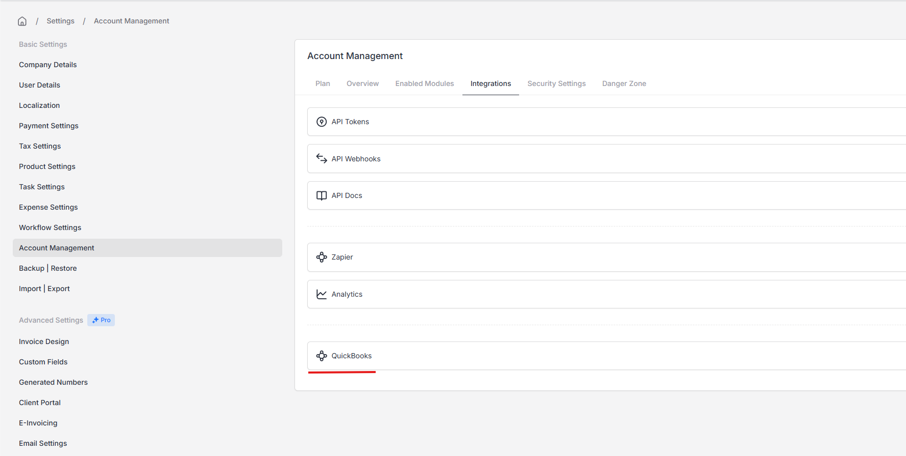
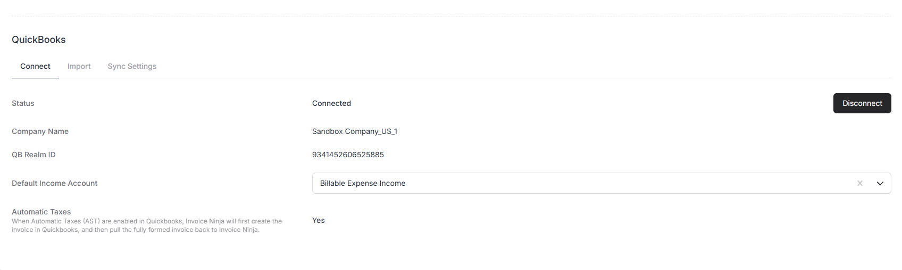
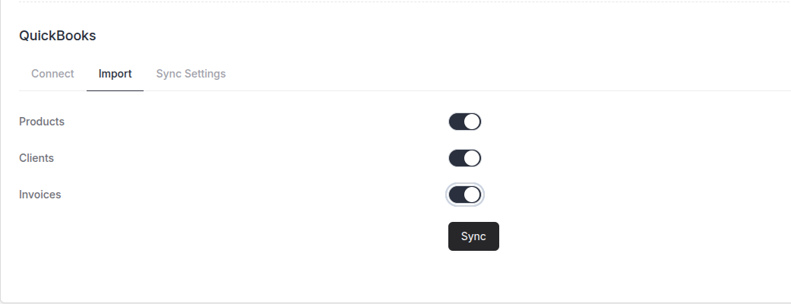
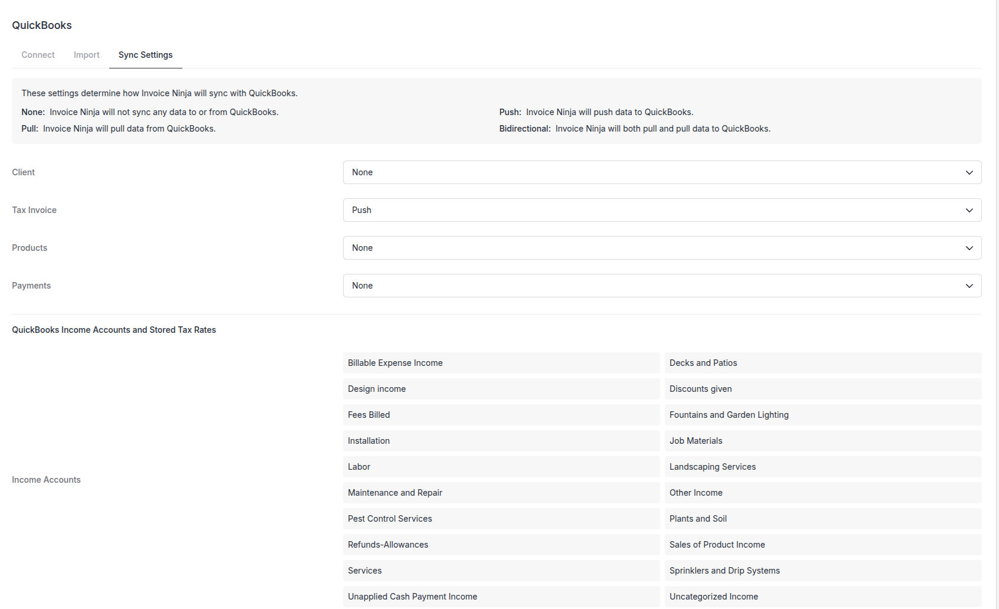

# QuickBooks: import your books and keep them in sync

Invoice Ninja's QuickBooks Online connection can import data from QuickBooks into Invoice Ninja and push Invoice Ninja activity back to QuickBooks.

This lets you create invoices and get paid in Invoice Ninja, while also keeping QuickBooks connected if you want an ongoing accounting integration.

:::info
Self-hosting? You need to register your own Intuit app and add its keys to your `.env` file before you can connect. See [Self Host QuickBooks](/docs/self-host/self-host-quickbooks).
:::

## How do I connect QuickBooks to Invoice Ninja?

Go to **Settings > Account Management**, open the **Integrations** tab, and click **QuickBooks**. The route is `#/settings/account_management/integrations`.

That tab also lists API Tokens, API Webhooks, API Docs, Zapier and Analytics.

Clicking **QuickBooks** opens a window with this text: "Connect your QuickBooks account to Invoice Ninja to automatically sync your transactions and invoices." and a **Connect** button. **Connect** starts the sign-in (OAuth) flow with Intuit. Choose the QuickBooks company you want to link; you are then redirected back to Invoice Ninja.

While QuickBooks is not connected, invoices do not have a **QuickBooks** tab.

After you connect, the QuickBooks pages in Invoice Ninja show import and sync options.

On the hosted app, the Integrations tab does not show self-hosted setup wording. Self-hosted installs still need their own Intuit app keys, as described in [Self Host QuickBooks](/docs/self-host/self-host-quickbooks).

## How do I import my QuickBooks data?

After you connect, you can import your QuickBooks data into Invoice Ninja.

From the import menu, turn on the record types you wish to import, then start the import (the button on that screen is typically **Sync**).

For large accounts, this can take several hours to complete.

The exact import types and button labels are shown after the account is connected.

## How do I choose sync options?

After the data import, you can turn on sync options that allow Invoice Ninja to push records that have been created or updated to QuickBooks.

For example, if you select the **Push** option for invoices, Invoice Ninja will push to QuickBooks when a new invoice is created, or when an existing invoice is updated.

:::warning
Only **Push** is supported for ongoing synchronisation. Pull and Bidirectional synchronisation are not supported. The initial import is a separate, one-time step that brings your selected QuickBooks records into Invoice Ninja.
:::

## How does a push work?

When you push an invoice, its client has to exist in QuickBooks first. If it does not, Invoice Ninja will create it on the fly as part of the invoice push, regardless of whether client Push is enabled. Any line-item products that do not exist in QuickBooks yet are also created automatically during the invoice push.

Not every field change triggers a push. Client balance updates (for example, when a payment is applied) are ignored; only meaningful edits like name, address or contact info sync across. Product updates (price changes, description edits) are not currently pushed either; only newly created products are.

The first time you push a record, the integration checks QuickBooks for a matching record before creating a duplicate. Clients are matched by display name, products by item name (skipping Category and Group types). If a match exists, Invoice Ninja links to it rather than creating a second copy.

## How do I check an invoice in QuickBooks?

After QuickBooks is connected, individual invoices can include a **QuickBooks** tab. That tab is not shown while the integration is disconnected. Use it when you want to confirm that an invoice was pushed successfully or investigate a mismatch.

1. Open the invoice in Invoice Ninja.
2. Select the **QuickBooks** tab.
3. Review the **QuickBooks ID**, **Status** and **Message**.
4. Select **Check Record**.
5. Review the connection status, QuickBooks balance and last-updated time, and the comparison of the invoice number and total.
6. Follow the recommended action shown on the page, if one is needed.

The available actions depend on what Invoice Ninja finds:

- **Force Link** links the Invoice Ninja invoice to a matching invoice already found in QuickBooks.
- **Force Push** sends the current Invoice Ninja invoice to QuickBooks again.
- **Change Invoice Number** returns you to the invoice so you can resolve a duplicate or mismatched number.
- **Verify QuickBooks Invoice** asks you to inspect the matching invoice in QuickBooks before running **Check Record** again.

:::warning
Use **Force Link** and **Force Push** only after comparing the invoice number and total in both systems. Linking the wrong invoices or pushing the wrong version can leave your accounting records inconsistent.
:::

## How does the connection stay signed in?

The integration uses OAuth 2.0 and refreshes tokens automatically. If both your access and refresh tokens expire, which typically happens after 100 days of inactivity, you will get an email prompting you to reconnect. Reconnecting from the QuickBooks settings page preserves your sync configuration and all existing record links, so you will not lose the mapping you have already built up.

## How do QuickBooks terms map to Invoice Ninja?

| QuickBooks | Invoice Ninja | Where to learn more |
|---|---|---|
| Customer | Client | [Clients](/docs/user-guide/clients) |
| Customer contact | Contact | [Clients: Contacts](/docs/user-guide/clients#contacts) |
| Estimate | Quote | [Quotes](/docs/user-guide/quotes) |
| Invoice | Invoice | [Invoices](/docs/user-guide/invoices) |
| Receive Payment | Payment | [Payments](/docs/user-guide/payments) |
| Credit Memo | Credit | [Credits](/docs/user-guide/credits) |
| Product or Service | Product | [Products](/docs/user-guide/products) |
| Recurring Transaction / Template | Recurring Invoice | [Recurring Invoices](/docs/user-guide/recurring-invoices) |
| Vendor | Vendor | [Vendors](/docs/user-guide/vendors) |
| Purchase Order | Purchase Order | [Purchase Orders](/docs/user-guide/purchase-orders) |
| Bank Transaction | Transaction | [Transactions](/docs/user-guide/transactions) |
| Sales Tax | Taxes | [Taxes](/docs/user-guide/taxes) |
| Reports | Reports | [Reports](/docs/user-guide/reports) |

## What should I check before I migrate?

Use this checklist to keep the move controlled and easy to verify.

- [ ] Confirm which QuickBooks Online company you will connect.
- [ ] Save QuickBooks reports or exports needed for backup and reconciliation.
- [ ] Decide whether to import only active records or include historical invoices.
- [ ] Review duplicate customer names, product names and invoice numbers before import.
- [ ] Review active recurring templates so you know which ones need to be recreated.
- [ ] Save copies of important attachments.
- [ ] Confirm payment gateway access.
- [ ] Confirm invoice number sequence and next invoice number.
- [ ] Confirm tax settings with your accountant or bookkeeper.

## What should I do after I connect QuickBooks?

Once the migration data is in place, do a short end-to-end setup pass before inviting clients.

1. Set your company name, logo, address and contact details in [Company Details](/docs/user-guide/basic-settings#company_details).
2. Check invoice numbering in [Generated Numbers](/docs/user-guide/advanced-settings#generated_numbers).
3. Configure taxes in [Taxes](/docs/user-guide/taxes).
4. Connect a payment gateway in [Payment Gateways](/docs/user-guide/gateways).
5. Create or open a migrated test client.
6. Create a test invoice. Send it only when you are ready for the client (or a mailbox you control) to receive it.
7. Pay the invoice using a test or low-value transaction if appropriate.
8. Open the client portal as the client contact and review invoices, payments, statements and payment methods.
9. Run your first [report](/docs/user-guide/reports) to check the migrated billing data.

## How does the client portal fit in?

QuickBooks users often move to Invoice Ninja because the client-facing experience is more direct. Your clients can use the branded portal to view invoices, pay online, download statements, approve quotes, manage saved payment methods and access shared documents.

The portal is connected to client contacts. When you email an invoice or quote, the link opens that contact's portal view, so the portal becomes part of the normal billing flow instead of a separate tool clients need to learn. See [Client Portal](/docs/user-guide/client-portal) for the full walkthrough.

## How does Automatic Sales Tax work (US)?

If your QuickBooks account uses Automated Sales Tax (AST), Invoice Ninja defers to QuickBooks for tax calculations. When an invoice is pushed, QuickBooks works out the applicable tax based on the customer's location, returns the details, and Invoice Ninja applies them per line item. Matching tax rates are created in Invoice Ninja on the fly, totals are reconciled between the two systems, and tax-exempt products stay tax-free: only taxable lines receive tax assignments.

Because the response has to come back before the invoice can be finalised, invoice pushes are processed straight away rather than queued when AST is on. See [Taxes](/docs/user-guide/taxes) for how Invoice Ninja handles tax outside of this integration.

:::warning
When Automatic Taxes are enabled, Invoice Ninja creates the invoice in QuickBooks first (in real time) and uses QuickBooks' response as the source of truth for taxes. You cannot adjust tax calculations on the Invoice Ninja side while AST is enabled.
:::

If a product should be tax-exempt, set the product's tax category to **Tax Exempt**. QuickBooks will then evaluate the line item as non-taxable.

## Troubleshooting

### Taxes are not being carried over from Invoice Ninja to QuickBooks

In this situation, Automatic Sales Tax (AST) is usually enabled in QuickBooks, because QuickBooks is in charge of calculating the tax and the applicable rates. The most common cause of taxes being removed is that the client record is set to tax exempt, or that QuickBooks cannot determine the correct tax rates because the customer address is missing or incomplete.

## Related

- [Self Host QuickBooks](/docs/self-host/self-host-quickbooks): register your own Intuit app on a self-hosted install
- [Clients](/docs/user-guide/clients): customers imported from QuickBooks
- [Invoices](/docs/user-guide/invoices): invoices you can push after connecting
- [Taxes](/docs/user-guide/taxes): tax settings, including the Tax Exempt category
- [Reports](/docs/user-guide/reports): check migrated totals
- [Client Portal](/docs/user-guide/client-portal): what clients see after you migrate
