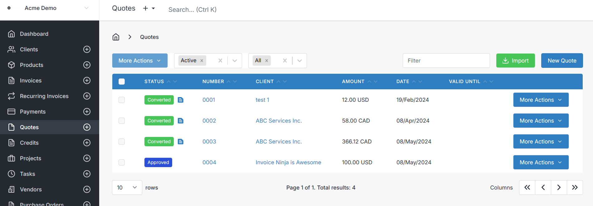
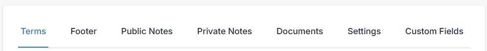
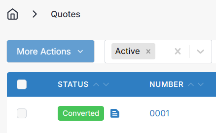

# Quotes: price the work and get it approved before you invoice

A quote is a priced proposal you send a client before any money changes hands. Use one whenever a client needs to see and agree to the scope and price before you start the work.

<video width="100%" controls>
  <source src="/assets/videos/quotes/quotes_creation_demo.mp4" type="video/mp4" />
</video>

## How is a quote different from an invoice?

| | Quote | [Invoice](/docs/user-guide/invoices) |
|---|---|---|
| What it says | "Here's what this would cost" | "Here's what you owe" |
| Affects the client's balance? | No, never | Yes, once it's sent |
| Expects payment? | No | Yes |
| What happens next | The client approves it, then you convert it to an invoice | The client pays it |

Creating and editing a quote works almost exactly like an invoice, so if you've sent an invoice before, none of this will feel new. Quotes can bill for [products](/docs/user-guide/products), [tasks](/docs/user-guide/tasks) or [expenses](/docs/user-guide/expenses), carry attachments your client can open in the [Client Portal](/docs/user-guide/client-portal), and keep a full history of who changed what and when. That history is handy when a proposal goes through a few rounds before it's accepted.

## Where do I see all my quotes?

Click **Quotes** in the left menu. From the list you can search, filter and create quotes, and each row has an **Actions** menu with the same actions as the quote itself (see [What can I do with a quote?](#what-can-i-do-with-a-quote)).

## How do I view a quote?

| You want to see | Do this |
|---|---|
| The PDF your client receives | Open the row's **Actions** menu and choose **View PDF** |
| Every detail: line items, notes, settings | Click the quote number |
| The quote exactly as your client sees it | Choose **Client Portal** from the **Actions** menu |

### What are the tabs at the top of a quote?

| Tab | What it shows | When it helps |
|---|---|---|
| **Edit** | The client, dates, line items, notes and terms | Creating or changing the quote |
| **Documents** | Files attached to the quote | Adding contracts, mock-ups or site photos |
| **Settings** | Extra options for this quote only | Linking a project, picking a design and more |
| **Activity** | Every action on the quote (created, edited, approved, converted) and who did it | You need the full record of who did what |
| **History** | Every change to the quote total, and who made it | A client asks why the price changed between versions |
| **Email History** | Every time the quote was emailed, to whom and when | A client says they never got the quote |

## What can I do with a quote?

Once you've saved a quote, click the arrow next to **Save** to see what you can do with it. On the list, use the row's **Actions** menu. The choices change as the quote moves through its statuses.

| Action | What it does |
|---|---|
| **View PDF** / **Print PDF** / **Download PDF** | Shows, prints or saves the quote PDF |
| **Email Quote** | Sends the quote to the contacts ticked to receive it |
| **Schedule** | Sends the quote automatically at a later date and time |
| **Client Portal** | Shows the quote exactly as your client sees it |
| **Mark Sent** | Changes a draft to sent without emailing it, for example when you handed over a printed copy |
| **Approve** | Marks the quote as accepted yourself, when the client agreed by phone or in person |
| **Convert To** | Turns the quote into an **Invoice**, a **Purchase Order** or a **Project**. See [How do I turn a quote into an invoice?](#how-do-i-turn-a-quote-into-an-invoice) |
| **Cancel** | Cancels a sent quote. Only appears on sent quotes. |
| **Clone To** | Copies the quote into a new **Quote**, **Invoice**, **Credit**, **Recurring Invoice** or **Purchase Order** |
| **Run Template** | Runs one of your custom [templates](/docs/advanced-topics/templates) on the quote. Only appears once you've created a template. |
| **Download E-Quote** | Downloads the quote as an electronic file, for countries that use [e-invoicing](/docs/user-guide/einvoicing). Only appears when e-invoicing is turned on. |
| **Archive** / **Delete** | Tidies up or removes the quote. See [What do the quote statuses mean?](#what-do-the-quote-statuses-mean) |

## How do I create or edit a quote?

Click **New Quote** on the quote list. Creating and editing use the same screen, so everything below applies to both.

### Who is the quote for?

1. Pick the [client](/docs/user-guide/clients) in the **Client** dropdown. Every quote needs one.
2. Check which contacts get the quote under **Contacts**. Contacts with **Add to Invoices** turned on in the client record are ticked automatically. Untick anyone you'd rather leave out, or tick extra contacts for this quote only.

Each contact also has a link to their view in the client portal, handy when you want to double-check what they'll see.

### Which quote details do I fill in?

| Field | What it is for |
|---|---|
| **Quote Date** | The date on the quote. Defaults to today. |
| **Valid Until** | Optional. The date after which you no longer honor the price. It stays blank until you set it. |
| **Partial/Deposit** | Optional. A deposit amount owed before the full amount. When you enter a value, a **Partial Due Date** field appears. |
| **Tags** | Optional. Labels you can use to find or group quotes later. |
| **PO #** | Your client's purchase order reference, so their accounts team can match it to their records |
| **Quote #** | Created automatically from the pattern under **Settings > Generated Numbers > Quotes**. Shows "Auto Generate" until you save. |
| **Discount** | A flat amount or a percentage off the total |

### How do I add line items?

The items list is the substance of the quote. Each row has:

| Column | What it is for |
|---|---|
| **Item** | The product, task or expense you're quoting for |
| **Description** | Free text. Markdown (simple formatting codes for bold, lists and so on) shows as formatting when **Enable Markdown** is on under **Settings > Account Management**. |
| **Quantity** | Multiplied by the unit cost to give the line total |
| **Unit Cost** | The price per unit |
| **Line Total** | The quantity multiplied by the unit cost |

Line items have **Products** and **Tasks** tabs. The quote total is the sum of the lines, with any discount and tax applied. Line items work just like they do on invoices; see [How do I add line items?](/docs/user-guide/invoices#how-do-i-add-line-items) for more detail.

### What goes in the tabs below the line items?

| Tab | What it is for | Can the client see it? |
|---|---|---|
| **Public Notes** | A short summary of the work, or context the client should see | Yes |
| **Private Notes** | Notes for your own team. Never on the PDF or in the client portal. | No |
| **Terms** | The conditions attached to the quote. Turn on **Save as default terms** to fill them in on future quotes. | Yes |
| **Footer** | Disclaimers and small print at the bottom of the PDF. Turn on **Save as default footer** to fill them in on future quotes. | Yes |
| **Custom Fields** | Extra fields you've set up for quotes | Depends on the field |

### How do I attach files to a quote?

Open the **Documents** tab and upload contracts, mock-ups, site photos or anything else that supports the quote. Save the quote first: until then the tab says "Save the record to upload documents." Your client can open the files from the client portal.

### What is on the Settings tab?

The **Settings** tab holds the less-used options for this quote only:

- **Assigned User:** the team member the quote belongs to.
- **Project:** links the quote to a [project](/docs/user-guide/projects).
- **Vendor:** links a [vendor](/docs/user-guide/vendors) to the quote.
- **Exchange Rate:** when the client is billed in a different currency, sets the rate used to convert the total.
- **Design:** picks the PDF design. You can customize designs under **Settings > Invoice Design**.
- **Inclusive Taxes:** when on, tax is treated as already included in the unit cost instead of added on top.

## What do the quote statuses mean?

Every quote moves through a small set of statuses. Each one tells you, and your client, where things stand.

| Status | What it means | Can the client see it? |
|---|---|---|
| **Draft** | Being prepared. You can edit it freely. | No |
| **Sent** | Emailed, or marked as sent | Yes, in the client portal |
| **Viewed** | The client has opened the quote in the portal | Yes |
| **Approved** | The client (or you, for them) agreed to the quote | Yes |
| **Converted** | Turned into an invoice | Yes |
| **Expired** | The Valid Until date has passed | Yes |
| **Cancelled** | Cancelled after it was sent | |
| **Archived** | Hidden from your normal list | |
| **Deleted** | Removed, but can still be restored | |

### What does Draft mean?

Every quote starts as a draft. Your client can't see it, it doesn't appear in the portal and no emails go out. It's entirely yours until you decide to share it.

:::warning
Once you email a quote or mark it as sent, you can't change it back to a draft.
:::

### What does Sent mean?

A quote becomes **Sent** the moment you email it from Invoice Ninja, or when you choose **Mark Sent** because you shared it some other way. From then on your client can open it in the [Client Portal](/docs/user-guide/client-portal) and approve or reject it.

### How does a client approve a quote?

There are two ways:

1. **The client approves it in the portal** by clicking **Approve**. They can also click **Reject**. Approving is the cleanest way, because you get a timestamped record of their agreement.
2. **You approve it for them** with **Approve** in the menu next to **Save**, when they agreed by phone or in person.

Need a signed document rather than a click? See [E-Signatures](/docs/user-guide/esignatures).

### How do I turn a quote into an invoice?

Converting is the last step of a successful quote. It copies the line items, totals and details into a new invoice that your client can pay.

1. Open the quote.
2. Click the arrow next to **Save**, choose **Convert To**, then **Invoice**.

On the quotes list, a converted quote shows a green **Converted** label with a blue invoice icon next to it. Click the icon to jump to the new invoice, so you can always trace a quote to the invoice it produced. (The Converted badge on the quote itself is not a link.)

### What happens when I delete a quote?

You can delete a quote while it's still a **Draft** or **Sent**. Deleting sets the status to **Deleted**. The quote isn't gone for good. You can restore it.

### What does archiving a quote do?

Archiving hides a quote from your normal list to keep your active work tidy. All the data stays put, and you can still edit and save the quote without restoring it first. The **Actions** menu then offers **Restore** and **Delete**. To show it on your normal list again, restore it.

### How do I bring back an archived or deleted quote?

1. On the quote list, open the **Lifecycle** filter, tick **Archived** (or **Deleted**) and click **Apply**.
2. In the quote's row, open the **Actions** menu and choose **Restore**.

The quote goes back to the status it had before, so you can pick up exactly where you left off.

## Related

- [Invoices](/docs/user-guide/invoices): where an approved quote ends up
- [Clients](/docs/user-guide/clients): set contacts and a default quote validity period
- [Client Portal](/docs/user-guide/client-portal): where your client views and approves quotes
- [E-Signatures](/docs/user-guide/esignatures): get a signed approval
- [Projects](/docs/user-guide/projects): track the work once a quote is accepted
- [Products](/docs/user-guide/products): reuse items and prices on quotes
- [Templates](/docs/advanced-topics/templates): build advanced documents from templates
