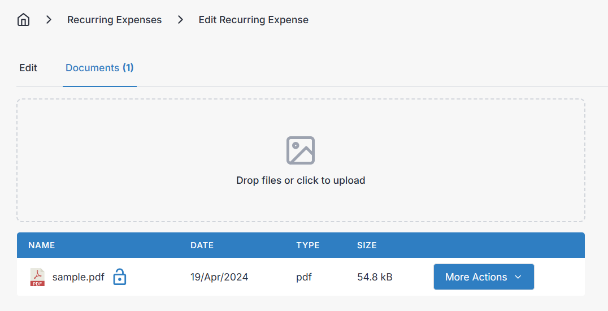
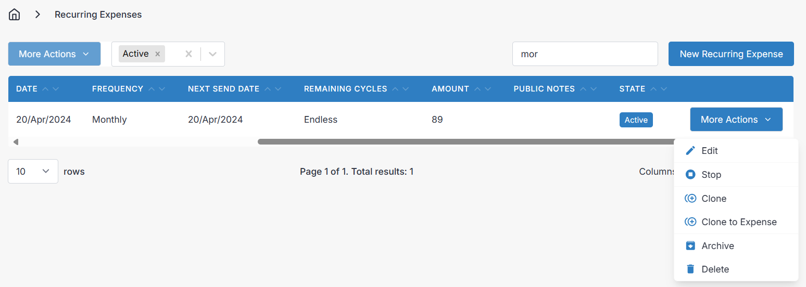
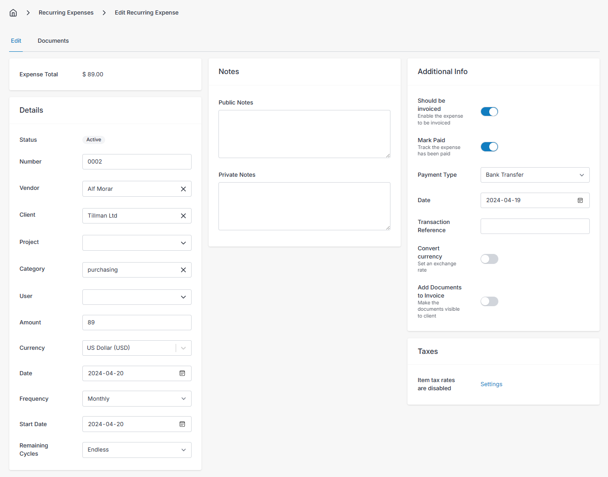

# Recurring expenses: record repeating costs on a schedule

A recurring expense is a template for a cost that keeps coming back: office rent, a software subscription, a standing order with a supplier. You set the details once, and Invoice Ninja creates a fresh [expense](/docs/user-guide/expenses) record each cycle, on the frequency you choose.

It is the same idea as [recurring invoices](/docs/user-guide/recurring-invoices), pointed the other way. Recurring invoices bill your clients on a schedule; recurring expenses record what you pay on a schedule.

Use one when the amount, frequency and [vendor](/docs/user-guide/vendors) stay roughly the same from one period to the next. If a generated expense needs to be billed back to a [client](/docs/user-guide/clients), turn on **Should be invoiced** and it flows through to an invoice just like a one-off expense.

<video width="100%" controls>
  <source src="/assets/videos/recurring_expenses/recurring_expenses_overview_creation.webm" type="video/webm" />
</video>

## How does a recurring expense work?

You build it once, like any other expense, and tell Invoice Ninja how often to run it. On each cycle Invoice Ninja creates a new expense with its own number, amount, vendor and notes. The recurring expense itself is the blueprint; the records that show up in your [Expenses](/docs/user-guide/expenses) list are what your books actually use.

**Keep this in mind:** saving on its own only stores a draft. **Start** is what puts it on the calendar.

## Where do I see all my recurring expenses?

Click **Recurring Expenses** in the left menu. The list shows **Status**, **Number**, **Vendor**, **Client**, **Date**, **Frequency**, **Next Send Date**, **Remaining Cycles**, **Amount**, **Public Notes** and **State**. From here you can:

- Search with the **Filter** box
- Show archived or deleted records with the **Lifecycle** filter
- Choose what to show with **Columns**
- Create a recurring expense with **New Recurring Expense**

There is no **Status** filter on this list. **Status** (for example Draft, Active or Paused) and **State** (Active, or Archived or Deleted when you use the Lifecycle filter) are separate columns.

Each row has an **Actions** menu on the right. Clicking elsewhere on a row does nothing; click the number, or choose **Edit**, to open the recurring expense.

You can also open the **Recurring Expenses** tab on a [vendor](/docs/user-guide/vendors) to see only that vendor's recurring expenses.

## How do I create a recurring expense?

1. Go to **Recurring Expenses** and click **New Recurring Expense**. You can also clone an existing expense or recurring expense.
2. Fill in the same details you would on a one-off expense: vendor, amount, category, notes, tax and, if you will bill it back, a client or project. See [Which details do I fill in?](#which-details-do-i-fill-in).
3. Set the schedule: **Frequency**, **Start Date** and **Remaining Cycles**. See [How do I set the schedule?](#the-schedule-frequency-start-date-and-cycles).
4. Optional: turn on **Should be invoiced**, **Mark Paid**, **Convert currency** or **Add Documents to Invoice**. These follow the same defaults as new expenses, under [Expense Settings](/docs/user-guide/basic-settings#expense_settings).
5. Click **Save**. A new recurring expense has only a **Save** button (no arrow menu) until it has been saved.
6. Open the saved record, click the arrow next to **Save**, and choose **Start**.

## How do I set the schedule? {#the-schedule-frequency-start-date-and-cycles}

| Field | What it controls | Example |
|---|---|---|
| **Frequency** | How often a new expense is created. Options: Daily, Weekly, Two weeks, Four weeks, Monthly (the default), Two months, Three months, Four months, Six months, Annually, Two years, Three Years. | Monthly |
| **Start Date** | When the first expense is created. Defaults to today. Set a future date if the first cycle should wait. | The 1st of next month |
| **Remaining Cycles** | How many expenses to create before stopping. Pick **Endless** (the default) for open-ended subscriptions, or a number from 0 to 36 for a fixed term, such as a twelve-month licence. | Endless |

There is no due date field and no Auto Bill setting here: a recurring expense records a cost, it does not wait for a client to pay or charge a card.

**Next Send Date** on the list shows when the next expense will be created.

## Which details do I fill in?

These fields work the same way as on a one-off [expense](/docs/user-guide/expenses#which-expense-details-do-i-fill-in). The differences are the schedule fields above, and that each cycle creates a new expense from this template.

| Field | What it is for |
|---|---|
| **Vendor** | Who you pay. See [Vendors](/docs/user-guide/vendors). |
| **Client** | Who the cost is for. If you invoice a generated expense, the new invoice uses this client. See [Clients](/docs/user-guide/clients). |
| **Project** | Links the cost to a [project](/docs/user-guide/projects). If a client is already chosen, the project list is limited to that client's projects; picking a project can also fill in the client. |
| **Category** | What kind of spend it is. Create and manage categories under **Settings > Expense Settings**. |
| **Assigned User** | The team member the recurring expense is recorded against. |
| **Tags** | Optional. Labels you can use to find or group records later. |
| **Amount** | The total cost of each cycle. |
| **Currency** | Defaults to the vendor's currency, or your company currency if no vendor is set. |
| **Date** | The original date of the agreement with the vendor. Defaults to today on a new record. |
| **Tax** | Appears when **Expense Tax Rates** is enabled under **Settings > Tax Settings**. |

The edit screen has two tabs along the top: **Edit** and **Documents**. There is no Settings, Activity, History or Schedule tab.

### What goes in the notes?

**Public Notes** describe the cost. When a generated expense is added to a client invoice, these notes become the line-item description, so write them as something a client would read.

**Private Notes** are for your team only. They never appear on the PDF or in the client portal.

### How do I bill a repeating cost back to a client?

Turn on **Should be invoiced**. Each expense this template creates is then billable, just like a one-off expense that has the same toggle on. You can add those generated expenses to a client invoice when you are ready.

See [How do I make an expense billable to a client?](/docs/user-guide/expenses#how-do-i-make-an-expense-billable-to-a-client).

### How do I record that I paid the vendor, or convert the currency?

**Mark Paid**, **Convert currency** and **Add Documents to Invoice** work the same way as on a one-off expense. Mark Paid records that *you* paid the vendor, with a payment type, date and transaction reference. It is not a client payment.

:::warning
Reports group expenses by the expense or vendor currency, not the converted currency. If you want a single-currency Profit and Loss, record each expense directly in your home currency using the already-converted amount, and leave the foreign-currency detail in the notes or on an attached document.
:::

Tax is also the same as on a one-off expense: **By Rate** or **By Amount**, and **Inclusive Taxes** when tax is already included in the amount. See [How do taxes work on an expense?](/docs/user-guide/expenses#how-do-taxes-work-on-an-expense).

### How do I attach files?

Open the **Documents** tab. You can drop files or click to upload, for example the original contract or a sample invoice from the vendor. If **Add Documents to Invoice** is on, those files can go out with a client invoice.

## What can I do with a recurring expense?

Click the arrow next to **Save** on a saved recurring expense, or use the row **Actions** menu on the list. If you tick one or more rows, a bulk **Actions** menu appears: **Start**, **Documents**, **Archive** and **Delete**.

| Action | When it shows | What it does |
|---|---|---|
| **Start** | Draft or Paused | Puts the recurring expense on the schedule. Starting a draft makes it **Active**. |
| **Stop** | Active | Pauses it. The status changes to **Paused** and no new expenses are created until you start it again. Handy when a subscription is on hold or a supplier contract is paused. |
| **Clone** | | Copies the recurring expense into a new recurring expense. |
| **Clone to Expense** | | Copies it into a one-off [expense](/docs/user-guide/expenses). Use this when you need to log a single out-of-cycle payment. |
| **Archive** / **Delete** | | Tidies the recurring expense away. Expenses it already created do not change. |
| **Restore** | Archived or deleted | Brings it back. |

**Run Template** only appears once you have created a [template](/docs/advanced-topics/templates).

## What do the recurring expense statuses mean?

| Status | What it means |
|---|---|
| **Draft** | Saved, but not on the calendar yet. **Start** puts it on the schedule. |
| **Active** | Running. A new expense is created on each cycle. |
| **Paused** | Stopped. No expenses are created until you click **Start** again. |
| **Archived** | Hidden from your normal list. The **Actions** menu then offers **Restore** and **Delete**. |
| **Deleted** | Removed, but can still be restored. |

### How do I bring back an archived or deleted recurring expense?

1. On the list, open the **Lifecycle** filter, tick **Archived** (or **Deleted**) and click **Apply**.
2. In the row, open the **Actions** menu and choose **Restore**.

## Related

- [Expenses](/docs/user-guide/expenses): the records each cycle creates, including billable costs, tax and currency
- [Recurring Invoices](/docs/user-guide/recurring-invoices): the same schedule idea, for money you collect
- [Vendors](/docs/user-guide/vendors): who you pay
- [Clients](/docs/user-guide/clients): who you may bill the cost back to
- [Projects](/docs/user-guide/projects)
- [Expense Settings](/docs/user-guide/basic-settings#expense_settings)
