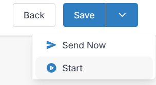
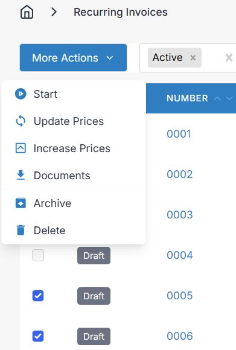
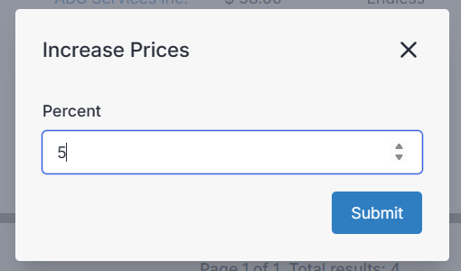
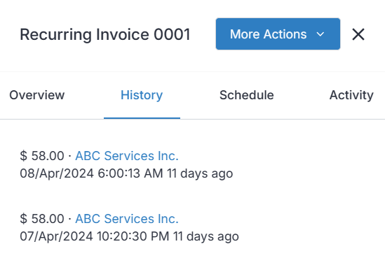
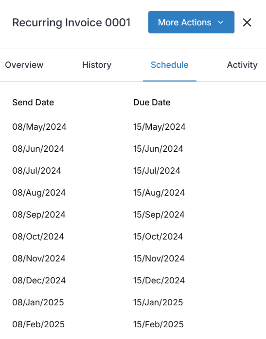
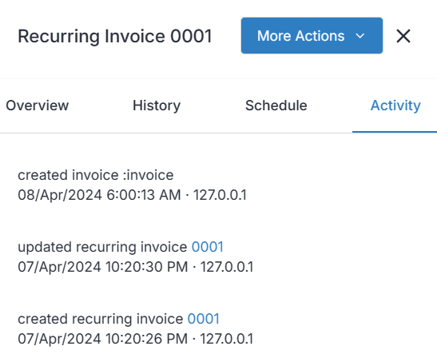
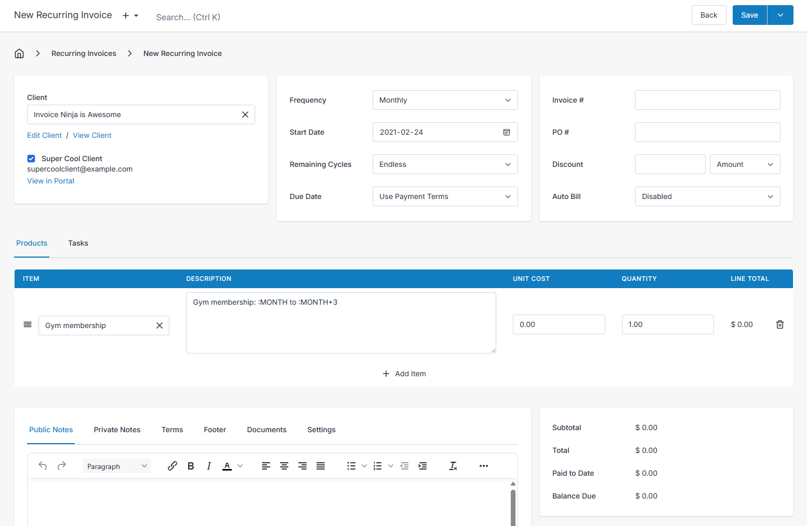
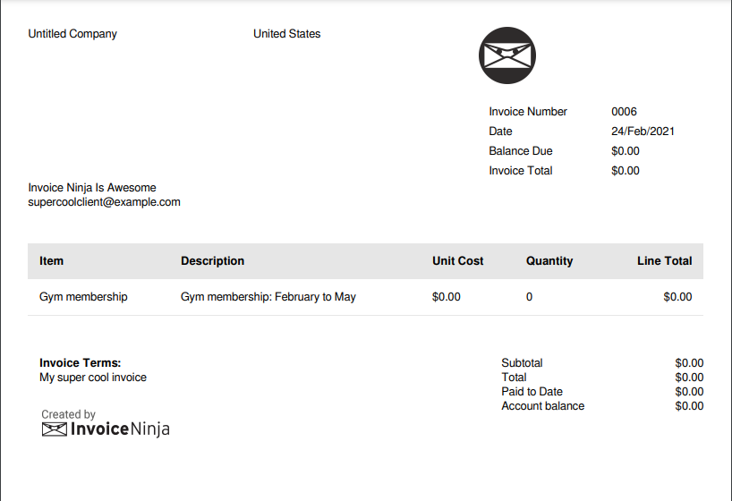
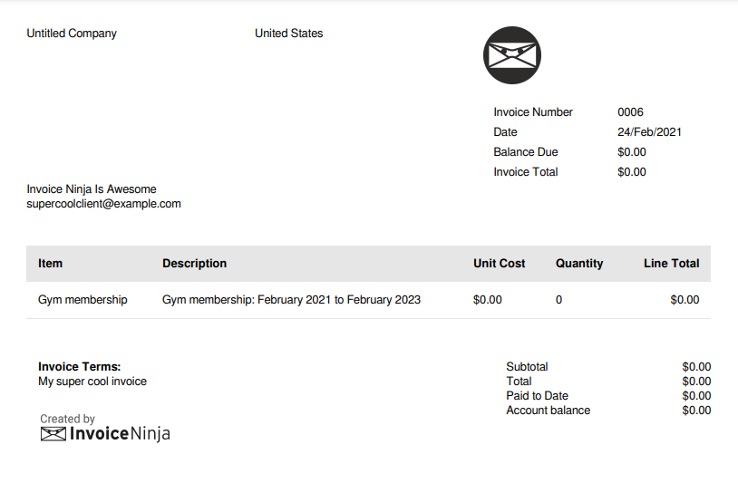
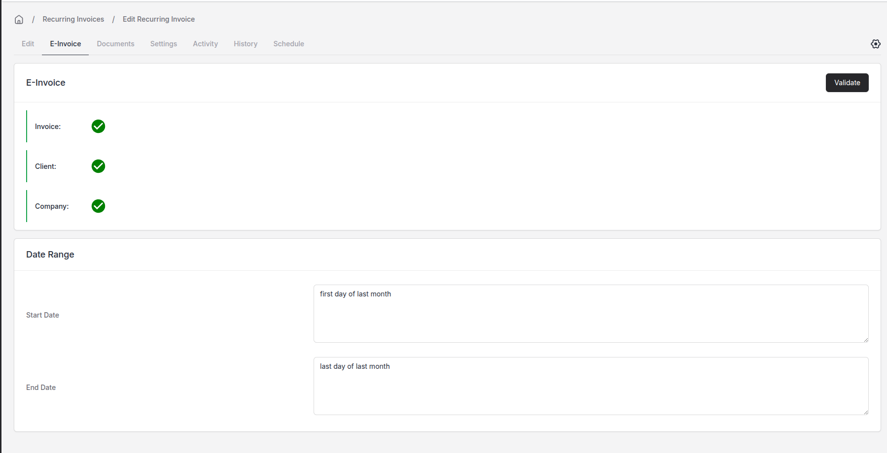

import VideoPlayer from "@site/src/components/VideoPlayer";

# Recurring invoices: bill clients automatically on a schedule

A recurring invoice lets Invoice Ninja bill a [client](/docs/user-guide/clients) for you on a schedule. Use one for monthly retainers, quarterly memberships, annual renewals or weekly service fees.

## How does a recurring invoice work?

You build it once, like any other invoice, and tell Invoice Ninja how often to run it. From then on, on each cycle Invoice Ninja:

1. Creates a fresh [invoice](/docs/user-guide/invoices) with its own number, PDF, payment link and balance.
2. Emails it to the contacts you chose.
3. Charges the client's saved card or bank account, if you turned on [Auto Bill](#auto-bill-charging-the-card-on-file).

**Keep this in mind:** the recurring invoice itself is never sent to your client. It's the blueprint. What your client receives is the regular invoice it produces. The recurring invoice stays behind the scenes, keeping track of what's been billed and what's coming next.

<video width="100%" controls>
  <source src="/assets/videos/recurring_invoices/create_recurring_invoice_v5.mp4" type="video/mp4" />
</video>

## How do I create a recurring invoice?

1. Click **New Recurring Invoice**.
2. Fill it in like a normal invoice: client, line items, taxes, notes, terms and footer. Line items work exactly like [invoice line items](/docs/user-guide/invoices#how-do-i-add-line-items), and you can link a project, set an exchange rate or add a discount as usual.
3. Set the schedule: **Frequency**, **Start Date**, **Remaining Cycles** and **Due Date**. See [How do I set the schedule?](#the-schedule-frequency-start-date-and-cycles)
4. Optional: choose an **Auto Bill** option (it sits under Discount). See [How do I charge a saved card automatically?](#auto-bill-charging-the-card-on-file)
5. Optional: use [date keywords](#how-do-i-add-dates-that-update-themselves) in line descriptions, so text like "March 2026" updates itself each cycle.
6. Click **Save**.
7. Click the arrow next to **Save** and choose **Start**. On a new recurring invoice that arrow also offers **Send Now**.

Saving on its own only stores a draft. **Start** is what puts it on the billing calendar.



## How do I set the schedule? {#the-schedule-frequency-start-date-and-cycles}

| Field | What it controls | Example |
|---|---|---|
| **Frequency** | How often a new invoice is created. Options: Daily, Weekly, Two weeks, Four weeks, Monthly (the default), Two months, Three months, Four months, Six months, Annually, Two years, Three Years. | Monthly |
| **Start Date** | When the first invoice goes out. Defaults to today. Set a future date if the first bill has to land on a particular day. | The 1st of next month |
| **Remaining Cycles** | How many invoices to create before stopping. Pick **Endless** (the default) for retainers and subscriptions that run until you stop them, or a number from 0 to 36 for a fixed term. | Endless |
| **Due Date** | When payment is due on each invoice it creates. It doesn't change the schedule. Options are **Use Payment Terms** (the default) or a fixed day of the month, **Day 1** through **Day 31**. | Use Payment Terms |

## What do the recurring invoice statuses mean?

| Status | What it means |
|---|---|
| **Draft** | Saved, but not started. Nothing goes out until you click **Start**. |
| **Pending** | Started and on the schedule, but still waiting for its first run |
| **Active** | Has created at least one invoice and has cycles left |
| **Paused** | Stopped. No invoices are created until you click **Start** again. |
| **Completed** | The last cycle has been billed |
| **Archived** / **Deleted** | Tidied away. Invoices it already created are never affected. |

## How do I charge a saved card automatically? {#auto-bill-charging-the-card-on-file}

Use **Auto Bill** on the recurring invoice (it's on the right-hand side, under Discount). It decides whether each invoice it creates is charged automatically to the client's saved payment method, or just emailed so the client pays when they like. The saved payment method comes from one of your [payment gateways](/docs/user-guide/gateways) (the services that process card or bank payments). Company-wide defaults and timing are under [Payment Settings](/docs/user-guide/basic-settings#payment_settings), including **Auto Bill Recurring Invoices** and **Auto Bill On** (Send Date or Due Date).

| Auto Bill | What happens | Good for |
|---|---|---|
| **Enabled** | The client is always charged automatically when a valid payment method is saved | Subscriptions and ongoing retainers |
| **Opt-Out** | At checkout the client sees an auto-billing checkbox that is already ticked. They're charged automatically unless they untick it. | Most clients stay on auto-billing, but they can choose |
| **Opt-In** | At checkout the client sees the same checkbox, unticked. They're only charged automatically if they tick it. | Situations where clear consent matters, for legal or trust reasons |
| **Disabled** | Never charged automatically. The client gets the invoice and pays it themselves. | Clients who prefer to pay by hand |

Selling to new customers through a hosted checkout page, rather than billing a client you already have? See [Payment Links](/docs/user-guide/subscriptions).

## What can I do with a recurring invoice?

Click the arrow next to **Save** on a recurring invoice, or use the row **Actions** menu on the list. If you tick one or more rows, a bulk **Actions** menu appears.



| Action | When it shows | What it does |
|---|---|---|
| **Start** | Draft or Paused | Puts the recurring invoice on the schedule. On a paused one, Start puts it back on the schedule (it becomes Pending or Active). |
| **Stop** | Pending or Active | Pauses it. The status changes to **Paused** and no invoices are created until you start it again. Handy for a client on holiday, a suspended service or a contract under review. |
| **Send Now** | Draft | Creates the next invoice immediately, rather than waiting for the start date. Also appears on a new recurring invoice before you save. |
| **View PDF** | | Shows the recurring invoice PDF |
| **Update Prices** | | Refreshes every line to the current price in your [Products](/docs/user-guide/products) list |
| **Increase Prices** | | Raises every line by a percentage you choose. The dialog field is **Percent** and the button is **Submit**. |
| **Bulk Update** | When you tick one or more rows | Changes one field on every selected recurring invoice. Pick the **Column** (for example Terms, Footer, Remaining Cycles or Auto Bill) and click **Update**. |
| **Add Comment** | | Adds a comment to the record |
| **Clone To** | | Copies the recurring invoice into a new record |
| **Archive** / **Delete** | | Tidies the recurring invoice away. Invoices it already created don't change. |
| **Restore** | Archived or deleted | Brings it back. An Active recurring invoice that was archived returns to **Active**. There is no prompt about missed cycles. |

### How do I update prices to match my product list?

Choose **Update Prices**. Every line is refreshed to the current price in your [Products](/docs/user-guide/products) list. Use it after you raise the price of something you sell. Invoices already created keep their old prices; future cycles use the new ones.

### How do I raise all prices by a percentage?

Choose **Increase Prices**, enter the percentage in **Percent**, and click **Submit**. Every line goes up by that much, which is handy for a yearly cost-of-living increase across all your clients.



## Where do I see past and upcoming invoices?

Clicking a row on the list does nothing. Open the recurring invoice (click its number) and use the tabs along the top: **Edit**, **Documents**, **Settings**, **Activity**, **History** and **Schedule**.

| Tab | What it shows |
|---|---|
| **Edit** | The client, schedule, Auto Bill setting, line items, notes and terms. Status, frequency, remaining cycles and Auto Bill are here. |
| **Documents** | Files attached to the recurring invoice. Drop files or click to upload. |
| **Settings** | Extra options for this record only, including **Assigned User**, Project, Vendor, Exchange Rate, Design and Inclusive Taxes |
| **History** | Dated revisions of this recurring invoice (amount, client and timestamp), which you can expand. It is not a list of the invoices already generated. |
| **Schedule** | Upcoming **Send Date** and **Due Date** values, based on your schedule settings. The next send date is also a column on the list. |
| **Activity** | The audit trail: who created, edited, stopped or otherwise changed it, and when |







## How do I add dates that update themselves?

Typing "February 2026" into a line description isn't much use on an invoice that repeats, because by the next cycle it's wrong. Instead, use keywords. Invoice Ninja swaps them for the right date every time it creates the PDF.

| Keyword | Becomes | Can do math? |
|---|---|---|
| `:MONTH` | The month name, for example January | Yes: `+`, `-`, `*`, `/` |
| `:YEAR` | The year, for example 2026 | Yes: `+`, `-` |
| `:QUARTER` | The quarter, for example Q4 | Yes: `+`, `-` |
| `:MONTHYEAR` | The month and year together, for example November 2026 | Yes: `+`, `-` |
| `:WEEK` | The week, for example 15-Jan-2027 to 21-Jan-2027 | |
| `:WEEK_BEFORE` | The week before, for example 08-Jan-2027 to 14-Jan-2027 | |
| `:WEEK_AHEAD` | The week ahead, for example 22-Jan-2027 to 28-Jan-2027 | |

To shift a date, add the math right after the keyword, in the pattern **keyword, operation, value**. For example, `:MONTH+3` is three months later.

**Example:** you bill a gym membership every three months. Type this in the line description:

> Gym membership: :MONTH to :MONTH+3



Save and preview the PDF:



Now every cycle names the right three-month window without you touching it.

All supported combinations:

```bash
Month: :MONTH
Year: :YEAR
Quarter: :QUARTER

:MONTH (+, -, *, /) e.g. :MONTH+1 :MONTH-1 :MONTH*2 :MONTH/2
:YEAR (+, -) :YEAR+1 :YEAR-1
:QUARTER (+, -) :QUARTER+1 :QUARTER-1
:MONTHYEAR (+, -) :MONTHYEAR :MONTHYEAR+1
```

### How do I show a date range?

To print a full range, such as "Gym membership: February 2021 to February 2023", type:

> Gym membership: [MONTHYEAR|MONTHYEAR+24]



You could also write it the long way: `Gym membership: :MONTH :YEAR to :MONTH :YEAR+2`. The `[MONTHYEAR|MONTHYEAR]` format is tidier, because it handles ranges that cross into a new year cleanly.

Supported range combinations:

```bash
[MONTHYEAR|MONTHYEAR +, -], [MONTHYEAR|MONTHYEAR+16], [MONTHYEAR|MONTHYEAR-2]
```

**Other languages:** the word "to" between the two dates comes from [your localization settings](/docs/user-guide/basic-settings/#localization), so ranges appear in your client's language.

## How do I set the service period for e-invoices?

Some e-invoices must state the service period they cover, for example February 2026 to April 2026. The **E-Invoice** tab appears when [e-invoicing](/docs/user-guide/einvoicing) is turned on. It has a **Start Date** and **End Date** for this.



Both fields take plain-English phrases, worked out with PHP's [date_create()](https://www.php.net/manual/en/function.date-create.php) function, so you can describe the period the way you'd say it.

| Invoice created on | Start Date | End Date | Period on the invoice |
|---|---|---|---|
| 1 October 2025 | `first day of last month` | `last day of last month` | 1 September 2025 to 30 September 2025 |
| 1 October 2025 | `first day of month` | `first day of month, +1 month` | 1 September 2025 to 1 October 2025 |

As the second row shows, you can chain phrases with a comma for finer control.

## Which workflows are worth knowing?

### Create invoices on schedule but hold them for review

This video shows how to create recurring invoices on schedule but hold them so you can check them before they're sent.

<VideoPlayer src="/assets/videos/recurring_invoices/draft/draft_recurring_invoices.mpd" isDash={true} id="draft-recurring-invoices" />

## Related

- [Invoices](/docs/user-guide/invoices): what each cycle creates
- [Clients](/docs/user-guide/clients): who gets billed, and their saved payment methods
- [Payment Settings](/docs/user-guide/basic-settings#payment_settings): Auto Bill defaults and timing
- [Payment Gateways](/docs/user-guide/gateways): save cards and bank accounts for Auto Bill
- [Payment Links](/docs/user-guide/subscriptions): sell subscriptions through a hosted checkout
- [Products](/docs/user-guide/products): the prices **Update Prices** uses
- [E-Invoicing](/docs/user-guide/einvoicing): send invoices as structured electronic files
