# Reports: turn your records into numbers you can share

Reports turn the day-to-day activity inside Invoice Ninja (invoices sent, payments received, expenses logged, taxes collected) into the numbers you or your accountant need. Every report is built from filters at the top of the screen, so once you learn one you have effectively learned them all.

## Which reports can I run?

Go to **Reports** in the left menu (`#/reports`). The **Report** list has these types, in this order:

Activity, Client, Contact, Credit, Document, Expense, Invoice, Invoice Item, Purchase Order, Purchase Order Item, Quote, Quote Item, Recurring Invoice, Recurring Invoice Item, Payment, Product, Product Sales, Task, Vendor, Profit and Loss, Aged Receivable Detailed Report, Aged Receivable Summary Report, Customer balance report, Customer sales report, Tax Summary Report, Tax Period Report, User sales report, Project.

The default type is **Activity**. Some names are singular (Invoice Item, not Invoice Items) or use sentence-style capitalisation (Customer balance report).

## Which filters can I use?

The filters you see depend on the report type.

- **Range** appears on every report checked. The presets are All, Last 7 Days, Last 30 Days, This Month, Last Month, This Quarter, Last Quarter, This Year, Last Year, and Custom.
- **Status** appears on record reports that have statuses, for example Invoice. It does not appear on Profit and Loss.
- **Client** appears where the report is client-related. It does not appear on every type.
- Extra filters such as **Products**, **Tags**, **Template**, **Group by**, **Vendors** or **Projects** appear when they apply to that type.

Examples:

| Report | Filters and options shown |
|---|---|
| **Invoice** | Send Email, Attach Documents, Attach PDF, Include Deleted, Status, Template, Tags, Group by, Range, Client, Customize Columns |
| **Payment** | Send Email, Attach Documents, Status, Template, Group by, Range, Client, Customize Columns (no Include Deleted, no Attach PDF) |
| **Invoice Item** | Send Email, Attach Documents, Include Deleted, Status, Template, Products, Tags, Group by, Range, Client, Customize Columns |
| **Client** | Send Email, Attach Documents, Include Deleted, Template, Tags, Group by, Range, Customize Columns |
| **Product Sales** | Send Email, Products, Range, Client |
| **Profit and Loss** | Send Email, Expensed reporting, Accrual accounting, Include tax, Range |
| **Tax Period Report** | Send Email, Accrual accounting, Range |
| **Aged Receivable Detailed Report**, **Aged Receivable Summary Report**, **Customer balance report**, **Customer sales report**, **Tax Summary Report**, **User sales report** | Send Email and Range |

### Which extra options appear?

- **Send Email:** instead of downloading the CSV, emails it to the currently logged-in admin user as an attachment.
- **Attach Documents:** also emails a ZIP of documents attached to the records in the report, on types that show this option.
- **Attach PDF:** available on Invoice reports, alongside Attach Documents.
- **Include Deleted:** "Include deleted records in reports." Handy if you have deleted a client (see [Clients](/docs/user-guide/clients)) and still need historical numbers.
- **Customize Columns:** available on standard record reports, not on Profit and Loss or the other special reports below. Turn it on to move fields between an available list (for example Client - Name, Client - Number, Contact - Email) and **Report Columns**. There is a **Reset** control. If you turn it on only to look, turn it off again afterwards.

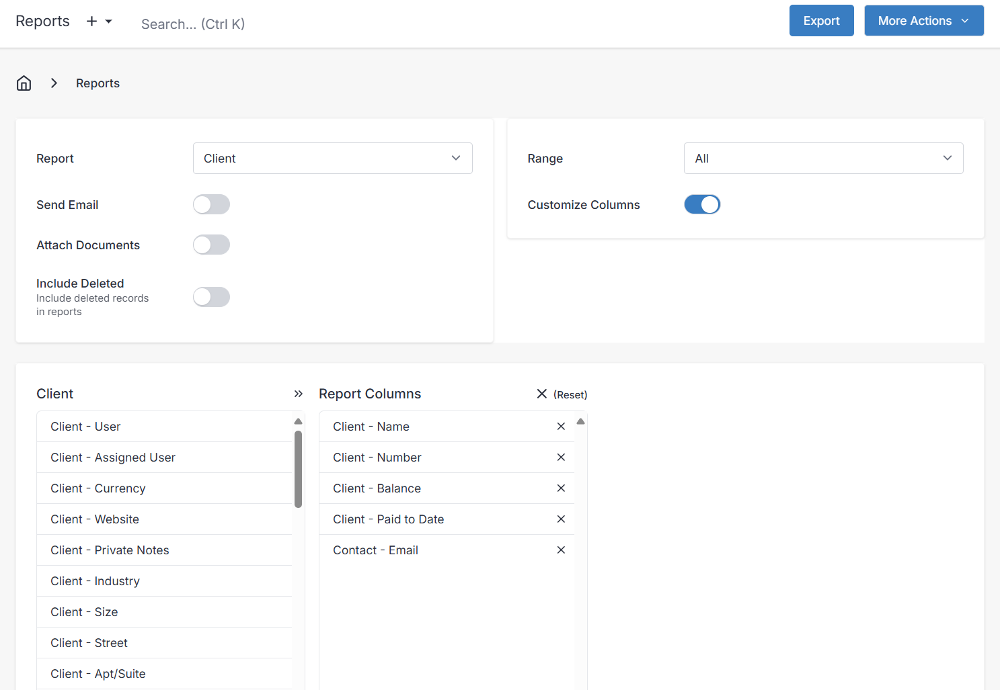

## How do I run a report?

1. Go to **Reports**.
2. Choose the report type and set the filters.
3. Click **Export** to download a CSV, or open **Actions** and choose **Preview** (on reports that support it).

**Export** is a button at the top of the page. It downloads a CSV you can open in Excel, Google Sheets or LibreOffice.

**Actions** contains **Preview** and **Schedule** on standard reports (for example Invoice and Payment). On Product Sales, Profit and Loss, the aged receivable reports, the customer reports, Tax Summary Report and User sales report, **Actions** contains only **Schedule**. Those types still have **Export**.

**Schedule** opens a full page (**New Schedule**, at `#/settings/schedules/create`) rather than a small dialog. Fields include Name, Template (Email Report), Next Run, Frequency (Monthly is offered), Remaining Cycles (for example Endless), and the report options. **Send Email** is on by default on that page, so review the fields before you save if you use scheduling.

## How does Preview work?

On reports that support it, **Actions > Preview** shows a processing state, then a table on the screen.

### How do I filter a preview?

The first row of the preview table is a set of text fields you can type into to filter the results live. A totals row can appear under the headers. The **Download CSV file** button above the preview downloads what you are looking at.

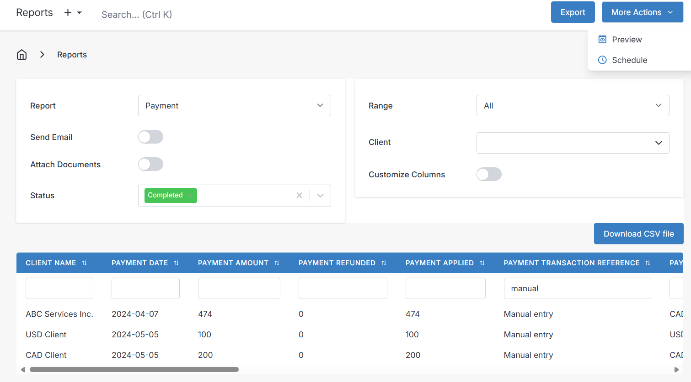

To download the report with the filters you set at the top of the Reports page, use **Export**.

## Which reports have a special layout?

These reports do not use **Preview** or **Customize Columns**. Use **Export** (and **Schedule** if you need a repeating run).

### Product Sales

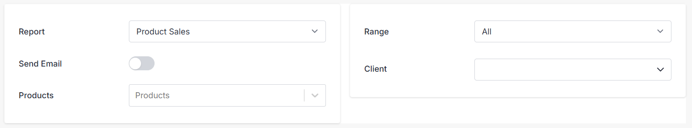

The Product Sales report is for seeing which products sold and how they performed. Options are Send Email, Products, Range and Client.

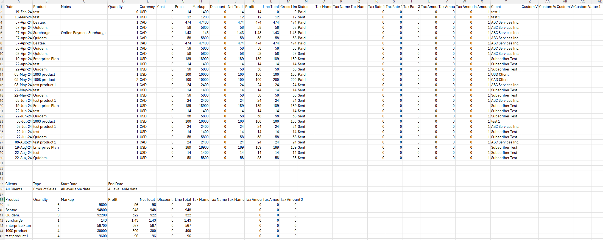

### Profit and Loss Report {#profit_and_loss_report}

This is the report most accountants reach for at year-end. It sums your revenue, your expenses, and the profit or loss that falls out of the difference, along with [taxes](/docs/user-guide/taxes) when you include them.

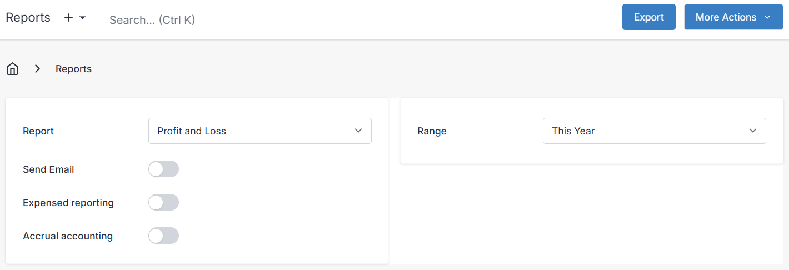

Three toggles change how the numbers are tallied. All three are off by default.

- **Expensed reporting:** when on, expenses in the period are counted whether or not they have been marked paid; when off, only paid expenses are counted.
- **Accrual accounting:** when on, invoiced totals in the period are counted whether or not the client has paid; when off, only payments received are counted.
- **Include tax:** adds tax collected on revenue and tax paid on expenses into the totals.

These options let you switch between a cash-basis and an accrual-basis view without changing your underlying records.

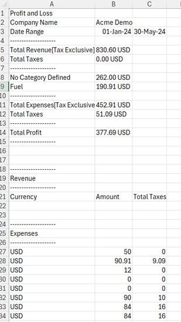

### Aged Receivable Detailed Report

When a client has not paid and you need to know which invoices are outstanding and for how much, use this report. It lists unpaid invoices with their balances.

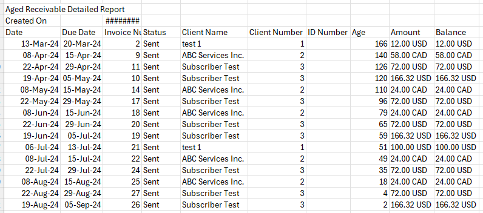

### Aged Receivable Summary Report

The summary version rolls unpaid balances up per client and drops them into aging buckets, so you can spot slower payers without wading through every invoice.

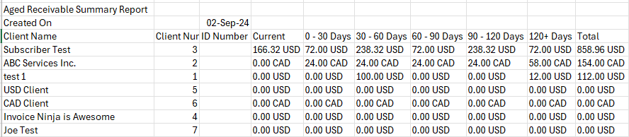

### Customer Balance Report

A per-client snapshot of invoices, credits and payments. An exported file includes columns such as Client Name, Client Number, ID Number, Invoices, Invoice Balance, Credit Balance and Payment Balance.

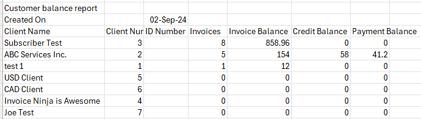

### Customer Sales Report

For each client, this totals invoiced amount, outstanding balance, taxes and amount paid: a view of who is worth what to the business.

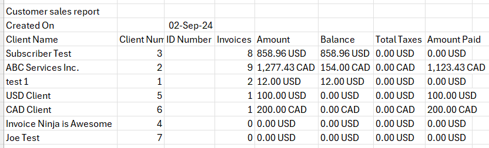

### Tax Summary Report

The Tax Summary Report totals tax in the chosen date range. For how tax is configured, see [Taxes](/docs/user-guide/taxes). For a wider discussion of tax reports, see [Tax Accounting Tips](/docs/advanced-topics/tax-accounting-tips/).

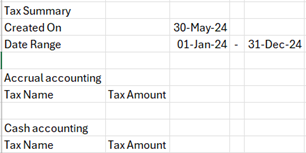

### Tax Period Report

The Tax Period Report is a separate type in the list. Its options are Send Email, Accrual accounting and Range.

### User Sales Report

If more than one person on your team creates invoices, the User Sales report totals activity for each user.

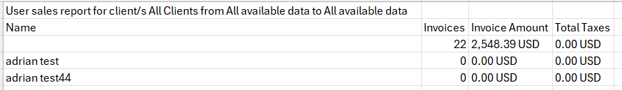

## How do I work with the CSV in a spreadsheet?

For charts, pivot tables or deeper analysis, open the exported CSV in a spreadsheet tool such as Microsoft Excel, Google Sheets or LibreOffice.

If Excel prompts you to remove leading zeros when opening the file, choose **Don't Convert**. Some Invoice Ninja fields (invoice numbers, client numbers) legitimately start with zeros, and you want those preserved.

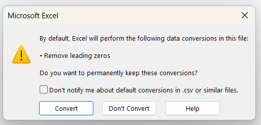

If you are pushing this data into your accounting software, the [QuickBooks](/docs/user-guide/quickbooks) integration may save you the CSV step entirely.

## Related

- [Payments](/docs/user-guide/payments): payment records and payment reports
- [Expenses](/docs/user-guide/expenses): expense totals that feed Profit and Loss
- [Taxes](/docs/user-guide/taxes): how tax is configured
- [Products](/docs/user-guide/products): the Product and Product Sales reports
- [QuickBooks](/docs/user-guide/quickbooks): an accounting sync that can reduce CSV exports
- [Clients](/docs/user-guide/clients): client filters, and including deleted records
- [Tax Accounting Tips](/docs/advanced-topics/tax-accounting-tips/): tax and sales tax reports
