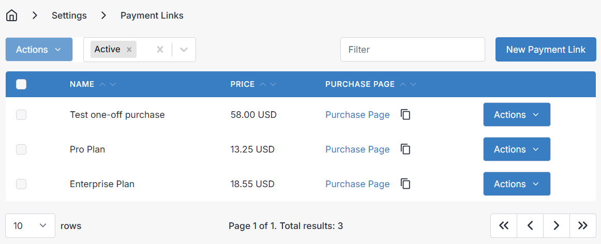
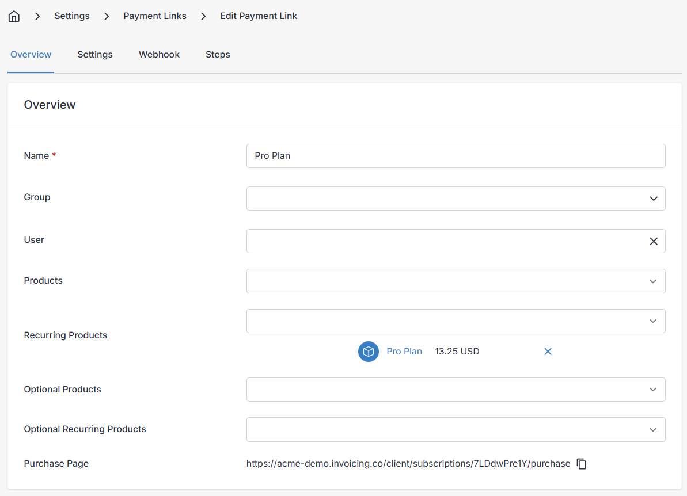
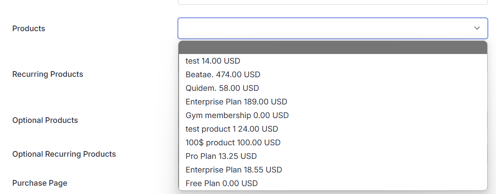
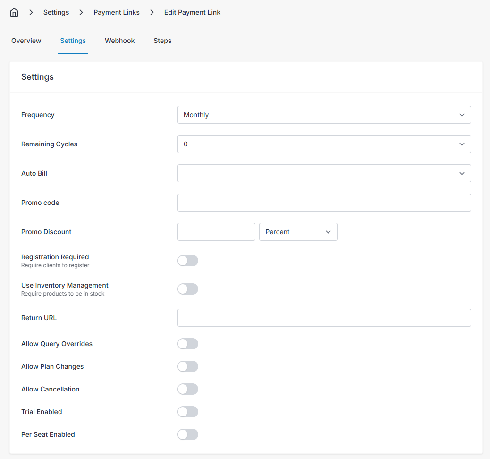
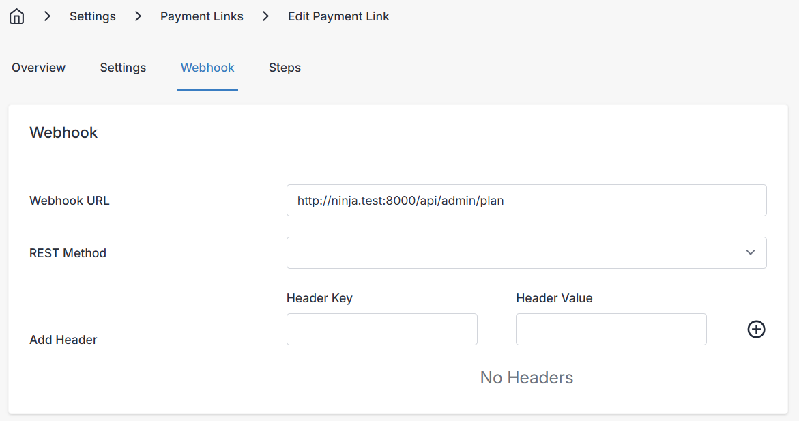

# Payment Links: let anyone check out without an invoice first

Payment Links (previously called Subscriptions) are Invoice Ninja's hosted checkout: a shareable URL that lets anyone buy from you without you creating an invoice or a client record first. Drop the link in an email, a social post or a button on your website. The person who clicks it lands on a branded checkout page, pays through your connected [payment gateway](/docs/user-guide/gateways), and is added as a client in your account automatically.

## When should I use a Payment Link instead of a recurring invoice?

Use a Payment Link when you want to sell something directly: a downloadable template, a one-off service fee, a monthly retainer, or a SaaS-style plan. If you already have a client on file and want to bill them on a schedule, [Recurring Invoices](/docs/user-guide/recurring-invoices) are the better fit. Payment Links are for the first sale, where the customer sees the price, pays, and then can self-serve from then on.

## Where do I find Payment Links?

Open **Settings > Payment Links**. There is no left-menu item for this page. The list has a **Filter** box and a **Lifecycle** filter (Active, Archived, Deleted).

Columns are Name, Price and **Purchase Page**. Purchase Page is the public checkout URL, with a link and a copy icon. Each row has an **Actions** menu with **Edit**, **Archive** and **Delete** (or **Restore** once the link is archived).

The public URL looks like this:

`https://<your-subdomain>.invoicing.co/client/subscriptions/<id>/purchase`

## How do I create a Payment Link?

A Payment Link is made up of [products](/docs/user-guide/products) you have already defined. Name, description, price and tax come from the product record.

1. Go to **Settings > Payment Links** and click **New Payment Link**.
2. On the **Overview** tab, give the link a name and pick the products to include.
3. Review **Settings**, **Webhook** and **Steps** if you need them, then click **Save**.
4. Copy the **Purchase Page** URL from the list or from Overview, and put it on your website, in an email or in a social post.

The edit tabs are **Overview**, **Settings**, **Webhook** and **Steps**. After you save, Overview also shows a read-only **Purchase Page** row with a copy icon.

### What goes on the Overview tab?

| Field | What it is for |
|---|---|
| **Name** | Required. This is the name of the link, and it appears on the checkout page. |
| **Group** | Optional. Use the same group on several links if you want clients to be able to move between those plans. |
| **Assigned User** | Optional. The teammate this link belongs to. |
| **Products** | One-time products included in the sale. |
| **Recurring Products** | Products billed on a schedule after checkout. |
| **Optional Products** | One-time products the customer can add. |
| **Optional Recurring Products** | Recurring products the customer can add. |

You can use both one-time and recurring products on the same link. For example, a setup fee can go in **Products** and a monthly plan in **Recurring Products**.

## Which settings can I change?

| Setting | What it is for |
|---|---|
| **Frequency** | How often a recurring product is billed (for example Monthly). |
| **Remaining Cycles** | How many times the recurring charge should run. |
| **Auto Bill** | Whether later cycles are charged automatically to a saved payment method. |
| **Promo code** and **Promo Discount** | An optional discount, as a percent plus a value. |
| **Registration Required** | "Require clients to register" before they can complete checkout. |
| **Use Inventory Management** | "Require products to be in stock." |
| **Return URL** | Where to send the customer after checkout. |
| **Allow Query Overrides** | Allow the public URL to override selected values with query parameters. |
| **Allow Plan Changes** | Let the customer move to another Payment Link in the same group, from the [Client Portal](/docs/user-guide/client-portal). |
| **Allow Cancellation** | Let the customer cancel from the client portal. |
| **Trial Enabled** | Offer a trial at the start of a recurring plan. |
| **Per Seat Enabled** | Bill according to a seat or quantity count. |

Payment Links use the same gateways as the rest of the app, so anything you have configured under [Payment Gateways](/docs/user-guide/gateways) is available at checkout.

## What does the checkout page look like?

The customer opens the Purchase Page URL and sees the link name, a **One Time Purchases** or **Recurring Purchases** heading, the product description and price, and the total. They continue with **Next**. Depending on the link, they may be asked for an email address, and a **Payment Methods** heading appears when it is time to pay. Card details are collected after that step, through your connected gateway.

Copy the URL with the copy icon on **Purchase Page** when you want to share it yourself.

## How do I use webhooks with a Payment Link?

If you want an external service to be notified when someone goes through checkout, open the **Webhook** tab. You can set a single **Webhook URL**, a **REST Method**, and optional headers (**Header Key** and **Header Value**). When no headers are set, the tab shows "No Headers."

## How do checkout steps work?

The **Steps** tab controls the order of the checkout flow. It includes **Authentication**, **Other steps** and **Order**.

The help text says: "The order of the steps is important. The first step should not depend on any other step. The second step should depend on the first step, and so on."

The steps shown include **Cart** and **Login or Register**.

## How do I archive, restore or delete a Payment Link?

1. On **Settings > Payment Links**, open the row **Actions** menu.
2. Choose **Archive** or **Delete**. Delete has no confirmation dialog, so choose carefully.
3. To see archived or deleted links, use the **Lifecycle** filter, tick **Archived** and/or **Deleted**, and click **Apply**.
4. **Restore** appears on an archived (or deleted) link and puts it back in the Active list.

A deleted link keeps its name. The name does not get a `_deleted` suffix.

## Related

- [Products](/docs/user-guide/products): the items a Payment Link sells
- [Payment Gateways](/docs/user-guide/gateways): the services that take payment at checkout
- [Recurring Invoices](/docs/user-guide/recurring-invoices): better when you already have the client and want a schedule
- [Client Portal](/docs/user-guide/client-portal): where customers manage a subscription they bought through a Payment Link
- [Payments](/docs/user-guide/payments): payments created when someone checks out
