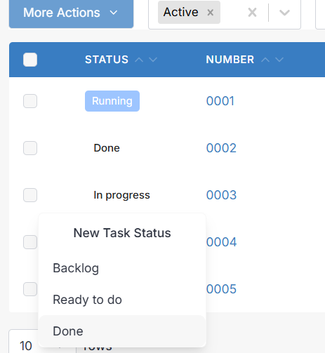
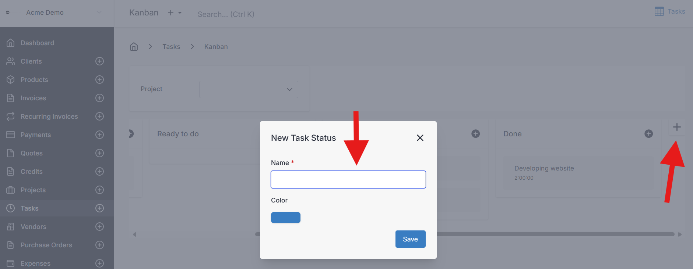
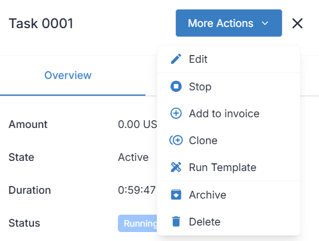

# Tasks: track time and bill it on invoices

A task is a time entry: a record of work you have done for a client, usually billed at an hourly rate. Use tasks for work measured in hours rather than units, such as design sessions, consultations, support calls or development work. Once the hours are tracked, you can drop the task onto an invoice without retyping anything.

Tasks can stand on their own, or you can group them under a [project](/docs/user-guide/projects) when the work spans several sessions or team members. They also pair well with [expenses](/docs/user-guide/expenses): together they let you bill a client for both your time and the costs you incurred on their behalf.

<video width="100%" controls>
  <source src="/assets/videos/tasks/tasks_demo.mp4" type="video/mp4" />
</video>

## Where do I see all my tasks?

Click **Tasks** in the left menu. The list shows **Tags**, **Date**, **Status**, **Project**, **Client**, **Description**, **Duration** and **State**. There is no Number column by default. From here you can:

- Search with the **Filter** box
- Show archived or deleted tasks with the **Lifecycle** filter
- Narrow the list with the **Status** filter: **Invoiced**, **Uninvoiced**, **Overdue**, **Backlog**, **In Progress** or **Done**
- Choose what to show with **Columns** (the **Edit Columns** dialog lets you add, order or reset columns)
- Switch the view with **List**, **Daily**, **Weekly**, **Monthly** or **Kanban**
- Create a task with **New Task**

Each row has an **Actions** menu on the right with the same actions as the task itself (see [What can I do with a task?](#what-can-i-do-with-a-task)). On an uninvoiced task you can also change the workflow status by clicking the status badge in the row and choosing **Backlog**, **In Progress**, **Done** or **Create New**. An invoiced badge cannot be changed that way.

Clicking a row away from a link opens a side panel titled with the task number, with tabs **Overview**, **Activity** and **Documents**, plus an **Actions** menu. Click the task or choose **Edit** to open the edit screen, which has tabs **Edit** and **Documents**.

You can also open the **Tasks** tab on a [client](/docs/user-guide/clients#what-can-i-see-on-a-clients-page), or the **Tasks** tab on a [project](/docs/user-guide/projects#how-do-i-view-a-project), to see only those tasks.

**Status** (for example Backlog or In Progress) and **State** (Logged or Invoiced) are separate columns.

### What is the kanban view?

The kanban view (`#/tasks/kanban`) is the same tasks arranged as a board. Cards are grouped into columns by status (for example **In Progress**, **Backlog** and **Done**), so you can see at a glance what is waiting, what is underway and what is finished.

- Use **Filter by user** and **Filter by Project** at the top to narrow the board.
- Press **+** in a column header to add a new task with that status already set. A **+** after the last column adds another column.

<video width="100%" controls>
  <source src="/assets/videos/tasks/tasks_kanban_operations.mp4" type="video/mp4" />
</video>

:::warning
The kanban view is a working board, not a history view. Invoiced tasks are hidden so you can focus on what is still in progress. For the full history, use the list view. If you delete the invoice that billed a task, the task becomes uninvoiced again and can show on the board once more.
:::

### How do I add a custom task status?

The built-in statuses cover most workflows, but you can add your own to match how your team works.

1. From the list view, click a task's status badge and choose **Create New**. From the kanban view, press **+** after the last column.
2. Give the status a name and a colour.
3. Save it. It becomes available everywhere.

To rename, reorder or delete statuses later, go to **Settings > Task Settings**. That page has a status table with **New Task Status**, plus Name and Color.

#### From the list view

#### From the kanban view

## What can I do with a task?

Once you have saved a task, click the arrow next to **Save** to see what you can do with it. On the list, use the row's **Actions** menu, or the **Actions** menu in the side panel. The choices change as the task moves through its states.

If you tick one or more rows, a bulk **Actions** menu appears: **Bulk Update**, **Start**, **Invoice Task**, **Documents**, **Archive** and **Delete**.

| Action | What it does |
|---|---|
| **Start** / **Stop** | Starts or stops the timer. Starting adds a new time entry with the current time. Stopping closes it with an end time. Start appears on the edit page of a saved task, and in the menu of an uninvoiced task. |
| **Invoice Task** | Opens a new unsaved [invoice](/docs/user-guide/invoices) for the task's client, already filled in with the task as a line item. Appears on uninvoiced tasks. |
| **Add to invoice** | Adds the task as a line item on one of the client's existing invoices. Appears on uninvoiced tasks. The edit arrow and side panel use this capitalisation. |
| **Clone** | Opens a new task form already filled in with this task's details. There is no Clone To dialog. |
| **Archive** / **Delete** | Tidies up or removes the task. See [What do the task statuses mean?](#what-do-the-task-statuses-mean). |
| **Restore** | Brings an archived or deleted task back. |

An invoiced task's menu is **Edit**, **Clone**, **Archive** and **Delete** (no Start, Invoice Task or Add to invoice).

**Run Template** only appears once you have created a [template](/docs/advanced-topics/templates).

## How do I create or edit a task?

1. Go to **Tasks** and click **New Task**, or add a task from a [project](/docs/user-guide/projects) or a [client](/docs/user-guide/clients).
2. Pick the **Client** and, if you use one, a **Project**.
3. Fill in the rate, status and description, then log time or, after saving, start the timer.
4. Click **Save**.

If you click **New Task** from a project's Tasks tab, the new form is already filled in with that **Project** and the project's **Rate**, and the status is **Backlog**. The **Client** is filled in from the project after you save.

A new unsaved task has no Start button. Save it first, then start the timer from the edit page.

### Which task details do I fill in?

| Field | What it is for |
|---|---|
| **Client** | Who the work is for. When you invoice the task, the invoice is raised against this client. See [Clients](/docs/user-guide/clients). On a saved task, the client name is a link. |
| **Project** | Optional, but useful. Assigning a task to a [project](/docs/user-guide/projects) can inherit the project's task rate. Creating the task from the project prefills the project and rate. |
| **Assigned User** | The team member responsible for the task. Helpful when more than one person logs time. |
| **Task Number** | Leave it empty and it is created automatically when you save, from **Settings > Generated Numbers > Tasks**. |
| **Rate** | The hourly rate for this task. A new project uses the company **Default Task Rate** from **Settings > Task Settings**. You can type a different rate. |
| **Status** | A built-in workflow status (**Backlog**, **In Progress**, **Done**), or a custom one you created under **Settings > Task Settings**. |
| **Due Date** | Optional. When the task is due. |
| **Estimated Duration** | Optional. Your estimate, with a unit such as Hours. |
| **Tags** | Optional. Labels you can use to find or group tasks later. |
| **Description** | A note about the work, written with the client in mind. |

### How do I attach files to a task?

Open the **Documents** tab on the edit page or in the side panel and upload files such as photos from a site visit, a signed scope of work or meeting notes.

## How do I track time?

Every task holds a list of dated work sessions on the edit form. The columns are **Start Date**, **Start Time**, **End Date**, **End Time**, **Duration** and **Billable**.

The timer is the fastest way:

1. Open the saved task and press **Start**. Invoice Ninja adds a new entry with the current date and start time, the duration updates live, and the badge becomes **Running**.
2. Press **Stop** when you are done. The end time locks in, and the badge returns to the workflow status it had before (for example **Backlog**).

Time is rounded using **Settings > Task Settings**: **Task Rounding Direction** (for example Round Up) and **Round To Nearest** (for example 1 Minute). A short entry can therefore show as a full minute.

If you would rather log time after the fact, type the entries by hand. You can enter a start and end time and let the duration calculate itself, or type the **Duration** and let the end time calculate instead.

**Add Item** under the time log starts a new running entry. It does not add a blank row to fill in later. If a timer is already running, you will see "You need to stop the task before adding a new item." Stop the open entry first, then add another, and avoid overlapping times.

A task that is **Running** shows a live duration in the header and a time-entry row with a blank end time and a pause icon.

## How do I bill a task?

Once a task has hours logged, there are two ways to turn it into an invoice:

| Action | What it does |
|---|---|
| **Invoice Task** | Opens a new unsaved invoice for that client, with the task already filled in as a line item (rate, hours and a line total). Save the invoice when you are ready. |
| **Add to invoice** | Adds the task to one of the client's existing invoices. Handy when you are batching a month of small tasks onto a single bill. |

If the task is tied to a project, you can also invoice at the project level and bring unbilled tasks over in one step. See [How do I invoice a project?](/docs/user-guide/projects#how-do-i-invoice-a-project). For how the line looks on the invoice itself, see [How do I add line items?](/docs/user-guide/invoices#how-do-i-add-line-items).

Once you save the invoice, the task's badge becomes **Invoiced** and it drops off the kanban board. It is done work, not pending work. If that invoice is later deleted, the task becomes uninvoiced again (for example it returns to **Backlog**), and the logged time is kept, so you can bill it again.

## What do the task statuses mean?

A task can have a workflow status you set yourself (such as **Backlog** or **In Progress**) and a system state at the same time (such as **Logged** or **Invoiced** in the **State** column). **Running** is shown as a badge while the timer is on.

| Status | What it means |
|---|---|
| **Backlog**, **In Progress**, **Done** | Workflow statuses you (or a custom status) assign. Uninvoiced tasks can be moved between these from the status badge. |
| **Running** | The timer is on: a time entry has a start time but no end time, and the duration ticks upward. Stopping the timer, or filling in the end time or duration by hand, returns the task to its previous workflow status. |
| **Logged** | Shown in the **State** column when the task has not been invoiced yet. |
| **Invoiced** | The task has been added to an invoice. It disappears from the kanban board. The invoiced badge cannot be changed from the row dropdown. |
| **Archived** | Hidden from the default views, but not removed. The Save button stays available, and the **Actions** menu offers **Restore** and **Delete**. |
| **Deleted** | Hidden, with a **Deleted** badge. The task number does not get a `_deleted` suffix. The menu offers **Invoice Task**, **Add to invoice**, **Clone** and **Restore**, and Save stays available. |

The **Status** filter also offers **Uninvoiced** and **Overdue**.

### How do I bring back an archived or deleted task?

1. On the task list, open the **Lifecycle** filter, tick **Archived** (or **Deleted**) and click **Apply**.
2. In the row, open the **Actions** menu and choose **Restore**.

The task goes back to the status it had before (for example, a Backlog task that was archived returns to **Backlog**).

## Related

- [Projects](/docs/user-guide/projects): group tasks, set a default rate and invoice them together
- [Invoices](/docs/user-guide/invoices#how-do-i-add-line-items): how a billed task appears as a line
- [Clients](/docs/user-guide/clients#what-can-i-see-on-a-clients-page): the client a task is billed to, and the Tasks tab on their page
- [Expenses](/docs/user-guide/expenses): bill time and costs together
- [Client Portal](/docs/user-guide/client-portal): related client-facing documents
