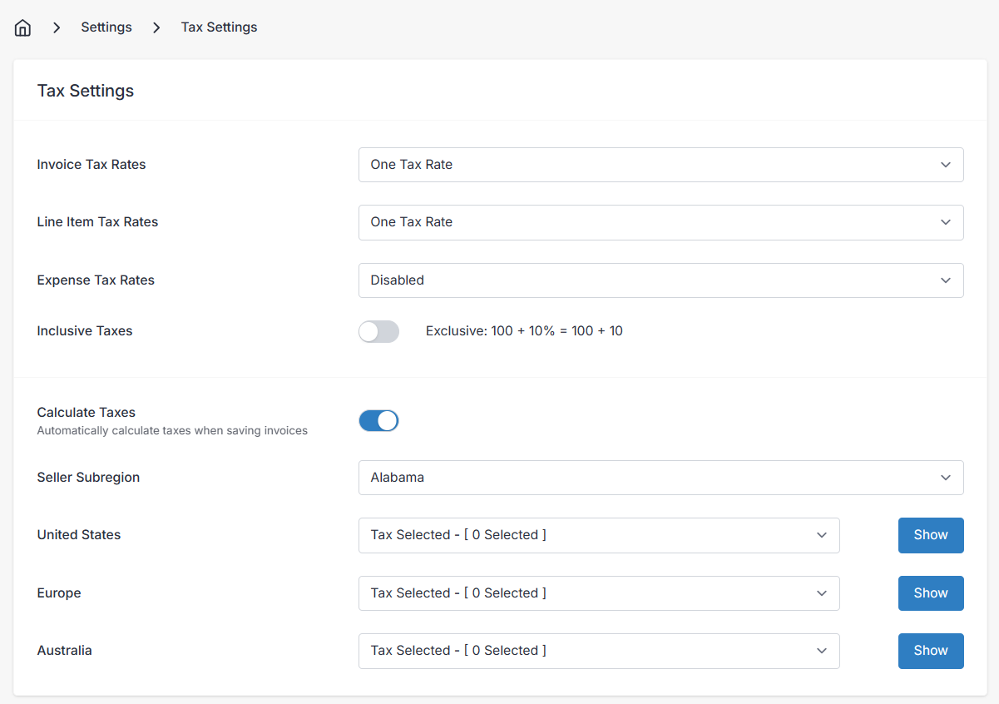
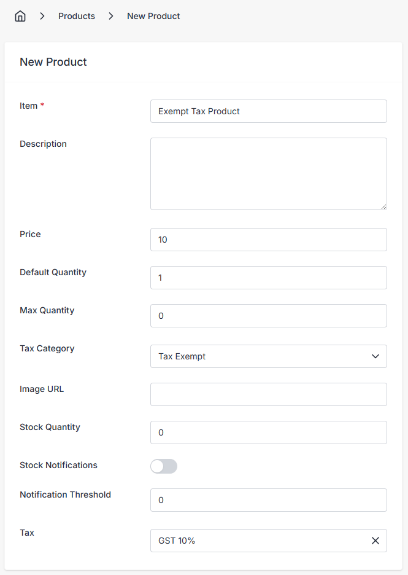
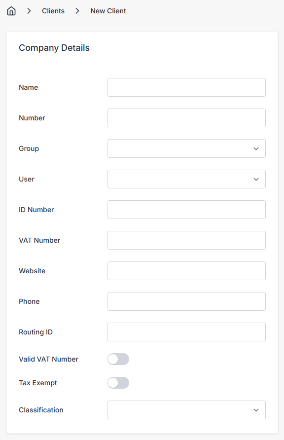
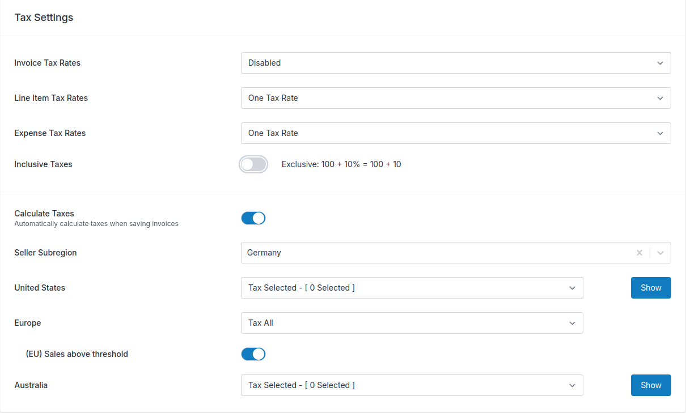
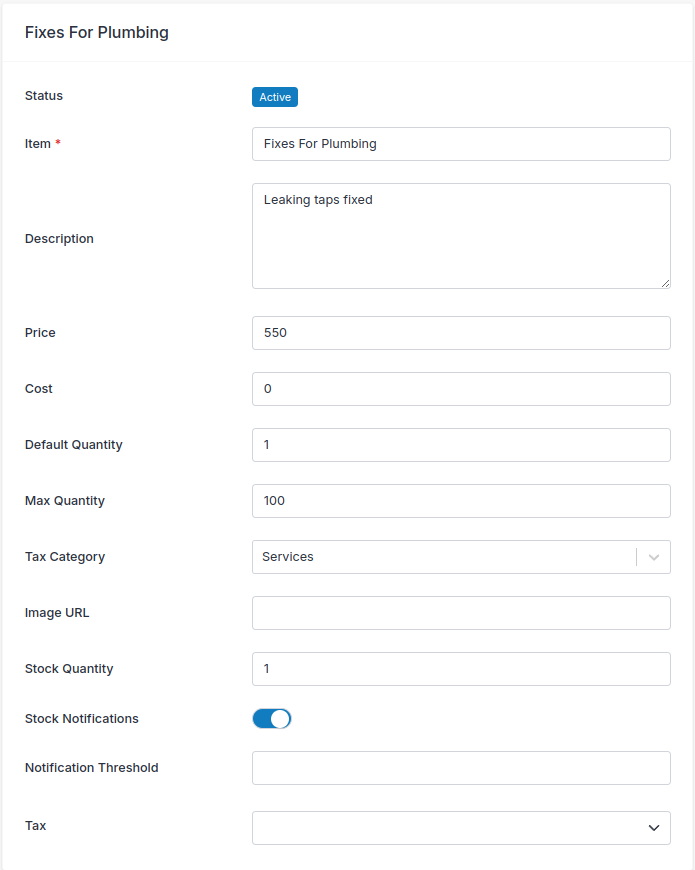
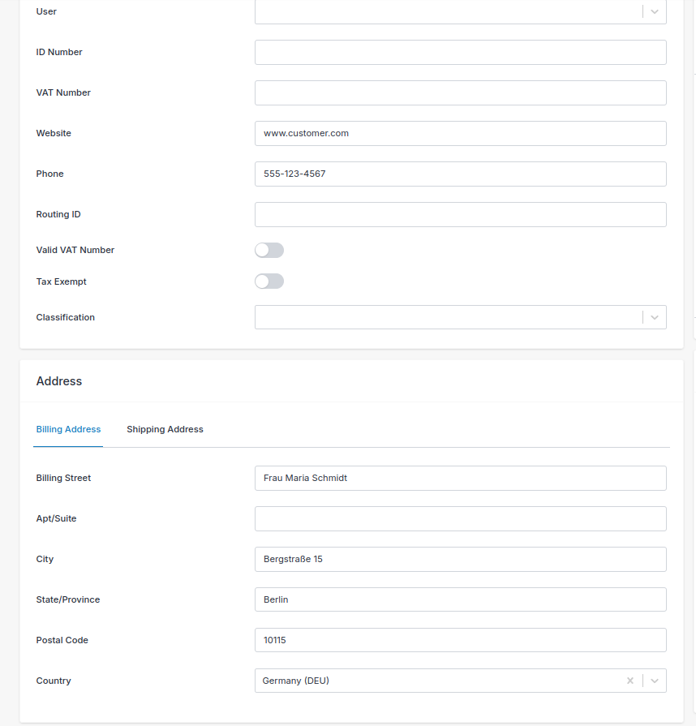

import VideoPlayer from "@site/src/components/VideoPlayer";

# Taxes: set rates, exemptions and calculated tax

Tax can look simple until you have a client in another state, a product that is partly exempt, or a VAT number that needs validating. Invoice Ninja tries to keep the easy cases easy (one rate, applied to every invoice) while still handling the harder cases when you grow into them. This page explains how the moving parts fit together so you can pick the setup that matches how you bill.

## How does tax work in Invoice Ninja?

Before you change any settings, it helps to know the three decisions that drive every tax calculation in the app: where the tax is applied on the document, how the rate relates to the price, and who decides the rate.

### Should I use invoice-level or line-level tax?

Tax can be applied to a whole invoice at once, or to each line item individually.

Invoice-level tax is the simpler of the two: one rate sits at the bottom of the invoice and multiplies the subtotal. Line-level tax is more flexible, because each item can carry its own rate. That is what you need when you sell a mix of taxable and exempt products, or goods at different rates (for example, standard-rated services alongside zero-rated books).

You can enable both at the same time, and you can choose one, two or three tax rates per line or per invoice under **Settings > Tax Settings**. The trade-off is a small rounding difference between the two approaches, covered in [Get Started: Line-Level vs Invoice-Level Tax](/docs/user-guide#line-level-vs-invoice-level-tax). Both are valid. Pick whichever your accountant or tax authority expects.

E-invoicing only supports line-level tax. If you send structured e-invoices, see [E-Invoicing](/docs/user-guide/einvoicing).

### What is the difference between inclusive and exclusive tax?

**Exclusive** tax is added on top of the price. A $100 item at 19% becomes $119. This is the default almost everywhere, and is how US sales tax and most EU VAT invoicing works.

**Inclusive** tax is already built into the price you display. That same $100 item, tax-inclusive at 19%, is still $100 to the buyer, but the invoice shows the net amount and the tax as parts of that total. Inclusive pricing is common in retail, hospitality and consumer-facing quotes where the headline number needs to be the number the customer actually pays.

You choose the mode under **Settings > Tax Settings**. When Inclusive Taxes is off, the example shown is "Exclusive: 100 + 10% = 100 + 10". On Expense Settings, both examples are shown: "Exclusive: 100 + 10% = 100 + 10" and "Inclusive: 100 + 10% = 90.91 + 9.09".

### Should I use manual rates or calculated taxes?

There are two ways Invoice Ninja arrives at a tax figure.

- **Manual:** you define the tax names and rates yourself, and apply them wherever you want.
- **Calculated:** Invoice Ninja determines the rate automatically based on the client's location, the seller's jurisdiction, and the product category. This is turned on with the **Calculate Taxes** toggle ("Automatically calculate taxes when saving invoices") on Tax Settings.

Manual is right for most freelancers and small businesses with a single tax rate, or when your accountant has already given you the rates to use. Calculated taxes are useful once you sell across state or country borders and need the app to keep up with jurisdiction-specific rules. The rest of this page walks through both.

## How do I set up manual tax rates?

Set up manual rates under **Settings > Tax Settings** (route `#/settings/tax_settings`). The full field list is in [Tax Settings](/docs/user-guide/basic-settings#tax_settings). In short, you choose how many **Invoice Tax Rates**, **Line Item Tax Rates** and **Expense Tax Rates** to allow (Disabled, One Tax Rate, Two Tax Rates or Three Tax Rates), set Inclusive Taxes if you need it, and pick a **Default Tax Rate**.

The tax rate list sits on the same page, with **Filter**, **Lifecycle** and **New Tax Rate**. The list columns are Name and Tax Rate, plus an Actions button on each row. **New Tax Rate** opens an unsaved **Add Tax Rate** form (`#/settings/tax_rates/create`) with **Name** and **Tax Rate**. Once saved, those rates are available in the tax selector on every [invoice](/docs/user-guide/invoices), quote, credit and [product](/docs/user-guide/products).

On a new invoice, the tax selectors follow those settings. If Invoice Tax Rates is set to One Tax Rate and Line Item Tax Rates is Disabled, the invoice shows a single **Tax** dropdown in the totals box, not a tax column on each line. That dropdown also includes **Add Tax Rate**.

Learn how to configure taxes in Invoice Ninja:

<VideoPlayer src="/assets/videos/taxes/tax_configuration/tax_configuration_react.mpd" isDash={true} id="tax-configuration-video" />

A useful workflow is to assign a default tax rate at the product level. When you add a product to an invoice, its tax comes with it, so you are not picking a rate by hand for every line. You can also set tax defaults per client from the client's settings (see [Clients](/docs/user-guide/clients)), which is handy when one client is tax-exempt or sits in a jurisdiction with a different rate.

## How does US sales tax calculation work?

<VideoPlayer src="/assets/videos/taxes/us_sales_tax/us_sales_tax.mpd" isDash={true} id="us-sales-tax-video" />

Invoice Ninja can calculate US sales tax for you. A short primer first, because US sales tax is unlike VAT or GST in a way that shapes how the rest of this section is configured.

Sales tax in the United States is a consumption tax levied on the sale of goods and services. Unlike countries with a single national VAT, the US has no federal sales tax. It is imposed at the state, county and sometimes municipal level, so the rate varies not just from state to state but within a state. One city might total 6%, the next 9%, and states such as Oregon and Delaware do not charge sales tax at all.

Products and services are also taxed unevenly. Groceries are taxable in some states and exempt in others. Some states run tax holidays where certain goods temporarily are not taxed. To calculate correctly you need three things: the precise location of the sale (the *nexus*), the type of product or service being sold, and the current rate at that location. Invoice Ninja handles this by reading the ship-to address on the invoice, looking up the current rate for that location, and applying it to the taxable items. Getting this right is a legal obligation, and automating it reduces the risk of under- or over-collecting.

### How do I turn on calculated taxes?

If you are on a hosted Pro or Enterprise plan, open **Settings > Tax Settings**.

**Your company's country must be set to either the United States, Australia, or an EU country for the Calculate Taxes option to appear** (set under **Settings > Company Details > Address**).

The **Calculate Taxes** toggle has the help text "Automatically calculate taxes when saving invoices."

When you turn it on, a confirm dialog titled **Calculate Taxes** appears:

"This action will enable line item taxes and disable total taxes. Any open invoices may be recalculated with the new settings!."

**Continue** applies that change. **Cancel** leaves Calculate Taxes off and does not recalculate anything. Only continue if you intend open invoices to be recalculated and invoice-level (total) taxes to be turned off in favour of line-item taxes.

After you continue, a new section appears. Set **Seller Subregion** (the region where your business is registered for tax purposes), since this is the nexus Invoice Ninja uses as the origin of every calculation.

<video width="100%" controls>
  <source src="/assets/videos/taxes/tax_settings_calculate_taxes_subregions.webm" type="video/webm" />
</video>

Below Seller Subregion are region controls, including **United States** and **Europe**, plus **United Kingdom**, **Australia**, **Andorra** and **Singapore**. Some of those show a value such as **Tax Selected - [ 0 Selected ]** and a **Show** button, so you can tick the places where you are registered to collect. There are also **(EU) Sales above threshold**, **(UK) Sales above threshold** and **(SG) Sales above threshold** toggles. Save when you are done.

If a client has sites in multiple states, attach a [location](/docs/user-guide/clients#how-do-i-bill-one-client-at-different-addresses-locations) to each site. The location's address then drives the tax calculation per document, so a single client can be billed under the correct state-level rules without creating duplicate client records.

Do not turn Calculate Taxes on or off unless you intend to change how this company calculates tax, and be aware that continuing the dialog can recalculate open invoices.

### What product tax categories can I use for US sales tax?

How sales tax applies depends heavily on what you are selling, because each state sets its own rules about what is taxable. Each [product](/docs/user-guide/products) carries a **Tax Category**. The calculator reads the category, the seller subregion and the destination address, and picks the right rate for that combination.

The categories include:

| Category | When to use it |
|---|---|
| **Physical Goods** | Tangible personal property such as electronics, furniture or vehicles. This is the most common taxable category in the US, though groceries, prescriptions and sometimes clothing may be exempt or reduced in certain states. |
| **Digital Products** | E-books, music and video downloads, software and digital subscriptions. Some states tax digital goods the same as physical goods, some tax only certain types, and others do not tax them at all. |
| **Services** | Professional or personal services. Treatment varies by state: consulting, legal and accounting work may be exempt in one state and taxable in the next. |
| **Shipping** | A charge relating to shipment. |
| **Tax Exempt** | Goods or services that are not subject to sales tax. Common examples include groceries and prescription medicines, with clothing sometimes exempt or reduced. |
| **Reduced Tax** | Items that many states tax at a lower rate, such as some educational, medical or public transportation services. |
| **Override Tax** | The escape hatch. If a product sits outside the normal sales tax scope, choose Override Tax and pick whatever tax (if any) you want to apply to the line. |
| **Zero Rated** | The item remains taxable but at a rate of 0%. In VAT systems this matters because businesses can still reclaim input VAT on zero-rated goods, which they cannot on exempt goods. In US sales tax the distinction is less meaningful, because states usually classify goods as taxable, exempt or reduced rather than zero-rated. |
| **Reverse Tax** | Out-of-state purchases used in the buyer's home state where no sales tax was charged at the point of sale (use tax). Use tax is the mirror of sales tax. Some states require larger businesses with a significant in-state presence to charge use tax up front. |

The product **Tax Category** dropdown lists those nine options, in that order, with a default of **Physical Goods**.

### How do tax exemptions work?

Tax exemptions are specific scenarios where sales tax does not apply. They fall into four broad shapes.

- **Product-based** exemptions attach to the item itself: groceries, prescription medications, sometimes clothing, or temporary back-to-school holidays.
- **Use-based** exemptions attach to how an item is used. Goods bought for resale are commonly exempt because tax is collected further down the chain. Items used in manufacturing, or purchased by non-profits for their charitable work, are often exempt too.
- **Buyer-based** exemptions attach to who is buying. Government agencies, non-profit organisations and certain other groups may be exempt regardless of what they purchase.
- **Transaction-based** exemptions attach to the nature of the sale itself. Interstate commerce sales can qualify in some cases.

If you sell to a tax-exempt client, edit the client record and turn on the **Tax Exempt** switch on the **Edit** tab. Invoice Ninja will then skip tax on their invoices automatically. The same client page has a **Locations** tab, with **Add Location**, for extra site addresses. See [Clients](/docs/user-guide/clients) for the full field list.

## How does EU VAT calculation work?

The EU engine can calculate EU-wide VAT. Enable it under **Settings > Tax Settings**, with your company country set to an EU country so **Calculate Taxes** appears.

When you turn on Calculate Taxes, the confirm dialog warns that line-item taxes will be enabled and total (invoice-level) taxes will be disabled, and that open invoices may be recalculated. For EU VAT, tax calculations are exclusive, so 100 plus 19% = 119 total.

As with the US, set your seller subregion: the country that counts as your nexus for VAT.

### What is the EU VAT threshold?

The EU-wide threshold for distance selling is €10,000. Once your cross-border B2C sales exceed that in a year, you must register for VAT in the destination country, charge VAT at that country's rate, and submit returns there. When Calculate Taxes is on, Tax Settings includes **(EU) Sales above threshold**, and also **(UK) Sales above threshold** and **(SG) Sales above threshold**. Toggle the one that applies to you and Invoice Ninja applies the destination-country rules automatically.

:::info
If you use PEPPOL, additional VAT numbers can be stored in Invoice Ninja and the system will pick the right VAT identifier on each [e-invoice](/docs/user-guide/einvoicing) based on the destination.
:::

### What is the One-Stop Shop (OSS)?

The EU One-Stop Shop simplifies cross-border VAT by letting you register for VAT in a single EU country, file returns for all EU sales through that one country, and still charge the correct destination-country rate on each sale. Invoice Ninja supports OSS by calculating the destination rate automatically from the client's location, so you do not have to maintain a rate table yourself.

### What product tax categories can I use for EU VAT?

In the EU, tax categories are also configured per [product](/docs/user-guide/products) and drive how the calculator treats each line.

| Tax Category | Description |
|---|---|
| **Physical Goods** | A physical product for sale, such as a car. |
| **Services** | A service-based product, such as bricklaying. |
| **Digital Products** | A digital product, such as a software service. |
| **Shipping** | A charge relating to shipment. |
| **Tax Exempt** | A product that is tax exempt. |
| **Reduced Tax** | A product that attracts a reduced rate. |
| **Override Tax** | A product that does not fit a standard category. A custom name and rate are applied. |
| **Zero Rated** | A product that attracts a 0% rate. |
| **Reverse Tax** | Not charged at origin. The buyer pays the tax at their end (reverse-charge). |
| **Intra Community** | A cross-border supply that carries no tax under intra-community supply rules. |

Set the category on the create or edit product screen and it applies every time the product is added to an invoice.

### Which client fields affect EU VAT?

A few client fields (see [Clients](/docs/user-guide/clients)) carry real weight once Calculate Taxes is on.

These fields sit on the client's **Edit** tab, in the Company Details card, together with **Routing ID** and a **Check VAT** button next to Valid VAT Number.

| Field | Why it matters |
|---|---|
| **VAT Number** | Must be filled in if the client has one. The EU requires businesses with VAT numbers to supply them. Otherwise tax may be applied that should not be. |
| **Valid VAT Number** | Toggling this on or off forces the calculation to follow this setting regardless of what is in the VAT Number field. Useful for overriding validation on known-good clients when the VIES service is flaky. **Check VAT** sits next to this toggle. |
| **Tax Exempt** | If the client is exempt, turn this on and no tax will be applied to their invoices. |
| **Classification** | A material input to the calculator. In some regions, government agencies are not taxable entities, so the classification gives the engine another parameter. |

Where a valid VAT number is present, the calculator takes it into account and applies or removes tax based on the client's location. The VAT number must pass VIES validation. You can check a number manually in the [VIES VAT number validation](https://ec.europa.eu/taxation_customs/vies/) service.

:::warning
Self-hosted users need the PHP SOAP extension installed for VAT number validation to work.
:::

## How do VAT, GST and sales tax differ?

If you move between jurisdictions it helps to know how the three major systems differ in principle, even though day-to-day configuration in Invoice Ninja looks similar across all of them.

**VAT** (Value-Added Tax), used across the EU, UK and many other countries, is charged at every stage of the supply chain, with businesses reclaiming the VAT they have paid on inputs. The end consumer ultimately bears the cost. Zero-rated and exempt items look alike to consumers but are treated very differently on the business side.

**GST** (Goods and Services Tax), used in Australia, New Zealand, India, Canada and others, works on the same value-added mechanics as VAT, just with a different name and national quirks. Australia's GST, for example, is a flat 10% on most goods and services with its own exempt list.

**Sales tax**, used in the United States, is charged only at the final sale to the end consumer, not at each step in the chain. That makes it conceptually simpler but practically more fragmented, because thousands of state, county and city jurisdictions each set their own rates and rules.

The categories, client flags and product settings in Invoice Ninja are designed to cover all three models. You just enable the regional calculator that matches where you operate.

## What should I check before sending an invoice?

Always look at the taxes on an invoice before it goes out. The calculator is only as accurate as the data feeding it: the client's address and VAT number, the product's tax category, and your own company country and seller subregion all have to be right for the result to be right. When in doubt, preview the invoice PDF and check the numbers against what your accountant expects.

## Related

- [Tax Settings](/docs/user-guide/basic-settings#tax_settings)
- [E-Invoicing](/docs/user-guide/einvoicing)
- [Products](/docs/user-guide/products)
- [Clients](/docs/user-guide/clients)
- [Invoices](/docs/user-guide/invoices)
- [Expenses](/docs/user-guide/expenses)
