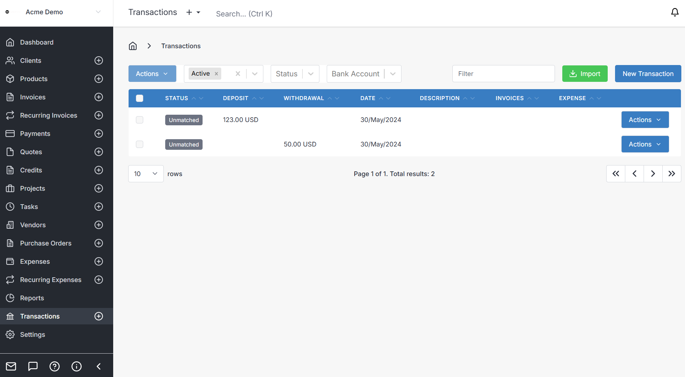
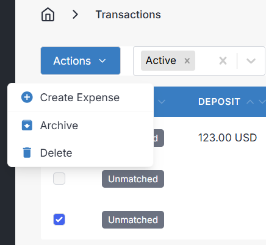
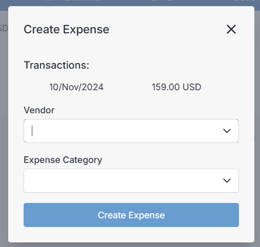
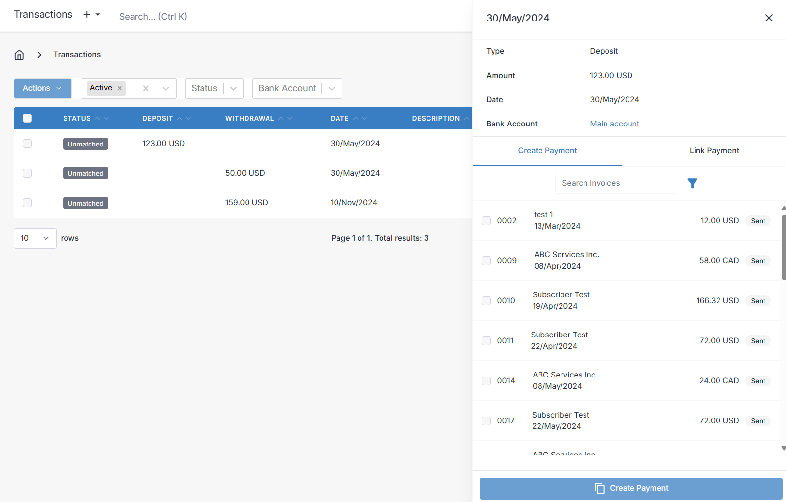
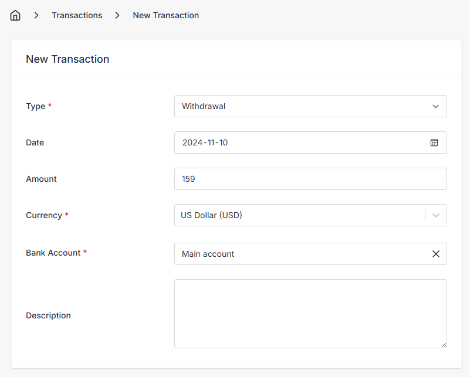
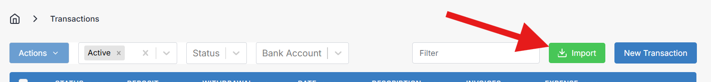
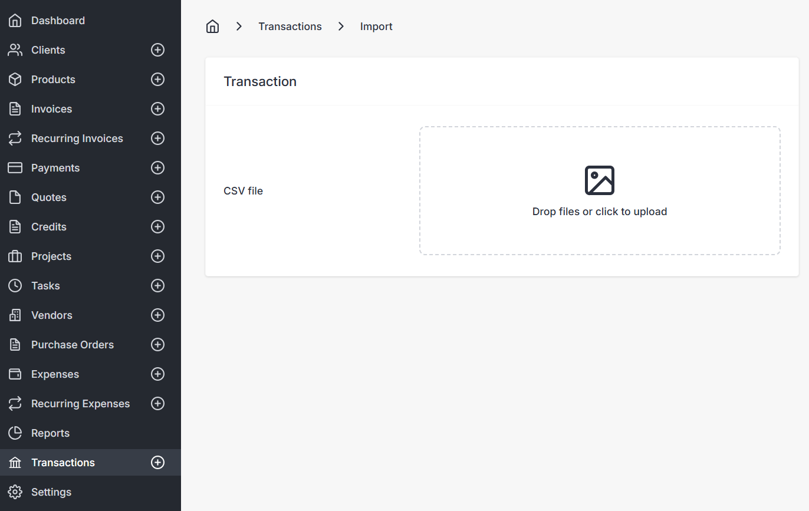

# Transactions: match bank lines to invoices and expenses

The **Transactions** screen is where every line from your bank feed lands. It is the bridge between what your bank says happened and what Invoice Ninja already knows. Withdrawals can be turned into [expenses](/docs/user-guide/expenses), deposits can be used to create an [invoice](/docs/user-guide/invoices), and anything still unmatched waits here for a review.

If you have not connected a bank yet or set up matching rules, start with [Banking](/docs/user-guide/banking). That page covers connecting an account, importing a CSV and how rules work. This page is the day-to-day work: going through the list, converting what you can, and fixing anything the rules missed.

## Where do transactions come from?

Every row in the list originates from one of three places:

- An automatic bank sync, pulling fresh transactions on a schedule after you connect an account.
- A CSV file you exported from your bank and imported yourself.
- A transaction you entered by hand from this screen, handy for cash movements or anything outside your connected accounts.

No matter the source, each transaction follows the same lifecycle and shows up in the same list.

## Where is the transactions list?

Click **Transactions** in the left menu (it sits between Recurring Expenses and Reports). The route is `#/transactions`.

The buttons on the list are **Rules**, **Columns**, **Import** and **New Transaction**. **Rules** opens the same Transaction Rules page described in [Banking](/docs/user-guide/banking#bank-rules).

Filters:

| Filter | What it does |
|---|---|
| **Filter** | A text box for searching the list. |
| **Lifecycle** | Active, Archived and Deleted. All three can be selected at once. |
| **Status** | **Unmatched**, **Matched**, **Converted**, plus **Deposits** and **Withdrawals**. |
| **Bank Account** | Limits the list to one account. |

Default columns are Status, Deposit, Withdrawal, Date, Description, Invoices, Expense and Actions. Deposit and Withdrawal are separate amount columns, so money in and money out are easy to scan.

Clicking a row does not open a side panel. The status (or **Edit** in the **Actions** menu) opens the edit page, which has Type, Date, Amount, Currency, Bank Account, Description and Tags, plus **Save**. The arrow next to Save includes **Archive** and **Delete**.

### What do the statuses mean?

| Status | What it means |
|---|---|
| **Unmatched** | Nothing has been linked to this transaction yet. This is where new lines start. |
| **Matched** | A match has been identified, but a payment or expense may not have been created yet. |
| **Converted** | An expense (or other record) has been created from the transaction. The Expense or Invoices column shows a link to it. |

Filtering by **Unmatched** is usually the fastest way to get through a session: those are the rows that still need a decision from you.

## How do I turn a withdrawal into an expense?

Tick one or more withdrawal rows, then choose **Actions > Create Expense**.

The **Create Expense** dialog lists the selected transactions (date and amount) and asks for a **Vendor** and an **Expense Category**. The **Create Expense** button stays disabled until you choose a vendor or a category.

After you confirm, the transaction status becomes **Converted**, and the Expense column links to the new expense. See [Expenses](/docs/user-guide/expenses) for more on that record.

An unmatched withdrawal's row **Actions** menu is **Edit**, **Archive** and **Delete**. Conversion is done from the bulk **Actions** menu, not from a side panel.

## How do I use a deposit?

An unmatched deposit's row **Actions** menu includes **Create Invoice**, as well as **Edit**, **Archive** and **Delete**. **Create Invoice** opens a new invoice with a line already filled in from the transaction (description, quantity 1, and the deposit amount). You can finish and save that invoice as usual. There is no separate button on the transaction itself for matching a manual deposit to an invoice that already exists.

## What can I do with a converted transaction?

A converted row's **Actions** menu includes **Edit**, **Unlink**, **Archive** and **Delete**.

**Unlink** disconnects the transaction from the expense (or other record) and sets the transaction back to **Unmatched**. The expense or payment itself stays, and you can delete it separately if it was created by mistake.

## How do I add a transaction by hand?

Click **New Transaction**.

| Field | What it is for |
|---|---|
| **Type** | **Deposit** or **Withdrawal** (required). Deposit is the default. |
| **Date** | Defaults to today. |
| **Amount** | The amount of the line. |
| **Currency** | Required. |
| **Bank Account** | Required. Pick an existing account. The list can also include **Add Bank Account**. |
| **Description** | The text shown on the list. |
| **Tags** | Optional labels. |

After you save, the transaction appears as **Unmatched**.

## How do I import a bank statement?

1. Add a bank account first under **Settings > Credit Cards & Banks** if you do not already have one, so the imported lines have somewhere to land.
2. Go to **Transactions** and click **Import**.
3. Drop a CSV file onto the **CSV file** area, or click to upload. A **How to import data** link is also on that screen.
4. In the mapping table, match each header in your file to a transaction field. Date, Description and Amount are often mapped automatically to **Transaction - Date**, **Transaction - Description** and **Transaction - Amount**. Other available fields include Transaction ID, Currency, Account type, Category, Category Type, Bank Account, Base Type, Credit, Debit, Participant and Participant name.
5. Choose a **Bank Account**, then click **Import**.

## How should I work through unmatched transactions?

Let [bank rules](/docs/user-guide/banking#bank-rules) handle the lines that follow predictable patterns, then filter the list to **Unmatched** and work through whatever is left: **Create Expense** for withdrawals, and **Create Invoice** when a deposit should become a new invoice.

If a transaction was imported in error, delete it from the list. If it was already converted, **Unlink** it first if you want to keep the transaction but disconnect the expense, or delete the expense separately if that record should not stay.

## Related

- [Banking](/docs/user-guide/banking): connect a bank, import a CSV and build matching rules
- [Payments](/docs/user-guide/payments): payments in your account
- [Expenses](/docs/user-guide/expenses): expenses created from withdrawals
- [Invoices](/docs/user-guide/invoices): invoices you can create from a deposit
