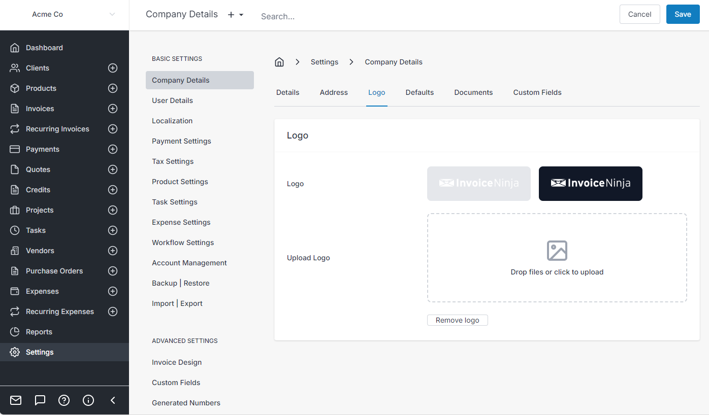

import VideoPlayer from "@site/src/components/VideoPlayer";

# Get Started: set up your company and send your first invoice

Invoice Ninja helps freelancers, small businesses and agencies send invoices, quote work, track time and get paid. Once your account is set up, you can invoice a client in any currency, accept online payments, run reports, and give customers a branded portal to pay and manage their documents, all from the same place.

This guide walks through the parts of the app you will actually use day to day. Each section explains what something is, when you would reach for it, and how it connects to the rest of the system.

Invoice Ninja is available on the web and as a native app on iOS, Android, macOS, Windows and Linux. Everything is synced to the same account, so you can start an invoice on your phone and finish it on your laptop.

## What do the main terms mean? {#key-concepts}

A few terms appear throughout the guide. Understanding them up front makes everything else easier.

- **Client:** a person or company you invoice. See [Clients](/docs/user-guide/clients).
- **Contact:** an individual email address attached to a client. A client can have multiple contacts (for example, Accounts Payable and Operations), and each contact gets their own [Client Portal](/docs/user-guide/client-portal) login.
- **Invoice:** a bill sent to a client. See [Invoices](/docs/user-guide/invoices).
- **Quote:** a priced proposal that can be converted into an invoice once the client accepts it. See [Quotes](/docs/user-guide/quotes#how-do-i-turn-a-quote-into-an-invoice).
- **Recurring Invoice:** a template that automatically generates and sends invoices on a schedule (weekly, monthly, annually, and so on). See [Recurring Invoices](/docs/user-guide/recurring-invoices).
- **Payment:** money received against one or more invoices. See [Payments](/docs/user-guide/payments).
- **Credit:** a balance owed to the client, which can be applied to their future invoices. See [Credits](/docs/user-guide/credits).
- **Expense:** a cost you have incurred, optionally billable back to a client. See [Expenses](/docs/user-guide/expenses).
- **Product:** a reusable line-item template (description, price, tax) you can drop into invoices and quotes. See [Products](/docs/user-guide/products).
- **Client Portal:** the customer-facing side of Invoice Ninja, where contacts view and pay their invoices. See [Client Portal](/docs/user-guide/client-portal).

## What should I set up first? {#initial-setup}

When you first sign in you will land on an empty dashboard. Working through the steps below in order will get you from a blank account to sending your first paid invoice.

### How do I set my company details and logo? {#1-set-up-your-company-details-and-logo}

Your company name, address and contact information appear on every invoice, quote and email you send. Your logo is displayed on PDFs, in emails to your clients, and across the client portal.

Go to **Settings > Company Details** (route `#/settings/company_details`). The tabs are **Details**, **Address**, **Logo**, **Defaults**, **Documents** and **Custom Fields**. The **Details** and **Address** tabs hold the company information. The **Logo** tab is where you upload your logo (**Upload Your Company Logo**, **Drop files or click to upload**, plus **Crop Logo** and **Remove logo**).

For best results use a landscape-oriented logo. It displays most cleanly across emails, PDFs and the client portal.

<VideoPlayer src="/assets/videos/setup/setup.mpd" isDash={true} id="initial-setup-video" />

See [How do I set my company details?](/docs/user-guide/basic-settings#company_details) and [How do I add a company logo?](/docs/user-guide/basic-settings#logo).

### How do I set the defaults for new documents? {#2-configure-your-company-defaults}

A few settings pages work together as the starting point for every new invoice, quote and client. Set them once, and individual clients can still override them when needed.

- **Settings > Company Details**, on the **Defaults** tab: default Invoice, Quote, Credit and Purchase Order terms and footers. See [What defaults apply to new documents?](/docs/user-guide/basic-settings#defaults).
- **Settings > Payment Settings** (titled **Online Payments**): **Payment Terms** and **Quote Valid Until**. See [How do payment settings and automatic billing work?](/docs/user-guide/basic-settings#payment_settings).
- **Settings > Invoice Design**: how PDFs look. See [How do I change how invoices look?](/docs/user-guide/advanced-settings#invoice_design).
- **Settings > Templates & Reminders**: email wording and overdue reminders. See [How do I edit email templates and payment reminders?](/docs/user-guide/advanced-settings#templates_and_reminders).

<VideoPlayer src="/assets/videos/company_defaults/company_defaults.mpd" isDash={true} id="company-defaults-video" />

### How do I set up taxes and localization? {#3-set-up-taxes-and-localization}

If you charge tax, configure it before creating your first invoice so tax lines appear correctly from the start. You can set invoice-level taxes (one tax applied to the total), line-level taxes (a different tax per item), or both. Under **Settings > Localization** you can also set currency, date format and related options for your region. See [How do I set language, currency and dates?](/docs/user-guide/basic-settings#localization).

Go to **Settings > Tax Settings** (route `#/settings/tax_settings`).

<VideoPlayer src="/assets/videos/taxes/tax_configuration/tax_configuration_react.mpd" isDash={true} id="tax-configuration-video" />

For detailed tax setup, including multiple jurisdictions, per-client tax rules and calculated tax, see [Taxes](/docs/user-guide/taxes) and [Tax Settings](/docs/user-guide/basic-settings#tax_settings).

### How do I create my first invoice? {#4-create-your-first-invoice}

Once your company details, defaults and taxes are in place, you are ready to invoice. The video below walks through the full flow: adding a client, listing items, customizing product columns, setting your invoice number pattern, and sending.

<VideoPlayer src="/assets/videos/invoices/first_invoice/first_invoice.mpd" isDash={true} id="invoice-creation-video" />

See [Invoices](/docs/user-guide/invoices) for the full reference, including [How do I create or edit an invoice?](/docs/user-guide/invoices#how-do-i-create-or-edit-an-invoice). Invoice numbers are configured under [Generated Numbers](/docs/user-guide/advanced-settings#generated_numbers).

### How do I connect a payment gateway and get paid? {#5-connect-a-payment-gateway-and-get-paid}

Connect a payment gateway so clients can pay online directly from the invoice email or the client portal. Invoice Ninja integrates with the major gateways, including Stripe, PayPal, Authorize.Net, Square and many more.

<VideoPlayer src="/assets/videos/payments/get_paid/get_paid.mpd" isDash={true} id="get-paid-video" />

For the full list of supported gateways and setup instructions, see [Payment Gateways](/docs/user-guide/gateways) and [Payment Settings](/docs/user-guide/basic-settings#payment_settings).

## Which payment actions will I use most? {#important-functionality}

### How do I record a payment? {#1-enter-a-payment}

Use **Enter Payment** on the [Payments](/docs/user-guide/payments) list, or on an invoice, to record money you have received. See [How do I record a payment by hand?](/docs/user-guide/payments#how-do-i-record-a-payment-by-hand).

<VideoPlayer src="/assets/videos/getting_started/enter_payment/enter_a_payment.mpd" isDash={true} id="enter-payment-video" />

### How do I undo a payment I entered by mistake? {#2-reverse-a-payment}

A **Reverse** action appears only in some cases. On a completed payment, the Actions menu includes **Refund Payment** and **Delete**. On a sent invoice, the Actions menu includes **Cancel**. Invoices also have a **Reversed** status, described in [What does Reversed mean?](/docs/user-guide/invoices#what-does-reversed-mean).

<VideoPlayer src="/assets/videos/getting_started/reverse_payment/reverse_a_payment.mpd" isDash={true} id="reverse-payment-video" />

### How do I refund a payment? {#3-refund-a-payment}

To refund a payment, open it and choose **Refund Payment** from the Actions menu. See [How do I refund a payment?](/docs/user-guide/payments#refunds).

<VideoPlayer src="/assets/videos/getting_started/refund_payment/refund_a_payment.mpd" isDash={true} id="refund-payment-video" />

## What else is useful to know? {#good-to-know}

These details will not change how you use the app day to day, but they are worth knowing if a figure on an invoice ever looks slightly different from what you expected.

### How precise are currency amounts? {#currency-precision}

Invoice Ninja stores and calculates values in the client's currency, using that currency's usual number of decimal places (often two, for example $41.64). Unit prices can also use smaller fractional values, which is useful for per-unit components or fractions of an hour.

### How precise are quantities? {#quantity-precision}

Quantity fields can use fractional values, which is useful for time entries (for example, 1.25 hours), weights or measurements.

### Why do line-level and invoice-level tax totals sometimes differ? {#line-level-vs-invoice-level-tax}

You may see a small, expected difference in totals depending on whether tax is applied per line or to the whole invoice. This is caused by rounding on each line versus rounding once at the end:

| Description | Line Level Tax Calculation | Invoice Level Tax Calculation |
|------------|---------------------------|------------------------------|
| Item 1: $10.33 | $10.33 × 10% = $1.033 → $1.03 | - |
| Item 2: $10.33 | $10.33 × 10% = $1.033 → $1.03 | - |
| Item 3: $10.34 | $10.34 × 10% = $1.034 → $1.03 | - |
| Subtotal | $31.00 | $31.00 |
| Tax Calculation | Sum of rounded individual taxes: $1.03 + $1.03 + $1.03 = $3.09 | Total × Tax Rate: $31.00 × 10% = $3.10 |
| Total | $34.09 | $34.10 |

Both approaches are valid. Choose whichever your accountant or local tax authority prefers. You set this under [Tax Settings](/docs/user-guide/basic-settings#tax_settings). See also [Taxes](/docs/user-guide/taxes).

## Where should I go next? {#where-to-go-next}

Once you are up and running, these pages cover the rest of the app in detail.

**Working with customers**

- [Clients](/docs/user-guide/clients): add clients, manage [contacts](/docs/user-guide/clients#contacts) and [locations](/docs/user-guide/clients#how-do-i-bill-one-client-at-different-addresses-locations)
- [Client Portal](/docs/user-guide/client-portal): what your customers see
- [Vendors](/docs/user-guide/vendors): the businesses you buy from

**Billing and revenue**

- [Invoices](/docs/user-guide/invoices) · [Quotes](/docs/user-guide/quotes) · [Credits](/docs/user-guide/credits)
- [Recurring Invoices](/docs/user-guide/recurring-invoices): automated subscriptions and retainers
- [Payment Links](/docs/user-guide/subscriptions): share a hosted checkout URL
- [Purchase Orders](/docs/user-guide/purchase-orders)

**Payments and banking**

- [Payments](/docs/user-guide/payments#how-do-i-record-a-payment-by-hand) · [Payment Gateways](/docs/user-guide/gateways)
- [Banking](/docs/user-guide/banking) · [Transactions](/docs/user-guide/transactions)

**Operations**

- [Products](/docs/user-guide/products) · [Tasks](/docs/user-guide/tasks) · [Projects](/docs/user-guide/projects)
- [Expenses](/docs/user-guide/expenses) · [Recurring Expenses](/docs/user-guide/recurring-expenses)

**Compliance and reporting**

- [Taxes](/docs/user-guide/taxes) · [E-Invoicing](/docs/user-guide/einvoicing) · [E-Signatures](/docs/user-guide/esignatures)
- [Reports](/docs/user-guide/reports) · [QuickBooks](/docs/user-guide/quickbooks)

**Configuration**

- [Basic Settings](/docs/user-guide/basic-settings): [Company Details](/docs/user-guide/basic-settings#company_details), [Localization](/docs/user-guide/basic-settings#localization), [Payment Settings](/docs/user-guide/basic-settings#payment_settings), [Tax Settings](/docs/user-guide/basic-settings#tax_settings)
- [Advanced Settings](/docs/user-guide/advanced-settings): [Invoice Design](/docs/user-guide/advanced-settings#invoice_design), [Email Settings](/docs/user-guide/advanced-settings#email_settings), [Templates & Reminders](/docs/user-guide/advanced-settings#templates_and_reminders), [User Management](/docs/user-guide/advanced-settings#user_management)
- [Import and Export](/docs/advanced-topics/import-and-export)

## Frequently asked questions {#frequently-asked-questions}

See the [FAQ](/docs/user-guide/faq).
