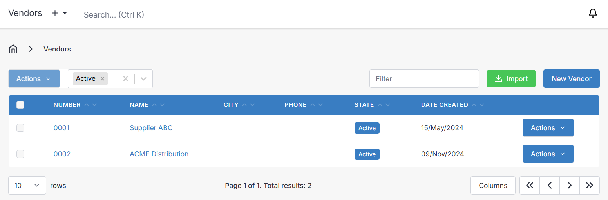
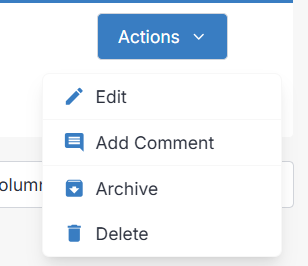
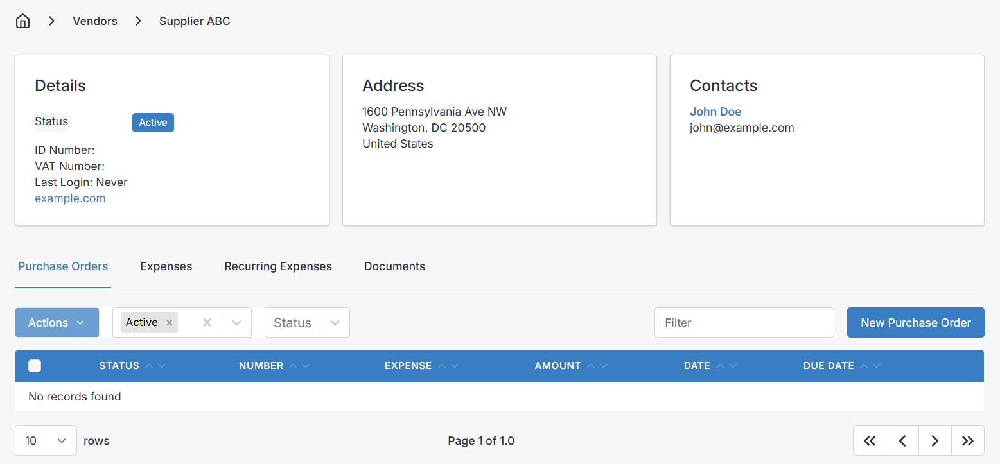
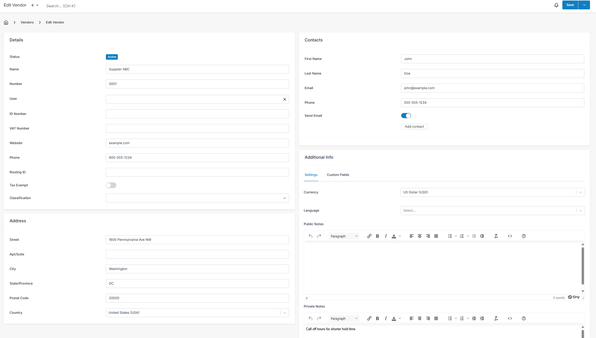

A vendor is a person or business you buy from, the counterpart of a [client](/docs/user-guide/clients). [Expenses](/docs/user-guide/expenses) and [recurring expenses](/docs/user-guide/recurring-expenses) can be linked to a vendor. This is optional. Every [purchase order](/docs/user-guide/purchase-orders) must be issued to a vendor.

## Create a vendor {#creating-vendors}

Go to **Vendors** and click **New Vendor**. You can also click the **+** next to **Vendors** in the left menu, choose **+ → Expense → Vendor** in the top bar, or select **New Vendor** from the vendor dropdown when creating an expense or a purchase order.

Vendors can also be imported (see [Import and Export](/docs/advanced-topics/import-and-export)) or created through Zapier, Make, APISync, or the [API](https://invoiceninja.github.io/docs/api-reference/invoice-ninja-api-reference).

If **Name** is left empty, the vendor is displayed using the primary contact's name, or the primary contact's email if that name is also empty.

## Vendor list {#vendor-module-view}

Select **Vendors** in the left menu to open the vendor list. You can sort by column, add or remove columns with **Columns**, search with **Filter**, import vendors with **Import**, and include archived or deleted vendors with the **Lifecycle** filter (**Active**, **Archived** or **Deleted**, then **Apply**).

Each row has an **Actions** menu with **Edit**, **Add Comment**, **Merge**, **Archive** and **Delete**.

## Change vendor currency {#change-a-vendors-currency}

Navigate to **Vendors → Edit Vendor → Additional Info → Settings → Currency** to change the vendor currency.

If no currency is set, the company's currency is used. Purchase order PDFs and purchase order reports use the vendor's current currency, so changing it can affect how existing purchase orders are displayed and reported.

## Archive, delete and restore {#archive-a-vendor}

| Action | Effect | Reversible |
| --- | --- | --- |
| **Archive** | Hides the vendor from the default list. Related purchase orders and expenses are not archived. | Yes, with **Restore** |
| **Delete** | Hides the vendor from the default list. Related purchase orders and expenses are not deleted. Purchase order reports and dashboard expense totals omit activity linked to a deleted vendor. | Yes, with **Restore** |

Use **Archive** to hide a vendor without changing report totals. Use **Delete** when purchase order reports and dashboard expense totals should omit that vendor's activity.

Vendors cannot be purged. A deleted vendor can be restored.

To archive or delete a vendor, choose **Archive** or **Delete** from the arrow menu next to **Edit Vendor**, or from the **Actions** menu on the vendor list. That arrow menu also includes **Add Comment** and **Merge**.

To restore a deleted vendor, set the **Lifecycle** filter to **Deleted**, then choose **Restore** from the row **Actions** menu or from the arrow menu on the vendor.

## Merge vendors

Administrators can merge two vendor records from the row **Actions** menu, or from the arrow menu next to **Edit Vendor**. Purchase orders, expenses, recurring expenses, contacts, documents and related activity move to the vendor you keep. The other vendor is permanently removed. Contacts with a matching or empty email are not kept as duplicates.

## View a vendor {#viewing-a-vendor}

Select a vendor in the list to open the record. The page shows **Details**, **Address** and **Contacts**, with tabs for **Purchase Orders**, **Expenses**, **Recurring Expenses**, **Activity** and **Documents**.

- **Purchase Orders**: every [purchase order](/docs/user-guide/purchase-orders) issued to this vendor.
- **Expenses**: [expenses](/docs/user-guide/expenses) linked to this vendor. Linking an expense to a vendor is optional.
- **Recurring Expenses**: [recurring expenses](/docs/user-guide/recurring-expenses) linked to this vendor.
- **Activity**: a log of changes to the vendor.
- **Documents**: files stored on the vendor record. The tab has an upload area and a table of Name, Date, Type and Size. It does not include a public or private control for individual files.

New files are public by default when **Settings → Company Details → Documents → Set Documents Public by Default** is enabled (the default). Public documents can be accessed by the vendor's contacts in the vendor portal. If that company setting is turned off, new files are not accessible in the vendor portal. On hosted Invoice Ninja, uploading documents requires the Enterprise plan. Self-hosted installations include this feature.

## Vendor fields {#creating-and-editing-a-vendor}

Most fields are optional. **Currency**, **Language**, **Public Notes** and **Private Notes** are under **Additional Info → Settings**. Custom fields appear on the **Additional Info → Custom Fields** tab.

| Field | Behaviour |
| --- | --- |
| **Number** | Generated automatically if you leave it empty. Number patterns are configured under **Settings → Generated Numbers → Vendors**. |
| **Assigned User** | A team member can view and edit a vendor they are assigned to, or that they created, even if they do not have permission to view or edit all vendors. |
| **Currency** | See [Change vendor currency](#change-a-vendors-currency). |
| **Language** | Used for purchase order PDFs and emails, and for expense payment notifications sent to the vendor. If unset, the company's language is used. |
| **Public Notes** | Copied onto a new purchase order when the purchase order's public notes are empty. Later changes to the vendor notes do not update existing purchase orders. |
| **Private Notes** | Visible in the admin portal. They are not included on purchase order PDFs. |
| **Send Email** (contact) | Contacts with **Send Email** enabled, and **CC Only** disabled, receive a purchase order invitation and are included when the purchase order is emailed. If no contact is set to receive the email, an invitation is still created for the primary contact. |
| **CC Only** (contact) | The contact is copied on the email (up to four addresses) instead of receiving their own invitation. |
| **Custom Fields** | Fields configured under **Settings → Custom Fields → Vendors** appear on the vendor form. |

## Related documentation

- [Clients](/docs/user-guide/clients)
- [Expenses](/docs/user-guide/expenses)
- [Recurring Expenses](/docs/user-guide/recurring-expenses)
- [Purchase Orders](/docs/user-guide/purchase-orders)
- [Import and Export](/docs/advanced-topics/import-and-export)
- [API Documentation](https://invoiceninja.github.io/docs/api-reference/invoice-ninja-api-reference)
